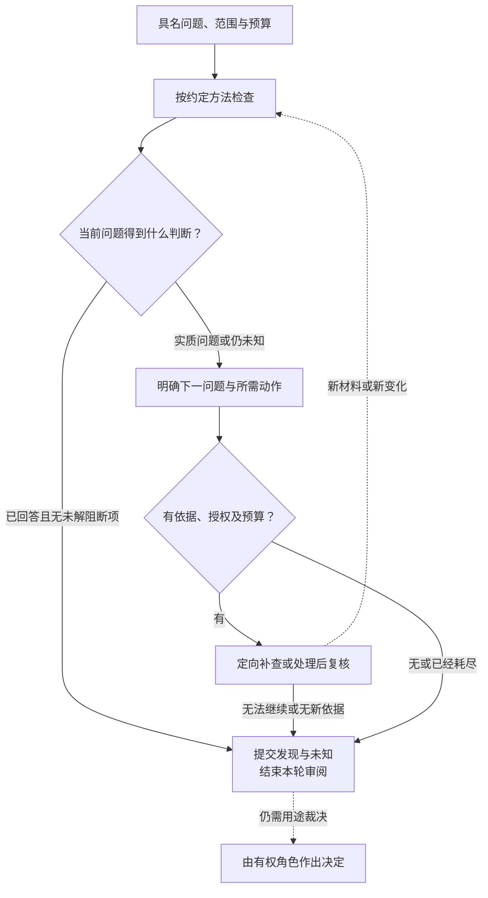

# 第10章 Review Engineering
## 从事后检查转向有 Target、有 Budget、有独立性边界的 Review

> 工作稿状态：Phase D 最小完整正文；依据 [全书大纲](../OringinalDocs/beyond_code_ai_native_software_engineering_outline_zh.md) 重构，不把 Review 次数或 Agent 数量当作质量证明。
> 回接说明：[RR-038](../RevisedResult/RR-038_章节解决方案与机制简图联合修订计划.md)。
> 适用边界：本章提出 Review、Review Target、Finding、Review Budget、Review Independence 与 Review Disposition 的候选工程关系；不要求每项 Work 实例化三阶段 Review，也不声称独立 Review、更多检查或固定等级普遍提高质量与效率。

第9章说明 Evidence 怎样支持、挑战或限制 Claim，并进入具名 Decision Target。

Review 仍然不能被压成一句：

> Reviewer 看过了，PASS。

这句话没有说明：

- 看的是哪个 Target 与版本；
- 使用什么 Criteria、Evidence 与 Non-goal；
- 覆盖了什么，忽略了什么；
- 发现的是 Observation、推断、风险还是未知；
- Reviewer 是否独立；
- Reviewer 是否拥有作出处置的 Authority；
- PASS 允许哪个下游动作，又明确不允许什么。

Review Engineering（审阅工程：为具名对象配置审阅目标、范围、方法、预算、独立性、Finding 与有权处置关系的工程活动）处理的就是这些边界。

---

## 10.1 Review 不等于阅读、Validation 或 Decision

**Review（审阅：针对具名 Review Target、版本、Scope 与 Criteria，检查其与 Intent、Contract、Evidence、风险和已知未知之间关系的有边界活动）** 可以包含阅读，但不以“读了多少”定义。

它与相邻活动不同：

| 活动 | 主要输出 | 不自动代表什么 |
|---|---|---|
| Reading / Inspection | 被查看的 Source 与观察 | 已形成 Finding |
| Validation | Evaluation Result 与 Coverage | 已接受 Candidate |
| Review | Finding、Unknown 与 Disposition Recommendation | Reviewer 拥有 Decision Authority |
| Decision | 有权主体对 Decision Target 的 Disposition | 决定已经被执行 |

同一个人或 Gate 可以承担多个功能，但记录需要保留它正在以哪个角色、针对哪个 Target 行动。

---

## 10.2 Review 的最小对象链

本章采用：

~~~text
Review Target + bounded Review Contract
→ inspection / validation / challenge
→ Finding + Unknown + Recommendation
→ authorized Decision Record
  names a Decision Target for closing or limiting use of that Review Target
→ Review Disposition
~~~

这条链允许以下真实情况存在：

- Review 已提交，但没有有权处置；
- Finding 仍然 Unknown；
- Candidate 技术上可行，但 Scope 需要收窄；
- 有权 Review PASS 只关闭一个与 Review Target 关联的窄 Decision Target；
- Review 要求补证，但不阻止其他不相关 Work；
- Finding 被采纳，建议的修复方案仍被拒绝。

---

## 10.3 Review Target 与 Decision Target 不同

**Review Target（审阅对象：被当前 Review 检查的具名对象、版本、Baseline 与 Scope）** 回答：

> 当前检查的究竟是什么？

Review Target 可以是：

- Intent、Plan Candidate 或 Execution Contract；
- Work、Attempt、Checkpoint 或 Attempt Outcome；
- Change、Diff、Artifact 或 Configuration；
- Target Result、Evaluation Result 或 Evidence Portfolio；
- Decision、Policy、Authority Grant 或 Release Candidate；
- Incident、Recovery Plan、Memory Candidate、Context Capability Profile 或 Engineering Capability Profile。

Decision Target 回答的是“有权主体准备裁决什么”。两者可能引用同一个 Candidate，但不能自动合并。

例如，Review Target 可以是某个 Parser Change；Decision Target 可以分别是：

- 是否允许继续实现；
- 是否接受 Regression Evidence；
- 是否采用为受支持 Baseline；
- 是否授权 Release。

一个 Review Target 不会因为被看过一次，就同时关闭所有 Decision Target。

---

## 10.4 Review Contract 连接 Target、方法与边界

Review 需要一个可引用的边界接口。本章把它称为 **Review Contract（审阅契约：声明当前 Review Target、Criteria、Scope、Non-goal、Evidence、Budget、独立性要求、允许输出与 Authority 边界的约定）**。

它不要求成为独立文件。低风险任务可以把这些信息压缩进 Pull Request、Issue、Gate 配置或一句审阅 Brief。

最小关系包括：

- Review Target 与 Baseline；
- Review Question / Criteria；
- Scope、Non-goal 与当前阶段；
- Intended Decision Use；
- 可用 Evidence、Primary Source 与 Counterevidence；
- Review Budget 与 Stop Condition；
- 所需 Independence；
- Reviewer / Validator / Challenger Assignment；
- 允许提交的 Finding、Recommendation 或 Disposition；
- Authority Grant 与 Escalation Path。

Review Contract 不创造 Authority。它只能引用或服从有效 Grant。

---

## 10.5 Finding 是有范围的审阅判断

**Finding（审阅发现：Reviewer 根据具名 Criteria、Evidence、Counterevidence 与 Unknown，对 Review Target 在当前 Scope 内形成的可检查判断）** 不能与它引用的底层 Evidence 互换，也不是 Decision。

Finding 可以指出：

- Target 与 Intent / Contract 一致；
- 存在缺陷、冲突或 Scope 扩张；
- Evidence Coverage 不足；
- 当前没有安全动作；
- 某个风险只在更窄条件下成立；
- Candidate 明显超过当前目标所需复杂度；
- 当前无法判断；
- 现有材料只支持更窄的 Claim Scope，或原 Claim 包含需要分别判断的命题。

一个有用 Finding 至少应说明：

| 字段 | 问题 |
|---|---|
| Review Target / Version | 对什么发言 |
| Criterion / Contract | 相对什么判断 |
| Observation / Evidence | 直接看到了什么 |
| Inference | 从观察推导了什么 |
| Counterevidence / Alternative | 什么可能推翻或限制判断 |
| Scope / Materiality | 在哪里、何时重要 |
| Unsafe Action / Current Impact | 当前是否已有需要停止的动作 |
| Unknown / Missing Evidence | 还不知道什么 |
| Recommendation | 建议 keep、narrow、rework、defer、block 或 escalate 什么 |

Finding 可以被挑战、更新或撤回。Reviewer 的资历、Agent 数量或语气不能使 Finding 自动成为事实。

---

## 10.6 Finding、Evaluation Result 与 Evidence 不能互换

一个 Test FAIL 是 Evaluation Result。

Test log、Environment 与 Target identity 可以成为 Evidence。

Reviewer 基于这些材料判断“当前 Candidate 违反 Parser Contract”是一条 Finding。

有权主体决定“阻断这个 Candidate 进入 Baseline”才是 Decision / Disposition。

可以表达为：

~~~text
Evaluation Result
+ supporting Evidence
→ informs Finding
→ informs Decision Record
→ records Target-specific Disposition
~~~

Finding 本身不授予动作，也不自动证明 Root Cause。它必须保留观察、推断和建议之间的边界；只有在绑定具名 Claim、Scope 与 Intended Use 时，才可以作为新的 Evidence 被考虑。

---

## 10.7 Pre-execution Review 检查投入前的方向与边界

Pre-execution Review 可以检查：

- Intent 与 Non-goal 是否清楚；
- Work 拆分与 Scope 是否相称；
- Execution Contract 是否引用有效 Baseline、Context 与 Authority；
- 风险假设和替代方案是否可见；
- Evidence Plan 是否能回答 Acceptance Target；
- Stop、Recovery 与 Handoff 是否可行；
- 是否存在当前阶段不需要承担的证明义务。

它的价值在于让方向性问题在更小 Change Surface 上暴露。

但并非每项 Work 都需要独立 Plan Gate。一个局部、可逆、已有 Policy 覆盖且易验证的修正，可以直接进入受限执行和自动检查。

Plan Review PASS 也不产生 Tool Permission 或 Execution Authority。

---

## 10.8 In-process Review 检查变化是否越过原边界

In-process Review 可以在 Checkpoint、Handoff 或风险触发时检查：

- 当前 Attempt 是否仍服务原 Intent；
- Scope、依赖、Baseline 或 Authority 是否变化；
- 新 Evidence 是否推翻原 Assumption；
- Tool Side Effect 是否超出 Contract；
- 当前实现是否正在制造不必要的复杂度；
- 已触发的 Stop 是否被处理；
- 是否需要 Rebase、Restrict、Recover 或 Human Decision。

它不要求 Reviewer 实时观察每一步。触发时点应与风险、不可逆性、持续时间和恢复成本相称。

如果 Review 本身阻塞执行，却无法指出 Material Finding、当前 Unsafe Action 或具名 Decision Use，应检查是否出现 Governance Livelock，而不是自动再增加一层 Review。

---

## 10.9 Post-execution Review 检查结果、范围与下游用途

Post-execution Review 可以检查：

- Attempt Outcome 与 Target Result 是否完整；
- Evaluation Result 是否绑定正确 Target；
- Change 是否符合 Intent、Contract 与架构边界；
- Regression、Security、Privacy、Data 与 Operational Risk；
- Evidence Portfolio、Coverage、Gap 与 Counterevidence；
- Failure、Unknown、Recovery 与 Residual Risk；
- Candidate 可以进入哪个 Decision Target。

Post-execution Review 不只回答“代码对不对”。它还要说明当前结果不能支持什么。

执行后才审阅可能使 Change Surface 过大，但这不表示 Pre / In-process Review 必然更优。额外 Checkpoint 会增加等待、Context 与协调成本；是否使用三种时点，应由 Review Budget 决定。

---

## 10.10 Review Budget 要对应会改变决定的问题

**Review Budget（审阅预算：为具名 Review Target 分配的有限时间、注意力、检查深度、方法、抽样、独立性和循环上限）** 不是只填一个小时数。它需要说明这段投入准备回答什么，以及什么情况下不再继续投入。

预算应参考影响面、不可逆性、新颖度、已有覆盖、来源完整性、恢复能力和当前下游用途。高影响工作可能需要专业审阅或更强独立性，但不能由“风险较高”直接推出无限增加文档和 Reviewer。

沿用旧存档修复教学情境，假设实现者已经提交局部修改，当前需要审查它是否符合开发基线的范围。Reviewer 没有最终接受权，可以用下面这份简短约定开始：

| 项目 | 本次审阅的安排 |
|---|---|
| 问题 | 修改是否仍保持格式不变；异常路径是否会破坏原副本；缺样本是否被写成全部兼容 |
| 材料与方法 | 对照原任务范围和实际 Diff；回读相关调用路径；核对原始检查结果与未覆盖项，必要时提出定向验证 |
| 投入边界 | 先完成这一组问题的一轮检查；修复后只复核受影响条件。无法在约定时间内完成时提交已覆盖范围和未知，不自动延长或改成通过 |
| 输出 | Finding、来源、影响范围、未解决问题与建议；不创建重复的整份项目结论 |
| 停止与重开 | 问题已在范围内回答且无未解阻断项则结束；有实质新变化、失败、反证或必要门禁时重开对应问题 |

这里的一轮检查是教学安排，不是全书统一轮数上限。对一个低影响文字改动，可以回读即结束；对生产数据迁移，相关规则可能要求独立检查和其他前提。预算既不能用来取消这些要求，也不能成为把审阅扩大到整个系统的理由。

如果审阅者发现“可能存在更多风险”，还要指出具体对象、触发条件，以及它如何影响当前决定。能够提出一个可区分解释的检查时，才有可执行的下一步；如果只是重复同一个担忧，应把它作为未决问题交给适当角色，而不是不断更换 Reviewer 来寻求形式上的确定。

---

## 10.11 Review Independence 是多维控制性质

**Review Independence（审阅独立性：Review 在产出者、Contract、Context、Source、Method、Decision 与 Authority 上保持适当分离的程度）** 不是布尔字段，也不等于“换一个 Agent 名称”。

可以分别检查：

1. **Producer Independence**：是否由不同 Subject Configuration 审阅；
2. **Contract Independence**：是否使用不同 Decision Lens 与失败问题；
3. **Context Independence**：是否只收到 Producer 的结论性 Summary；
4. **Source Independence**：是否能访问 Primary Source 与 Counterevidence；
5. **Method Independence**：是否使用不同 Test、Harness、Model 或检查方式；
6. **Decision Independence**：Finding 是否不会被 Producer 自行重写；
7. **Authority Independence**：重大冲突是否有另一个有权主体处置。

两个使用同一 Model、Prompt、Summary 与失败假设的 Agent 可以增加采样，但不能被写成充分独立 Review。

反过来，独立 Reviewer 也不自动正确。独立性不能消除 Source 缺失、错误 Contract、能力不足或共享盲点。

低风险工作可以合并 Reviewer、Validator 与 Challenger；高影响、不可逆、Self-referential 或利益冲突明显的 Change，更可能需要额外分离。

---

## 10.12 Reviewer 默认提交 Finding，不自动拥有处置权

Reviewer 可以：

- 检查 Target、Criteria、Evidence 与 Scope；
- 提交 Finding、Unknown 与 Counterevidence；
- 建议 accept、reject、narrow、rework、defer、block 或 escalate；
- 在 Contract 允许时请求补证或触发 Stop；
- 在获得明确 Delegation 时执行窄 Gate。

Reviewer 不会因为名称中包含 Review 就自动拥有：

- Work Acceptance；
- Candidate Adoption；
- Release Authorization；
- 扩大 Review Scope；
- 修改自己的 Authority Grant；
- 覆盖 Human 的方向、体验、审美或法律判断。

如果同一个 Gate 同时执行 Validation 和窄 Acceptance，必须分别说明它评价的 Target、获得的 Delegation 与下游非权限。

---

## 10.13 Review Disposition 必须绑定 Target 与 Authority

**Review Disposition（审阅处置：具名 Authority 通过 Decision Record，对“如何关闭、限制或继续使用某个 Review Target”这一具名 Decision Target 作出的允许、拒绝、收窄、返工、延期、阻断或升级结果）** 是第9章 Disposition 上位关系的 Target-specific subtype。Review Target 是被检查的对象；Decision Target 是当前有权裁决的问题，二者必须分别保留。

它的规范性效力来自 Authority Grant，不来自 Finding 本身。

例如：

~~~text
Review Target:
  migration candidate v4 / rollback coverage

Finding:
  evidence does not cover migration rollback

Disposition Recommendation:
  narrow current target to dry-run only

Decision Record:
  decision_target: permitted migration mode for candidate v4
  authority_grant: production-migration-owner / scoped grant
  review_disposition: dry-run allowed; production migration blocked pending rollback evidence
~~~

同一个 Finding 可能产生不同处置。低影响 Sandbox 可以记录 Residual Risk 后继续；生产迁移可能被阻断。

如果 Reviewer 没有相应 Grant，输出只能是 Finding 与 Recommendation。`Unknown` 首先描述当前判断不足；有权主体随后可以选择 defer、block、request-evidence、narrow 或允许有限探索。

项目可以在窄 Contract 中使用 `PASS / FAIL` 作为 Review Disposition，但必须说明 PASS 关闭哪个 Target。它不自动形成 Adoption 或 Release Authorization。

---

## 10.14 区分审阅结束、预算停止与问题重开

一次审阅可以正常结束，也可以在仍有未知时停止。前者表示约定问题已得到有范围回答，后者表示当前材料、能力、权限或预算不足以继续。两者都需要留下结果边界，不能合并为一个表示全部正确的 `PASS`。

### 图10-1 有依据地继续，有边界地停止

建议机制：实线表示本轮审阅的选择，虚线表示新材料触发复核或把用途交给有权角色。结束审阅不等于接受候选，预算耗尽不等于问题消失；图中的后续动作必须处于已有授权内，当前危险动作按适用停止规则处理，不等待审阅循环结束。

| 触发情况 | 下一步 | 结束或重开的边界 |
|---|---|---|
| 问题已回答，适用检查完成，无未解实质问题 | 提交有范围 Finding 和未覆盖项，结束本轮 | 没有新变化、失败、诊断问题或门禁要求时，不为“再确认一次”重复同一检查 |
| 新变化触及原判断的前提 | 定位影响，复核对应来源或断言 | 未受影响部分可按第9章复用，不自动从头审全项目 |
| 新失败或新 Finding 会改变当前决定 | 保存首次失败与区分原因的材料，提出可验证的下一问题 | 修复后核对受影响路径；新结果扩大影响面时才扩大审阅 |
| 来源冲突或关键材料缺失 | 分开观察与推断，补最可能改变判断的来源 | 无新线索或当前无法取得时保留未知；依赖它的用途交有权角色处理 |
| 已知实质风险尚未解决，但其他检查通过 | 明确风险、受影响动作和处置建议 | 不能用其他 PASS 或“没有新增 Finding”关闭旧问题 |
| 预算到达或缺乏所需能力 | 提交已查范围、未查问题、原因和建议 | 后续追加预算、引入专家、收窄用途或接受剩余风险均需相应权限；Reviewer 不自行放行 |

对教学例子，如果审阅发现异常输入会触发写入，就应定位并处理该路径，修复后复核它及受影响依赖。如果剩下的问题是作者尚未判断错误提示的可读性，重跑机器检查不能代替这项判断；可以结束机器审阅，保留体验待审。若当前准入规则要求该体验接受，相关准入仍需等待。

停止补查和关闭 Finding 也不是同一件事。无论是范围已回答还是预算被用完，都应在原 Review 记录中说明开放项、当前建议和重开条件。合并重复记录不删除问题，新的审阅也不覆盖先前失败。

Review 过多、交付停滞可以提示治理活锁，但不能据此断言审阅是唯一原因。目标不断变化、依赖未就绪、工具失败或权限不清都可能造成相同现象。裁剪前先定位具体循环；裁剪后检查是否仍能发现原来要防止的问题。

---

## 10.15 Review Agent 与 Cognition 功能可以分开，不必固定成两个 Agent

Review 功能回答：

> 当前 Target 相对 Criteria、Evidence、Risk 与 Scope 存在什么 Finding？

Cognition / Compression 功能回答：

> Human 为当前 Decision 需要看到什么，如何下钻，哪些 Unknown 不能被摘要隐藏？

两者关注点不同，但不要求永久由两个 Agent 实现。

小任务可以由同一主体输出 Finding 和 Human-facing Brief；高影响任务可能需要独立 Reviewer 与独立信息投影，以免 Producer 控制全部 Source 和叙事。

第11章将处理合格审阅容量；第12章处理 Human-facing Compression 与 Decision Interface。

---

## 10.16 最小实现按 Review Target 裁剪

### 低风险局部 Change

可以使用：

~~~text
named target + bounded diff
+ focused check
+ one reviewer or authorized gate
→ finding / narrow disposition
~~~

不必强制独立 Reviewer 或三阶段 Review。

### 普通多文件 Work

通常需要：

- Target / Baseline / Scope；
- Intent、Contract 与 Non-goal；
- Evidence Portfolio 与 Gap；
- Finding、Recommendation 与 Authority；
- Rework / Re-review 条件；
- 明确的下游非权限。

### 高影响或不可逆 Decision

可能进一步需要：

- Pre-execution 和 In-process Checkpoint；
- Source、Method 与 Authority Independence；
- Security、Privacy、合同或法域专家；
- Recovery 演练与 Residual Risk；
- Human Decision Target；
- Review Budget、循环上限与完整 Trace。

复杂度应由 Target 和影响触发，不由模板完整性触发。

---

## 10.17 常见反模式

1. **Review Target 不明。** “Review the change”没有版本、Scope 或 Criteria。
2. **Finding = Evidence。** Reviewer 判断被当作原始观察。
3. **Finding = Decision。** 无 Authority 的建议直接阻断或发布。
4. **PASS = Everything。** 一个 Review PASS 升级为 Acceptance、Adoption 与 Release。
5. **Unknown = FAIL。** 材料不足被写成负面事实。
6. **独立性按人数计算。** 同源 Agent 被写成独立复核。
7. **Review 越多越成熟。** 不计算等待、认知和返工成本。
8. **三阶段全部必需。** 低风险 Work 被固定 Gate 拖慢。
9. **只看 Producer Summary。** Primary Source 与 Counterevidence 不可访问。
10. **Review 自我递归。** 每个 Finding 只产生新的 Review 对象。

---

## 10.18 与相邻章节的接口

| 章节 | 第10章复用 | 第10章不重新定义 |
|---|---|---|
| 第4–6章 | Intent、Acceptance Target、Claim、Evidence、Authority 上位边界 | Truth 或 Decision 来源 |
| 第7章 | Work、Execution Contract、Attempt、Checkpoint | 执行身份与允许动作 |
| 第8章 | Attempt Outcome、Target Result、Evaluation Result、Failure、`non-result`、Recovery | Result taxonomy |
| 第9章 | Evidence Use、Decision Target、Disposition、Acceptance、Adoption、Release Authorization | Evidence 的规范性用途 |
| 第11–12章 | Review Capacity、Cognitive Load、Compression、Human Decision Interface | Human 判断替代物 |
| 第13–14章 | Authority、Risk Trigger、Observation、Intervention | Governance 与 Control Plane |
| 第17章 | Role、Assignment、Handoff、Conflict、Integration | Review 的组织拓扑 |
| 第18章 | Trace、Attribution、Accountability | Review Record 的长期追踪 |
| 第21–22章 | Lifecycle Transition、Capability Fit Review | Review 的整合与 Target-specific subtype |

第10章拥有 Review、Review Target、Finding、Review Budget、Review Independence 与 Review Disposition 的首次正式定义。Review Contract 是承载这些关系的可压缩接口，不要求成为新的全书超级对象。

---

## 10.19 检查清单

### 定义 Review

- Review Target、Version、Baseline 与 Scope 是否清楚？
- Criteria、Non-goal 与 Intended Decision Use 是否明确？
- Review Contract 是否说明允许输出和 Authority Boundary？

### 形成 Finding

- Observation、Evidence、Inference 与 Recommendation 是否分开？
- Counterevidence、Alternative Explanation 与 Unknown 是否可见？
- Finding 在哪个阶段首次 Material？
- 当前是否有 Unsafe Action，还是只有未来风险？

### 分配 Budget 与 Independence

- Review 深度是否与影响、可逆性和 Coverage 相称？
- 哪些独立性维度真正不同？
- Reviewer 是否能访问 Primary Source？
- 循环上限、Stop 与 Escalation 是否存在？

### 记录处置

- Reviewer 是否拥有相应 Authority Grant？
- Finding、Recommendation 与 Review Disposition 是否分开？
- PASS / FAIL 关闭的是哪个 Target？
- Adoption 与 Release 是否仍需独立 Decision？

---

## 10.20 本章结论

Review Engineering 的中心不是最大化阅读和检查，而是让有限审阅能够改变具名决定，同时暴露它没有覆盖的部分。

~~~text
named Review Target
+ bounded Contract and Budget
+ appropriate Independence
→ scoped Finding and Unknown
→ named Decision Target + valid Authority Grant
→ Decision Record + authorized Review Disposition
→ explicit downstream boundary
~~~

Review Target 说明检查什么；Finding 保存有范围判断；Review Budget 分配有限能力；Independence 暴露共因风险；Review Disposition 只有在具名 Authority 下才产生规范性结果。

如果生成与执行速度继续上升，而合格审阅容量没有同步变化，正确的 Review 模型仍可能在现实时间窗口内失效。

下一章将把这个问题作为 Cognitive Overload 处理：不是假设 Human 必须阅读一切，而是判断真正需要 Human Judgment 的变化是否超过可用容量。
