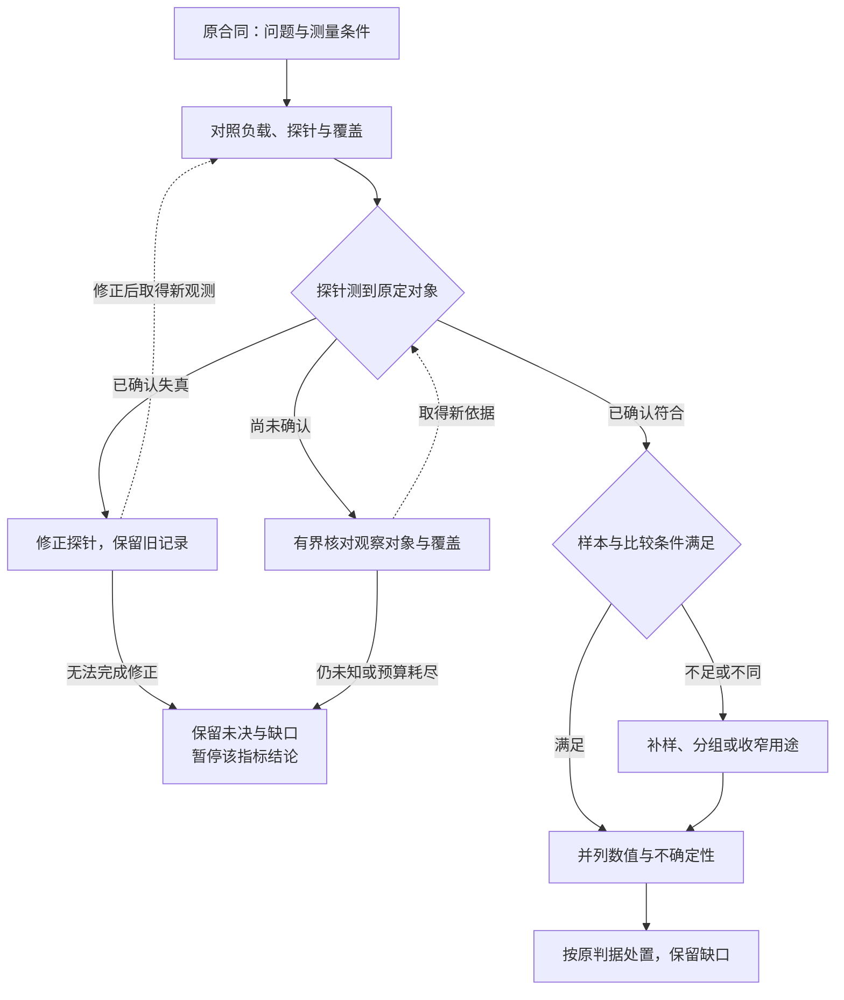

# 第20章 AgentOps、成本与模型漂移
## 从运行指标清单到有基线、有分母、有处置权的持续评价

> 工作稿状态：首轮逻辑修订稿，不替代 [全书大纲](../OringinalDocs/beyond_code_ai_native_software_engineering_outline_zh.md)。
> 回接说明：[RR-041 实施记录](../RevisedResult/RR-041_RR-040实施后书稿与配图复查.md)。
> 适用边界：本章提出 Operational Baseline、Evaluation Window、Drift Finding 与 Re-evaluation Case 的候选工程模型；它不声称这些对象完备或最优，不声称统一指标可以比较所有 Agent 系统，也不声称 AI Game Dev OS v4.94 已证明成本、可靠性或治理效果改善。

当代码生成成本下降以后，最容易被看见的是：

- Model 调用了多少次；
- 消耗了多少 Token；
- Tool 执行了多少次；
- 第一版 Output 多快出现；
- 同时运行了多少 Agent。

这些数据可能有用。

但它们不能单独回答：

- 结果是否完成了当前 Intent；
- 完成是否被具名 Authority 接受；
- 失败、重试和 `non-result` 是否被计入；
- Human Review、等待、返工和恢复消耗了什么；
- Model、Tool、Permission 或 Evaluation 是否已经变化；
- 原有 Security、Privacy、IP 与 Authority Boundary 是否仍成立；
- 系统是否需要继续、收窄、重路由、回滚、暂停或退役。

因此，本章不把 AgentOps 写成一个 Dashboard 产品，也不把 Agent Economics
写成 Token 价格比较。

本章使用以下中心句：

> **Operate against a versioned baseline, evaluate accepted outcomes within a bounded window, and treat drift as a trigger for scoped re-evaluation rather than automatic proof of failure.**

围绕版本化基线运行，在有边界的窗口内评价被接受的结果，并把 Drift 视为有范围再评估的触发，而不是自动的失败证明。

这句话包含四个相互连接、但不能合并的动作：

~~~text
bind an operational baseline
→ observe a bounded evaluation window
→ identify a relevant drift finding
→ make an authorized operational disposition
~~~

---

## 20.1 先区分必要、有用与可选

### 必要

只要一个 Agent 配置会长期、重复或以较高影响运行，项目至少需要能够回答：

- 当前运行的 Model、Tool、Skill、Policy、Context 与 Permission 是哪个版本或变化策略；
- 什么算一个可评价的 Outcome，什么算 Accepted Outcome；
- 指标对应哪个 Workload、分母、时间窗与 Observation Coverage；
- 哪些质量、安全、Authority、成本或 Human Capacity 边界不能静默越过；
- 哪些变化会触发 Re-evaluation；
- 谁可以继续、收窄、重路由、回滚、暂停或重新授权；
- 失败、退出、未知外部结果和 `non-result` 怎样保留。

### 有用

当运行量、变化频率或失败成本增加时，下列能力通常有用：

- 版本化 Operational Baseline；
- 可比较的 Evaluation Window；
- Metric Contract；
- Cost Attribution View；
- Drift Finding；
- Re-evaluation Case；
- Routing Comparison View；
- Budget、Alert、Canary、Fallback 与 Rollback；
- Human Attention 和 Decision Queue 的有限观察。

### 可选

以下实现不应被当成 AgentOps 的定义条件：

- 独立的 AgentOps 平台；
- 实时全量 Dashboard；
- 统一 Cost 或 Trust Score；
- 每个 Tool Call 的永久保留；
- 自动 Root Cause；
- 多 Model 投票；
- 全量在线 Evaluation；
- 对每次 Provider 更新执行完整回归；
- 为每个指标建立独立 Registry。

一个低风险、低频、可人工检查的内部 Workflow，可能只需要版本记录、少量
结果样本和一个明确的停止条件。

---

## 20.2 AgentOps 与 DevOps、LLMOps 的关系是范围问题

**AgentOps（Agent 运行工程：持续识别 Agent 配置、Workload、Outcome、
Control、Cost 与 Drift，并把运行观察连接到有 Authority 的处置）** 可以复用
DevOps、SRE、MLOps 与 LLMOps 的大量能力。

例如：

- Deployment Identity；
- Log、Metric、Trace 与 Alert；
- Service Level、Error Budget 与 Incident Response；
- Model / Data Evaluation；
- Feature Flag、Canary 与 Rollback；
- Cost Allocation 与 Capacity Planning；
- Dependency、Provider 与 Configuration Management。

本书不以工具类别来划分它们。

AgentOps 需要额外显式连接的，是 Agent 工作中经常同时出现的关系：

~~~text
Intent and Workload
+ Context and Instruction Boundary
+ Model and Tool Selection
+ Permission, Credential and Authority
+ Generated Proposal and Action Sink
+ Human Review and Decision Capacity
+ Outcome, Evidence and Recovery
~~~

如果现有 DevOps、MLOps 或 LLMOps 系统已经能保存这些关系，就没有必要另建一套平台。

名称不产生能力。

---

## 20.3 第20章只拥有运行评价与处置层

第20章不重新拥有所有运行事实。

| 对象 | 主要所属章节 | 第20章如何使用 |
|---|---|---|
| Intent、Scope、Non-goal | 第4章 | 绑定运行观察与 Workload，不修改 Intent |
| Context Contract / Manifest | 第5章 | 识别 Context 配置与成本变化 |
| State Claim、Baseline、Conflict | 第6章 | 引用当前运行依据，不建立第二套 Truth |
| Work、Execution Contract、Attempt、Checkpoint、Bounded Execution | 第7章 | 关联运行成本与执行边界，不重新定义 Work / Attempt |
| Attempt Outcome、Target Result、Evaluation Result、Failure、`non-result`、Recovery | 第8章 | 读取结果与恢复关系，不拥有裸 Outcome 上位对象 |
| Evidence、Acceptance、Adoption、Release Authorization | 第9章 | 判断指标能支持什么发布授权处置 |
| Review、Review Target、Finding、Review Budget、Review Independence、Review Disposition | 第10章 | 观察 Review Capacity、Queue 与运行处置成本 |
| Human Decision Interface | 第11–12章 | 观察 Decision Queue 与 Attention Boundary |
| Capability、Permission、Authority、Autonomy | 第13章 | 约束 Routing、Budget、Tool 与自动处置 |
| Observation、Detector、Signal、Intervention | 第14章 | 提供有来源的运行观察 |
| Memory Lifecycle | 第15章 | 识别 Retrieval、Promotion、Expiry 与维护成本 |
| Self-Evolution Candidate、Evaluation Contract、Activation / Rollout 与 Post-adoption specialization | 第16章 | 接收长期观察并触发重新评价；基础 Adoption / Disposition 引用第9章 |
| Agent Organization | 第17章 | 观察 Coordination、Handoff 与 Integration Cost |
| Release Execution、Release Outcome、Trace 与 Accountability | 第18章 | 区分发布执行与外部后果，并提供来源和责任审查依据 |
| Data、Model、Tool、Supply Chain、IP Boundary | 第19章 | 观察边界是否仍成立 |

本章拥有的候选核心对象是：

1. Operational Baseline；
2. Evaluation Window；
3. Drift Finding；
4. Re-evaluation Case，以及案件形成的 Operational Disposition。

Cost Attribution View 与 Routing Comparison View 只是投影，不成为新的 Truth Store。

---

## 20.4 Operational Baseline 绑定“什么正在被评价”

**Operational Baseline（运行基线：在具名 Purpose、Workload 与时间范围内，
用于解释运行结果的版本化配置、边界和评价引用集合）** 不是一份永久 Known-good 声明。

它可以引用：

- Use-case 与 Workload Population；
- Model、Endpoint、Deployment 与 Change Policy；
- Tool、Adapter、Skill、Prompt / Policy Pack；
- Context Contract、Retrieval 与 Memory Boundary；
- Permission、Credential Scope、Authority 与 Autonomy Profile；
- Evaluation Suite、Rubric 与已知 Coverage；
- Outcome、Guardrail 与 Budget；
- Data、Provider、Security 与 IP Disposition；
- Owner、Valid From、Expiry 与 Re-evaluation Trigger。

示例：

~~~yaml
operational_baseline_id: OB-020-014
purpose: internal_issue_triage
workload_ref: WL-issue-triage-v3

runtime:
  model_endpoint: provider-a/model-family-x
  version_policy: provider_managed_with_notice
  agent_contract: agent-triage-v5
  tool_contracts:
    - issue-reader-readonly-v2
  context_contract: ctx-triage-v4

control:
  authority_grant: AG-triage-readonly
  autonomy_profile: observe_and_propose
  data_profile: internal-no-customer-secrets

evaluation:
  suite: eval-triage-v7
  outcome_contract: outcome-triage-v2
  known_gaps:
    - multilingual_long_threads
    - malformed_attachments

economics:
  cost_boundary: CB-triage-team-quarter
  budget_ref: budget-triage-q3

validity:
  opened_at: 2026-08-01T00:00:00+08:00
  expires_at: 2026-09-01T00:00:00+08:00
  owner: developer_productivity
~~~

这不是通用 Schema。

它表达一个语义要求：比较之前先说明运行对象、配置、边界和有效期。

如果 Provider 只暴露 Alias 而没有固定 Digest，Baseline 应记录可获得的 Service
Identity、Contract、Change Notice、Observed Behavior Baseline 与不确定性。

“无法完全固定”不等于“假装没有变化”。

---

## 20.5 Baseline 变化不能静默重写过去

当 Model Alias、Tool Version、Prompt、Policy 或 Evaluation Set 更新时，常见做法是
直接把 Dashboard 的当前值当成新常态。

这样会丢失两个问题：

1. 历史结果是在什么配置下产生的；
2. 新配置是否已经获得相同用途和风险边界的 Adoption。

更稳妥的处理是：

~~~text
old baseline closes or remains active for its scope
→ candidate/current configuration receives a new identity
→ comparability and required re-evaluation are assessed
→ authorized disposition selects rollout, coexistence, rollback or retirement
~~~

修正错误的 Baseline Metadata 可以保留 Correction Record，但不能为了让趋势连续而
把过去的 Model、Tool、Permission 或 Evaluation Identity 改成当前值。

---

## 20.6 Evaluation Window 提供分母、范围和观察缺口

**Evaluation Window（评价窗口：为一组可比 Work、配置和时间范围绑定纳入规则、
分母、Observation Coverage 与 Decision Use 的观察区间）** 不是随意选择的一段日期。

它至少需要说明：

- Window 的开始、结束或事件边界；
- Workload、Environment 与 Baseline；
- 纳入、排除、抽样与去重规则；
- Outcome Unit 与分母；
- Retry、Fallback、Cancellation 与 `non-result` 的计入方式；
- Incident、Override、Canary 和异常流量是否单列；
- 缺失数据、延迟数据与 Detector Failure；
- 计划支持的 Decision Target。

例如，“成功率 92%”缺少以下信息时几乎无法解释：

- 92% 的什么；
- 哪些任务没有进入分母；
- 成功由 Test、Agent、Reviewer 还是 Acceptance Authority 判断；
- Retry 后成功是否掩盖了第一次失败；
- 未执行目标是否被记成失败；
- Workload 是否在两次测量间改变；
- 观察覆盖是否完整。

一个实际例子来自 [RandomHeroes 的经济测量记录](../Evidence/receipts/ER-20261122-003__CLM-C20-001.md)：原清单要求至少5,000次，实际每组执行4,000次。脚本固定种子、主动重置能量及部分遗迹和Boss状态，并限制进度范围。这是调用真实结算链的自动化样本，却不是4,000次自然玩家会话。三组对应的代码或配置不同，也不能合并成“12,000次同条件验证”。计划中未执行的1,000次应记为样本缺口，不是已经观察到的失败或 `non-result`。

---

## 20.7 Outcome Unit 与 Accepted Outcome 必须先定义

**Outcome Unit（结果单位：在具名 Work 与 Scope 下，可被独立观察和处置的一次
目标结果）** 可能是：

- 一个回答；
- 一个修复候选；
- 一个 Review Decision；
- 一个构建或迁移结果；
- 一次发布；
- 一个用户可观察行为；
- 一项被接受的知识或 Policy 变更。

Tool Call、Message、Generated File 和 Commit 不一定是 Outcome。

**Accepted Outcome（已接受结果：由具名 Acceptance Authority 针对明确 Scope 和
用途作出接受处置的 Outcome）** 也不等于：

- Agent 声称完成；
- Tool 返回零退出码；
- Test PASS；
- Reviewer 已阅读；
- Artifact 已生成；
- Change 已 Merge；
- 功能已 Release。

Outcome Unit 是运行计量投影：它引用一个或多个第8章 Target Result / Evaluation Result，并声明当前统计分母，不建立新的 Result 上位对象。Accepted Outcome 则表示该计量单元引用的具名结果已经获得第9章定义的 Acceptance Disposition；它不建立第二种 Acceptance，也不把未观察、`non-result` 或 Reviewer PASS 自动计为已接受结果。

不同工作可以使用不同的接受边界。

一个探索任务可能以“候选已记录并明确未知”作为 Outcome；一个生产迁移则需要
更强的状态观察、验证、Authority 与恢复条件。

上述产品测量以一次 Spin 为观察单位；4,000是产品样本分母，不是4,000项 Agent Work，也不是4,000个 Accepted Outcome。同期清单针对某个均值写下“通过”，并没有因此产生本章所需的具名结果接受处置，不能拿它计算“每个已接受结果的开发成本”。

---

## 20.8 Metric Contract 说明数字能够支持什么

**Metric Contract（指标契约：为具名指标规定定义、来源、分母、窗口、分段、
Coverage、限制和 Decision Use）** 可以写成：

~~~yaml
metric_id: M-accepted-outcome-latency
question: how_long_until_a_scoped_outcome_is_accepted

unit: elapsed_minutes
population: issue_triage_outcomes
denominator: outcomes_opened_in_window
start_event: work_accepted
end_event: acceptance_disposition_recorded

segments:
  - workload_language
  - issue_complexity_band
  - model_endpoint
  - human_review_required

source:
  events:
    - work_record
    - acceptance_record
  coverage: sampled_with_known_gaps
  known_missing:
    - offline_human_review_time

decision_use:
  - compare_routing_candidates
  - identify_review_queue_pressure

not_supported:
  - reviewer_understanding
  - outcome_quality_without_acceptance_scope
  - causal_attribution_to_model
~~~

指标的 `not_supported` 与数值本身同样重要。

它阻止读者或系统从“我们记录了什么”跳到“我们已经证明什么”。

模板中的 `outcomes_opened_in_window` 还需要区分已接受、已拒绝、取消和观察结束时仍开放的结果。只对已接受者计算延迟时，应同时报告其占全部开放结果的比例，以及未接受者的等待时长和当前状态。静默删去尚未接受的慢任务，会把局部样本伪装成整个窗口。

### 把原合同、实测与处置放在一起

RandomHeroes 的 F33 修复后构建保存了以下测量结果。这里的 Spin 指大世界一次转动结果的结算；快速测试调用实际结算链，但不等待完整动画，也不代表一段玩家会话。回补测的是**每次结算产生的能量等价量**，不是发生回补的概率。

本次每轮扣费1点能量。设扣费前为 E0、结算后为 E1，直接回补为 `max(E1 − (E0 − 1), 0)`；本次结算若产生一份免费Spin资格，再按1点能量计入。保存记录的4,000个有效结算观测合计直接回补1,623点、产生294份免费资格，因此均值为 `(1,623 + 294 × 1) / 4,000 = 0.47925点/Spin`。免费资格是这一轮产生的标记，没有另外增加294次观测；空结果不进入分母。单次回补也可以大于1，不能把0.47925读成47.925%的触发概率。

以下目标、均值和置信区间都采用“点/Spin”口径；表中“通过”保留同期判断的原范围。

| 层次 | 保存的内容 | 允许的结论或下一步 |
|---|---|---|
| 原合同 | 平均能量等价回补目标0.39–0.49点/Spin，至少5,000次 | 比较前先保留原条件，不能看完结果再更换判据 |
| 实际执行 | 固定种子和状态干预下4,000次 | 样本量未达到原要求；说明干预，补样或收窄用途 |
| 数值 | 均值0.47925；记录95%区间约0.444–0.515 | 点估计落在目标均值区间，统计不确定性继续存在 |
| 同期处置 | 均值项标为通过 | 原合同没有要求整个置信区间落在目标内；不能事后新增这条硬门槛判失败 |
| 未覆盖项 | 原定样本量、自然会话、真人体验 | 不能扩为“全部合同通过”或产品平衡已被接受 |

免费资格的折算依赖本轮单次成本为1；固定种子、能量及部分世界状态重置、排除自然回复等条件，也限制了这组数据的用途。它不能直接解释自然会话中的续航。

从这里可分出四步：公式能算，只说明定义可执行；采到数据，还要检查探针与覆盖；可以比较，需要条件和分母一致；足以支持结论，则取决于原来的问题与决定范围。缺一项时先处理该缺口，避免用一个漂亮数值跨过全部步骤。

### 图20-1 从测量合同走到有限结论

图20-1是测量处置示意。探针是否测到原定对象尚未确认时，先核对起止事件、覆盖及合同要求；取得新依据才重新判断，无新依据或预算耗尽则保留未决，暂停该指标结论。已确认失真需要修正探针，并以新观测重新核对，追加同类样本不能自行修复失真。收窄用途后仍可报告已有数值，但必须带上缺口；点估计通过不能代替全合同完成。

---

## 20.9 指标不能脱离 Population、分段与缺失值

平均值可能把不同 Workload 混在一起。

例如：

- 简单格式修改增加，平均 Latency 下降；
- 高风险任务被转交 Human，Agent Success Rate 上升；
- 失败任务在执行前被拒绝，Completed Task 的平均成本下降；
- 只记录 Tool 成功响应，外部未知结果从数据中消失；
- 新 Detector 增加发现率，看起来像 Incident 变多。

这不一定表示系统改善或退化。

需要按实际决策问题选择分段，例如：

- Workload / Domain；
- Complexity；
- Risk / Reversibility；
- Model / Tool / Policy Baseline；
- Data Class；
- Human Review Mode；
- New / Returning Workflow；
- Incident / Normal Operation。

分段过细会造成样本稀疏、隐私风险和维护成本。

因此分段也需要 Question、Owner 与最小必要性。

lessismore 的一次固定短流程也说明统计量不能互相替代：具名 Driver 的累计耗时从1,724,377降至1,605,462微秒，最大单次却从16,962升至18,258微秒，P95从7,659降至7,093微秒。条件限于 Godot 4.4、M3 Pro、Compatibility、1920×1080、固定种子、三回合15次操作。可以报告这些统计量的分向变化；不能由累计值写成整体游戏性能改善，也不能由单次最大值写成尾延迟普遍退化。它们都不是整帧、GPU或长期体验测量。

---

## 20.10 AgentOps 观察面不能压成一个分数

原大纲列出的 Agent 状态、Tool Call、成功率、延迟、成本、失败类型、人工介入、
Permission 与 Context 使用都应保留，但要放入不同语义面。

| 观察面 | 候选问题 | 不能自动推出 |
|---|---|---|
| Outcome / Acceptance | 什么结果被谁为哪个 Scope 接受 | 结果长期有价值 |
| Reliability / Failure | 哪些 Failure、Retry、Fallback、`non-result` 出现 | 已找到 Root Cause |
| Latency / Waiting | 时间花在执行、排队、Review 还是外部依赖 | 越快越好 |
| Model / Tool Cost | 直接调用和资源消耗是什么 | Total Production Cost |
| Human Attention | 哪些判断、重建和中断可观察 | 人类认知已被完整量化 |
| Coordination | Handoff、Conflict、Integration 与 Output Triage | 多 Agent 必然低效或高效 |
| Context | 获取、装配、传输和 Retrieval 发生了什么 | Model 实际使用了全部内容 |
| Permission / Authority | 哪个 Grant 支持了哪个 Action | Permission 已正确使用 |
| Control Health | Detector、Gate、Fallback 与 Recovery 是否可观察 | 没有未观察风险 |
| Drift / Re-evaluation | 什么变化触发了什么处置 | 变化由 Model 导致 |

单一 AgentOps Score 会掩盖这些边界之间的冲突。

---

## 20.11 Total Production Cost 不只是 Token

**Cost Boundary（成本边界：为具名 Outcome、Decision Target、Owner 与时间窗规定
纳入、排除、归属和未知成本的评价范围）** 先于任何总成本相加。

**Total Production Cost（总生产成本：为具名 Outcome、Decision Target 与时间窗
识别执行、验证、人类、协调、失败、治理和维护投入的有边界成本视图）** 不是要求
把一切换算成一个货币数字。

候选成本面包括：

### Direct Execution Cost

- Model / Token；
- Tool / API；
- Compute、Build 与 Test Environment；
- Storage、Network 与 Runtime；
- Retry 与 Fallback。

### Context Cost

- Retrieval；
- Assembly；
- Summarization；
- Transfer；
- Storage；
- Freshness 与 Index Maintenance。

### Verification and Review Cost

- Test；
- Evaluation；
- Code / Design / Product Review；
- Approval；
- Evidence Collection；
- Release Decision。

### Human Attention Cost

- Context Reconstruction；
- Decision Preparation；
- Waiting 与 Interruption；
- Exception Triage；
- Takeover；
- 重新建立对系统状态的理解。

### Coordination Cost

- Work Decomposition；
- Assignment；
- Handoff；
- Conflict Resolution；
- Integration；
- Output Triage。

### Failure and Recovery Cost

- Failed Attempt；
- Rework；
- Rollback；
- Incident Response；
- Data / External State Repair；
- Customer、Player 或组织影响。

### Governance and Maintenance Cost

- Policy、Gate、Trace、Detector 与 Audit；
- Exception、Override 与 Escalation；
- Prompt、Skill、Tool 和 Model Integration；
- Baseline、Evaluation 与 Documentation Refresh；
- Training 与 Adoption Support。

这些成本可能重叠。

Cost Boundary 必须说明归属规则，避免把同一 Human Review 同时计入 Verification、
Governance 和 Cognitive Cost 后再相加。

产品运行指标与生产产品的成本还要分开。上述金币、能量和 Driver 耗时没有计入开发过程中的模型调用、人工审阅、等待和返工，因此不能据此给出 Agent Economics 的改善百分比。RandomHeroes 的一次修复同时改了代码和配置，金币均值从152.0205变为75.697，也不能全部归因于消除重复发奖这一项改动。

---

## 20.12 Cost Attribution View 是处置投影

**Cost Attribution View（成本归属视图：把可获得的运行和人工记录按具名 Outcome、
Workload、Baseline、Owner 与 Decision Target 组织的查询投影）** 可以回答：

- 一类 Accepted Outcome 的直接运行成本范围；
- Review 与 Waiting 是否成为主要瓶颈；
- Retry、Rework 或 Recovery 在哪里累积；
- 某个 Gate 的运行、误报和人工处置成本；
- Model Routing 改变了哪些成本面；
- 哪些成本目前不可观察或只能由 Human 估计。

它不应伪造以下精度：

- 没有记录的认知时间；
- 失败本可造成但未发生的损失；
- 延迟造成的全部 Opportunity Cost；
- 一次 Incident 对长期信任的影响；
- Creative Quality、Learning 或组织能力的完整货币价值。

允许 `unknown`、区间、定性比较和不适用，通常比填入一个虚假数字更可靠。

---

## 20.13 Human Attention 是有限资源，但不是完整可测对象

Agent 系统可能降低某些操作时间，同时增加：

- Output Review；
- 多方案比较；
- Exception Triage；
- Permission Approval；
- Context Reconstruction；
- Handoff Interpretation；
- Drift Investigation；
- Override 与 Takeover；
- 对低质量高产出的筛选。

可观察的近似量包括：

- 等待 Human Decision 的 Work 数量与时长；
- Review 开始和结束事件；
- Reopen、Reject、Request-change 与 Override；
- Human Takeover；
- 同一 Decision Target 的重复 Brief；
- 在多个 Agent Output 之间进行 Triage 的数量；
- Decision Queue 的年龄与风险分布。

这些记录仍不能单独说明：

- Human 是否真正理解了变更；
- 一次 Review 的认知难度；
- 中断对其他工作的机会成本；
- Creative、Product 或 Ethical Judgment 的质量；
- 没有进入系统的隐形工作。

因此 Human Attention 需要机器观察与选择性 Human Annotation 结合，不能从鼠标点击、
评论数量或在线时长推导完整 Cognitive Cost。

---

## 20.14 Governance Economics 比较治理增量，不追求治理最少

**Agent Economics（Agent 经济性：评价具名 Agent 生产安排能否在 Outcome、Risk、
Human Capacity 与时间边界内，以可持续的总生产成本运行）** 是本章的上位经济视角。

它不只比较 Model 单价，也不预设 Agent 方案一定比 Human-only、普通自动化或更简单的
Tool Workflow 经济。

**Governance Economics（治理经济性：在 Protected Control Floor 和不可接受损失
边界之上，比较不同控制安排带来的执行、等待、Review、误报、漏报、返工、恢复与
维护成本）** 处理的是权衡，不是取消控制的理由。

候选比较可以写成：

~~~text
compare:
  execution cost
  + context cost
  + review and waiting cost
  + human attention cost
  + governance and maintenance cost
  + observed rework and recovery cost

subject to:
  protected control floor
  legal / security / privacy constraints
  unacceptable-loss limits
  Human-reserved Decision Types mapped to named Authority Grants or institutional boundaries
  minimum outcome and evidence boundaries
~~~

这不是一个可直接求解的通用公式。

原因包括：

- Failure Probability 可能未知；
- Prevented Incident 是反事实；
- 低概率高影响损失不能被平均值掩盖；
- 安全、隐私、权利和 Human Authority 不能全部货币化；
- 不同团队对 Delay、Quality 与 Risk 的容忍度不同；
- 新 Detector 可能同时增加发现和人工负担；
- 更少 Incident 可能来自更少 Workload，而不是更强控制。

因此更准确的问题不是“哪个 Governance Score 更低”，而是：

> 在不可降低的边界之上，哪一组控制以可接受的额外成本处理了当前具名风险，并且没有制造更大的未观察故障面？

本章的产品测量例子用于解释分母、探针和归因方法；若要比较治理安排的经济性，还需另采同范围的执行、审阅、等待与返工投入，保留未测成本。材料回收数和文档字符量同样不能直接代替这些成本。

### 一份能算出部分成本的教学账本

下面全部是**虚构教学数据**，不代表三个项目的价格、工时或效率。观察窗口为一个工作日；总体是当日新开的5项Work，示例约定每项只有一个待接受Outcome，接受范围都是约定的局部交付。窗口结束即截断，不等待所有任务完成。表中记账元只表示已记录的模型与工具费用，人工分钟单列，不换算货币。

| Work / Outcome | Attempt或事件 | 本次事件及窗口末状态 | 直接费用（记账元） | 已知人工活动（分钟） |
|---|---|---|---:|---:|
| W1 / O1 | A1 | 尝试失败，随后重试；O1最终接受 | 4 | 6 |
| W1 / O1 | A2 | 重试产生被接受结果 | 6 | 9 |
| W2 / O2 | A1 | 输出被拒绝，窗口内未再尝试 | 5 | 12 |
| W3 / O3 | A1 | 产生投入后取消 | 3 | 4 |
| W4 / O4 | A1 | 仍开放，已等待审阅2小时 | 8 | 未记录 |
| W5 / O5 | A1 | 输出被接受 | 4 | 7 |
| 本窗口共享 | 一次公共环境准备 | 服务上述5项Work，未归属单项 | 2 | 未记录 |

先数对象，再算费用。这里是5项Work、5个Outcome、6次Attempt；W1重试没有新开第二个Outcome。窗口末接受2个、拒绝1个、取消1个、仍开放1个，故在整个新开总体中的接受比例为 `2/5 = 40%`。开放项的2小时是等待，不是已知人工活动时间；它后续被接受时，应更新该总体的后续观察，不能悄悄改写这个截断时点。

所有Attempt的直接费用为 `4 + 6 + 5 + 3 + 8 + 4 = 30`，共享费用已确定服务本窗口，故窗口已记账费用为32。用本窗口已接受的2个Outcome归一化，得到 `32/2 = 16记账元/已接受Outcome`；这个名称必须保留“窗口已记账”范围，它既不是最终生命周期成本，也不是只统计成功路径的费用。

若另问“两个已接受结果各自已归属多少直接费用”，答案是W1的 `4 + 6 = 10` 与W5的4，平均7；这个数没有包含其他任务和共享费用，不能拿它替换上面的16来宣称效率更好。拒绝、取消和开放任务的投入仍在30之中。共享费用可以按事先声明的规则分摊，例如本例等分给5项Work、每项0.4，但那只是记账约定，不是它们各自引起该成本的因果证明。

已知人工活动合计 `6 + 9 + 12 + 4 + 7 = 38分钟`，W4与公共准备仍未知，不能按零补齐。因而完整人工投入、总生产成本和该流程是否更经济都算不出来。下一步应补这两处记录，再为同类工作定义可比较窗口；接受范围、失败与取消的计入方式、截断规则或成本覆盖不同，都不能直接比较两个“每结果成本”。

---

## 20.15 Governance 指标需要反事实与损失不对称边界

原跨章规划提出了若干有用候选指标：

- Governance Overhead Ratio；
- Review Time；
- Human Decision Time；
- Escalation Frequency；
- False Escalation Rate；
- Under-governance Incident Rate；
- Rework Avoided；
- Failure Cost Avoided。

它们不能机械进入一个总分。

### Governance Overhead Ratio

分子和分母必须明确。

如果分母只包括 Model Runtime，Review 占比会很高；如果分母包括长期维护与 Incident，
同一控制的比例可能不同。

### False Escalation 与 Under-governance

二者损失通常不对称。

一次低风险误升级可能增加等待；一次漏升级可能导致不可逆外部影响。不能只比较次数。

### Rework Avoided 与 Failure Cost Avoided

“避免”是反事实推导。

除非存在合适对照、历史基线或明确事件链，否则更诚实的写法是：

- Gate 阻断了哪一个具体动作；
- 后续检查发现了什么；
- 如果没有 Gate 会发生什么仍属于估计；
- 估计依据和不确定性是什么。

### Protected Control Floor

Secret、Production Authority、不可逆数据损失、法定义务和明确保留给 Human 的 Decision Type
不能因为短期成本高就由执行 Agent 自动关闭。

优化对象是 Floor 之上的实现和流程，不是让经济指标自行取消 Floor。

---

## 20.16 Model Routing 是有边界的运行处置

原大纲提出：

- 快速低成本模型；
- 强推理模型；
- 专用模型；
- 本地模型；
- 多模型交叉验证。

这些可以保留为候选能力或拓扑，但不是稳定等级。

**Routing Disposition（路由处置：Decision Record 针对具名 Routing Decision Target，
在声明的 Purpose、Data、Tool、Authority、Evaluation 与 Cost Boundary 下，选择某个
Model / Tool 路径及其 Fallback、Review 和有效期的运行处置）** 是本章 Operational Disposition 的局部特化，并继续服从第9章的 Target-specific Disposition 上位关系。它需要同时考虑：

- Workload 与 Required Capability；
- Outcome 与 Guardrail；
- Data Processing Permission；
- Provider Contract、Region、Retention 与 Change Policy；
- Tool、Network、Credential 与 Authority；
- Latency、Availability 与 Capacity；
- Direct、Review、Recovery 与 Maintenance Cost；
- Evaluation Coverage 与已知失败面；
- Fallback、Canary、Rollback 与 Owner。

一个价格较低的 Model 如果增加 Retry、Review 和 Rework，未必具有更低总成本。

一个公开 Benchmark 更高的 Model，如果不满足 Data、Tool、Latency 或 Output Contract，
也不一定适合当前 Work。

Local、Private 与 Cloud 的处理合同由第19章定义；第20章观察它们在运行中的结果、
成本和变化。

---

## 20.17 Routing Comparison 先保证可比性

**Routing Comparison View（路由比较视图：在尽量一致的 Workload、Boundary、
Evaluation 与处置规则下比较候选运行路径的查询投影）** 可以使用：

- Offline Evaluation；
- Shadow Run；
- Replayable Fixture；
- Canary；
- A/B 或 Interleaving；
- Human Blind Review；
- Sequential Rollout；
- Incident / Failure Mode Review。

每种方法都有边界。

| 方法 | 可能提供 | 主要限制 |
|---|---|---|
| Offline Evaluation | 低风险、可重复比较 | Workload 与真实 Tool Effect 可能失真 |
| Shadow Run | 同一输入下观察候选输出 | 不能自动评价外部副作用和 Human Adoption |
| Replay Fixture | 精确重现已知案例 | 容易过拟合历史失败 |
| Canary | 观察真实路径的小范围行为 | 仍可能产生实际影响，需要停止与恢复 |
| A/B | 比较受控 Population | 难以用于低频高风险或不可逆任务 |
| Human Blind Review | 减少部分品牌或模型偏见 | 成本高，且仍受 Reviewer 差异影响 |

比较时需要保持或明确记录：

- Prompt / Instruction；
- Context 与 Retrieval；
- Tool Function 与 Permission；
- Retry、Fallback 和 Review Policy；
- Outcome Definition；
- Sampling 与 Time Window；
- Model / Tool Identity；
- 缺失值与退出条件。

无法保持可比时，可以形成有边界的工程判断，但不要伪装成精确实验。

---

## 20.18 Drift 是相对 Baseline 的相关变化

**Drift（漂移：相对于具名 Operational Baseline，可能改变 Outcome、Control、
Cost、Evidence Coverage 或适用边界的持续或离散变化）** 不是任何数字波动的同义词。

**Drift Finding（漂移发现：把有来源的变化、Baseline、Coverage、潜在影响和
不确定性连接起来，但尚不自动确认原因或决定处置的版本化判断）** 是本章保存 Drift
的核心对象。

候选分类包括：

| Drift 面 | 典型变化 | 可能影响 |
|---|---|---|
| Identity / Version | Model、Tool、Skill、Prompt、Policy、Dependency | 可比性、行为、来源 |
| Workload | 任务、语言、数据、用户、难度分布 | Outcome、Cost、Coverage |
| Behavior / Output | 格式、稳定性、错误模式、Tool Selection | Quality、Safety、Review |
| Tool / Interface | Schema、Side Effect、Error、Latency、API | Execution、Recovery、Evidence |
| Permission / Authority | Function、Credential Scope、Grant、Destination | Action Boundary、Risk |
| Control | Detector、Gate、Sandbox、Fallback、Rollback | Prevention、Detection、Recovery |
| Evaluation | Dataset、Judge、Rubric、Coverage、Threshold | Measurement Meaning |
| Economic | Price、Token、Runtime、Review、Waiting、Maintenance | Routing 与 Sustainability |
| Contract / Rights | Terms、Region、Retention、License、Purpose | 可用性、Privacy、IP |

Drift Finding 需要说明它对哪个 Claim 或 Decision Target 有意义。

随机波动、季节性、Workload 变化和 Observation Gap 都可能造成指标移动。

---

## 20.19 Model Drift 不只来自权重更新

Model 相关变化可能来自：

- 明确 Model Version 更新；
- Provider Alias 指向变化；
- System Instruction 或 Safety Policy 变化；
- Sampling、Temperature、Tool Policy 或 Output Schema 变化；
- Retrieval、Context、Memory 或 Prompt Template 变化；
- Provider Runtime、Capacity、Routing 或 Region 变化；
- Workload 与输入分布变化；
- Evaluation Set 或 Judge 变化。

因此“Model 表现下降”通常是待检验的 Cause Candidate，不是仅凭指标下降得到的事实。

需要先问：

1. Model Identity 或 Change Policy 是否变化；
2. Context、Tool、Prompt、Permission 与 Workload 是否可比；
3. Observation 和 Evaluation Coverage 是否变化；
4. 退化发生在哪个 Segment；
5. 是否有独立复现或对照；
6. 当前影响是否需要立即限制运行。

Cause 尚未确定，不妨碍在高影响边界下先 Restrict 或 Fallback。

Operational Safety Decision 与 Root Cause Completion 可以分开。

---

## 20.20 Tool、Permission 与 Control 也会漂移

Tool Drift 可能表现为：

- Function 或 Parameter Schema 变化；
- 默认值或返回格式变化；
- 新增 Network、Filesystem 或 Process Side Effect；
- Error、Retry、Idempotency 或 Transaction 语义变化；
- Credential Scope 扩大；
- API Rate、Quota、Latency 或 Availability 变化；
- Adapter、Launcher 或 Observer 行为变化；
- Recovery、Disable Switch 或 Fallback 失效。

Permission / Authority Drift 需要分开：

- Permission 变化是执行环境实际开放面变化；
- Authority 变化是有权来源对 Purpose、Scope 或 Effect 的授权变化；
- 实际使用变化是运行行为变化。

三者不能从一个 `permission_count` 推出。

Control Drift 则可能来自：

- Detector 未运行或 Coverage 下降；
- Gate 规则过期；
- Alert Route 无 Owner；
- Sandbox 配置变化；
- Exception 长期未到期；
- Rollback Artifact 不可用；
- Credential Revocation 不能传播到在途工作；
- Human Approval 变成机械点击。

一个 Agent Output 没有变化，不代表控制面没有漂移。

---

## 20.21 Evaluation 与 Observer 也属于漂移面

Evaluation 变化可能使数字改善，但不代表系统改善。

例如：

- 删除了困难 Fixture；
- Judge Model 更新；
- Rubric 变宽；
- Failure 被重新分类为排除项；
- Test 只覆盖新主路径；
- Human Reviewer 构成改变；
- Threshold 被调低；
- 记录失败导致分母缩小。

**Evaluation Drift（评价漂移：评价数据、Judge、Rubric、Threshold、Sampling、
Coverage 或处置语义发生变化，使不同时点结果不再直接可比）** 需要自己的 Identity。

Observer 也可能：

- 漏 Event；
- 重复 Event；
- 改变采样；
- 延迟上报；
- 在目标前产生 Side Effect；
- 因权限变化看不到原 Surface；
- 把未知记录成零；
- 把 Detector Failure 写成 Target Failure。

因此重要趋势需要同时显示 Evaluation / Observer Version 和 Coverage Gap。

---

## 20.22 Economic、Provider Contract 与 Rights Boundary 也会变化

Economic Drift 不只包括单价变化。

还包括：

- Token / Request Pattern；
- Retry 与 Fallback 频率；
- Context 长度与 Retrieval Cost；
- Review、Waiting 与 Decision Queue；
- Tool、Build 与 Test Environment；
- Incident、Recovery 与 Maintenance；
- Capacity、Rate Limit 与 Availability；
- 多 Agent Coordination 与 Integration。

Provider 或 Rights Boundary 变化可能包括：

- Terms、Output Use 或 Indemnity；
- Retention、Training、Support Access；
- Region、Subprocessor 或 Tenant Boundary；
- Model Alias 与 Change Notice；
- Package、Dataset、Model 或 Tool License；
- 原用途扩展到新产品、客户或法域。

这些变化是否构成法律、安全或业务问题，由第19章定义的 Authority 处置。

第20章负责发现“原 Routing 和 Operational Baseline 可能不再适用”，不生成新的法律结论。

---

## 20.23 Observation、Impact、Cause 与 Disposition 必须分开

一个 Drift Record 最容易出错的地方，是把整条推导写成一件事实。

更清楚的结构是：

~~~text
Observable Change
  source, baseline, current value, window, coverage

Impact Inference
  which outcome, guardrail, cost or boundary may be affected

Cause Candidate
  model, tool, workload, evaluation, control or external explanation

Operational Disposition
  continue, observe, restrict, reroute, rollback, suspend or retire
~~~

示例：

~~~yaml
drift_finding_id: DF-020-041
baseline_ref: OB-020-014
window_ref: EW-020-2026-08-b

observable_change:
  metric: accepted_outcome_latency_p95
  baseline: 42m
  current: 71m
  coverage: partial
  segments:
    - multilingual_long_threads

impact_inference:
  status: plausible
  affected_boundary:
    - review_queue_capacity
    - response_time_commitment

cause_candidates:
  - workload_mix_changed
  - provider_latency_changed
  - human_review_queue_changed

disposition:
  status: continue_with_restriction
  action:
    - route_long_multilingual_threads_to_fallback
    - open_scoped_re_evaluation
  authority: operations_owner
  expires_at: 2026-08-30T18:00:00+08:00
~~~

这个 Record 不声称已经找到 Root Cause。

它保存了足以支持当前有范围处置的外部理由。

---

## 20.24 Re-evaluation 由变化、到期和新用途触发

**Re-evaluation（再评估：当运行依据、适用边界或用途发生相关变化时，对受影响
Claim、Evaluation 与处置进行有范围重新检查）** 不等于定期重跑所有 Test。

候选 Trigger 包括：

- Model、Endpoint、Tool、Skill、Prompt 或 Policy Identity 变化；
- Tool Function、Schema、Permission、Credential 或 Action Sink 变化；
- Provider Terms、Region、Retention、Training、Subprocessor 或 Incident 变化；
- License、Rights、Data Class、Purpose、Customer 或 Jurisdiction 变化；
- Outcome、Guardrail、Cost、Latency 或 Human Load 越过当前 Boundary；
- 重复 Retry、Fallback、Override、Takeover 或 Unknown External Result；
- Evaluation、Judge、Detector、Sampling 或 Observation Coverage 变化；
- Baseline 到期；
- 新 Workload、新语言、新平台或更高影响用途；
- Recovery、Rollback、Disable Switch 或 Owner 不再可用。

Trigger 只说明需要判断，不自动说明系统已经失败。

---

## 20.25 Re-evaluation 先做 Impact Mapping，再决定重测范围

**Impact Mapping（影响映射：从一个具名 Change 或 Trigger 追踪其可能影响的
Baseline、Claim、Workload、Boundary 与 Decision Target）** 用来限制后续评价范围。

当 Trigger 出现时，先问：

1. 变化发生在哪个 Source、Identity 或 Contract；
2. 哪些 Baseline、Workload 与运行窗口受到影响；
3. 哪些 Outcome、Guardrail、Data、Authority 或 Cost Claim 依赖该对象；
4. 原 Evidence 哪部分仍然适用；
5. 哪些不确定性已经扩大；
6. 在完成评价前需要什么临时处置；
7. 谁具有 Re-evaluation 和最终运行处置 Authority。

原大纲建议重新运行：

- 项目基准任务；
- 安全测试；
- 可靠性测试；
- 成本测试；
- 行为回归测试；
- Cognition 输出质量测试。

这些应按 Impact Scope 选择，而不是每次全量执行。

候选评价面可以包括：

| 受影响面 | 候选 Evaluation |
|---|---|
| Output Contract | Schema、Format、Reference、Deterministic Check |
| Task Outcome | Project Fixture、Replay、Human Review、Acceptance Sample |
| Tool Behavior | Permission、Argument、Side Effect、Idempotency、Recovery Test |
| Security / Privacy | Threat-specific Test、Data Boundary、Credential、Logging Review |
| Reliability | Retry、Fallback、Rate Limit、Partial Failure、Recovery Exercise |
| Economics | Direct Cost、Latency、Review、Waiting、Rework 与 Capacity |
| Human / Cognition | Brief Quality、Decision Sufficiency、Creative / Product Judgment |
| Evaluation Integrity | Dataset、Judge、Rubric、Coverage 与 Observer Check |

“Cognition 输出质量”不能只交给另一个 Model 形成循环确认。

当问题涉及方向、体验、审美、权利或重要业务判断时，Human Review 仍是必要的语义来源。

RandomHeroes 的完整表现时长探针两次出现不一致结果，源记录将它弃用；另一个约1.96秒的按钮恢复计时没有因此成为完整体验时长，更不是真人测试。应按触发原因选择后续动作：探针失效先修正观察方法；样本不足按原合同补样或收窄用途；代码、配置改变则按影响范围重测。每一条都保留旧数据及处置原因，避免把“重测”当作统一答案。

---

## 20.26 Re-evaluation Case 保存触发、证据和 Authority

**Re-evaluation Case（再评估案件：由具名 Trigger 打开的有范围评价工作，连接受影响
Baseline、所需 Evidence、临时控制、Decision Authority 和最终处置）** 可以写成：

~~~yaml
re_evaluation_case_id: REC-020-018
trigger:
  type: provider_model_alias_change
  observed_at: 2026-08-26T09:30:00+08:00
  source: provider_change_notice

affected:
  baselines:
    - OB-020-014
  workloads:
    - internal_issue_triage
  claims:
    - output_schema_stability
    - accepted_outcome_latency
    - no_external_side_effect

interim_disposition:
  status: restrict
  scope:
    tools: read_only
    workloads:
      deny:
        - malformed_attachments
  expires_at: 2026-08-29T18:00:00+08:00

evaluation_plan:
  - project_fixture_replay
  - output_schema_regression
  - prompt_injection_boundary_check
  - cost_and_latency_sample
  - human_review_of_multilingual_cases

authority:
  evaluation_owner: ai_platform_evaluation
  operational_decider: developer_productivity_owner
  security_decider: security_owner

result:
  status: pending
  final_disposition: null
~~~

一个案件可以只影响部分 Workload、Tool 或 Claim。

如果变化与当前用途无关，可以记录 `no_re_evaluation_required_for_scope`，但需要说明判断依据和 Authority。

---

## 20.27 Operational Disposition 不是二元 PASS / FAIL

**Operational Disposition（运行处置：具名 Authority 通过 Decision Record，对某个
Operational Use、Operational Baseline 或 Next-state Choice 这一具名 Decision Target
作出的继续、限制、改变或停止处置）** 是第9章 Disposition 的 Target-specific subtype，可以包括：

| Disposition | 含义 |
|---|---|
| `continue` | 当前 Evidence 足以维持已接受 Scope |
| `continue_with_observation` | 暂不改变运行，但增加有期限观察 |
| `restrict` | 收窄 Workload、Data、Tool、Permission 或 Output Use |
| `reroute` | 将指定 Workload 转到其他 Model / Tool / Human Path |
| `canary` | 只在受控 Population 和停止条件下运行候选 |
| `fallback` | 使用已定义的降级路径 |
| `rollback` | 恢复到可用且仍适用的先前配置 |
| `suspend` | 暂停新运行，保留状态与 Evidence |
| `reauthorize` | 由有权角色重新确定 Grant、Scope 或有效期 |
| `retire` | 终止当前 Baseline 的后续使用 |
| `pending` | Evidence 或 Authority 尚不足，不伪造确定结论 |

Disposition 需要绑定：

- Target 与 Scope；
- Baseline / Candidate Identity；
- Trigger 与 Evidence；
- Authority；
- Effective Time 与 Expiry；
- 在途 Work；
- Recovery / Fallback；
- 后续观察与关闭条件。

`continue` 不是永久认证，`rollback` 也不自动证明先前版本在当前环境仍然安全。

---

## 20.28 自动处置只能执行预先授权的动作

Automated Gate 可以在明确 Grant 内：

- 阻断新 Tool Action；
- 切换到只读或低影响模式；
- 启用预先批准的 Fallback；
- 降低并发、Rate 或 Budget；
- 打开 Re-evaluation Case；
- 保存 Evidence；
- 通知具名 Owner。

它不能仅凭自身指标：

- 扩大 Tool Function；
- 增加 Credential Scope；
- 放宽 Protected Control Floor；
- 把新 Provider 自动加入允许清单；
- 把低 Cost 当成 Security Approval；
- 改写 Acceptance Authority；
- 删除已触发的 Incident 或 Drift Record；
- 将未完成的 Root Cause 写成事实。

自动化的速度不能替代 Authority 来源。

---

## 20.29 Alert 与 Escalation 也需要成本和容量边界

Alert 数量增加可能表示：

- 风险增加；
- Detector Coverage 改善；
- Threshold 变窄；
- Workload 增加；
- 重复 Event 未去重；
- Control Drift；
- Alert 设计失败。

因此 Alert 需要：

- Source 与 Detector Version；
- Severity 与 Confidence；
- Deduplication / Correlation；
- Owner 与 Response Window；
- Suppression / Exception Authority；
- Expiry；
- False Positive 与 Miss Review；
- Human Decision Capacity。

低风险重复 Signal 可以聚合或 Sampling。

高影响、不可逆或 Authority 越界 Signal 可以直接触发 Hard Stop，但仍要区分：

~~~text
detector fired
≠ incident confirmed
≠ root cause known
≠ target failed
~~~

Alert Fatigue 不是关闭 Detector 的充分理由；它是重新检查 Scope、Threshold、Routing、
Owner、自动化和 Protected Floor 的信号。

---

## 20.30 案例只约束指标与分母

完整时间线见[第23章](第23章_AI_Game_Dev_OS纵向案例_首轮修订稿.md)；本章只把共享案例投影到 Metric Contract 与 Cost Boundary。

| Episode | AgentOps 约束 | 不能说明 |
|---|---|---|
| D-073 至 D-075 / F1–F4a | Governance Work、Delivery Outcome、Evidence Stage 与 Claim Use 分开计量；Review、Waiting、Proof Surface 与 Rework进入成本；`NON_QUALIFYING` 不得从完成量中消失 | 严格治理必然造成 Livelock、Function-first 单独导致恢复，或新路径已降低总成本 |
| D-048 | Verifier Failure 与 Target `non-result` 使用不同分母；不能把未执行 Target 计成 PASS 或 FAIL | Exact Inventory 是唯一正确控制 |
| D-079 | Selected Test PASS 是有范围的 Evaluation Result，可在具名用途下作为 Evidence；未获接受的 Candidate 不能进入 Accepted Outcome 分母 | 较小实现长期缺陷或维护成本更低 |

这些关系复用[治理活锁与 Function-first 历史记录](../Evidence/receipts/ER-20260818-001__CLM-OUTLINE-002.md)、[D-048 记录](../Evidence/receipts/ER-20260818-002__CLM-C06-004.md)和[D-079 范围裁决记录](../Evidence/receipts/ER-20260818-003__CLM-C09-001.md)。它们没有提供 AgentOps 机制的前后对照、长期经济数据或效果量。

---

## 20.31 最小实现从一个重复运行问题开始

不要先建立全局 AgentOps 平台。

选择一个：

- 重复发生；
- Outcome 可以观察；
- Baseline 可以识别；
- 失败、Review 或 Cost 已经形成真实问题；
- 有 Owner 和运行处置 Authority；
- 可以限制 Scope 或恢复。

建立最小闭环：

1. 定义一个 Outcome Unit 和 Acceptance Boundary；
2. 记录当前 Model、Tool、Context、Permission 与 Evaluation Baseline；
3. 选择一个有分母的 Evaluation Window；
4. 选择一项 Outcome、一个关键 Guardrail 和一到两项成本观察；
5. 明确 `non-result`、Retry、Fallback 与缺失数据的处理；
6. 定义一个真实 Drift Trigger；
7. 绑定一个临时处置和具名 Authority；
8. 收集至少两个可解释窗口，或一个 Baseline 与一个候选窗口；
9. 分开 Observable Change、Impact Inference 与 Cause Candidate；
10. 作出 Continue、Restrict、Reroute、Rollback、Suspend 或 Re-evaluate 决定；
11. 记录仍未知的成本和风险；
12. 删除没有支持任何 Decision Use 的 Telemetry。

如果系统没有足够运行量，不必等待统计显著性神话。

可以使用窄案例、Failure Mode、Replay、Human Review 与明确不确定性作出有范围判断。

---

## 20.32 与相邻章节的接口

第20章直接使用第5–19章提供的 Context / State、Result / Evidence、Human / Authority、Observation、Memory / Evolution、Organization / Trace 与 Security / IP 边界；第20.3节已经给出完整所有权表，这里不再复制。

本章只增加运行期 Baseline、Evaluation Window、Cost / Drift Finding 与 Re-evaluation Disposition。它不从访问记录推断 Model 内部注意，不把 Metric PASS 写成 Acceptance，不从趋势自授权 Evolution，也不从 Agent 数量分配 Responsibility 或法律责任。

这些运行观察进入第21章的 Lifecycle；Model / Tool、Permission、Provider Terms、Incident 或 Rights Boundary 变化仍须回到第19章的安全、隐私、合同与 IP 判断，不能由成本指标替代。

---

## 20.33 本章原则

1. **Baseline identity precedes comparison.** 比较之前先识别运行基线。
2. **A denominator is part of a metric.** 分母、Population 和排除规则属于指标定义。
3. **Accepted outcome precedes productivity.** 先说明什么结果被谁为哪个 Scope 接受，再谈生产力。
4. **A tool call is not an outcome.** Tool Activity 不自动等于业务或工程结果。
5. **A `non-result` remains visible.** 未到达 Target 的工作不能被清洗成 PASS 或 FAIL。
6. **Observed change is not causal proof.** 指标变化、影响推导和原因候选保持分离。
7. **Drift includes the evaluator.** Model、Tool、Workload、Control、Observer 与 Evaluation 都可能变化。
8. **Cost is wider than tokens.** Review、Waiting、Coordination、Rework、Recovery、Governance 与 Maintenance 进入边界。
9. **Human attention is finite and partially observable.** 不从点击或在线时长推导完整认知成本。
10. **Governance cost is real; the protected floor is not self-negotiable.** 治理需要评价，但执行者不能以成本为由自行降低底线。
11. **Routing is a scoped disposition, not a model ranking.** Model 路径绑定 Purpose、Data、Tool、Authority、Evaluation 与 Fallback。
12. **Re-evaluation follows impact scope.** 变化触发有范围检查，不默认全量重测。
13. **Operational safety can precede root-cause closure.** Cause 未确定时仍可先限制高影响运行。
14. **Automation executes granted dispositions.** 自动 Gate 可以执行预授权动作，不能创造新 Authority。
15. **Telemetry has cost and risk.** 没有 Decision Use 的观察应被删除或降级。
16. **History is not normalized by rewriting baselines.** 新配置获得新 Identity，不用当前值覆盖过去。

---

## 20.34 常见 Anti-pattern

- Dashboard Everything；
- 把 Token Cost 当成 Total Production Cost；
- 把 Generated Output 数量当成 Productivity；
- 把 Tool Call 成功当成 Accepted Outcome；
- 只统计完成任务，排除 Retry、Cancellation 与 `non-result`；
- 没有分母、Population 或 Window 的 Success Rate；
- 用统一 Agent Score 混合 Quality、Risk、Cost 与 Authority；
- Cheapest Model Wins；
- Public Benchmark Wins；
- 把所有指标变化归因于 Model Drift；
- 忽略 Tool、Permission、Evaluation 与 Observer Drift；
- Provider Alias 变化后静默更新 Baseline；
- 每次变化都全量重测；
- 从 Scanner、Judge 或 Test PASS 自动推出 Adoption；
- 把 Human Intervention 越少写成自治越成熟；
- 把 Human Review 当成零成本；
- 重复计算 Review、Governance 与 Cognitive Cost；
- 把 Prevented Failure 当成已观察收益；
- 为降低短期成本关闭 Protected Control Floor；
- 由 Agent 自己扩大 Model、Tool、Budget 或 Permission；
- 只有 Alert，没有 Owner、Expiry、Fallback 与 Decision Authority；
- 保存所有 Prompt、Context 和 Tool Payload，制造新的 Privacy / Security Risk；
- 用新 Baseline 重写旧窗口，使 Drift 从历史中消失。

---

## 20.35 检查清单

### Baseline 与 Window

- [ ] Model、Tool、Skill、Prompt / Policy、Context、Permission 与 Evaluation Identity 是否可识别？
- [ ] Operational Baseline 是否绑定 Purpose、Workload、Owner、有效期和已知缺口？
- [ ] Evaluation Window 是否说明纳入、排除、Sampling、分母与 Observation Coverage？
- [ ] Baseline 变化是否创建新 Identity，而不是覆盖历史？

### Outcome 与 Metric

- [ ] Outcome Unit 是否区别于 Tool Call、File、Commit 或 Agent 声明？
- [ ] Accepted Outcome 是否绑定 Scope 与 Acceptance Authority？
- [ ] Retry、Fallback、Cancellation、Unknown External Result 与 `non-result` 是否保留？
- [ ] 每个指标是否说明 Source、Population、Window、Segment、Coverage 与 Decision Use？
- [ ] 数字不能支持的结论是否明确？

### Cost 与 Human

- [ ] Cost Boundary 是否包括 Direct、Context、Verification、Human、Coordination、Failure、Governance 与 Maintenance？
- [ ] 是否避免同一成本被重复归属？
- [ ] Unknown、区间和定性成本是否被允许？
- [ ] Human Decision Queue、Waiting、Review、Override 与 Takeover 是否只作有限观察？
- [ ] 安全、隐私、不可逆损失和 Human 保留裁决权是否被保留为 Guardrail，并映射到具名 Authority Grant 或制度边界？

### Routing

- [ ] Routing 是否绑定 Purpose、Data、Tool、Authority、Evaluation、Fallback 与 Expiry？
- [ ] 比较路径是否尽量保持 Workload、Context、Retry 与 Review Policy 可比？
- [ ] Local、Private、Cloud、快速、强推理与专用 Model 是否被当作候选，而非固定等级？
- [ ] Public Benchmark 或单价是否被错误当成最终处置？

### Drift

- [ ] Drift 是否相对于具名 Baseline？
- [ ] Identity、Workload、Behavior、Tool、Permission、Control、Evaluation、Economic 与 Contract Drift 是否按实际问题选择？
- [ ] Observable Change、Impact Inference、Cause Candidate 与 Disposition 是否分开？
- [ ] Evaluation 和 Observer 变化是否进入解释？
- [ ] Coverage Gap 是否被显示，而不是填成零？

### Re-evaluation 与 Authority

- [ ] Trigger 是否绑定受影响 Baseline、Claim 与 Scope？
- [ ] 是否先做 Impact Mapping，再选择重测范围？
- [ ] Interim Restriction、Canary、Fallback、Rollback 或 Suspend 是否有明确条件？
- [ ] Evaluation、Security、Operational 与 Acceptance Authority 是否分别具名？
- [ ] 自动化是否只执行已有 Grant 内的处置？
- [ ] Disposition 是否有 Effective Time、Expiry、Recovery 和关闭条件？

### Telemetry 与 Governance

- [ ] 每项 Telemetry 是否服务于具体控制、调试、评价或问责问题？
- [ ] Sampling、Retention、Redaction、Access 与删除边界是否明确？
- [ ] Alert 是否有 Owner、Severity、Deduplication、Response Window 与 Exception Authority？
- [ ] False Escalation 与 Under-governance 是否考虑损失不对称？
- [ ] 没有下游 Decision Use 的指标、字段和 Dashboard 是否可以删除？

---

## 20.36 结论

AgentOps 的核心，不是让 Agent 产生更多 Telemetry。

它是让项目能够回答：

~~~text
which operational baseline ran
+ which workload and evaluation window applied
+ what outcome was observed and accepted
+ what cost and control boundaries were used
+ what changed and how certain that observation is
+ who may continue, restrict, reroute, rollback, suspend or retire
~~~

成本也不是一个附加 Dashboard。

如果只计算 Model 和 Token，AI 很容易显得便宜；如果把所有不可量化风险随意换算成
货币，模型又会显得伪精确。

更诚实的做法是建立有边界的多目标比较：

- Outcome 与 Acceptance；
- Reliability 与 Recovery；
- Direct、Human、Coordination 与 Governance Cost；
- Security、Privacy、Authority 与 Rights Guardrail；
- Evidence 与 Observation Coverage；
- Drift 与 Re-evaluation Readiness。

这套方法也可能得到一个不方便的结论：某个 AI 或多 Agent Workflow 在当前 Scope、
风险和 Human Capacity 下，并没有比更简单方案更经济。

发现这一点不是 AgentOps 失败。

它正是把“原始生成能力”与“可持续的有效生产能力”分开的运行价值。

下一章将把 Intent、Baseline、Execution、Evidence、Human Decision、Evolution 和
Operations 组织进 AI-Native Software Development Lifecycle。Lifecycle 不是把所有
对象按顺序执行一次，而是说明哪些关系在不同工作阶段被打开、观察、裁决和关闭。
