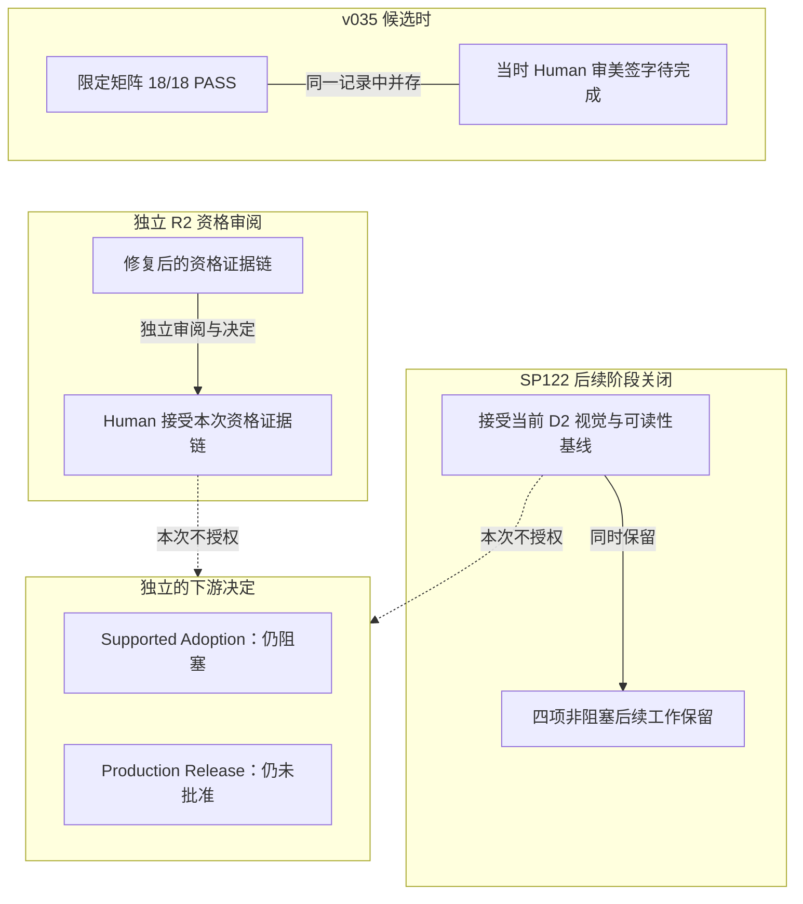
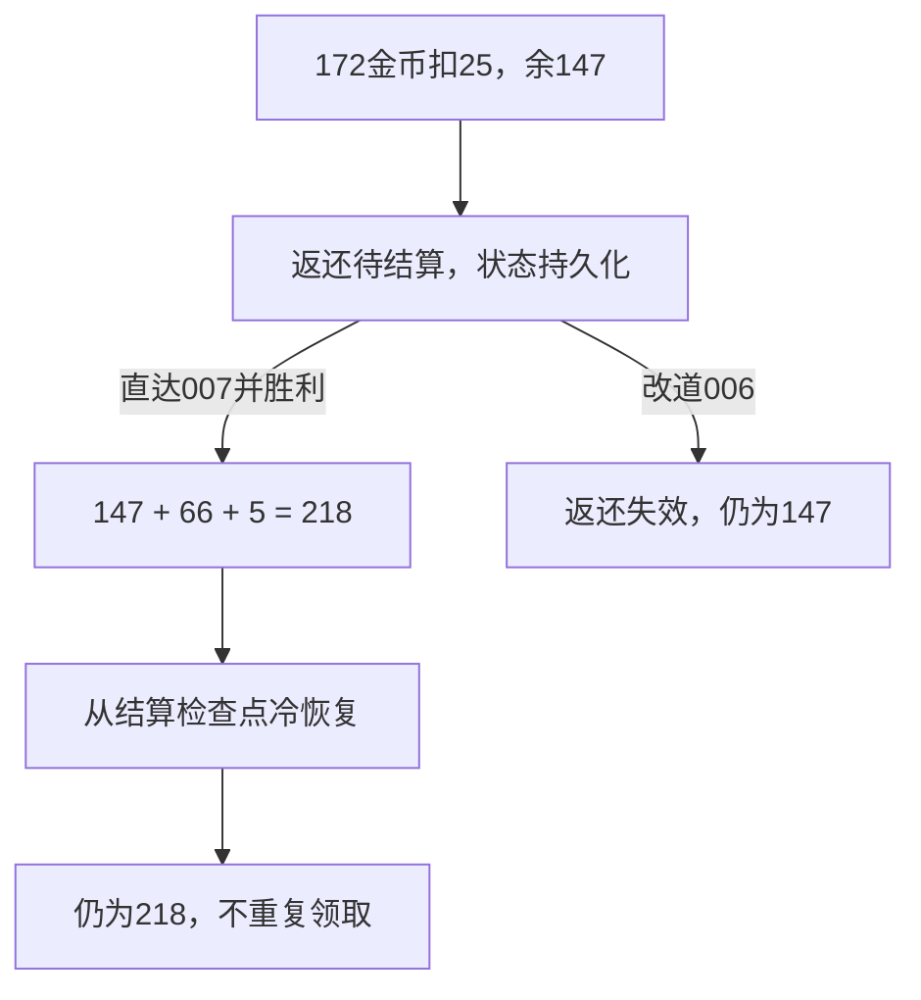

# 第23章 纵向实践：AI Game Dev OS、lessismore 与 RandomHeroes
## 从功能映射转向失败、修正与有限结论

> 工作稿状态：首轮逻辑修订稿，不替代 [全书大纲](../OringinalDocs/beyond_code_ai_native_software_engineering_outline_zh.md)。
> 回接说明：[RR-041 实施记录](../RevisedResult/RR-041_RR-040实施后书稿与配图复查.md)。
> 适用边界：本章以 AI Game Dev OS v4.94 与 lessismore SP122 为早期案例，补入三项目2026年10–11月的具名材料；这些材料共享作者、方法和反馈链，不构成独立重复验证；它不证明 AI、多 Agent 或本书模型提高了效率、质量、安全或成本表现，也不直接授权 AI Game Dev OS 的后续修改。

案例很容易被写成理论的陈列柜。

先提出一组概念，再到实践系统中寻找同名机制；只要能够找到 Intent 文档、Context
Pack、Review、Gate、Memory 或 Dashboard，就宣布理论已经落地。

这种写法能说明系统“长得像什么”，却不能说明：

- 机制是否进入了真实执行；
- 它保护了哪个决定；
- 它留下了什么可检查结果；
- 它制造了什么额外成本；
- 失败后发生了什么；
- 哪些结果被 Human 接受；
- 哪些更高层决定仍然没有发生。

本章采用另一种案例标准：

> **A case constrains a theory only when its preserved history can also show where the theory fails to explain, predict, or justify a conclusion.**

只有当一段被保存的历史也能指出理论不能解释、预测或正当化什么时，案例才真正开始
约束理论。

因此，本章不把 AI Game Dev OS 写成产品说明，也不把 lessismore 的一次视觉迭代写成
AI-native 工程的成功证明。

本章以两条互相连接、但承担不同问题的早期历史为主线：

1. lessismore SP122：机器验证、Human 视觉判断、Sprint Closure、Qualifying Evidence、
   Supported Adoption 与 Production Release 怎样被分开；
2. AI Game Dev OS v4.94：真实检查缺陷、治理活动停滞、失败尝试、范围拒绝、受限验证与
   `NON_QUALIFYING` Closure 怎样共同构成一次恢复过程。

23.12–25展开SP122，23.26–43展开v4.94；23.44在保留早期反证之后，补入三项目10–11月的限定案例。它们分别检验设计假设、隔离交付、视觉判断、证据用途、检索与压缩、治理规则及本地采用。23.11的地图列出各自入口。这些任务有不同日期、参数和接受对象，尤其30金币纸面设计与5金币返还功能不是同一方案的连续版本，SP139也不能继承SP122的关闭状态。

这组共享来源的材料最终支持的，不是“这套系统已经正确”。

从中可以提出一项更克制的当前工程建议：对于本章这类跨越 Lifecycle Stage 与
Authority Boundary、且其结果会成为后续决定输入的变化，应明确当前 Work、适用的
Authority Grant、Evidence、Decision Target 与仍未成立的结论。

---

# 23.1 先区分必要、有用与可选

## 必要

如果一个实践案例要承担书中论证，它至少需要保留：

- 被讨论的 Repository、Version、Work 与时间范围；
- Observable Fact、同期判断、事后推导和当前建议之间的区别；
- Plan、Attempt、Result、Acceptance、Adoption 与 Release 之间的区别；
- 失败、`non-result`、Open Item、Rejected Scope 和 Explicit Non-claim；
- Human 决定的对象、权限和未授权的下游动作；
- 与中心解释竞争的替代解释；
- 案例能够支持与不能支持的结论。

没有这些边界，时间线越完整，越可能只是在制造更顺滑的事后故事。

## 有用

当事件跨多个版本、角色和仓库时，下列材料通常有用：

- 版本化 Source、Transaction、Review、Runtime Result 与 Human Decision；
- 一条按事件组织的时间线；
- Case Episode 与相关理论问题的有限映射；
- 计划路径与实际路径的对照；
- 关键失败发生前后的 Artifact 差异；
- 少量真正改变判断的截图、Diff 或状态图；
- 读者可以带到其他项目中的 Transfer Questions。

## 可选

以下内容不是案例成立的必要条件：

- 展示 AI Game Dev OS 的全部功能；
- 罗列每个 Agent、Task、Thread 或 Commit；
- 把全部 Artifact 复制到书中；
- 为每个概念安排一个产品功能；
- 计算一个 AI-native 成熟度分数；
- 证明每个步骤都由 AI 或多 Agent 完成；
- 把案例扩展成企业级参考架构；
- 由本章直接生成 OS Roadmap。

案例的价值不由材料数量决定，而由材料能否约束结论决定。

---

# 23.2 本章是 Longitudinal Case，不是 Validation Claim

本章使用 **Longitudinal Case（纵向案例：沿着具名版本和事件序列观察问题、修正与决定
如何变化）**。

“纵向”只说明观察方式，不说明样本独立，也不说明结论已经被验证。

AI Game Dev OS 与 lessismore 具有三层关系：

1. AI Game Dev OS 提供 Workflow、Schema、Policy、Runtime 与治理机制；
2. lessismore 在实际游戏项目中使用其中一部分版本化机制；
3. 游戏项目与 OS 自身开发中的问题又反向影响作者对这些机制的理解。

这使两者适合解释“理论怎样从实践中长出来”。

同一关系也限制了它们的证据地位：

- 作者与方法来源重叠；
- 概念命名与系统设计互相影响；
- 两个仓库之间存在直接采用和反馈关系；
- 后来的理论可能改变作者对早期事件的解释。

因此，不能把它们写成两个独立项目对本书理论的重复验证。

更准确的定位是：

> 一组共享来源的纵向材料，用来生成概念、暴露边界、保存反例，并形成后续待验证问题。

---

# 23.3 三个相关项目承担不同的案例角色

## AI Game Dev OS

AI Game Dev OS 在本章中是方法与基础设施仓库。

它提供：

- Plan、Proposal、Review、Transaction 与 Closure；
- Context、Authority、Evidence、Gate 与 Lifecycle 结构；
- Agent Role、Handoff 和可见任务记录；
- v4.94 自身开发中的 Incident、Source、Test 和处置历史。

本章讨论的 v4.94 事件绑定当时的历史切片。

不能用后来版本已经存在的能力，倒推早期事件当时已经拥有同样的语义、实现或约束。

## lessismore

lessismore 在本章中是产品与运行时仓库。

它提供：

- Godot 游戏 Runtime；
- UI、Art、Content、Game Design 与 QA；
- PlayerStatus 和 Battle Visual 的版本化候选；
- Machine Check、Visual Capture、Manual Inspection 与 Human Experience Judgment；
- SP122 Closure 以及 v4.93 项目侧的独立 Qualifying Decision。

本章讨论的 SP122 事件只绑定当时的 D2 Battle 与 v4.93 范围。

后续 Sprint、后来视觉版本或当前仓库状态不能替代当时决定。

## RandomHeroes 与后续材料

RandomHeroes 增加了另一套产品条件：Godot结算链的经济测量、GDD整理复核，以及v4.98本机接入与恢复说明。它让本章可以比较同类问题在不同产品条件下怎样出现；共享作者与方法来源的关系仍在，不能将它自动算作独立验证。

后续材料还包括 lessismore 的说明生成、检索与治理反馈、专业设计、隔离功能交付和SP139视觉迭代，以及 DevOS 的方法对照与有限Beta分发。23.44按具名任务分别叙述，早期SP122和v4.94保留自己的时期、决定与未完成项。

## 项目之间的关系

AI Game Dev OS 是部分方法与基础设施的提供方，也保存自身开发问题；lessismore 与 RandomHeroes 提供具体产品条件和反馈。DevOS不是两个产品的外部审计机构，产品项目也不是本书理论的独立实验室。项目名称、工作树版本、候选包、本机绑定、实际使用与资格判断必须分别定位，不能用后来存在的能力补写早期历史。

---

# 23.4 案例对象不是“整个项目”

“AI Game Dev OS 项目”和“lessismore 项目”都太大，不能直接成为一个可判断的案例对象。

本章使用 **Case Episode（案例事件单元：绑定具名 Work、版本、观察结果、决定和非结论
的一段有限历史）**。

一个 Episode 至少回答：

| 字段 | 问题 |
|---|---|
| Work | 当时试图完成什么？ |
| Decision Target | 当前需要作出哪个决定？ |
| Authority | 谁能执行、审查、接受、采纳或发布？ |
| Observable Result | 实际产生了什么，什么没有产生？ |
| Contemporaneous Judgment | 当时如何解释和处置？ |
| Retrospective Inference | 现在能怎样有限解释？ |
| Counterevidence | 什么事实削弱了中心解释？ |
| Non-claim | 仍然不能推出什么？ |

这种粒度让“系统有某项功能”转化为更具体的问题：

> 这项机制在哪个 Episode 中进入了哪条路径，保护了哪个决定，又留下了什么结果？

---

# 23.5 四层叙述不能压成 Lessons Learned

每个关键 Episode 使用四种不同陈述。

## Observable Fact

**Observable Fact（可观察事实）** 是 Source、Artifact、Runtime、Test、Diff、Commit 路径或
可见 Human Decision 直接保存的内容。

例如：

- 某次验证记录了 `18/18 PASS`；
- 某个候选的 Human Aesthetic Signoff 仍然打开；
- 某次执行在 Target 启动前被 Verifier Failure 阻断；
- 某组提交只改变治理记录，没有改变 Package Source 或 Test；
- 某次 Closure 明确保持 `NON_QUALIFYING`。

## Contemporaneous Judgment

**Contemporaneous Judgment（同期判断）** 是事件发生时，Human、Reviewer 或项目记录对
结果的解释和处置。

例如：接受当前视觉基线、拒绝过度范围、把后续项设为非阻塞，或把事件记录为 Incident。

## Retrospective Inference

**Retrospective Inference（事后推导）** 是后来根据多个事件提出的解释。

例如：E2 / E3 的完整证明义务可能被过早施加给 E0 / E1 Work，从而参与形成治理停滞。

它不是当时直接观察到的因果事实。

## Current Recommendation

**Current Recommendation（当前建议）** 是本书根据事实、判断和替代解释提出的设计候选。

例如：每个 Gate 应写明自己保护的 Claim、Evidence Use 和 Decision Target。

建议可以有价值，却仍然需要新的应用和评估。

---

# 23.6 Source Identity 先于故事完整性

同一个文件名在不同 Revision 中可能代表不同状态。

同一个 `PASS` 在不同 Test Selection、Environment、Input、Package Identity 或 Decision Use
下，也不是同一个结论。

本章的历史事实在编辑证据中绑定了：

- Source Repository；
- 历史 Revision；
- Artifact Path；
- 当时的 Project / OS Version；
- Worktree 与当前编辑检查状态；
- 结果范围和 Explicit Non-claim。

正文不展开内部审计编号，也不把 Git 元数据堆给读者。

但叙述必须保留自然语言边界，例如：

- “PlayerStatus v035 的当时验证记录”；
- “SP122 的 Human Closure 决定”；
- “v4.93 post-repair R2 的独立 Human Decision”；
- “v4.94 D-073 至 D-075 的提交路径”；
- “F4a 的 bounded test selection”。

来源精度不是为了让故事更复杂。

它防止后来状态覆盖早期 Unknown，也防止当前理论替历史补写动机。

---

# 23.7 为什么游戏开发对本书有解释价值

游戏开发把多种工程表面压在同一个产品循环中：

- Source Code 与 Runtime Behavior；
- UI Layout、Art Asset 与 Visual Hierarchy；
- Game Design、Content、Balance 与 Interaction；
- Importer、Data、Localization 与 Tooling；
- Automated Test、Visual Capture 与 Manual Playtest；
- Human Aesthetic、Experience 与 Product Direction；
- 跨角色 Handoff、版本采用和发布决定。

在纯代码案例中，Test PASS 很容易被叙述成“任务完成”。

在 PlayerStatus 这类视觉对象上，机器可以检查 Geometry、Binding、状态变化和已定义回归，
但界面层级是否可接受、战斗时是否易读、交互是否符合体验目标，仍然需要具名 Human
判断。

这让一个重要边界变得可见：

> Machine Evidence 可以缩小 Human 判断面，但不能因为更结构化就自动取得体验、范围、
> 采用或发布 Authority。

游戏开发因此是高解释密度场景。

“高解释密度”不等于“覆盖所有软件工程”。

---

# 23.8 游戏案例不能覆盖什么

本章材料不能代表：

- 医疗设备或临床决策；
- 金融交易与受监管模型；
- 公共基础设施；
- 大型企业多层审批与劳动关系；
- 不同法域中的 Privacy、Copyright 或 Liability；
- 独立团队采用 AI-native Workflow 的组织效果；
- 大规模用户研究中的体验偏好；
- 长期运维、灾难恢复和生产安全。

它也不能证明游戏开发“比所有行业更复杂”。

复杂性没有单一尺度。

游戏项目突出了视觉、体验、内容和多专业协作；其他领域可能在安全后果、合规、数据权利、
长期维护或不可逆影响上更难。

所以本章只把游戏案例用于暴露控制关系，不把它当成全行业代理样本。

---

# 23.9 为什么原“理论概念 → OS 功能”映射会循环支持

原稿将本书概念与 AI Game Dev OS 功能逐项对应：

| 原概念 | 原对应设计 |
|---|---|
| Intent Engineering | Doc as Intent |
| Truth Architecture | Code as Truth |
| Context Engineering | Context Packs |
| Agent Organization | Controller / Lead / Worker |
| Verification | Review Agent + Evidence-driven DoD |
| Governance | Gate + Automation Default Off |
| Traceability | Registry + Handoff |
| Memory | LTM |
| Evolution | Self-Evolution |
| Cognition | Change Summary、Risk Map、Decision Surface |
| Observability | Timeline、Dashboard、Checkpoint |
| Reliability | Branch、Worktree、Sandbox、Rollback |

问题不是这些机制不存在。

问题是概念和系统来自同一实践演化链，再用名称相似证明理论，会形成循环：

~~~text
experience produces a concept
→ concept influences OS terminology and design
→ OS contains similarly named mechanism
→ mechanism is used to validate the concept
~~~

这个循环最多证明设计意图一致，不能证明运行效果、边界充分或理论普遍有效。

---

# 23.10 同名机制不等于同一工程关系

原映射需要逐项收窄：

| 机制 | 可以说明 | 不能自动说明 |
|---|---|---|
| Intent Document | 有记录 Intent 的表面 | 文档取代 Human Intent Owner 或 Authority |
| Code | Implementation State 的重要来源 | Code 是全局 Truth |
| Context Pack | 有选择和传递上下文的容器 | 内容为真、选择正确或 Agent 实际使用 |
| Controller / Lead / Worker | 有角色标签或分工候选 | Work 可分解、Authority 清楚或组织有效 |
| Review / DoD | 有检查与完成条件 | Finding 已被接受、采纳或发布 |
| Gate | 有阻断或条件判断点 | Governance 完整、相称或低成本 |
| Registry / Handoff | 有部分外部记录 | 决策环境完整或责任已经建立 |
| LTM | 有持久存储 | 记忆适用、被采用或改善行为 |
| Self-Evolution | 系统可产生变化候选 | 变化是 Improvement |
| Summary / Dashboard | 有压缩和投影 | Human 已理解、Coverage 完整或 Authority 正确 |
| Branch / Sandbox / Rollback | 有隔离与恢复机制 | 边界足够、恢复可用或系统可靠 |

本章不再问：“OS 是否实现了书中概念？”

它改问：

> 哪个具名 Episode 中，什么机制真实进入了工作路径，支持了什么决定，付出了什么成本，
> 又留下了什么失败和非结论？

---

# 23.11 新 Case Map 映射 Episode，不映射理论名称

| Case Episode | 可观察机制或结果 | 相关问题 | 可以支持 | 不能支持 |
|---|---|---|---|---|
| PlayerStatus v035 | 实现、自动检查、Visual Capture、Human Gate Pending | Machine Evidence / Human Decision | 两种判断面可以分开 | v035 最优 |
| SP122 Closure | Human 接受当前基线并保留四项 Follow-up | Scope / Closure | Closure 可保留 Open Item | Final Art 或 Production Approval |
| v4.93 R2 | Authority Repair、Qualifying Package、Human Decision | Evidence Use / Adoption | Evidence 接受可与 Adoption 分开 | 全流程必要或高效 |
| D-048 | Verifier Self-mutation、Target `non-result` | Evidence Generation | Observer Integrity 与 Target Result 分开 | 所有 Tool 必须零副作用 |
| D-073–D-075 | Meta-only successors、Delivery Evidence 未出现 | Governance Economics | Activity 与 Delivery Result 分开 | Governance 普遍无效 |
| D-079 | 42 tests PASS、Scope Rejected、Forward Correction | Evidence / Acceptance | Test Result 与 Scope Acceptance 分开 | 测试越少越好 |
| F1–F4a | Source、Replay、Identity、48 PASS、`NON_QUALIFYING` | Lifecycle / Qualification | Development Closure 与 Qualification 分开 | Production Readiness |

早期两条主线保留完整时间线。下面的近期案例按所回答的问题组织，入口位于23.44的独立小节；第16、20章负责方法比较与测量的完整推演，本章只回接其对历史结论的影响。

| 近期案例及时间 | 本章入口 | 主要问题 | 仍未成立的结论 |
|---|---|---|---|
| 专业设计，11月1日 | 23.44.2 | 纸面购买门槛在项目校准后是否仍成立 | 30金币方案已落地或改变实际玩家选择 |
| REWARD-FU05，11月19日 | 23.44.3、图23-2 | 直达、改道和冷恢复能否分别检查 | 已合入主项目或完成持续观察 |
| SP139近期视觉工作 | 23.44.4 | 方向、接入、技术检查与体验接受如何分开 | Sprint已关闭或美术普遍提效 |
| CardInformation，10月27日 | 23.44.5 | QA适用性失败该阻断哪个对象 | 所有治理失败都不影响产品 |
| OBS16–18检索与11月GDD复核 | 23.44.6；详见第12、15章 | 找回与整理后能否回答原问题 | 全量召回或文档权威冲突已解决 |
| 日常开发规则，10月25日 | 23.44.7；方法见第21章 | 复用、重跑与停止条件具体改了什么 | 已减少实际总成本 |
| 11月方法对照与产品测量 | 23.44.7、23.56；详见第16、20章 | 有限差异能支持多大结论 | 完整流程的持续收益 |
| v4.98 Beta与本地绑定，11月 | 23.44.8；详见第22章 | 分发、绑定与正式资格是否分别成立 | 后来的能力改写早期资格 |

两张表用于限定每个Episode承担的问题，不把不同任务拼成一条持续成功的历史，也不构成评分表。

---

# 23.12 SP122 的问题不是“让 AI 做一个 UI”

PlayerStatus 是战斗界面中的状态表面。

它涉及布局、资源绑定、状态显示、消耗品交互、视觉层级和战斗可读性。

如果把 Work 写成“AI 优化 Player Status UI”，至少有五个问题被隐藏：

1. 优化针对哪一版候选和哪一个场景；
2. 几何、绑定和状态回归由什么检查；
3. Visual Capture 能说明什么；
4. 谁决定视觉和体验是否可接受；
5. 当前接受是否同时意味着最终美术、系统采用和生产发布。

SP122 更准确的问题是：

> 一个同时包含 Runtime、Visual、Machine Check 与 Human Aesthetic Judgment 的 Work，
> 怎样在当前阶段被接受，同时保留 Follow-up 和更高层 Adoption / Production 边界？

这个问题不依赖“AI”是否出现在任务标题中。

它关注的是结果和决定的边界。

---

# 23.13 原十三步 Workflow 只能作为重构说明

原稿给出了一条很整齐的路径：

~~~text
Human Intent
→ Controller
→ Git State
→ Context Pack
→ Plan Review
→ Worker
→ Checkpoint
→ Review Agent
→ Cognition Layer
→ Human Visual Decision
→ Merge
→ Decision / Memory
→ Skill / Pack Update
~~~

这可以作为候选 Lifecycle 的说明图，却不能写成 SP122 已经按顺序发生的事实。

现有历史支持的是一条更不整齐的关系：

~~~text
scoped visual work
→ multiple candidates and bounded checks
→ runtime / visual evidence while Human aesthetic gate remained open
→ an authority defect preserved and repaired
→ Human current-stage closure of the repaired baseline with four follow-ups
→ separate post-repair qualifying run
→ Human accepts qualifying evidence
→ adoption and production remain blocked
~~~

差异很重要。

它说明：

- Plan 不是 Actual Path；
- Role Label 不是 Participation Evidence；
- Merge 不是 Acceptance；
- Sprint Closure 不是自动 Memory Promotion；
- Qualifying Evidence 不是 Supported Adoption；
- Human Decision 不是把所有下游 Gate 一次性打开。

---

# 23.14 PlayerStatus v035：机器结果先于 Human 视觉决定

PlayerStatus v035 的当时记录包含：

- 已提交实现；
- 绑定和几何边界；
- `18/18 PASS` 的限定验证矩阵；
- 非 Headless 的 Visual Capture；
- Manual Inspection；
- Human Aesthetic Signoff 仍然打开；
- 正式多 Potion Lifecycle 仍是独立问题。

这里可以观察到三个不同结果面：

| 结果面 | 当时可以说什么 | 当时不能说什么 |
|---|---|---|
| Machine Check | 被选择的检查通过 | 所有行为和视觉都正确 |
| Visual Capture / Inspection | 具名场景被捕获和人工查看 | 视觉方案已由有权 Human 接受 |
| Human Gate | 决定仍待完成 | 机器 PASS 自动填补该决定 |

因此，v035 不是“自动验证后完成的 UI”。

它是一个机器可检查部分已经形成、但 Human 视觉决定仍未完成的候选。

---

# 23.15 `18/18 PASS` 只属于被选择的 Claim

数字具有压缩力。

`18/18 PASS` 很容易被读成“全部通过”。

但分母 18 只代表当时被纳入矩阵的 18 个检查，不代表所有可能的：

- 分辨率与设备；
- 游戏状态；
- Potion 组合；
- 动画与输入时序；
- 视觉偏好；
- 玩家群体；
- 长期维护条件。

正确表述是：

> 在具名版本、环境与选定矩阵内，18 项检查产生 18 项 PASS；Human Aesthetic Signoff 和
> 其他未纳入问题仍保持独立。

这不是削弱测试价值。

它使 Test Result 保持可用，而不让结果承担不属于自己的 Acceptance Authority。

---

# 23.16 Visual Capture 不是 Aesthetic Acceptance

截图和 Contact Sheet 可以支持：

- 当前候选被运行并产生可见输出；
- 某些布局、遮挡或状态差异可以被比较；
- Human 不必重新阅读全部 Source 才能进入视觉判断；
- Review 可以绑定具体版本和场景。

它们不能单独支持：

- 界面美观；
- 战斗中始终易读；
- 玩家偏好一致；
- 视觉风格已经最终批准；
- Production Art 已完成；
- 运行时所有状态都被覆盖。

Visual Capture 是 Human Decision Interface 的输入，不是 Human 决定的替代物。

它的价值取决于场景选择、版本绑定、缺失状态和呈现方式。

---

# 23.17 SP122 Human Closure 接受的是当前阶段基线

后续 SP122 Human Closure 接受了当前 D2 Battle 的视觉与可读性基线，其中包括
PlayerStatus v035 和 lifecycle-tag repair。

同一决定保留了四项Non-blocking Follow-up，具体内容及后续方向见23.18。

在这次记录中，当前阶段被接受、四项后续工作保留以及更高层决定未获授权，可以同时成立。图23-1把这些决定对象分别画出。

Closure 在这里不是“所有工作已经完成”。

它是有权 Human 对一个有限 Scope 的处置。

这个处置没有同时批准：

- Final Production Art；
- 当时尚未独立完成的 Qualifying Provenance；
- v4.93 Supported Adoption；
- Production Release；
- v4.94 Kickoff。

---

# 23.18 四个 Follow-up 不是 Closure 的反证

[SP122的关闭记录](../Evidence/receipts/ER-20260827-001__CLM-C23-001.md)没有只留下“四项”这个数量，还给出了具体遗留问题和后续方向：

| 当时保留的后续项 | 保存的接手方向 |
|---|---|
| 药剂焦点提示的一致性（Potion focus Tooltip parity） | 后续有范围的可访问性任务 |
| 旧CardFace冒烟检查需要更新 | QA维护任务 |
| 拖拽测试夹具的非确定性 | QA维护任务 |
| 最终修订的悬停、选中与奖励返回视觉绑定 | 下一项相关Battle视觉任务 |

这些是当时Human针对当前D2范围判断为非阻塞的剩余项，不是本章推导出的通用风险等级。关闭接受当前阶段基线，同时把可访问性、检查维护和后续视觉工作交回各自任务；它没有宣称这些问题已修复，也没有替采用或发布决定补签授权。

读者因此能看到具体交接：例如拖拽夹具的不确定性被保留为QA维护工作，而不是在关闭时从记录中消失。原件没有逐项展开完整的风险论证，本章也不补造理由。另一项目中的同类问题是否阻塞，仍须按其当前Claim、风险、Authority和Decision Target判断。

---

# 23.19 一个 `closed` 不能覆盖多种 Decision State

把“测试通过”“阶段关闭”和“资格证据接受”放在同一条升级线上，会让读者误以为前一步自动产生后一步。SP122 的记录需要按不同对象读取。

## 图23-1 同一案例保留不同决定对象

*历史关系简图，依据[SP122 两次有范围的人类决定记录](../Evidence/receipts/ER-20260827-001__CLM-C23-001.md)。无箭头连线表示并存，实线箭头表示具名处置关系，虚线表示该决定不产生下游授权；分组位置不复原全部执行步骤。早期未完成的审美签字不会被后来的接受回填。阶段关闭所接受的是包含 v035 与 lifecycle-tag repair 的当前 D2 基线，还明确排除了最终 Production Art 与 v4.94 Kickoff。*

沿图阅读时，先选择想回答的问题。若问“v035 当时是否已获视觉接受”，应看候选记录中的待完成状态；若问“当前 D2 阶段是否后来关闭”，才看阶段关闭记录。R2 接受的是修复后的资格证据链，不能画成阶段关闭自动带来的下一等级。

将这个读法用于一次实际交接，可以按以下顺序处置：先确定这次要决定的对象，再找对应版本的证据与有权决定；缺少相应决定就保留待决或阻塞，而不是借用邻近的 PASS。已有接受仅在具名范围内使用，四项后续工作仍应有自己的接手与跟踪入口。这是从案例提出的使用建议，不是对 SP122 每一步实际操作的重演。

如果只保留一个 `closed = true`，这些关系会全部丢失。

第21章把 Lifecycle 改成状态迁移网络，正是为了避免这种压缩。

本案例没有证明该网络模型完备，却说明单一完成状态不足以表达这段历史。

---

# 23.20 lifecycle-tag 问题说明 Authority 也有历史

后续 Authority Review 保存了一段不理想的历史：早期存在冲突来源，一条旧的实现影响
进入了当前运行路径；项目后来选择 Human-approved Source Chain，完成 Repair，并把当前
Authority 重新绑定到修正后的来源。

可以观察到的是：

- 冲突来源和历史影响被保存；
- Repair 发生；
- 后续审查把当前来源判断为已解决；
- 后续 qualifying task 使用修正后的 Authority Chain。

不能观察到的是：

- 一个 Authority Audit 可以发现所有冲突；
- 冲突没有留下任何未观察影响；
- 所有 UI Work 都需要同样复杂的 Authority Review；
- Repair 自动使其他 Evidence 重新有效。

Authority 不是文件是否存在。

它还包含哪个版本、在哪个 Scope、被谁授权、何时失效，以及历史冲突怎样影响当前判断。

---

# 23.21 Repair 不能静默覆盖原 Evidence

当 Authority-bearing Source 被修正时，有三种错误处理：

1. 假装旧版本从未影响运行；
2. 用修正后结果覆盖旧 Evidence；
3. 把所有旧 Evidence 一律删除。

SP122 的更有价值做法是保留事件关系：

~~~text
historical authority conflict
→ observed influence
→ selected current authority
→ repair
→ post-repair evidence generation
→ separate Human Decision
~~~

这使旧结果可以继续作为“历史上发生了什么”的 Evidence，同时不再被当成“当前正确
Authority 下的 qualifying result”。

一般化建议应保持有限：

> 当 Authority Change 可能改变 Claim 输入时，项目应识别哪些旧 Evidence 仍支持历史
> 事实，哪些需要重新生成，哪些只能标记为不适用于当前决定。

---

# 23.22 v4.93 R2 是另一个 Decision Target

在 SP122 current-stage Closure 之后，项目进行了独立的 post-repair qualifying R2。

该记录包含：

- 修正后的 Authority Chain；
- 受限计划和可见工作分工；
- 机器检查与 Result Manifest；
- Human 对 qualifying evidence chain 的明确处置；
- Adoption 与 Production 的 Explicit Boundary。

Human 接受了 R2 的 qualifying evidence chain。

这个接受没有追溯性地把早先 Sprint Closure 改写成 qualifying acceptance，也没有同时
批准 Supported Adoption 或 Production Release。

因此有两次不同的 Human 决定：

1. 当前 D2 Battle 视觉与可读性范围是否可以关闭；
2. post-repair qualifying evidence chain 是否可以接受。

相同 Human 参与不使两个 Decision Target 合并。

---

# 23.23 Qualifying Evidence Accepted 不等于 Supported Adoption

一个 Evidence Package 可以被接受为：

- 来源可定位；
- 计划与结果可重建；
- 机器检查满足声明范围；
- Human Review 已完成；
- Explicit Non-claim 被保存。

这仍然不必然回答：

- 是否应成为默认项目路径；
- 迁移成本是否可接受；
- 备份与恢复是否足够；
- 团队是否准备采用；
- 长期维护与退出路径是否成立；
- 是否允许进入 Production。

SP122 R2 保持 Supported Adoption blocked、Production not approved。

这不是一次失败的 qualifying decision。

它是 Evidence Use 被限制在当前 Decision Target 的结果。

---

# 23.24 SP122 的四层结论

## Observable Fact

PlayerStatus v035 有限定 Machine / Runtime / Visual Evidence；当时 Human Aesthetic Gate 仍
打开。后续 Human 接受当前 D2 Battle 基线并保留四项 Follow-up；独立 R2 又接受修正后的
qualifying evidence chain，而 Adoption 与 Production 继续分开。

## Contemporaneous Judgment

Human 判断当前阶段视觉与可读性范围可接受，也判断 R2 qualifying evidence chain 可接受；
两个决定均明确限制了下游含义。

## Retrospective Inference

这段历史可以说明 Machine PASS、Human Aesthetic Acceptance、Sprint Closure、Qualifying
Evidence Acceptance、Supported Adoption 和 Production Release 是不同 Decision Target。

## Current Recommendation

对于同时包含机器检查与 Human Experience Judgment 的 Work，应为每个决定分别记录
Scope、Authority、Evidence Use、Open Item 和下游 Non-claim。

四层彼此相关，但不能合并为“AI Game Dev OS 成功完成了 UI 优化”。

---

# 23.25 SP122 明确不能支持什么

SP122 不能支持以下结论：

- PlayerStatus v035 是最终或普遍最优 UI；
- `18/18 PASS` 覆盖了所有体验与运行状态；
- 原十三步 Workflow 按顺序完整执行；
- 多 Agent 是结果成立的必要原因；
- AI 提高了开发速度、质量、安全或成本表现；
- 四项 Follow-up 一定应该非阻塞；
- Qualifying Manifest 中每个字段都不可缺少；
- 同一 Workflow 适合所有游戏或软件项目；
- Human Review 必须介入每个低风险步骤；
- 当前视觉接受等于最终玩家偏好。

常规 UI / QA 流程同样可以使用 Plan、Screenshot、Test、Review 与 Scoped Closure。

没有匹配的对照过程，本案例不能把结果归因给 AI-native 方法。

---

# 23.26 v4.94 的案例对象是 OS 自身开发过程

第二条案例不再讨论“AI Game Dev OS 有哪些功能”。

它讨论 v4.94 如何开发自己。

这会暴露一个特殊风险：

> 一个用于治理开发的系统，在开发自身治理能力时，既是被修改对象，又提供部分计划、
> 审查、证据和处置语言。

因此必须防止两类循环：

1. 因为治理 Artifact 很完整，就把治理效果视为已证明；
2. 因为后续 Closure 成立，就把早期全部设计选择解释为正确铺垫。

v4.94 的时间线必须同时保留：真实缺陷、meta-only successor、失败执行、过度范围、
受限 PASS 和未完成 Qualification。

---

# 23.27 v4.94 时间线概览

~~~text
D-048
verifier self-mutation
target not observed
        ↓
D-073–D-075
governance / proof obligations expand
package source and test evidence do not appear
        ↓
D-076
scoped and retractable recovery candidate
        ↓
D-077
two confined execution attempts fail with SIGABRT/-6
        ↓
D-079
selected tests pass
candidate rejected as over-scoped
smaller forward correction becomes baseline
        ↓
F1–F4a
source freeze → read-only replay → package identity → 48/48 bounded PASS
        ↓
development closure remains NON_QUALIFYING
~~~

箭头表示历史先后和后续关系，不表示每一步单独造成下一步。

它也不表示恢复路线从 D-076 开始后一直成功。

---

# 23.28 D-048：Verifier 先改变了自己要检查的表面

D-048 的目标原本是运行一个 Target Compile Harness。

在 Target 执行前，本地 Import 产生了 Python bytecode 文件，改变了具有 Authority 意义的
Closed Inventory。

第二次 Exact-inventory Check 按设计 Fail Closed。

因此这次运行产生了两个不同结论：

- 关于 Verifier / Launcher：发生了 Self-mutation，完整性检查捕获了变化；
- 关于 Target：Target 没有执行，没有 Compile PASS，也没有 Compile FAIL。

后者应记录为 `non-result`。

如果把整个 Attempt 只写成 `FAIL`，读者会误以为 Target Compile 失败。

如果把失败前的准备步骤视为无关，又会漏掉 Verifier 自身改变 Authority-bearing Surface
这一真实缺陷。

---

# 23.29 D-048 的反证：严格检查在这里有真实价值

后续治理停滞不能被用来推导“严格检查没有价值”。

D-048 恰好提供反向证据：Exact-inventory Check 检测到了真实 Self-mutation。

需要修正的不是“所有严格检查”，而是：

- Verifier 的副作用边界；
- Target Observation 是否发生的记录方式；
- 失败结果属于 Verifier 还是 Target；
- 哪些输出是已声明且隔离的正常产物；
- Corrective Run 是否需要重新生成 Target Evidence。

因此，本书采用有限建议：

> 当 Verifier 在观察前阻断 Target，或改变 Authority-bearing Input / Surface 时，
> Evidence Generation Integrity 与 Target Observation Result 必须分开记录。

这不要求所有测试工具绝对零副作用。

已声明、被隔离、不会改变 Claim 输入的输出可以是正常行为。

---

# 23.30 从局部缺陷到全局义务，范围可能扩张

D-048 提出的是一个具体问题：Launcher / Verifier 在目标运行前改变了自己的受控清单。

后续修正如果逐渐扩展为：

- 所有可能环境都要先证明；
- 所有 Qualification 条件都要在开发早期关闭；
- 每个后继任务都要新增 Proposal、Review 与 Transaction；
- 还未形成 Source 的候选先承担完整 Gate Proof；

治理对象就可能从“修复具体 Observer Boundary”变成“提前证明整个系统可资格化”。

这不是 D-048 记录直接证明的因果链。

它是后来根据任务路径提出的范围解释。

关键问题是：当前控制仍在保护原来的 Claim，还是已经转而要求另一个生命周期阶段的
结论？

---

# 23.31 D-073 至 D-075：Activity 增加，Delivery Evidence 没有出现

v4.94 的 D-073、D-074 和 D-075 是连续 successor。

它们的版本历史显示：

- Governance、Proposal、Review 和 Transaction Artifact 持续增加；
- Package Source 与 Test Path 没有相应变化；
- Runtime、Qualification 或 Gate Evidence 没有形成；
- D-075 最终保存了 `0 blocker / 5 major / 0 minor` 的 Review Union。

可观察事实是“路径类别与结果类别发生了这种分离”。

项目后来把这段序列记录为 Governance Livelock Incident。

“Livelock”是项目的事后诊断，不是 Git History 自带的事实标签。

更克制的表述是：

> 连续治理活动扩大了证明面，却没有在该序列中形成 Package Source、Runtime、Test、
> Qualification 或 Gate Evidence。

---

# 23.32 Meta-only 不等于没有价值

“没有 Source Delta”不等于“没有任何有用思考”。

D-073 至 D-075 可能产生：

- 更清楚的风险识别；
- 约束冲突的暴露；
- 后续恢复计划需要的语言；
- 对 Qualification Surface 的提前理解；
- 对 D-048 真实问题的保守保护。

问题不在于文档或审查本身无价值。

问题在于当前 Decision Target 如果是形成一个可运行、可观察的 Development Candidate，
那么治理活动是否持续推迟了能产生该类 Evidence 的动作。

因此需要同时问：

| 问题 | 不能用什么替代 |
|---|---|
| Governance Artifact 有何信息价值？ | 不能由 Source Delta 数量否定 |
| 当前 Work 是否形成目标结果？ | 不能由 Artifact 完整度替代 |
| 控制是否仍与当前 Stage 对齐？ | 不能由“安全更重要”直接回答 |
| 是否应收窄控制？ | 不能由一次停滞自动决定 |

---

# 23.33 Governance Livelock 是解释，不是单因果事实

项目将这段历史解释为：E2 / E3 的完整 Proof Obligation 被过早施加给 E0 / E1 Development
Work，Stage Coupling 参与形成停滞。

这个解释与事件序列相容。

它仍然不是唯一解释。

替代解释包括：

- Work Scope 原本仍不清楚；
- D-048 暴露的缺陷需要比预期更深的修复；
- 团队对 Package Boundary 的理解仍在形成；
- Human Authorization 在后期发生变化；
- 后续成功利用了前期累积知识；
- Source 开发本身具有尚未暴露的难度；
- 记录粒度放大了“治理活动”的可见性，却低估了隐含设计工作。

所以本章保留“治理活锁”作为有用诊断名，不把它写成已证实的唯一 Root Cause。

---

# 23.34 D-076：恢复路线被定义为 Scoped and Retractable

后续 Function-first 计划把开发与资格化证据用途分层。

**Function-first（功能优先：先形成受限、可运行、可观察的 Development Candidate，再按
具名阶段追加相称证明）** 在这里不是“先写代码、以后再管安全”。

计划仍保留 Safety Envelope，但尝试把不同 Evidence Use 分开：

- Development Spec；
- Safety Envelope；
- Qualification Lock；
- Run Evidence。

D-076 被当作一个 Scoped、Retractable 的 Architecture Candidate。

这两个限定词很重要：

- Scoped：不声明替代全部 Governance；
- Retractable：如果后续结果不支持，可以撤回或修正。

计划本身不授权结果，也不证明路线有效。

它只记录了当时准备怎样改变工作顺序和证明面。

---

# 23.35 D-077：架构拆分后仍然失败

如果只从 D-076 直接跳到最终 Closure，会形成一条顺滑成功链。

D-077 破坏了这条故事。

在架构拆分之后，两个受限执行 Attempt 仍以 `SIGABRT/-6` 结束。

这说明：

- Stage Split 没有让所有执行立即成功；
- Recovery Plan 不是执行结果；
- Safety Envelope 的存在不等于 Runtime 已稳定；
- 后续形成 Evidence 不能把早期失败删除。

D-077 也限制了“Function-first 是恢复原因”的说法。

如果同一路线内部仍出现失败，就需要进一步解释：后续改变了 Scope、Environment、Source、
执行方式、Human Direction，还是只是完成了更多调试？

现有材料不足以把这些因素分离成因果权重。

---

# 23.36 D-079：42 个通过测试仍未获得 Source Scope Acceptance

D-079 的一个候选通过了 42 个 Focused Tests。

Human 没有因为测试通过就接受该候选为 E1 Source Baseline。

当时的处置认为它把 E2 / Gate-level 的 Schema Mirroring 和更大验证面带进了低风险 E1
Slice，因而属于 Over-scoped Candidate。

随后形成了较小的 Forward Correction，保留 8 个 D-079 Regression Cases，并进入后续
F1 Source Ancestor Chain。

这里至少有三个独立判断：

| 判断 | 结果 |
|---|---|
| Selected Behavior Tests | 42 项通过 |
| Candidate Scope | 未被接受 |
| Forward Correction | 成为后续 Development Baseline 的祖先 |

测试没有失败。

不成立的是从“42 项具名测试在该次运行中通过”直接跳到“实现范围应该被接受”的推论。

---

# 23.37 D-079 不证明较小实现长期更好

版本差异显示，Over-scoped Candidate 增加了较大实现和测试表面；Forward Correction 又删除
了其中大量内容并保留较小回归集。

这些差异可以作为 Scope Signal。

它们不是独立的质量指标。

不能由此推出：

- 行数更少一定更正确；
- 测试更少一定更高效；
- 被删除的验证永远不需要；
- Forward Correction 的长期缺陷成本更低；
- Human Scope Judgment 在其他项目也应相同。

被删除的某些检查可能在 E2 Qualification 阶段重新变得适当。

本案例支持的窄结论是：

> D-079 的具名 Test PASS 只在该次运行及其绑定范围内，为相应编码断言提供有范围
> Evidence；它不能单独完成 Source-scope Acceptance、Adoption 或 Release Authorization 决定。

---

# 23.38 F1：先冻结 Development Source

后续路线的 F1 先形成并接受一个具名 Source Freeze。

“冻结”在这里不表示 Source 永久不变。

它表示后续 F2、F3 和 F4a 可以绑定同一 Package Subtree，减少测试对象在验证期间静默变化。

F1 可以支持：

- 当前 Development Source Identity；
- 后续 Replay 与 Test 的输入边界；
- Diff 和 Ancestor Relation 的重建。

F1 不能支持：

- Runtime Behavior 已正确；
- Qualification 已完成；
- 迁移、备份和恢复已验证；
- Production Adoption 已批准。

Source Freeze 是后续观察的前提之一，不是完成证明。

---

# 23.39 F2：Read-only Replay 观察项目侧使用

F2 将 Source 放入只读项目 Replay 中观察。

Read-only 的价值在于限制观察过程反向修改被观察项目或 Package Source。

它可以支持：

- 具名 Project Context 下的有限执行结果；
- Input、Package 和 Replay Environment 的关系；
- Verifier 与 Target Boundary 的更清楚分离。

它仍然不能支持：

- 所有项目都可迁移；
- 所有 Runtime Path 都被覆盖；
- Production Environment 等同于 Replay Environment；
- 项目 Adoption 已经发生。

Read-only 是观察边界，不是外部有效性证明。

---

# 23.40 F3：Package Identity 连接 Source 与 Result

如果一个 Test Result 不能说明自己针对哪个 Package，它的复用价值会迅速下降。

F3 形成 Package Identity，用来把：

- Source Freeze；
- Replay Input；
- Test Selection；
- Closure Result；

绑定到同一开发对象。

Identity 能减少“测试的是不是同一版本”的歧义。

它不能回答：

- Package 是否适合目标组织；
- 所有 Dependency 是否可信；
- Artifact 是否取得发布 Authority；
- 后续 Drift 是否仍在边界内。

Identity 是 Trace 的必要组成之一，不是完整 Supply-chain、Security 或 Adoption 结论。

---

# 23.41 F4a：`48/48 PASS` 是 Bounded Evidence

F4a 收集了 48 项限定测试，并记录 `48/48 PASS`。

这个结果比“测试通过”更有意义，因为它与 F1 Source、F2 Replay 和 F3 Package Identity
形成了可定位关系。

它仍然必须带着分母边界阅读：

- 48 是被选择的测试集合；
- PASS 只为这 48 项具名测试的编码断言在该次运行中提供有范围 Evidence；
- 未纳入的 Historical Qualification、Migration、Backup / Recovery、F4b、PC-0 与完整
  Gate 仍然不在结果内；
- 测试结果没有自动产生 Production Adoption。

F4a 的价值来自“有限但清楚”，不是来自数字足够大。

---

# 23.42 `NON_QUALIFYING` 不是失败标签

最终 Development Closure 明确保留 `NON_QUALIFYING`。

这表示：

- F1–F4a 的 Development Evidence 可以被接受；
- 当前开发范围可以关闭；
- Qualification 所需的其他证明没有被假装完成；
- Production 与 Gate Claim 没有被借用 `48/48 PASS` 宣布成立。

`NON_QUALIFYING` 不是“所有工作失败”。

它是一条用途边界。

同样，`PASS` 也不是“整个系统成功”。

两者可以同时成立：

~~~text
bounded development evidence = accepted
qualification claim = not made
production adoption = not approved
~~~

---

# 23.43 v4.94 的四层结论

## Observable Fact

D-048 的 Verifier 在 Target 前发生 Self-mutation，Target 没有被观察；D-073 至 D-075
连续产生治理类 Artifact 而没有形成 Package Source / Test Delta；D-077 有两次受限失败；
D-079 出现 Test PASS 与 Scope Rejection；F1–F4a 最终形成受限 Development Evidence 并
保持 `NON_QUALIFYING`。

## Contemporaneous Judgment

项目确认 D-048 的完整性缺陷，后来把 D-073 至 D-075 记录为治理活锁，把 D-076 路线
定义为 Scoped / Retractable，并由 Human 拒绝 D-079 的过度范围。

## Retrospective Inference

不同 Lifecycle Stage 的 Proof Obligation 被耦合，可能参与形成 Delivery Evidence 停滞；
后续恢复也可能同时受 Scope 收窄、知识累积与 Human Authorization 变化影响。

## Current Recommendation

Gate 与 Review 应声明当前保护的 Claim、Stage、Evidence Use 和 Decision Target；在保留
Protected Floor 的同时，对失配的治理表面进行收窄、拆分、延后或重新设计。

---

# 23.44 早期反证与近期限定案例

## 23.44.1 早期恢复仍需保留反向证据

如果删掉反向证据，这段历史会被写成：

> 治理太重导致停滞，Function-first 解决问题，最终 48 项测试通过。

现有材料不支持这么强的因果链。

必须同时保留：

1. D-048 的严格检查捕获了真实 Self-mutation；
2. D-077 在架构拆分后仍然失败两次；
3. Lean Governance Activation 没有独自阻止后续 Over-scope；
4. D-079 的小实现进入后续 Baseline，不证明长期更优；
5. F1–F4a 保持 `NON_QUALIFYING`；
6. 没有 Old / New Workflow 的匹配时间、返工、缺陷、Human Waiting 或成本对照；
7. Narrower Scope、Accumulated Knowledge 与 Changed Human Direction 都可能参与恢复；
8. Function-first 可能把一部分证明义务推迟成后续 Qualification Debt。

因此可以保留“阶段耦合是一个有解释力的贡献因素”，不能写成唯一 Root Cause。

## 23.44.2 专业设计先检查哪些假设真的成立

11月1日的一项 lessismore 专业设计任务，从“怎样让额外奖励改变路线选择”出发。纸面候选把定点胜利奖励设为30金币。要看出这30金币做了什么，必须先把[保存的纸面计算](../Evidence/receipts/ER-20261122-006__CLM-C23-002.md)还原为一组明确假设。

设初始生命10、上限12、金币5。普通路线N经过入口商店、普通战，再到汇合商店，战斗损失3生命并收入10金币；精英路线E损失8生命并收入18金币，也到同一汇合商店。拒绝提案立即获得20金币；接受则放弃这20金币，只有目标精英胜利才额外得到30。纸面商店保证有50金币的提升商品，以及20金币恢复6生命、受上限约束的治疗。比较者被假设为依次优先存活、取得提升、保留生命、保留金币；这是设定的偏好，不是玩家行为测量。

把终点统一到**汇合商店购物结束**，本组选择如下：

| 选择 | 到达汇合商店时（生命，金币） | 购物后的比较结果 |
|---|---|---|
| 拒绝→N | `(10−3, 5+20+10) = (7,35)` | 治疗后12生命、15金币，无提升 |
| 拒绝→E | `(10−8, 5+20+18) = (2,43)` | 买不起提升；治疗后8生命、23金币 |
| 接受→N | `(7, 5+10) = (7,15)` | 买不起提升或治疗，仍为7生命、15金币 |
| 接受→E | `(10−8, 5+18+30) = (2,53)` | 买提升后2生命、3金币，取得提升 |

给定上述偏好，拒绝时以N路线更好；接受并走E则是唯一买得起提升的组合。比较的代价是从“12生命、15金币、无提升”转向“2生命、3金币、有提升”，生命差为10，不能只比较到店前的7与2。决定性条件是跨过50金币购买线：奖金26时总额49，27时才到50，30并不是唯一能翻转的数值。若初始金币变成20，拒绝走N也买得起，翻转消失；若初始生命只有4，精英战先导致死亡，胜利后奖金无法补救。

[当时的交付与项目校准记录](../Evidence/receipts/ER-20261122-006__CLM-C23-002.md)随后把纸面设定对照项目资源：战士生命为80，商店保证提供的删牌服务槽从75金币起并随次数增加，实际使用仍受删牌资格限制；某张59金币商品未必出现，小药剂也不能作为战斗外治疗窗口使用。数字大小本身不足以解释选择变化，必须知道玩家到达哪里、届时可以买什么，以及为此放弃什么。

这使纸面比较的两处关键步骤失效：53金币不能保证买到原先假定的50金币提升，拒绝走N后也不能照搬店内治疗到12生命的终点。改用75金币删牌服务并不会自动修好计算。假设两条路线均能活着到店、服务可用且同价，设事件前金币为G，精英、普通路线到共同购买时点前的金币净增量分别为R_E、R_N；这两个净增量不含本事件的20／30金币，计入途中支出，并按实际到账时点计算。要让拒绝两路都买不起而接受精英能买起，需同时满足 `G + R_E + 20 < 75 ≤ G + R_E + 30` 与 `G + R_N + 20 < 75`。第一式只给出整数金币下 `G + R_E` 为45至54的条件窗口；保存材料没有证明一条真实路线满足它，删牌资格还须另查。

因此，下一步问题从“30金币看起来值不值”改为“到同一个实际购买窗口时，两条路线各有多少净收入，可用选项是什么”。记录将30金币版保留为机制备选，没有接入正式事件池，也没有把纸面推演写成游戏验证。本轮部分项目资源已有后来变化，完整旧路线未重建；这里叙述的是当时校准与处置，不能外推当前完整经济系统。

这给读者一条可以使用的路径：先显式列出会翻转选择的假设，再用真实购买窗口与资源约束校准；关键前提得不到支持时，保留候选或改变题目。它仍可能耗费设计调查时间，是否值得取决于该假设会不会改变产品决定。

## 23.44.3 隔离功能交付把正常、改道与重开分别跑通

11月19日的 REWARD-FU05 是另一个任务，参数和目的都不同，不能接在30金币方案之后写成一次持续升级。它处理的是付费后的具名路线：直达007并胜利时额外返还5金币；改道006后这项返还失效；重开不能重复领取。

保存的[隔离运行与人工接受材料](../Evidence/receipts/ER-20261122-006__CLM-C23-002.md)记录了独立应用标识和用户目录，以及四个原生进程的报告、日志和检查点。机器路径先将172金币扣去25，得到147；直达胜利后普通奖励66加额外返还5，得到218；从结算状态冷恢复仍为218。改道路径则保留147并使返还失效。正常发奖、持久化、改道和防重复是不同结果，不能只看最终界面出现一次成功提示。

## 图23-2 FU05 的路线结果与冷恢复

图23-2只概括保存的隔离机器路径，不能代表所有异常分支、全部经济平衡或主项目采用。人工体验决定和交付范围仍见正文，图中的运行成功不会自动产生它们。

随后保存的人工记录记载用户确认007直达和006改道两条路线通过，并要求保留隔离包与存档，先不修改 lessismore 主项目，也不启动持续观察。一个材料限制同时留下来：两个保留的人工槽位后来具有相同字节，解析均指向006改道后的状态。007人工通过可引用保存的用户确认，007机器结算与冷恢复原件也仍在；不能把两个槽位当作两条人工路线各自的完整原始档。

这次交付说明如何把一个产品行为拆成可检查的结果链，也说明怎样结束一项有限工作：保存实际完成项、人工决定和交付物，明确没有发生的主项目采用与持续观察。这里仅叙述当次决定，不推断此后永久未采用。

## 23.44.4 视觉方向、技术接入与体验接受分别推进

SP139的近期材料提供另一类生产过程。[同期项目记录](../Evidence/receipts/ER-20261122-007__CLM-C23-003.md)记载旧白石污染画面被退回，之后在同一傲慢总览原帧、位置和尺寸下比较藤蔓、危险能量与沼泽方向。保留同机位，使比较主要落在方向本身；这些合成稿还不是已接入的产品场景。

藤蔓随后进入隔离Godot样段，逐步调整尺度、三丛密度、朝向、运动周期和地表染色。样段检查覆盖路线与节点、点击和净化状态；技术通过时仍等待视觉选择。最终正式接入把三丛藤蔓及扩大染色绑定到共享地形，保留旧污染素材；记录记载人工确认了该染色范围。能量与沼泽仍作为方向稿保留。

保存的最终检查包括固定种子的43项、种子0的28项，以及两条指定旧V3存档各43项。它们覆盖指定布局的路线/节点范围、真实点击、净化呈现与有限兼容；净化检查直接调用世界清除操作，不能替代完整Boss战通关。前两轮像素与镜头比较失败也保留着，后续修正了对照状态、相机和HUD干扰，说明观察方法本身同样可能需要修正。

同期记录还分别接受了中路路线、伊琳落脚和返回焦点；地标主次、装饰密度继续待人判断，Sprint保持开放。本轮没有直接复核原始人类聊天，也没有代做审美决定。这个局部过程可以教人把“方向值得试”“实现已接入”“指定检查通过”和“体验被谁接受”分开推进；它不能证明固定流程必然提高美术质量或节省时间。

## 23.44.5 检查失败究竟影响产品还是证明

10月27日的 [CardInformation 诊断](../Evidence/receipts/ER-20261030-001__CLM-C14-001.md)中，六个仓库完整性检查通过的说明模型样本因来源摘要失配退回全文分支。这六个样本来自 Repository、Composer、Reader 的生成链，不能叙述成六次玩家真实悬停。问题在于旧链把覆盖检查结果用于决定产品说明的展示资格。

修复把展示所需数据条件与QA适用性分别计算。保存验证中，数据有效而QA过期或待定时仍能生成规定说明；错误来源身份、加载对象不匹配、缺语言及未知消费者仍有拒绝检查。另有有限正式场景样本，但没有覆盖全部卡牌、语言、体验和发布包。

因此，此处可借用的办法是先定位失败属于输入、产品目标、观察工具还是证据用途，再决定拒绝产品、收窄结论或补验证。它没有提供“治理失败一律不阻断产品”的规则。第9章负责证据处置，第14章负责观察和干预，保留真实坏输入的拒绝路径是该案例的重要反证。

## 23.44.6 找回材料之后，还要回答原问题

DevOS 的 [OBS16–18有限检索试验](../Evidence/receipts/ER-20261030-002__CLM-C15-001.md)在22篇历史公开记忆中暴露了完整问句的AND匹配漏检。提取标识符能在所选正向问法中找回标注相关材料，却丢掉版本或否定条件，并漏掉一篇会纠正问题前提的材料。后续原文入口让代理能够回读已知来源，但没有自动补齐召回，也没有代替适用性判断。

改法因而不能止于“返回更多结果”：保存原问题及限制，观察查询怎样改变了它；为漏掉的纠错材料保留对照，再让读者下钻原文。这里的样本选择与单次有限范围不能证明整体检索提升，第15章给出预先选题、同时检查漏检与错误采用的方法。

11月RandomHeroes的GDD复核又提供一个相邻事件：审阅记录指出入口遗漏，合并处置将相关机制接回现稿；第12章12.13用Buff生命周期展示具体补回与核对。事件并未因此全部关闭：文档权威顺序仍待决定，真实体验与生产批准也没有被文本修补代签；没有整理前独立完整快照，不能把全部变化归因于摘要算法。第5章保留的是当前输入整理方法，本章保留的是这次处置及未决事项。

## 23.44.7 减轻治理负担，也保留衡量缺口

[规则调整的保存历史](../Evidence/receipts/ER-20261030-004__CLM-C21-001.md)中，DevOS在10月25日新增了六条日常开发规则。其中一条专门把“适用检查”展开为证据复用、重跑触发与停止条件。父版本只要求完成前运行适用检查，没有说明这些细节；材料不能证明旧规则强制每阶段全量重跑，也没有给出实际重复验证的发生次数。能够定位的原问题，是执行者仍需自行解释何时旧结果可用、何时继续检查以及何时结束。

| 环节 | 这次规则改动留下的具体内容 |
|---|---|
| 如何选择检查 | 文档改动检查差异和受影响链接；代码或契约改动覆盖直接受影响行为及必要回归，不为无关改动运行产品测试 |
| 何时可以复用 | 相关源码及依赖、输入、环境和断言仍适用时，允许使用已有证据 |
| 何时必须重跑或停止 | 新变更、失败、未解诊断问题或适用门禁触发重跑；首次失败保留可区分原因的条件；适用检查通过且没有未解问题后停止 |
| 保留什么控制 | 可运行不等于获准；暂停不能隐式恢复，代理不能冒充人类接受；来源、隔离、资源预算、失败保全及适用发布／迁移门禁仍保留 |
| 实际保存了什么 | 版本差异新增上述规则，原有授权与接受边界未因本次新增被删除；这是规范产物，没有同时形成新旧执行成本对照 |

这项修改将“继续跑一次求安心”收窄为需要具体触发的动作，但使用旧证据前仍要核对适用性。这是规则要约束的行为，不是已经测到的行为变化。事后可以提出一种可能的成本转移：少做重复执行，多做依赖与条件核对；净成本究竟升降，仍需任务、人工活动和返工数据。

同日lessismore也修改了相关日常流程；其验证矩阵删去旧内容后，却留下表头和不完整分隔行。这是另一个仓库的编辑缺口，不能归到上述DevOS提交名下。它提醒读者检查减负后留下的入口是否完整；两个相关项目也不是两个独立效果样本。第21章据此保留可复用的裁剪方法，这里保留规则变更、受保护控制与未测结果的历史。

11月材料进一步让衡量问题变得具体。第16章保存了一道奖励页首稿的局部正面比较，也保留另三题无预定优势及QA共同错误；第20章并列RandomHeroes的原样本要求、实际4,000次自动化取样和探针失效，以及lessismore短流程中累计耗时下降而最大值上升的结果。它们要求对用途、分母、测量对象和未测成本逐项作答，没有补出一项完整的DevOS整体收益实验。

## 23.44.8 后来存在的能力，不改写早期资格

[11月的本地采用材料](../Evidence/receipts/ER-20261122-005__CLM-C22-001.md)包含独立工作树中的v4.98 Beta候选包、构建与封存记录，范围限于macOS新建Godot项目；完整正式资格仍未成立。RandomHeroes本机另有标记为已应用的绑定结果，却未声明正式备份恢复成功。Art Kit目录、包与注册材料也不能单独证明它已完成真实美术生产或获得体验接受。

新增RandomHeroes和这些后续材料，改变了可讲案例的数量与具体程度。它没有改变早先的结论：分发、绑定、运行、接受、采用、资格与持续适配需要各自的来源和范围。第22章据此更新能力地图；SP122及v4.94当时的接受与 `NON_QUALIFYING` 边界仍保持原样。

---

# 23.45 早期两例共同出现的 Scope Separation

在同一方法生态中，多种 Scope 被反复分开：

| lessismore SP122 | AI Game Dev OS v4.94 |
|---|---|
| PlayerStatus bounded checks | D-079 selected behavior tests |
| Current-stage visual acceptance | E1 source-scope acceptance |
| Sprint Closure | Function-first Development Closure |
| Qualifying evidence acceptance | F4a bounded evidence acceptance |
| Supported Adoption | Qualification / Gate |
| Production Release | Production Adoption |

这支持一个案例内观察：同一个“完成”词无法安全覆盖这些决定。

它不支持“所有项目必须使用同一组状态名”。

其他项目可以有不同 Lifecycle，只要能避免当前结果越权填充更高层决定。

---

# 23.46 Authority Separation：谁判断什么

SP122与v4.94早期两例中可以看到不同 Authority：

- Machine Validator 判断被编码的检查；
- Verifier Integrity Check 判断观察过程是否保持边界；
- Reviewer 形成 Finding；
- Human 判断视觉与体验；
- Human 或具名 Gate 判断 Source Scope；
- Adoption Authority 决定是否进入支持路径；
- Release Authority 决定是否进入 Production。

这些 Authority 可以由同一个人承担，也可以分配给不同 Role。

关键不是人数，而是 Decision Target 是否明确。

Human 参与一个决定，不表示 Human 自动拥有或已经行使全部下游 Authority。

Machine Gate 也可以在明确委托的范围内自动作出特定处置，但不能把授权扩张到未声明的
Adoption、Release 或 Product Judgment。

---

# 23.47 Result Separation：失败属于谁，PASS 支持什么

这组共享来源的案例材料暴露了多种关系与记录；第23章只引用前章类型，不建立新的 `Result` 上位对象：

| Case relation / record | 前章类型 | 语义 |
|---|---|---|
| Verifier Failure | 第8章 Failure / Evaluation Result | 观察机制自身未满足边界 |
| Target `non-result` | 第8章显式结果缺席 | Target 在执行前被阻断，没有形成可归属结果 |
| Test PASS | 第8章 Evaluation Result；可进入第9章 Evidence Use | 具名测试在具名运行中为相应编码断言提供有范围 Evidence |
| Scope Rejection | 第9章 Decision Record / Disposition | 实现范围未被有权方接受 |
| Visual Evidence | 第6、9章 Evidence | 有具名可视输出可供判断 |
| Human Acceptance | 第9章 Acceptance Disposition | Human 接受当前 Decision Target |
| Evidence Accepted | 第9章 Evidence Use / Target-specific Disposition | 证据包适合声明用途 |
| `NON_QUALIFYING` | 明示 Non-claim / Qualification Boundary | 当前记录不承担 Qualification Claim |

这些关系与记录不是一条从差到好的等级。

一个 Attempt 可以同时包含有效的 Verifier Failure Evidence 与 Target `non-result`。

一个 Candidate 可以同时 Test PASS 与 Scope Rejected。

一个 Closure 可以同时 Evidence Accepted 与 `NON_QUALIFYING`。

---

# 23.48 Change Separation：变化不自动成为改进

案例需要分开以下记录、动作与判断；它们不构成同一条状态轴，也不是必须依次经过的阶段：

| 名称 | 在这里回答什么问题 |
|---|---|
| Plan、Candidate | 计划做什么、提出了哪个候选？ |
| Repair、Forward Correction | 采取了什么修复或向前纠正的动作？ |
| Accepted Baseline | 哪个基线已在具名范围内获接受？ |
| Adoption | 有权角色是否决定将候选用于指定范围？ |
| Sustained Improvement | 持续改进的效果主张是否得到相应观察支持？本章案例尚未证实这一主张 |

同一个候选可以在前向修正后被局部采用，而持续改善仍未知；这些记录不能互相替代。

PlayerStatus v035 从 Candidate 进入当前阶段 Accepted Baseline，不等于最终视觉最优。

D-079 的 Forward Correction 进入 F1 Ancestor Chain，不等于长期维护成本更低。

Function-first 路线形成 Development Closure，不等于 Governance 改进已经在长期运行中成立。

这与第16章的结论一致：Self-Evolution 不能把 Change Candidate、Adoption 与 Improvement
压成同一状态。

---

# 23.49 Human Role 不是每一步点击

从这些案例不能推出“Human 必须手工批准所有动作”。

那会把 Human Authority 错写成 Activity Volume。

Human 更重要的作用是拥有具名判断：

- Intent 与 Product Direction；
- Experience 和 Aesthetic Judgment；
- Scope Acceptance；
- Risk Acceptance；
- Exception 与 Takeover；
- Adoption 与 Release；
- 价值冲突和责任归属。

低风险、可逆、边界清楚的检查和迁移可以被明确委托给机器 Gate。

Human Control 的目标不是增加点击，而是防止关键决定在不透明压缩、默认继承或错误 Gate
Mapping 中消失。

---

# 23.50 Human Decision 必须留下 Explicit Boundary

一个 Human `approved` 如果没有对象和边界，仍然高度模糊。

更有用的 Decision Record 至少包含：

- 接受什么；
- 为哪个 Scope 和版本接受；
- 依据哪些输入；
- 哪些 Follow-up 仍打开；
- 哪些下游状态未被批准；
- 何时需要 Re-evaluation；
- 谁拥有下一项决定。

SP122 的价值不只是“Human 参与了”。

它在两个决定中保存了当前接受与下游未批准之间的边界。

这让后续 Agent 不必从一个模糊 `approved` 推测 Adoption 或 Production 意图。

---

# 23.51 Multi-Agent Lane 不等于组织效果

SP122 R2 保留了可见 Lane Identity、分工结果和 Result Manifest。

这些材料可以支持：

- 哪些 Work 被分配；
- 哪些输出来自哪个 Lane；
- Handoff 和 Integration 是否可定位；
- Human 最终看到了什么合成结果。

它们不能支持：

- 多 Agent 比单 Agent 更快；
- Lane 数量是最优的；
- Role Label 与实际独立性一致；
- 并行执行降低了 Human Load；
- 组织模式适合其他 Work。

多 Agent 的合理性仍取决于 Work 可分解性、共享状态、冲突风险、验证独立性和整合成本。

没有匹配对照，本案例只能说明“多 Lane 结构被使用并留下可见结果”，不能说明组织效果。

---

# 23.52 Context、State 与 Trace 是有限外部决策环境

两个仓库留下的 Plan、Manifest、Review、Transaction、Artifact Path 和 Decision Record 使
部分历史可以重建。

这不构成完整 Truth。

它们仍可能缺少：

- 未记录的 Human 对话；
- 当时没有捕获的运行状态；
- Agent 实际忽略的 Context；
- 外部工具、模型版本和环境变化；
- 没有进入 Artifact 的失败尝试；
- 后来才发现的 Alternative Explanation。

Trace 的合理目标是支持具名决定的有限重建，而不是重现全部过去。

本章也只使用可见 Task Message、Tool Activity、Output 与 File Change，不声称能够访问
Agent 的隐藏思维过程。

---

# 23.53 Governance Economics：控制也消耗生产系统

Governance 不只是 Policy 正确性问题。

它还消耗：

- Human Review Time；
- Agent Token 与 Tool Time；
- Waiting 与 Coordination；
- Artifact Maintenance；
- Rebase、Repair 与 Retry；
- Context Reconstruction；
- Failure Investigation；
- Adoption 和 Exit Cost。

但控制成本不能单独决定是否删除控制。

D-048 说明某些 Fail-closed Check 确实保护了 Authority-bearing Surface。

更合理的问题是：

~~~text
protected claim and risk
+ expected detection or prevention value
+ failure and recovery behavior
↕
human, compute, waiting, coordination and maintenance cost
~~~

现有案例没有完整成本数据，所以只能提出这种比较框架，不能宣称 Function-first 已提高效率。

---

# 23.54 控制应按当前 Evidence Use 裁剪

一个控制机制至少应回答：

- 它保护哪个 Claim；
- 当前处于哪个 Lifecycle Stage；
- 它生成或验证哪种 Evidence；
- 失败时阻断什么；
- 谁可以 Exception、Override 或 Retry；
- 哪些 Protected Floor 不得降低；
- 何时因为 Drift 重新评估。

如果 Gate 不能回答这些问题，它可能出现两种失配：

1. 控制不足：真实风险没有被观察；
2. 控制过度：后期完整证明被提前施加给探索或受限开发。

收窄控制不是默认目标。

相称才是目标。

---

# 23.55 Capability Fitness：案例不提供 Level

如果使用旧 Level 0–5 模型，AI Game Dev OS 很容易因为拥有多 Agent、Gate、Trace、Memory
和 Evolution 机制而被评成较高等级。

v4.94 历史说明这种评分会漏掉关键差异：

- 机制 Presence 不等于 Operational Use；
- Governance Activity 不等于 Delivery Result；
- Test Evidence 不等于 Scope Acceptance；
- Development Closure 不等于 Qualification；
- Adoption 不等于 Sustained Fitness；
- 复杂控制不等于相称控制。

因此，本章不回答“AI Game Dev OS 是 Level 几”。

它只问：在具名 Workload 和阶段中，当前 Capability Boundary 是否足够、过度或未知。

---

# 23.56 早期案例没有形成整体效果比较

要声称 AI-native Workflow 带来持续的整体流程收益，应先说明收益指什么，再取得与该主张匹配的比较材料：

- 可比较的 Workload；
- 旧流程与新流程的清楚定义；
- 相同或可校准的质量目标；
- 与主张有关的时间、返工、缺陷、等待或Human Review记录，以及不能遗漏的成本与约束；
- Environment、Team、Model 与 Scope 差异；
- 失败和未完成工作的共同计入；
- 能覆盖所声称持续性的采用后观察窗口。

指标与观察期随主张选择。单项输出缺陷的有限比较需要对应判据和适用对照，不要求一揽子长期成本数据；完整经济性需要更广的投入记录，持续适配才需要相应时间窗口。不能用同一份要求替代这三种问题。

SP122 没有匹配的非 AI / 单 Agent UI 流程对照。

v4.94 也没有 Old / New Workflow 的受控效率比较。

所以本章不把这些早期案例概括为：

- “显著提效”；
- “提高质量”；
- “降低治理成本”；
- “多 Agent 更可靠”；
- “Function-first 更安全”。

这些可以成为后续 Evaluation Question，不能成为当前案例结论。

11月新增的方法对照只补上第16章所述单题正面结果和三题无优势记录，产品测量也只补上其指定指标。它们没有补齐这里要求的整体流程、成本与采用后观察条件，因而没有推翻上述结论。

---

# 23.57 从 Case-specific Fact 转向 Transfer Question

原稿把经验分成“游戏专属、软件通用、企业治理通用”。

这种分类容易把出现范围改写成有效范围。

本章改成三层：

## Case-specific Fact

- PlayerStatus Geometry、Potion Dock 与 Battle Visual；
- Godot Runtime 和 SP122 D2 Scope；
- v4.93 R2 的项目侧 Qualifying Decision；
- v4.94 D-048、D-073 至 D-079、F1–F4a；
- 两个仓库中的具名 Artifact 与 Human Decision。

## Transfer Question

- Intent、Scope 与 Non-goal 是否明确；
- Context、State 与 Authority 是否可定位；
- Evidence 是否匹配当前 Decision Target；
- Human Experience Judgment 是否被自动指标替代；
- Failure、`non-result` 与 Open Item 是否保留；
- Acceptance、Adoption、Release 与 Qualification 是否分开；
- Governance 与 Coordination Cost 是否相称。

## Unvalidated Generalization

- 这些机制适用于所有企业；
- Multi-Agent 提高组织效能；
- Human Control Plane 降低认知负担；
- Function-first 改善交付；
- Evidence-heavy Workflow 提高安全；
- Self-Evolution 是组织发展终点。

本章把第二层交给读者，不把第三层写成答案。

---

# 23.58 Transfer Question 需要在目标环境重新回答

一个项目如果要借用本章经验，不应先复制 Artifact 模板。

应先回答：

1. 当前 Work 和 Decision Target 与案例是否真的相似；
2. 哪些判断可以机器化，哪些保留 Human Authority；
3. 失败后能否恢复，是否有不可逆外部影响；
4. 哪些 Source 和 Environment 构成 Authority-bearing Surface；
5. 当前测试的 Acceptance Mapping 是否明确；
6. Adoption、Release 与 Production 是否由不同 Authority 决定；
7. Governance Artifact 的维护成本由谁承担；
8. 哪些安全、隐私、法律或组织边界在游戏案例中没有出现。

相似术语不是迁移理由。

相似的 Work、Risk、Decision 和 Failure Surface 才可能形成有限可迁移性。

---

# 23.59 由本章产生的 OS 反馈只能是 Candidate

写作会反向整理 AI Game Dev OS 的问题。

但书内推导不能直接取得外部仓库的修改 Authority。

如果本章产生一个 OS 反馈，应进入独立路径：

~~~text
observed case problem
→ scoped retrospective inference
→ OS change candidate
→ intended objective and protected floor
→ evidence and counterevidence plan
→ Human Decision
→ separate implementation request
→ adoption observation
~~~

候选可能包括：

- 更明确的 Decision Target 字段；
- Verifier Integrity 与 Target Result 分离；
- Evidence Use / Stage Mapping；
- Closure 中的 Explicit Non-claim；
- Governance Cost Observation；
- Human Decision Boundary。

这些都是候选，不是本章完成后自动成立的 Roadmap。

---

# 23.60 视觉材料应改变判断，而不是装饰案例

本章最终可以选用少量版本化视觉材料：

1. PlayerStatus v035 Contact Sheet；
2. SP122 current-stage Battle Review Packet；
3. lifecycle-tag repair 前后关系图；
4. D-073 至 D-075 Path-class Timeline；
5. D-079 Over-scoped Candidate 与 Forward Correction 的 Diff 摘要；
6. F1–F4a Closure State 图。

每张图都需要回答：

- 它绑定哪个历史版本；
- 它展示 Machine Capture、Manual Inspection 还是 Human Acceptance；
- 哪个判断因为看到这张图而改变；
- 哪些状态没有被图像覆盖；
- 它是否把后来状态错误放回早期事件。

如果一张图不能改变理解，只是在让系统显得完整，就不应进入正文。

当前仍以机制简图解释关系；实际视觉差异需要时，再选择版本绑定的项目原图。外部大型 Artifact 继续原位引用。

---

# 23.61 案例写作的常见 Anti-pattern

## Feature Mapping as Validation

用同名功能证明理论，而不检查机制是否进入真实路径。

## Planned Workflow as History

把计划中的步骤写成实际发生顺序。

## Success-only Timeline

删除失败 Attempt、Rejected Scope、Open Item 和 `NON_QUALIFYING`。

## PASS Inflation

把选定测试的 PASS 扩张为完整正确、Acceptance 或 Production Readiness。

## Human Rubber Stamp

只写“Human approved”，不写决定对象、依据和未批准内容。

## Artifact Prestige

用 Manifest、Registry、Dashboard 和文档数量替代运行结果。

## Role-label Organization

因为存在 Controller / Lead / Worker，就宣称多 Agent 组织已经成立。

## Retrospective Causality

因为后续恢复成功，就把前期计划写成唯一原因。

## Shared-provenance Replication

把同一作者与方法生态中的多个项目当成独立重复验证。

## Case-to-industry Generalization

从一个游戏项目直接推出软件行业或企业治理结论。

## Book-to-roadmap Escalation

把书中建议直接变成 OS 修改授权。

---

# 23.62 案例阅读检查清单

## Source 与 Scope

- [ ] Repository、Version、Work 和时间范围是否明确？
- [ ] 后来状态是否没有覆盖早期 Unknown？
- [ ] Artifact 是否绑定具名 Source 和 Decision Target？
- [ ] 相关项目是否没有被误写成独立样本？

## 叙述层级

- [ ] Observable Fact、同期判断、事后推导和当前建议是否分开？
- [ ] 项目自己的 Incident Label 是否没有被当成自然事实？
- [ ] 计划路径是否没有被写成已发生历史？
- [ ] 结论改变时是否指出了新事实或新定义？

## Evidence 与 Result

- [ ] Machine Check 的分母、版本与环境是否明确？
- [ ] Verifier Failure 与 Target Result 是否分开？
- [ ] `non-result` 是否没有被误写成 Target FAIL？
- [ ] Visual Capture 是否没有替代 Human Aesthetic Judgment？
- [ ] Test PASS 是否没有自动扩张为 Scope Acceptance？

## Decision 与 Authority

- [ ] 谁拥有 Execution、Review、Acceptance、Adoption 与 Release Authority？
- [ ] Human 决定是否写明接受什么和未接受什么？
- [ ] Machine Gate 的自动处置是否限于明确委托范围？
- [ ] Open Item、Exception、Expiry 和下一 Decision Owner 是否保留？

## Counterevidence

- [ ] 真实严格检查的价值是否保留？
- [ ] 架构调整后的失败 Attempt 是否保留？
- [ ] 较小实现是否没有被自动写成长效更优？
- [ ] `NON_QUALIFYING` 和未完成 Production 是否保留？
- [ ] Alternative Explanation 是否与中心解释相邻？

## Generalization 与反馈

- [ ] Case-specific Fact、Transfer Question 与 Generalization 是否分开？
- [ ] 是否避免效率、质量、安全和成本效果声明？
- [ ] 是否没有给系统打统一 Level 或总分？
- [ ] OS Feedback 是否只作为 Candidate？
- [ ] 外部仓库修改是否等待独立 Human Authorization？

---

# 23.63 本章原则

1. **Preserved history constrains theory.** 被保存的历史必须能够限制理论，而不只装饰理论。
2. **Shared provenance is not independent replication.** 共享来源不构成独立重复验证。
3. **Episode before feature map.** 先讨论具名事件，再讨论机制名称。
4. **Plan is not execution history.** 计划不是执行历史。
5. **Observer result and target result are different claims.** 观察者结果与目标结果属于不同 Claim。
6. **A denominator bounds a PASS.** 分母决定 PASS 的适用范围。
7. **Visual evidence informs; authorized Humans decide through named Decision Records.** 视觉 Evidence 提供判断输入；持有相应 Authority Grant 的 Human 通过指向具名 Decision Target 的 Decision Record 记录处置。
8. **Closure is decision-specific.** Closure 只属于具名 Decision Target。
9. **Evidence acceptance is not adoption.** Evidence 接受不等于采用。
10. **Adoption is not production release.** 采用不等于生产发布。
11. **Governance activity is not delivery outcome.** 治理活动不等于交付结果。
12. **A strict control can be valuable and still become over-scoped.** 严格控制可以有价值，也可能在后来范围失配。
13. **Recovery does not prove a single cause.** 恢复不证明单一原因。
14. **Change is not improvement.** 变化不等于改进。
15. **Transfer questions travel farther than case answers.** 可迁移问题通常比案例答案走得更远。
16. **Book inference creates candidates, not implementation authority.** 书内推导产生候选，不产生实施 Authority。

---

# 23.64 结论：案例的任务是保留边界

AI Game Dev OS、lessismore与RandomHeroes的这些相关历史没有证明本书理论正确。

它们做了更基础、也更有用的事：让一组容易被压成“完成”的关系重新分开。

在 SP122 中：

~~~text
machine/runtime evidence
≠ Human aesthetic acceptance
≠ sprint closure
≠ qualifying evidence acceptance
≠ supported adoption
≠ production release
~~~

在 v4.94 中：

~~~text
verifier failure
≠ target failure

governance activity
≠ delivery evidence

test PASS
≠ source-scope acceptance

development closure
≠ qualification
≠ production readiness
~~~

近期材料增加了早期两条主线没有展开的中间步骤：购买门槛怎样被校准，功能怎样分别验证直达、改道与冷恢复，整理稿怎样补回可操作条件，以及规则怎样规定复用与停止。它们让读者能够检查局部做法；单题方法差异、产品测量和规则提交仍不能合成完整流程收益。

早期两例也限制了一个过于顺滑的结语：

AI 提高局部生成速度后，软件工程的瓶颈并不必然、同时、永久地转向 Intent、Context、
Truth、Verification、Cognition、Governance、Memory 或 Traceability。

更准确的条件命题是：

> 当 AI 扩大的提案与执行能力持续超过现有意图形成、状态维护、验证、Human Decision、
> 集成或恢复能力时，约束可能从局部产出转向这些控制关系；具体 Bottleneck 必须在具名
> Workload、风险面与时间窗口中观察。

有些项目的主要限制仍然可能是预算、技能、数据、部署、市场或产品方向。

同一系统也可能同时存在多个约束，而不是只有一个“下一瓶颈”。

本书最终保留的不是“最大化 AI 替代”。

它保留的是：

> 在可观察、可干预、可恢复并由具名 Authority 裁决的边界内使用受托智能执行，同时让
> Human 继续主导方向、价值、体验、风险与责任。

这是一项当前工程建议和作者价值立场。

它不伪装成由这些相关项目证明的经验定律。
