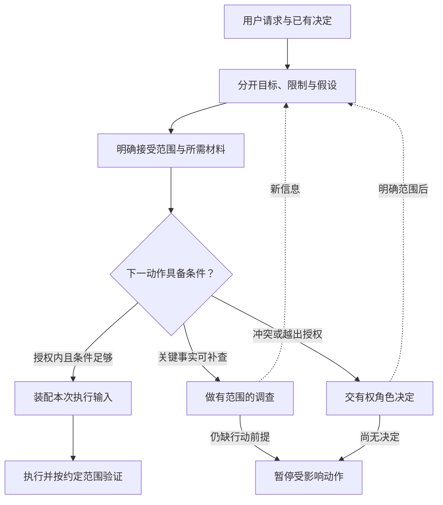

# 第4章 Intent Engineering
## 从模糊请求到有边界的执行目标

> 工作稿状态：阶段 B 连续正文候选，沿用历史文件名，不替代 [第4章原稿](../OringinalDocs/第4章.md)。
> 回接说明：[RR-039 实施记录](../RevisedResult/RR-039_三项目近期进展与书稿更新评估.md)。
> 适用边界：本章提出组织目标与执行输入的方法；存档例子均为教学情境，不代表项目已完成迁移或验证。

“把这个 UI 优化一下。”

这句话可以指信息层级，也可以指视觉风格、战斗中的读取速度，或某个危险状态没有被玩家及时注意到。如果 Agent 放大字体、调整颜色并完成检查，它可能做完了一组动作，却没有解决提出请求的人遇到的问题。

前三章讨论了 Agent 进入软件工程后，受托解释、行动和反馈怎样改变协作条件。从本章开始，我们进入更具体的问题：如何把“希望改变什么”保存下来，让不同角色、不同执行尝试都能回到同一个目标。

本书把这项工作称为 **Intent Engineering（意图工程：将期望结果、动机、边界和接受条件组织成可持续引用的目标说明）**。它延续需求澄清、变更控制和验收设计，不以证明自己是一门独立学科为前提。它关心的增量是：当 Agent 可以自行选择步骤时，我们怎样让目标持续可见，并在新信息出现时知道哪些可以调整、哪些需要新的决定。

# 4.1 先识别问题，再区分目标与方法

一个可执行目标需要回答四个问题：为什么做、期望什么结果、哪些边界不能越过，以及用什么判断结果。只写活动，例如“修改加载器”，没有说清修改后谁能够做什么；只写效果，例如“兼容性更好”，又没有给出可以检查的范围。

动机尤其容易被省略。假设人提出“把状态栏缩短 15%”，原因是在某个分辨率下它与敌人信息重叠。如果 15% 是必须遵守的设计决定，Agent 应当保留这个约束。如果它只是一个初步办法，Agent 可以提出另一种能消除重叠的布局。两种情况下都不应自行猜测这个数字的地位；可以先查看已有说明，再在影响方案选择时澄清。

原稿用 **Intent over Instruction** 表达这一取向：在需要判断的问题上先交代目标和边界，再选择操作步骤。它允许具体指令继续存在。文件移动、固定工具调用、已经批准的迁移程序，往往恰恰需要精确步骤。理解动机不赋予 Agent 跳过这些步骤的权利。

接下来使用一个贯穿第4、5章的教学请求：

> 让旧版存档在目标版本中继续使用，保持现有存档格式，不要顺便重做存档系统。

这句话已经给出了方向，但“旧版”覆盖哪些版本、“继续使用”包含哪些行为、目标版本是哪一个，都仍需定位。任务可以从查找这些信息开始；不能把查找前的猜测写成用户已经决定的范围。

# 4.2 Requirement、Intent、Task 与 Agent Input

这几个对象可以出现在同一份短文档里，但职责不同。

| 对象 | 在本书中的含义 | 存档例子中的作用 |
|---|---|---|
| Requirement（需求） | 利益相关者提出的需要与约束 | 老用户应能继续游戏；现有格式保持不变 |
| Intent Artifact（意图资产） | 保存期望结果、动机、身份和范围的持续记录 | 在具名目标版本中恢复具名旧存档的继续使用能力 |
| Task（任务） | 当前可分配的一段工作 | 调查失败路径、实现局部修复、核对迁移样本 |
| Agent Input（执行输入） | Agent 在一次运行中实际收到的装配结果 | 目标说明、选定代码、规则、工具能力和输出要求 |

需求可能含有冲突或尚未裁决的偏好，不能靠改写措辞自动成为可执行目标。Task 派生自某个 Intent 时，应保存两者的范围和验收关系；但调查、告警响应和例行维护也可以由规则或事件触发，不要求每个任务先创建一棵 Intent Graph。

本章使用 **Prompt（指令或消息表达层）** 指 Agent Input 中的文本表达。Prompt 可以持久保存、版本化和接受审查；本章不靠“Prompt 一定是一次性的”来区分它与 Intent。真正的区别在于用途：同一个长期 Intent 可以供多次运行使用，而每次输入还要结合当时可用的 Context、工具和执行边界。

# 4.3 把一句请求整理成最小任务说明

整理请求时，先保留用户原话，再把已明确的要求、查得的事实和 Agent 的假设分开。下面的版本标识、文件路径和角色都是教学占位。假设进一步查阅已有决定后，确认本次只覆盖 `v2` 存档，目标构建记为 `R`，已有授权允许局部实现和测试。

| 项目 | 最小任务说明 |
|---|---|
| 动机与结果 | 使用 `v2` 存档的玩家能在目标构建 `R` 加载进度，并继续一次规定操作 |
| 范围 | 调查并修复加载、迁移连接处；使用副本验证，保留原存档 |
| 明确限制 | 目标格式不变；不重做存档系统，不顺带调整玩法规则 |
| 验收范围 | 约定样本可加载；关键进度字段保持；重复加载行为符合契约；目标场景可继续操作 |
| 仍待核对 | 是否含所有约定变体；缺失可选字段的样本在哪里；失败后是否留下部分写入 |
| 授权引用 | 已有委托允许局部修改和验证；扩大版本范围、改变格式或覆盖真实用户数据另行处理 |
| 输出 | 修改与检查结果、实际覆盖的样本、未覆盖条件、后续动作建议 |

这份说明不需要先拥有数据库或专用格式。短任务可以直接放在当前任务入口；持续跨执行复用时，再给它稳定标识、Owner 和版本。

这里有两个不能互换的句子：“本次只要求兼容 `v2`”是已经确认的范围；“我暂时只找到了 `v2` 样本”是当前信息情况。后者不能悄悄变成前者。同样，“假设字段缺失可以用默认值补齐”必须保留为待检查假设，不能因为写进任务说明就成为实现依据。

专业设计也需要保留这种区分。lessismore 一项奖励设计曾用纸面价格与路线收入推演30金币的作用；当时的项目校准改变了可购买物、治疗条件和机会成本判断，方案最终保留为备选。这里的动作是核对“哪些假设会改变目标选择”，不是把推演当作已发生的玩家行为。完整任务与来源见[第23章23.44](第23章_AI_Game_Dev_OS纵向案例_首轮修订稿.md)。

# 4.4 将验收拆成能分别判断的维度

**Acceptance Criteria（接受条件）** 描述什么结果可以进入具名接受判断；**Required Evidence（所需证据）** 描述为该判断准备什么材料。两者应该对应，而不是在实现结束后只挑已经通过的检查作为完成标准。

存档例子至少有几类不同问题：

| 接受维度 | 应观察什么 | 还不能由此得出什么 |
|---|---|---|
| 格式与数据保持 | 指定输入副本的字段、默认值和迁移输出 | 所有历史存档都兼容 |
| 行为 | 目标构建实际加载后能继续规定操作 | 只凭解析成功就证明游戏可继续 |
| 异常与副作用 | 坏输入如何拒绝，失败是否破坏原副本，是否留下部分写入 | 正常样本通过就代表异常路径安全 |
| 产品与体验 | 若范围包含提示或恢复体验，由相应角色检查具体表现 | 机器检查代替体验接受 |
| 决定范围 | 有权角色接受哪个版本、样本集合和用途 | 局部实现接受自动允许采用或发布 |

不需要为每个低影响改动机械增加全部维度。先问本次改变可能影响什么，以及现有检查是否足以判断它。一次文案调整可能只需回读；涉及存档写入的变化，则需要知道失败后的数据状态。

如果接受条件包含“加载更快”，就还需要可比的修改前基线和相同条件下的测量。只有修改后耗时，无法单独支持“更快”。如果缺少关键样本，可以先完成不依赖该样本的调查和实现，但最终结论必须保留覆盖缺口；不能用“其他检查全过”补齐缺失维度。结果、证据使用和有权接受的区分由[第8章](第8章_Agent_Reliability_Engineering_首轮修订稿.md)与[第9章](第9章_Evidence_Use与Decision_Disposition边界稿.md)展开。

# 4.5 未知不都阻断行动，但需要具体处置

模糊请求并不意味着必须把所有问题问完才能开始。判断未知时，要同时看它是否影响下一动作、错误是否可逆，以及现有授权允许做什么。

## 图4-1 从用户请求到下一步行动

教学示意：实线表示行动选择，虚线表示新信息或决定使任务说明需要更新。图省略了执行内部步骤；“条件足够”针对下一动作，不表示任务全部未知已经消除，也不把任务说明本身当作授权。补查无新线索且缺口仍阻断下一动作时暂停该动作；独立且已授权的工作可继续。

图中的调查有明确出口。比如先查 `v2` 样本是否存在，找到就核对内容，找不到就记录搜索范围和缺口。如果样本缺失只影响最终兼容性结论，可以继续已获授权的实现准备；如果下一步会覆盖唯一一份数据，就不能靠乐观假设继续。

| 当前情况 | 可以做什么 | 停止或重新决定的条件 |
|---|---|---|
| 不清楚失败发生在读取还是迁移 | 读取相关实现，用副本做授权内诊断 | 下一步需接触未授权数据或产生不可逆副作用 |
| 缺一个约定样本 | 有范围地查找；继续不依赖它的工作 | 不对未覆盖变体作接受结论；搜索无新线索时报告缺口 |
| 可逆的局部实现选择，已有验证办法 | 记录关键假设，实施并检查 | 发现假设不成立或改变范围 |
| 修复似乎必须改变存档格式 | 提供局部适配、范围收窄或格式变化等候选 | 格式变化超出当前委托，受影响动作暂停 |
| 目标、交付时间与有效规则冲突 | 保存冲突，交由已有规则指定的角色处置 | 无优先级或无相应授权时，不自行宣布其中一项失效 |

升级可以是交给被授权的 Controller、使用既有门禁，或请求人类裁决；不必每次都新设一次人工审批。另一边，具备技术能力也不表示 Agent 拥有改变目标的权利。

# 4.6 从 Intent 到不同角色的执行输入

**Execution View（执行视图）** 是从同一个 Intent 为特定角色与任务选出的目标子集。实现者需要局部结果、不能改动的范围和检查要求；审阅者需要接受条件、已知风险与可独立核对的材料；协调者需要任务之间的依赖和谁可以决定例外。

视图不能删去会改变行动含义的约束。只告诉实现者“恢复旧存档加载”，却省略“格式保持不变”，就不再是同一目标的合理投影。

Execution View 仍不是完整输入。实际装配还需要[第5章](第5章_Context对象边界回接稿.md)选择的 Context、有效的 Policy 与 Decision 引用、工具能力、[第7章](第7章_Agent_Execution_Engineering_首轮修订稿.md)的 Execution Contract（执行契约）和输出要求。Intent 记录希望出现什么结果；执行契约描述本次允许怎样行动、如何结束，并服从有效授权。

代码当前是什么样、样本是否存在、刚才的运行结果是什么，属于状态与观察材料，不能作为不带来源的事实堆进 Intent。权限也不能由目标的紧迫程度推出。短文档可以同时承载这些引用，但各项职责仍应分清。

# 4.7 让目标跨执行持续存在

一次 Attempt（执行尝试）可能在目标执行前就中止，也可能完成实现但未获接受。同一个目标因此可以对应多次尝试。一次失败不自动取消 Intent；一次接受也不必然结束一个持续目标，更不自动产生发布决定。

需要长期复用时，Intent Artifact 可以保存标识、版本、Owner、来源或 Parent、动机、期望结果、范围、约束，以及接受条件和相关决定的引用。它不负责复制全部日志、运行状态或证据正文。

生命周期只描述目标自身的处置。例如，`draft` 表示尚在拟定，`approved` 表示已经按适用规则批准，`active` 表示当前采用，`superseded` 表示由新版本取代，`cancelled` 表示取消。这是一种可选记录方式；已有任务系统能表达相同区别时无需再造状态系统。某次执行的 `PASS`、失败或结果接受，应留在对应尝试与决定记录中。

**Intent Owner（意图责任角色）** 负责维持目标说明与决定入口。最终价值目标及 Parent Intent 的变更权属于被授权的人类或组织角色；Agent 可以在明确委托内提出、派生或维护局部目标。模型更强、任务更多或执行时间更长，都不会自行扩大这种委托。

# 4.8 拆分工作时保留继承，也保留冲突

把存档工作拆成调查、实现、验证，通常只需几个关联任务。只有这些部分确实需要独立维护结果、范围和生命周期时，才值得建立 Child Intent（子意图）。避免把每个函数改动都提升为新的目标对象。

拆分时至少保留仍适用的上层约束、非目标、接受映射和决定边界。验证任务不能因为容易取得样本就把“缺字段变体”排除；实现任务也不能把“格式不变”改成“尽量不变”。例外应指向允许它的决定。

冲突可能来自多个同样有效的要求。假设目标要求旧存档继续可用，现行规则禁止某条解析路径，而交付计划又要求本周冻结。Agent 可以调查替代路径并说明代价：局部适配可能增加实现和验证工作；缩小支持范围会留下受影响用户；延期会改变交付承诺。它不能用一句“综合考虑后兼顾三者”掩盖实际取舍。

如果既有规则已经指定优先级和处置者，按该规则执行；否则保留受影响范围、可选方案与未决问题，暂停依赖该决定的动作。其他独立且授权充分的工作仍可推进。

# 4.9 执行中发现目标需要变化

发现新事实后，先判断变化落在哪里：是实现方法调整、技术前提被推翻，还是目标与授权范围真的需要改变。

如果同样的接受条件可以通过更局部的修复满足，通常属于方法选择。若发现目标构建已变化，则需要重新核对代码、样本和原检查对新版本的适用性。若必须支持另一种存档版本或改变格式，则需要更新目标范围，并由有权角色处理新增取舍。

目标更新后，不应默认所有任务和输入自动同步。说明哪项约束变化，哪些子任务仍兼容，哪些需要重读或停止；旧版本及其结果继续保留历史含义。新决定可以改变今后的用途，不能把此前未做过的验证补写成已完成。

对存档例子，若最终只找到标准 `v2` 样本，任务说明应保留特殊变体未覆盖。可以建议补样本、收窄接受范围或暂缓相关决定；收窄若属于人类保留的权利，就使用[第12章的决策面](第12章_Cognitive_Compression与Human_Decision_Interface_首轮修订稿.md)呈现这一选择，而不是让缺失材料悄悄缩小承诺。

# 4.10 按任务代价选择记录强度

必要的是让执行者知道目标、边界、如何判断结果，以及缺少关键条件时如何处理。稳定 ID、独立 Registry、完整 Parent/Child 图和专用界面是条件性实现。

| 任务情况 | 合适的起点 | 增加结构的理由与代价 |
|---|---|---|
| 低影响、局部、易回退 | 当前入口中的短说明和适当回读或检查 | 额外登记可能比变化本身更费维护，不必强行增加测试 |
| 多次执行或多角色交接 | 稳定目标引用、范围与验收映射、关键假设 | 能追查各次输入差别，但需要同步维护 |
| 高影响、多方授权或难恢复 | 明确版本、责任角色、例外决定和证据要求 | 便于定位取舍与责任；若只复制模板，会掩盖真正未决项 |

时长和 Agent 数量可以提醒我们检查协作风险，却不是自动升级的门槛。一个很短的数据覆盖操作可能需要严密边界，一个长时间的只读整理任务则未必需要复杂治理。

# 4.11 把目标交给下一次具体行动

回到开头的请求，经过整理，我们得到的不是一份更长的命令，而是一项可以执行和检查的工作：指定旧存档范围与目标构建，保留格式约束，先查缺失条件，在既有委托内修复，并按实际覆盖范围报告结果。

到这里还缺一件事：执行者应该读取哪份格式说明、哪个版本的代码、什么样本和历史决定。如果这些信息错误，明确目标仍可能导向错误动作。下一章沿用同一个例子，讨论如何选择和补充信息，以及搜不到、来源冲突或无权访问时怎样继续。
