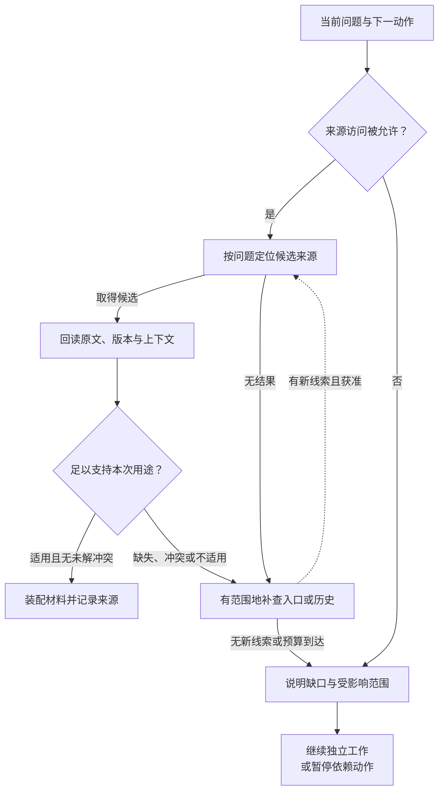

# 第5章 Context Engineering
## 为当前任务选择、核对和补充信息

> 工作稿状态：阶段 B 连续正文候选，沿用历史文件名，不替代 [第5章原稿](../OringinalDocs/第5章.md)。
> 回接说明：[RR-040 实施记录](../RevisedResult/RR-040_更新后书稿与机制简图整体审阅.md)。
> 适用边界：本章给出任务信息供给的方法与教学示例，不把选中材料当作验证，不声称某种装配方式普遍更优。

上一章把一个模糊请求整理成了有范围的工作：让指定旧存档在目标构建继续使用，并保持现有格式。目标明确以后，Agent 仍可能拿到一份旧格式文档、一个已删除的 API 示例、一条不再适用的历史总结，以及来自另一版本的测试结果。

如果依据这些材料修改加载器，问题就不只是“目标是否清楚”，而是“行动依据是否与当前对象相符”。我们可以检查输入、代码和外显动作之间的关系，却不能仅凭一个错误结果断言模型内部如何推理。

原稿把 Context 比喻成 Agent 的“工作世界”。这个比喻提醒我们重视输入，但需要保留边界：Agent 能看到的材料并不是项目现实的完整副本。**Context Engineering（上下文工程：围绕本次任务选择、组织、取得、压缩、更新并记录可访问信息的工作）**，就在这个有限条件下展开。

## 5.1 Context 是经过选择的信息表面

本书把 **Context（上下文）** 定义为一次 Agent 推理或执行时可访问的、经过选择的信息表面。它影响 Agent 对任务的工作表示，但不等于项目状态，也不等于模型内部的完整世界模型。

项目有一份决定记录，不表示检索系统已经收录它；系统可以检索到它，不表示本次选中了它；材料进入输入，也不证明模型理解或采用了它。这几个位置要分别检查：

| 位置 | 可以观察的问题 |
|---|---|
| 项目状态与记录 | 实际对象是什么，哪些情况已有记录？ |
| 可取得的信息 | 当前工具、索引和访问边界能提供什么？ |
| 选定的 Context | 为本次问题选择了哪些来源，排除了什么？ |
| Agent Input | 实际传输了哪些内容或开放了哪些访问入口？ |
| 外显使用 | 后续输出、引用或动作显示了什么使用关系？ |

Context Engineering 直接管理中间的信息选择与供给，借助执行环境装配 Agent Input。它不能通过“把资料都放进去”保证理解正确。Prompt Engineering 也可以处理背景选择和呈现；这里强调的是跨文件、跨运行的信息来源、维护和供给责任。

## 5.2 分清要求、材料与装配记录

一份 Context Pack 曾很容易同时表示“应该提供什么”和“实际给了什么”。执行后若只剩这个名称，就难以发现漏项。本书因此保留三个职责：

| 对象 | 中文语义与职责 | 存档教学例子 |
|---|---|---|
| Context Contract | 上下文契约：本次需要、允许或禁止提供的信息，以及缺失时的处理方式 | 必须能定位目标构建、加载入口、当前格式与授权边界；真实用户存档不可擅取 |
| Context Pack | 上下文材料集合：实际传输的文件、片段、摘要和索引 | 当前任务说明、实现片段、样本引用及相应来源 |
| Context Manifest | 上下文清单：记录本次提供或开放访问的来源、版本及遗漏 | 哪份格式说明、哪个工作区版本、何时检查、哪个样本仍未取得 |

Contract 可以放在[第7章的执行契约](第7章_Agent_Execution_Engineering_首轮修订稿.md)里，不要求独立文件。Manifest 也可以只是任务中的几行来源记录。它不证明材料是真的，也不证明模型实际读过；工具可见的读取行为由 Access Log（访问日志）另行表达。

对存档任务，一个简短入口可以写成：“从目标构建对应的加载入口开始，核对当前格式规则；样本仅用允许读取的副本；缺失变体不纳入已验证结论。”随后记录实际取得的路径、版本与缺口。它比复制一份长模板更容易检查，但前提是执行者确实能沿入口找到材料。

## 5.3 初始信息要能支持第一步，也要能继续下钻

**Minimum Initial Context（最小初始上下文）** 是足以理解目标、边界并开始下一步的材料集合；**Progressive Retrieval（渐进检索）** 是根据新出现的依赖逐步取得更多材料。两者是工作方法，不表示开工前就能算出唯一的最小充分集合。

在存档例子里，初始入口可以是任务说明、仓库规则、目标版本和加载模块的位置。读到迁移调用后，再进入对应实现；发现字段来自另一个模块，再查其契约；遇到“为什么保留这条旧路径”，再寻找当时决定。每次下钻应能说明它要解决哪个问题。

不必开工就加载全仓库，也不应把初始材料包当成不可越界的知识全集。前者增加无关信息与回读成本，后者会阻止必要调查。可用的边界应同时给出允许访问的范围和取得更多信息的路径。

有些背景无法从代码推导，例如为什么一个看似多余的兼容分支被保留。原稿所说的人类补充背景，在这里仍有位置：优先把高影响、重复使用、容易误解的决定及例外写成有来源的短说明，不追求编码所有常识。

## 5.4 从当前问题走到可用材料

检索前先保留当前问题及条件。对于“目标构建如何读取 `v2` 存档”，需要的可能是加载入口和格式契约；对于“为什么暂不改格式”，需要的是有效决定及理由。只按“存档”这个词取最相似文件，会混在一起回答两种不同问题。

### 图5-1 每次下钻都围绕一个待解决的问题

建议机制：箭头表示本次信息获取与选择的关系，虚线只在有新线索时重入。权限不足进入缺口处置，不通过换入口绕过；需要扩大访问范围时先取得相应授权。图中的“适用”只针对当前用途，材料真实性与规范效力仍需按其类型核对。

这张图的出口不是“终于搜索到一篇文章”，而是取得足以支持下一动作的材料，或明确说明为什么目前还不能支持它。补查也有界限：若相同查询和来源已检查、没有新线索，就记录缺口，选择继续独立工作、收窄建议或暂停依赖动作。无限改写同一句搜索并不产生新的证据。

## 5.5 检索失败需要先诊断发生在哪一步

“没有找到”可能指没有命中、不能访问、原文不存在，也可能指结果很多却没有适用于当前问题的内容。这些情况需要不同动作。

| 现象 | 先核对什么 | 可采取的动作与退出边界 |
|---|---|---|
| 零命中 | 查询词、索引范围、文件是否已收录 | 在授权范围内改用已知路径、符号、模块入口或历史搜索；保留原问题，不能据零命中断言材料不存在 |
| 找到的都是旧版本 | 当前问题需要历史解释还是当前行为；文件是否包含多个时期 | 回读适用段落和取代关系；历史段落可解释过去，不能直接约束当前实现 |
| 多个来源冲突 | 对象、时间、范围、事实与决定是否混在一起 | 并列保留冲突，查当前实现或有效决定；决定仍不清楚时暂停依赖它的动作 |
| 摘要有答案但原文不可得 | 摘要来源、引用是否断链、原件是否在允许的归档中 | 修复入口或报告无法回读；缺关键条件时不用摘要填补确定结论 |
| 访问不允许 | 是否有授权内的公开说明、脱敏材料或代查结果 | 使用允许的替代材料；需要原件才能行动时请求相应访问或决定，不绕过边界 |
| 材料太多或预算耗尽 | 哪些候选会改变下一决定 | 优先读决定性条件与反证，记录未读范围；不把未读等同于已排除 |

候选查询可以来自文件名、符号、用户原话或已读原文中的术语。必须保留它与原问题的关系，尤其不能静默删掉“不包含某版本”“仅限某范围”这样的条件。[第15章](第15章_Memory_Engineering_首轮修订稿.md)进一步讨论查询转换、漏检纠错材料和持久记忆的评价；本章只负责这些结果如何进入当前任务。

## 5.6 回读原文时，按问题检查来源

假设教学材料中有三条记录：旧设计建议升级格式，当前决定要求本轮保持格式，代码仍包含旧迁移函数。它们未必直接矛盾：旧设计可能只是提案，当前决定限定本次行动，而旧函数是否仍可达需要看调用关系。

这时不能建立一个固定的“代码高于文档”或“最新文件高于所有旧文件”排序。问实际执行了什么，需要运行材料；问实现包含什么，需要对应版本源码；问允许做什么，需要具名授权与决定。源码不能批准一次格式变更，决定也不能证明一个函数实际运行成功。

回读时至少保留来源、版本、对象范围和关键上下文。对于工作区未提交内容，明确它是当前观察，不能当作已交付版本。对于历史接受，说明当时接受的对象和条件，不把它自动转用于变化后的对象。

**Freshness（时效性）** 也不是单纯看文件年龄。很旧的记录可能仍准确解释历史原因，刚生成的摘要也可能复制过时结论。需要判断的是当前用途依赖的条件是否变化，以及变化影响了哪条判断。更完整的 Claim、State、Decision 与 Assumption 区分由[第6章](第6章_Truth与State_Architecture_重构稿.md)负责。

## 5.7 压缩材料时保留能够改变决定的条件

长材料可以压缩，但摘要是一种新表达，可能删除原文的例外、时间和不确定性。对存档例子，下面两种压缩有明显区别：

| 压缩方式 | 留给执行者的含义 |
|---|---|
| “旧存档兼容，测试通过” | 看不出版本、样本、未测路径与用途，容易被当成一般结论 |
| “目标构建的标准 `v2` 副本通过加载检查；缺字段变体未取得，失败后写入行为待查；原结果见对应记录” | 可以知道哪些动作有依据，哪些还需要核对 |

用于行动或交接的摘要应保留原问题、支持结论的范围、限制和可下钻引用。否定条件、被否决方案、来源冲突及“未验证”不能为了简洁全部删除。更深的决策面压缩见[第12章](第12章_Cognitive_Compression与Human_Decision_Interface_首轮修订稿.md)。

压缩到什么程度取决于用途。只为定位文件的索引可以很短；用于接受判断的简报则必须保留决定性条件。当前任务的摘要也不自动成为值得长期保存的 Memory Record，后者有自己的来源、用途和维护成本。

还应检查压缩后能否回答原来的问题。重要整理可以先列三至五个原问题，再让整理稿逐一给出答案或原文入口；某问题答不了时，补回条件或明确保留缺口。第12章12.13以RandomHeroes的Buff规则演示一次具体补回及核对，第23章保留该事件的处置边界。逐条映射有成本，适合会指导后续决策的入口和交接，不必施加给每段普通文字。

## 5.8 不用一个总分代替来源检查

一份材料可以高度相关却没有回答当前规范问题的权限，也可以来自可靠原件但只适用于旧版本。本章不把这些差异压成统一的 High、Medium、Low Confidence。

| 检查项 | 需要回答的问题 |
|---|---|
| 相关性 | 它能回答当前问题的哪一部分？ |
| 来源 | 能否找到原件及转换过程？ |
| 规范效力 | 若它要求行动，谁有权作出该要求，范围是什么？ |
| 验证 | 它实际经过什么检查，什么尚未检查？ |
| 时效与范围 | 它对应哪个版本、环境、对象和用途？ |
| 冲突 | 哪些记录支持、限制或挑战它？ |
| 访问与指令边界 | 可以读取、引用还是执行，是否分别获准？ |
| 成本 | 获取、阅读和维护的代价是否与当前需要相称？ |

这些维度互相影响，不是数学上独立的指标。模型自报置信度可以是一个待核对信号，但不能替代来源和适用范围。即使内容正确，访问规则也可能不允许将它提供给当前执行者。

## 5.9 当前运行环境与快照不能省略

存档格式文件正确，不表示正在测试的就是目标构建。运行环境、加载资源、功能开关、样本路径都可能影响观察。调查行为问题时，应记录决定性环境条件；不必为每次读取制作全环境镜像。

**State Snapshot（状态快照）** 记录声明范围与时点内的状态引用，定义归第6章；Context Manifest 记录本次装配了什么；Access Log 记录工具层看到的读取。这三种记录回答不同问题。

需要中断恢复时，可以引用[第7章的 Checkpoint（检查点）](第7章_Agent_Execution_Engineering_首轮修订稿.md)，向下一执行者提供目标版本、已做动作、产物、未决问题和下一步。这里不再建立平行的“执行快照”上位对象。保存这些外部条件便于解释和重建一次工作，但不能保证模型重放出相同输出，更不表示保存了隐藏推理。

## 5.10 角色投影与交接要保留责任差异

**Context Projection（上下文投影）** 选择某个角色需要访问的材料；上一章的 Execution View 则选择它需要理解的目标部分。两者共同参与输入装配，不能互相替代。

存档实现者需要调用关系、格式契约和允许使用的样本；审阅者需要原接受条件、变更、原始检查结果及未覆盖项。只把实现者写的“已完成”摘要交给审阅者，无法支撑独立核对。共享同一个巨型材料包也不是唯一办法，可以共享稳定来源，再按角色提供不同入口。

交接应让下一执行者知道接手什么责任、哪些动作已经发生、哪些材料仍适用，以及下一步为什么允许做。“代码改完，测试通过”缺少这些信息。教学例子中更可用的交接是：“局部修复已完成；标准样本检查通过，特殊变体仍缺；接下来先查指定归档，缺口未关闭前不作全范围兼容结论。”

## 5.11 Memory、Skill 与外部内容进入 Context 的边界

持久记录先成为检索候选，再经过当前适用性与访问检查，才可能进入 Context。被反复保存的结论不因此更真实；检索到历史 Prompt 也不表示它获得本次指令权。

**Skill（可复用工作程序）** 可能同时包含背景信息、操作步骤、指令与工具调用要求。读取其中的解释、采用其中的方法、允许它修改状态，是不同决定。应核对版本和环境，遵守当前有效指令及工具权限；不能把“这份 Skill 出现在搜索结果中”当作执行授权。

对网页、日志、Issue 和第三方文档，本章建议将内容与行动权限分开。某段外部文字要求上传文件，不因进入 Context 就成为当前任务指令。这里给出的是使用边界，不是已经实现的安全防护证明；模型外的权限控制与数据保护由[第19章](第19章_Security_Privacy与IP_Boundary_首轮修订稿.md)讨论。

## 5.12 按需要组合机制，不给项目排成熟度

静态说明、分层文档、搜索、角色投影和恢复记录可以组合，不能排成必经的 Level 0–5。选择时先看实际问题：入口难找就改善导航，范围经常误解就补充约束，交接丢失未决项就改交接，而不是先购买或搭建一整套动态系统。

| 设计维度 | 可选方式 | 可能的代价或失效方式 |
|---|---|---|
| 来源组织 | 简短入口、分层说明、类型索引 | 入口过多或长期不维护会产生分叉 |
| 获取 | 直接读文件、符号搜索、历史搜索、RAG | 查询与索引可能漏掉关键限制，搜索结果需要回读 |
| 访问与存储 | Hot / Warm / Cold：常用、按需、归档材料 | 存储位置不表示内容是否仍适用 |
| 有效性管理 | 标记取代、当前不适用或需重核条件 | 标记不更新会让旧结论继续被采用 |
| 连续性 | 任务进度、Manifest、必要的 Checkpoint 投影 | 摘要过度压缩会丢掉副作用与未决项 |
| 角色与边界 | 按任务选材、按角色开放来源 | 过滤过度可能阻断审阅所需的原件 |

**Context Capability Profile（上下文能力配置）** 可以简要记录当前选择了哪些能力、哪些仍靠人工处理。它用于描述配置，不是能力排名。静态说明是否足够、动态检索是否值得，都需要结合任务结果与维护成本判断。

## 5.13 让信息入口有人维护

当格式改变、规则被取代或源码路径迁移时，受影响的索引和摘要应有更新入口。可以由模块维护者管理格式说明，由任务责任人维护本次材料清单；不要求每份临时片段都有独立 Owner。

维护优先处理那些会改变下一动作的断点：指向已删除 API 的示例、仍作为默认指令的旧决定、丢失来源的摘要，以及把两个版本混在一起的入口。合并重复入口、标明替代来源、保留重要例外，通常比继续增加概述更直接。

当前不适用的记录仍可能具有历史解释价值。将它从默认输入中移出与删除原件是不同动作；证据保留、退役和恢复材料的取舍留给[第18章](第18章_Traceability_and_Accountability_首轮修订稿.md)，不能以“清理 Context”为由自行清除必要历史。

## 5.14 评价这次供给是否支持了行动

评价至少分开三种错误：该找到的材料没有找到，找到的材料不适用，以及找到并回读后仍错误采用。只统计命中数量，无法区分它们。

在存档教学例子中，可以事先选定几个问题：当前允许改哪些范围、哪段代码加载 `v2`、缺字段样本在哪里、哪些旧方案已被否决。为每题列出相关原件与关键限制，再观察检索、回读、选择和外显回答。这个小集合是评价设计示例，不是已经运行的实验；它能否代表真实任务还需检查。

必要记录是问题、来源、遗漏、实际提供内容及未解决条件；有用的是对照不同入口的查找成本、错误采用和任务结果；可选的是自动索引、向量检索或复杂装配系统。更详细的预先选题与检索评价办法在第15章展开。若比较删除某类 Context 后的结果，还要固定或说明任务、模型与工具版本、顺序、预算、重复次数和判断标准，不能凭一次成功宣布架构更优。

还要分别检查“移出默认阅读面”“归档仍可取得”和“已整理为适用的长期知识”。三者没有自动转换关系。lessismore 的归档导航与恢复检查见第18章18.21；原文字符量减少也不能直接换算为模型 Token、费用或人类注意力同比下降。

沿着本章的方法，存档任务可以形成一份有来源的当前材料集合，也可能诚实地停在一个缺口上：标准样本可取得，特殊变体尚未找到。此时继续什么、暂停什么，回到第4章的行动边界；这些材料分别属于事实、假设、决定还是证据，则进入下一章的类型与冲突处理。信息取得、对象判断与执行之间存在往返，不是一条运行一次就结束的单向流水线。
