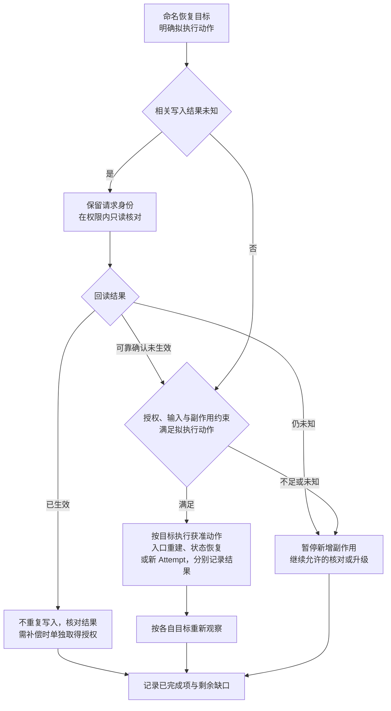

# 第8章 Agent Reliability Engineering
## 让 Outcome、Result、Failure、Unknown 与 Recovery 保持可区分

> 工作稿状态：Phase D 最小完整正文；依据 [全书大纲](../OringinalDocs/beyond_code_ai_native_software_engineering_outline_zh.md) 重构，不把错误分类或指标清单当作通用标准。
> 回接说明：[RR-040 实施记录](../RevisedResult/RR-040_更新后书稿与机制简图整体审阅.md)。
> 适用边界：本章提出 Attempt Outcome、Target Result、Evaluation Result、Failure、`non-result` 与 Recovery 的候选工程关系；不声称该分类完备，也不把 Retry、Rollback、Sandbox 或单一成功率写成普遍可靠性保证。

第7章把 Work、Execution Contract 与 Attempt 分开。

一旦 Attempt 开始，系统仍然不能只问：

> 成功了吗？

它需要先问：

- 这次 Attempt 实际发生了什么；
- Target 是否真的得到执行和观察；
- Test、Verifier 或 Human Evaluation 检查了什么；
- Failure 属于执行、目标、评价机制还是报告；
- 哪些信息仍然 Unknown；
- 下一步是 Retry、Recover、收窄 Scope、请求裁决，还是停止 Work。

Agent Reliability Engineering（Agent 可靠性工程：让不确定执行的后果能够被分类、限制、观察和恢复的工程活动）不是要求 Agent 永不犯错。

它首先要求错误和缺席结果不要被写成同一种“失败”。

---

## 8.1 Reliability 不是一个布尔属性

一个 Agent 在局部代码补全上表现稳定，不表示它在数据迁移、外部服务调用或生产发布上同样可靠。

Reliability 至少依赖：

- Work 与 Target；
- Contract 与允许影响面；
- Baseline、Context 与 Environment；
- Agent、Model、Tool 与配置；
- Evaluation Coverage；
- Failure Detection；
- Stop 与 Recovery；
- 当前时间和版本。

因此，本章不定义一个脱离用途的 `agent_reliability_score`。它关注的是具名 Attempt 和 Target 在具名条件下发生了什么，以及系统是否能对异常作出有边界响应。

---

## 8.2 先把三种结果关系分开

本章采用：

~~~text
Attempt
├── Attempt Outcome
├── Target Result or explicit non-result
└── Evaluation Result(s)
~~~

三者回答不同问题：

| 对象 | 回答的问题 | 不自动代表什么 |
|---|---|---|
| Attempt Outcome | 这次执行实际走到了哪里、产生了什么后果 | Target 已获得结果 |
| Target Result | Target 在实际执行后形成了什么输出或行为 | 评价机制已经验证它 |
| Evaluation Result | 某个 Check / Test / Verifier / Review 对具名 Target 和运行得出什么结果 | Work Acceptance、Adoption 或 Release |

它们可以同时存在，也可以部分缺席。

例如，一个 Attempt 可以成功启动 Test Harness，Harness 在 Target 前因自身完整性问题停止。此时 Attempt 有 Outcome，Verifier 有 Evaluation Result，但 Target 只有显式 `non-result`。

---

## 8.3 Attempt Outcome 记录执行后果

**Attempt Outcome（尝试后果：记录一次 Attempt 实际执行到哪里、发生了什么外部后果及其结束方式的结果关系）** 绑定 Attempt Identity。

它可以表达：

- completed as contracted；
- partially executed；
- blocked before target；
- paused at checkpoint；
- cancelled；
- timed out；
- crashed；
- stopped by policy；
- external effect unknown。

这些值不是全书固定枚举。关键是 Outcome 能够说明：

- 哪些 Action 实际发生；
- 哪些 Side Effect 已知存在；
- Attempt 在哪个边界结束；
- 哪些 Target 被触达；
- 哪些输出、Unknown 与后续义务仍然开放。

Attempt Outcome 不等于 Work Completion。一次 Attempt 按 Contract 完成，也可能只产生一个需要后续评价的 Candidate。

---

## 8.4 Target Result 只属于实际被执行和观察的 Target

**Target Result（目标结果：Target 获得足够执行与观察后，对其输出、状态变化或行为形成的有类型结果）** 必须绑定：

- Target Identity；
- Attempt 与输入版本；
- Environment；
- 观察时间与范围；
- 结果类型；
- 已知限制和未知。

Target Result 可以是业务输出、构建产物、迁移结果、运行行为或外部系统响应。它不是 Reviewer 对结果的判断，也不是产品是否接受该结果的 Decision。

如果同一次 Attempt 影响多个 Target，应分别记录。不能用“脚本失败”覆盖数据库是否被修改，也不能用“API 返回 200”覆盖下游业务状态是否符合预期。

---

## 8.5 `non-result` 明确表示目标没有形成可评价结果

**`non-result`（未形成目标结果：现有 Trace 足以确认预期 Target 未被触达，或可归属的结果属于另一个实际 Target，因此当前运行没有形成该预期 Target 的评价结果）** 是显式缺席分类，不是“另一种失败分数”。

典型情况包括：

- 前置条件检查在 Target 前阻断执行；
- Verifier 或 Harness 在 Target 前失败；
- 必要输入或 Environment 不存在；
- Authority、Credential 或 Permission 缺失；
- 运行被取消或超时且 Target 尚未触达；
- 实际观察对象可识别，但不是原预期 Target。

记录 `non-result` 时，仍然要记录 Attempt Outcome 和已发生的前置后果。

如果 Target 或外部 Side Effect 可能已经发生，但当前无法确认结果，就应记录 Unknown 与 `external-effect-unknown`，不能用 `non-result` 暗示安全缺席。如果 Target 已经在改变后的输入上执行并被观察，应记录实际 `observed_target`、输入差异与适用范围；该实际 Target 可以有自己的 Result，原预期 Target 则保留显式结果缺席。

`non-result` 的价值在于阻止语义伪造：没有观察到目标，不等于目标失败，也不等于目标通过。

---

## 8.6 Evaluation Result 属于具名评价

**Evaluation Result（评价结果：某个 Check、Test、Verifier、Review 或 Human Evaluation 对具名 Target、运行和评价条件形成的结果）** 需要保留：

- Evaluator / Generator Identity；
- Target 与 Attempt Reference；
- Criterion 或 encoded assertion；
- Input、Environment 与配置；
- Coverage 与 Exclusion；
- PASS、FAIL、Partial、Unknown、Not Applicable 或 Error 等结果；
- Generator Integrity 与已知限制。

`PASS` 的最窄含义是：

> 具名评价在具名运行中没有触发其失败条件，并为它所编码的断言提供有范围 Evidence。

它不自动表示：

- 整个 Behavior Claim 成立；
- 实现范围必要；
- Work 被接受；
- Candidate 被采用；
- Release 已被授权；
- 未覆盖场景同样通过。

Human Evaluation 也应绑定 Target 与 Criteria。对于明确保留给 Human Judgment 的审美、体验和方向事项，最终裁决应由具名且拥有相应 Authority Grant 的人类角色作出；一句“看起来不错”不能替代适用范围和 Decision Target。

---

## 8.7 Failure 是有范围的偏离分类，不是自动根因

**Failure（失败：相对于具名 Contract、Target、Criterion 或期望状态观察到的不可接受偏离）** 必须说明“什么相对什么失败”。

可以从不同位置分类：

| Failure Surface | 示例 | 不应自动推出 |
|---|---|---|
| Intent / Scope | 执行目标与有效 Intent 不一致 | Agent 故意越界 |
| Context / Baseline | 使用过期输入或错误版本 | Model 能力不足 |
| Planning | 路径遗漏必要步骤 | 最终 Target 一定失败 |
| Tool / Environment | Tool error、依赖缺失、服务不可用 | Target 本身有缺陷 |
| Execution | 动作未按 Contract 完成 | Root Cause 已知 |
| Target | 目标行为不符合 Criterion | Evaluation 机制一定正确 |
| Evaluation | Test、Verifier、Observer 自身失败 | Target FAIL |
| Reporting | 报告与可观察事实不一致 | 原始执行一定错误 |

Failure Classification 是当前解释，可以被新 Evidence 收窄、拆分或推翻。

时间顺序也不等于因果。某次 Change 后出现 Test FAIL，只说明两者在当前 Trace 中相邻；Environment、Baseline、并发变化、测试缺陷或第三个因素仍可能解释结果。

---

## 8.8 Unknown、Partial 与 Conflict 必须能够留下来

可靠性记录不应强迫所有运行立即归入 PASS 或 FAIL。

以下状态具有不同意义：

- **Unknown**：当前材料不足以判断；
- **Partial**：只完成或观察了 Target 的一部分；
- **Conflict**：不同 Observation 或 Evidence 互不相容；
- **Stale**：结果不再适用于当前 Baseline；
- **`non-result`**：目标没有形成可评价结果。

Unknown 不是失败，但可能限制后续动作。Partial 不是“差一点 PASS”，它必须说明已覆盖和未覆盖部分。Conflict 也不能由最后写入的记录静默覆盖。

高影响或不可逆动作遇到 Unknown 时，通常需要停止、收窄或升级裁决；低影响、可丢弃任务可以记录 Unknown 后结束，而不必建立完整治理流程。

---

## 8.9 Retry 是新的 Attempt，不是删除失败

Retry 可能解决瞬时错误，也可能：

- 重复同一无效路径；
- 放大外部副作用；
- 改变输入和环境；
- 产生不同失败；
- 增加成本和等待；
- 用最终一次 PASS 隐藏前面的不稳定性。

因此，Retry 至少需要：

- 前一次 Attempt 与 Failure Classification；
- 新 Attempt Identity；
- 次数、时间或成本上限；
- 幂等性或副作用处理；
- Baseline 是否仍有效；
- 继续使用同一策略的理由，或明确策略变化；
- 达到上限后的 Stop / Escalation。

如果输入、Contract、Authority 或 Environment 实质变化，新的运行不只是机械 Retry；它可能是 Rebase 后的新 Attempt。

最终一次 PASS 不能抹掉历史 Retry。下游判断可能需要知道成功是稳定结果、偶发结果，还是在多次不同条件下才出现。

---

## 8.10 Recovery 以恢复目标为中心

**Recovery（恢复：在 Attempt、Target 或 Environment 进入失败、未知或不可接受状态后，通过有授权的 Rollback、Forward Correction、Fallback、Compensation、Resume 或 Human Takeover，使系统回到具名可接受或可继续判断状态的响应过程）** 不等于“回到旧版本”。

常见路径包括：

- **Rollback**：恢复到已知旧状态；
- **Forward Correction**：保留历史，通过更小或兼容的新 Change 修正；
- **Fallback**：切换到能力更低但边界更清楚的路径；
- **Compensation**：对已发生且不可直接撤销的副作用执行补偿动作；
- **Checkpoint Resume**：在前置条件仍有效时继续；
- **Human Takeover**：由有权 Human 接管判断或执行；
- **Safe Discard**：当前 Attempt 没有需要保留的外部副作用，可以安全丢弃。

Recovery 应说明：

- Recovery Target；
- 当前不可接受状态；
- 所需 Authority 与 Permission；
- 新动作及其影响面；
- 成功、失败和 `non-result` 条件；
- Recovery 后需要重新评价的 Claim。

这里不新增三套平行对象：Recovery Decision 是以具名恢复动作或状态为 Decision Target 的 Decision Record；Recovery Attempt 是第7章定义的 Attempt；Recovery Outcome 由 Attempt Outcome、Target Result 与 Evaluation Result 表达。它们可以在小任务中合并保存，但语义不能混合。授权恢复不等于恢复已经执行，执行完成也不等于目标状态已经被观察和接受。

Recovery 不删除原始 Attempt。它创建新的动作与结果关系。

### 一份能执行的恢复说明

假设一次任务停在“写入请求已发出，最终状态未知”。这里是教学情境：直接重试可能重复发奖，重新打开入口也不能说明上次写入是否生效。恢复说明应先把问题收窄：

| 要说明的内容 | 这个情境中的最低要求 |
|---|---|
| 恢复目标 | 确认该次写入是否生效，再决定继续、补偿或人工接管 |
| 现状与副作用 | 保留请求身份；副作用未知时先回读，不能先假定没有发生 |
| 最小材料 | 请求、目标身份、输入与版本、持久状态读取入口；若需 Resume，再加有效检查点及其依赖 |
| 执行动作 | 先按请求身份回读；根据已生效、确认未生效或仍未知分别处置 |
| 停止条件 | 原件缺失、目标身份不匹配或回读失败时暂停依赖该事实的新副作用；保留允许的只读核对路径 |
| 再次观察 | 分别记录动作是否执行、目标达到什么状态、哪些条件仍未确认 |

回读后的下一步也必须明确，不能把“已经查过”当成恢复许可：

| 回读结果 | 下一动作 | 仍需满足的条件 |
|---|---|---|
| 已生效 | 不重复写入，核对目标结果并继续后续允许的工作 | 读到的结果确实属于同一请求和目标 |
| 可靠确认未生效 | 可以提出重试，并在条件满足后执行 | 授权仍有效，输入与目标仍适用，满足重试次数、幂等键及并发约束 |
| 仍未知 | 暂停新增副作用，保留请求身份，继续允许的只读核对或升级给有权方 | 超时或一次“未找到”不足以排除延迟写入；升级本身也不证明未生效 |

若核对发现写入已经生效但结果需要纠正，应另行决定补偿：补偿哪一个已发生的副作用、按什么顺序执行、由谁授权、如何确认补偿结果。具备补偿能力不会自动授权重复写入；新建 Attempt 也不会解除旧请求的未知副作用。

所谓“恢复成功”必须带宾语。入口重建只让人重新找到任务；状态恢复需要原状态和依赖；新执行则产生新的结果。Agent 的检查点也不等于游戏存档：前者保存任务继续所需的外部决策环境，后者保存产品运行状态；即使两者都叫 Checkpoint，恢复输入和验证条件仍然不同。

[lessismore 的 S5 材料记录](../Evidence/receipts/ER-20261122-002__CLM-C18-002.md)提供了一个实际边界：在已搜索位置找不到旧原件后，另建了新 Run 和 Visit，新生成及继续检查分别得到26项和30项通过。这支持新执行的指定结果；旧运行的原件缺口仍在。初次收尾盘点曾因符号链接别名受阻；后来新增了针对该别名的有限库存，状态仍要求审阅，记录也保留全部原件和未解除的保留项。新检查与库存都没有补回旧S5，不能合并成“整个恢复与收尾已完成”。

### 图8-1 恢复先命名目标，再判断能否继续

图8-1是恢复决策的教学示意。未知写入先走回读分支；暂停的是依赖未知状态的新副作用，允许的只读调查可以继续。入口、状态与新执行三种目标可以并存，但结果分别记录；补偿可能只达到具名可继续状态，不等于回到历史原状态。只恢复入口或另开一次成功运行，都不能补写成旧状态已恢复。

材料是否值得保留、退役后放弃哪些能力，由第18章18.21–24继续讨论。这里的必要动作是声明目标和检查前置条件；准备完整工作区镜像只在该恢复目标确实依赖它时才有用。

---

## 8.11 Sandbox 和 Blast Radius 限制损害面，不证明正确

Sandbox、只读模式、独立 Worktree、临时数据库、Mock Service 与最小 Credential 可以限制 Blast Radius（爆炸半径：一次错误能够直接影响的资产、用户、环境和后续系统范围）。

但隔离本身不证明：

- Target 行为正确；
- 测试环境代表生产；
- 外部调用没有发生；
- Secret、License 或 Privacy 边界合规；
- Recovery 一定成功。

隔离策略应与 Action Sink 对齐。限制文件写入不能控制已授权网络调用；使用测试数据库也不能解决敏感数据被复制到外部 Context 的问题。

安全、Privacy、Supply Chain 与 IP 的更完整边界由第19章处理。

---

## 8.12 Reliability Signal 是治理触发输入，不是结论

以下信号可能需要暂停、收窄、重新观察或升级：

- unexpected failure；
- repeated retry；
- scope expansion；
- state mismatch；
- tool uncertainty；
- unknown dependency；
- detector or verifier integrity problem；
- recovery path unavailable。

Signal 不自动证明 Root Cause，也不自动要求最高治理等级。

例如，第一次出现的只读查询超时可能只需要记录并重试；生产数据迁移中的 State mismatch 即使只出现一次，也可能需要立即停止。响应强度取决于影响、可逆性、当前 Authority、Policy Floor 和恢复能力。

执行 Agent 可以主动增加检查、暂停或请求帮助，但不能自行降低已经适用的保护底线。

---

## 8.13 可复现性首先是外部条件可定位

非确定性 Agent 不一定能够在相同 Prompt 下产生相同输出。

更现实的复查目标是定位：

- Agent / Model / Tool / Configuration；
- Intent、Contract 与 Context Version；
- Input、Baseline 与 Environment；
- 可观察 Action 与 Tool Result；
- Checkpoint、Stop 与 Retry；
- Attempt Outcome、Target Result 与 Evaluation Result。

这些材料可以帮助后来者检查原结果是否仍适用、识别缺失条件和重新运行关键步骤。

它们不能保证位级重放，也不能恢复隐藏 Chain-of-thought。记录越多也不必然更可复现；如果身份、版本和边界不清楚，大量日志仍可能无法回答执行了哪个 Target。

---

## 8.14 Reliability Metric 必须带分母和观察边界

原始大纲列出了 Task Success、First-pass Success、Rework、Regression、Rollback、Human Intervention、Scope Violation 与 Evidence Failure 等指标。

它们可以作为候选观察面，但不能脱离定义直接比较。

例如：

- Task Success 的 Task 和 Success 由谁定义；
- First-pass 是否把预检查、Retry 和 Human correction 算入同一次 Attempt；
- Human Intervention 是风险，还是高影响任务的正确设计；
- Rollback 增加代表不稳定，还是代表恢复机制真实可用；
- Evidence Failure 是 Target Failure、Verifier Failure，还是 Coverage Gap；
- 未被检测到的 Silent Failure 是否进入分母。

可靠性指标需要绑定 Workload、版本、时间窗口、Observation Coverage 与 Intended Use。单一百分比不能替代 Failure 分布、尾部风险和不可逆损失。

本章不声称这些指标已经证明某种 Agent、Workflow 或治理模型更可靠。

---

## 8.15 验证器自我修改案例：不区分 Verifier 与 Target 会造成什么错误

AI Game Dev OS v4.94 的 D-048 中，Launcher 在目标 Compile Harness 执行前，通过普通 Python import 改变了自身受保护的 inventory surface。后续 exact-inventory check 检测到变化并停止；目标 runtime directory 与 compile result 都没有产生。

这个案例可以分层记录为：

~~~text
Attempt Outcome:
  stopped before target after verifier self-mutation

Evaluation Result:
  exact-inventory check detected a real integrity change

Target Result:
  non-result; target compile was not executed and observed
~~~

它不能被写成“目标 Compile FAIL”，也不能被写成“验证系统完全无效”。Detector 检测到了真实变化；直接工程缺陷是 Verifier Self-mutation。

本例支持的最小边界是：当 Verifier 可以独立失败、改变观察对象，或 Target 未被触达时，Verifier 与 Target 的结果语义必须可区分；这不要求低风险任务分别持久化两份记录。

该案例不证明所有 Verifier 必须绝对无副作用。已声明、被隔离且不改变观察对象身份和解释边界的正常输出，不自动构成 Integrity Failure。现有材料也没有重跑历史 Harness，因此不能从这次 Incident 单独推出修正方案的运行效果。

完整来源、反证与人工收窄边界见 [D-048 验证器自我修改案例记录](../Evidence/receipts/ER-20260818-002__CLM-C06-004.md)。
该 Episode 在全书共享 Provenance 中的位置与后续失败、修正关系见[第23章](第23章_AI_Game_Dev_OS纵向案例_首轮修订稿.md)。

---

## 8.16 最小实现按影响裁剪

### 可丢弃的只读 Attempt

至少记录：

- Attempt Identity；
- Target；
- 是否触达；
- Output / Error / Unknown；
- 是否可以安全丢弃。

### 可逆修改

进一步记录：

- Start Baseline；
- Change 与 Attempt Outcome；
- Target Result；
- 具名 Test / Check 的 Evaluation Result；
- Retry 和 Rollback 边界。

### 高影响或不可逆动作

还可能需要：

- 预演和独立 Evaluation；
- Side Effect Inventory；
- Compensation / Forward Correction；
- Human Takeover；
- 目标环境观察；
- Recovery 的 Attempt Outcome / Target Result / Evaluation Result 与重新授权。

不是每个任务都需要完整记录，但任何任务都不应把“目标没运行”写成“目标失败”。

---

## 8.17 常见反模式

1. **One Result Field。** Attempt、Target 与 Evaluation 共用一个 `status`。
2. **Verifier Failure = Target Failure。** 前置工具失败却填写目标 FAIL。
3. **PASS = Done。** 评价结果自动升级为 Work Completion 或 Release。
4. **Last Retry Wins。** 最后一次 PASS 覆盖全部失败与副作用。
5. **Failure = Root Cause。** 当前分类被写成已证实因果。
6. **Unknown 被强制二分。** 缺少观察时仍选择 PASS 或 FAIL。
7. **Rollback = Recovery。** 回滚动作执行后不检查目标状态。
8. **Sandbox = Safe。** 隔离部分资源后忽略网络、数据与 Credential。
9. **Metric 没有分母。** 不说明 Workload、版本、时间窗和 Silent Failure。
10. **恢复覆盖历史。** Forward Correction 删除或改写原 Attempt。

---

## 8.18 与相邻章节的接口

| 章节 | 第8章复用 | 第8章不重新定义 |
|---|---|---|
| 第4–6章 | Intent、Context、State Claim、Evidence 与 Authority 边界 | Truth、Decision 或 Policy 上位类型 |
| 第7章 | Work、Contract、Attempt、Checkpoint、Bounded Execution | 执行身份与允许动作 |
| 第9章 | Evidence Use、Decision Target、Acceptance、Adoption、Release Authorization | 结果的规范性用途 |
| 第10章 | Review Target、Finding、Review Disposition | Review 如何挑战结果 |
| 第13–14章 | Authority、Risk Trigger、Observation、Detector、Intervention | Governance 与控制平面 |
| 第18章 | Trace、Release Execution / Outcome、Accountability | 结果关系的长期追踪 |
| 第19–20章 | Security Boundary、Operational Outcome、Metric 与 Drift | 安全或运行效果结论 |
| 第21章 | Lifecycle Transition | 结果如何进入下一状态 |

第8章拥有 Attempt Outcome、Target Result、Evaluation Result、Failure、`non-result` 与 Recovery 的首次正式定义。第9章决定 Evidence 怎样用于下游裁决；第10章决定 Review 如何形成 Finding；第21章只整合状态迁移。

---

## 8.19 检查清单

### 记录结果

- Attempt Outcome、Target Result 与 Evaluation Result 是否分开？
- Target 是否真的被执行和观察？
- `non-result`、Unknown、Partial 与 Conflict 是否可表达？
- PASS 是否绑定具名评价、运行和 Coverage？

### 记录失败

- Failure 相对哪个 Contract、Target 或 Criterion？
- 当前分类是 Observation、同期判断还是事后因果假设？
- Verifier、Target 与 Reporting Failure 是否被混合？
- 替代解释和 Counterevidence 是否可见？

### Retry 与 Recovery

- Retry 是否创建新 Attempt Identity？
- 副作用、幂等性和次数上限是否明确？
- Recovery Target、Authority 与 Outcome 是否分开？
- Rollback / Forward Correction 后是否重新观察目标状态？

### 指标

- 分母、Workload、版本和时间窗是否清楚？
- Silent Failure 与 Observation Gap 是否被承认？
- 指标是否被误用为因果或跨项目排名？

---

## 8.20 本章结论

Agent Reliability Engineering 的最低目标不是消除不确定性，而是防止不确定性被错误命名。

~~~text
Attempt
→ observable Attempt Outcome
→ Target Result or explicit non-result
→ scoped Evaluation Result
→ classified Failure / Unknown
→ authorized Retry, Recovery or Stop
~~~

Attempt Outcome 说明执行发生了什么；Target Result 只属于实际被执行和观察的 Target；Evaluation Result 只属于具名评价；Failure 需要 Scope，`non-result` 保留缺席，Recovery 产生新的动作与结果而不覆盖历史。

这些关系仍不能决定 Evidence 是否足以支持某个 Claim，也不能决定 Candidate 是否应被接受、采用或发布。

下一章将处理 Evidence 怎样进入具名 Decision Target 和有权处置。
