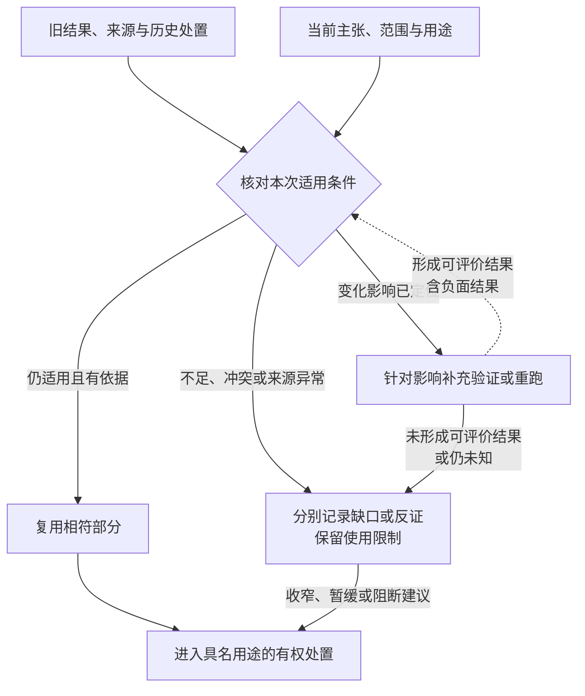

# 第9章 Verification and Evidence Engineering
## Evidence 如何进入有权裁决，而不是把 PASS 直接写成“完成”

> 工作稿状态：Phase D 最小完整正文；由既有对象边界稿扩展，并依据全书大纲重构，不替代原始规划。
> 回接说明：[RR-041 实施记录](../RevisedResult/RR-041_RR-040实施后书稿与配图复查.md)。
> 适用边界：本章提出 Evidence Coverage、Evidence Use Context、Evidence Portfolio 与 Decision Disposition 的候选模型；Evidence 类型不构成跨 Claim 的通用强弱等级，Test PASS 也不自动形成 Acceptance、Adoption 或 Release。

第8章把 Attempt Outcome、Target Result 与 Evaluation Result 分开。

但一个 Result 不会自动解释自己。

它只有在绑定 Claim、Scope、版本、Environment、Provenance 与 Intended Use 后，才可能成为某个决定可以依赖的 Evidence。

本章依次处理四个问题：

1. “声称完成、观察到结果、验证通过、接受结果”是否属于同一个完成等级；
2. Evidence 类型是否可以排列成对所有 Claim 都成立的通用强弱栈；
3. Evidence 如何保留来源、当前适用性、Coverage、Gap 与 Counterevidence；
4. Test PASS 在什么条件下可以形成 Acceptance，又在什么条件下只能作为 Evidence。

第9章不新增一个覆盖 Intent、Truth、Execution、Review 和 Release 的超级对象。它只处理 Evidence 怎样进入具名 Decision Target，以及有权主体可以据此作出什么范围的处置。

---

# 9.1 从 Result 到 Evidence Use

Result 是执行或评价产生的记录；Evidence 是能够支持、挑战或限制某个 Claim 的可检查材料。二者可以引用同一个 Artifact，但承担不同关系。

~~~text
Attempt Outcome / Target Result / Evaluation Result
+ provenance and observation boundary
→ supports / challenges / limits a Claim in Scope
→ is considered for an Intended Use
→ informs, but does not create, a Decision
~~~

这一区分使系统可以表达：

- Target 产生了结果，但尚未被评价；
- Test 产生了 PASS，但 Coverage 只覆盖局部断言；
- Evidence 足以用于开发反馈，不足以用于 Qualification；
- Evidence 被接受，Candidate 仍未被采用；
- Release 已获授权，但执行与运行后结果尚未发生。

本章保留一个候选设计原则：

> **Encapsulate Execution, Expose Evidence.**

> 执行细节可以按风险封装，但会改变判断的结果、修改范围、Evidence、未验证假设、风险、Scope Change、Unknown 与必要 Trace 必须可见。

这不要求 Human 或上层 Controller 阅读 Agent 的全部搜索、尝试和中间步骤，也不允许只展示一个“完成”摘要。Transparency 不等于暴露隐藏推理；它要求读者能够检查当前 Decision 所依赖的外部材料。

同样，Evidence over Confidence 不是说置信度没有用途，而是说模型自报概率、语气或历史成功率不能替代与当前 Claim 对齐的观察和验证。

---

# 9.2 Completion 不采用单轴等级

“任务完成”可能同时指：

- Agent 声称已经完成；
- 代码变化已经存在；
- 目标行为已经被观察；
- 某组检查在声明范围内通过；
- 有权角色接受候选成为某个基线；
- 结果已经被采用或允许发布。

这些状态可以连续发生，但不属于同一种语义。

| 维度 | 回答的问题 | 示例 |
|---|---|---|
| Completion Claim | 谁声称什么工作已经完成 | “command-response correction 已实现” |
| Observation Status | 实际观察了哪个目标 | target executed / target not observed |
| Validation Status | Evidence 覆盖哪个 Claim 和 Scope | `verified-for-scope` |
| Decision Disposition（Decision Record 针对指定目标记录的处置结果） | 哪个 Authority 对哪个 Target 接受、拒绝或保留了什么 | accepted as E1 source baseline |

因此，一种常见的教学顺序：

```text
Claimed Completion
→ Observed Completion
→ Verified Completion
→ Accepted Completion
```

可以保留为教学顺序，但不能被实现为一个同质、单调的 `completion_level`。前三项主要描述断言和认知状态；Accepted 描述规范性裁决。

一个结果完全可能处于：

```text
completion_claim = submitted
observation_status = observed
validation_status = verified-for-scope
decision_target = E1 source baseline
decision_disposition = rejected
```

这不是矛盾。它表示 Evidence 支持了被测试的行为 Claim，但有权角色没有接受候选的实现范围。

同样，`accepted` 不能脱离目标单独出现。至少要说明：

```text
accepted_for = evidence chain
accepted_for = source baseline
accepted_for = qualification result
accepted_for = release decision
```

这些短语不一定是项目的固定枚举。它们强调的是：记录 Accepted 时必须保留 `decision_target`。

完整案例和限制见 [Completion 与 Decision Disposition 记录](../Evidence/receipts/ER-20260818-004__CLM-C09-002.md)。本稿把四类状态分轴作为候选结构，不声称现有案例已经验证其普遍优越性。

---

# 9.3 Evidence 的三个不同问题

Evidence Engineering 不只问“证据强不强”，而要分开三个问题。

## 9.3.1 Evidence Coverage（证据对目标 Claim 的覆盖）

回答：

> 这份 Evidence 实际支持或反驳哪个 Claim、版本、环境和 Scope？

它可以记录：

```text
unsupported
partial
verified-for-scope
counterevidence
unresolved
```

Coverage 是 Claim-dependent（随目标主张而变化的），不是证据文件自身携带的永久分数。

## 9.3.2 Evidence Use Context（证据准备服务的决策语境）

回答：

> 当前收集这份 Evidence，是用于开发反馈、资格验证、Gate 输入，还是采用／发布决策？

例如：

```text
development feedback
bounded regression
qualification
acceptance decision
adoption decision
release decision
```

这些用途不是全书通用成熟度阶梯。项目可以定义自己的 Profile；同一份 Evidence 也可能只适合其中一部分用途。

## 9.3.3 Decision Target、Decision Record 与 Disposition

Decision Target（裁决对象）说明规范性判断针对哪个对象和用途。Decision Record（决策记录）保存具名 Authority 在有效 Grant 下对该 Target 作出的判断、Scope、理由、限制与复核条件。

Disposition（处置）是 Decision Record 针对该 Decision Target 形成的结果关系，回答：

> 对哪个 `decision_target`，哪一个 Authority 作出了什么处置？

本书不使用没有 Target 的裸 `Disposition`。Evidence Disposition、Reliance Disposition、Result Disposition、Change Disposition、Operational Disposition 与 Fitness Disposition 都是 Target-specific subtype；它们共享“具名 Authority 对具名 Target 记录规范性结果”的上位关系，不共享同一评价标准。

例如：

```text
accepted
rejected
deferred
blocked
```

如果尚无具名 Decision Record，应记录为 `not-decided`、Pending 或显式缺席状态，而不是把“没有决定”伪装成一个已经由 Authority 作出的 Disposition。

关系可以表达为：

```text
Evidence
→ supports / challenges / limits a Claim for a Scope
→ is considered for an Intended Use
→ informs a Decision Record and its Authorized Disposition
```

任何箭头都不自动赋予下一个对象 Authority。Decision Record 的规范效力来自有效 Authority Grant；Evidence 成功、工具 Permission 或既往成功次数都不能创造该 Grant。

---

# 9.4 从 Evidence Stack 到 Evidence Portfolio

一种常见的 Evidence Stack 图把下列材料排列在一起：

```text
Text Explanation
→ Diff
→ Static Analysis
→ Automated Test
→ Runtime Observation
→ User-facing Validation
→ Production Metrics
```

这个顺序可以表示系统暴露面逐渐扩大，但容易被误读为通用强弱等级。不同 Evidence 类型回答的是不同问题。

| Evidence 类型 | 适合支持的 Claim | 单独不能证明 |
|---|---|---|
| Text Explanation | 变更叙事、已声明的 Intent 与限制 | 目标行为真的发生 |
| Diff | 哪些 Repository 内容发生改变 | Runtime 行为正确 |
| Static Analysis | 声明规则下的静态属性 | 目标环境中的动态结果 |
| Automated Test | 被选场景在测试环境中的行为 | 实现范围必要、产品采用或发布授权 |
| Runtime Observation | 指定 Build/环境中的实际行为 | 未观察场景同样成立 |
| Human/User-facing Validation | 体验、审美或业务接受判断 | 大规模生产行为 |
| Production Metrics | 部署人群中的指标变化 | 因果来源、源代码正确性或未测风险 |

因此更稳妥的表达是 Evidence Portfolio（围绕目标 Claim 和用途组合的证据集合）：

```text
Claim + Scope + Risk + Intended Use
→ Required Evidence Portfolio
→ Coverage + Gaps + Counterevidence
```

Portfolio 不表示 Evidence 越多越好。它要求每一项材料回答一个具体问题，并暴露尚未覆盖的风险。

例如，D-048 的 exact-inventory Evidence 足以支持“验证器改变了自身 authority-bearing surface”，却不能产生目标 compile 的 PASS/FAIL。D-079 的 42 项 focused tests 支持所选行为检查，却不能单独裁决额外实现范围是否适合 E1。

完整案例和反例见 [Evidence Portfolio 记录](../Evidence/receipts/ER-20260818-005__CLM-C09-003.md)。“Portfolio 替代通用 Stack”在本稿中是候选结构，不是已被证明普遍更优的方案。

---

# 9.5 Provenance、Currency 与 Generator Integrity

Evidence Provenance 回答：

> 这份材料由谁、用什么方法、针对哪个对象和版本、在什么环境与时间产生？

有用的来源边界通常包括：

- Project、Work、Attempt 与 Target Reference；
- Source Revision、Artifact Identity 或 Input Snapshot；
- Tool、Model、Harness、Evaluator 与 Configuration；
- Environment 与时间窗口；
- 自动生成、Human Observation 或混合流程；
- 原始输出与后续解释之间的关系；
- 已知的 Generator Integrity、Coverage 与 Exclusion。

Provenance 不自动决定 Evidence 强弱。Human 产生的观察可以有误，自动 Test 也可能验证错误对象；它们的价值仍取决于 Claim、Scope、方法和 Intended Use。

Currency（当前适用性）同样不是文件年龄的简单函数。旧 Evidence 在 Baseline、Environment 和 Claim 未变化时仍可能有效；刚生成的 Evidence 如果绑定了错误版本，也可能立即失效。

当 Evidence 被用于新的 Decision Target 时，先问哪些条件发生了变化，以及这些变化是否影响当前用途。对需要复用的材料，可以按下表做一次有范围的比较，而不是只看文件时间或要求所有检查重新运行。

| 比较对象 | 具体核对 | 影响复用的例子 |
|---|---|---|
| 目标与来源版本 | 是否还是同一对象；代码及相关依赖是否改变 | 加载器本身未改，但它调用的解析函数变了 |
| 输入 | 样本、数据形态、参数与前置状态是否仍覆盖本次范围 | 旧结果只包含标准存档，本次新增缺字段变体 |
| 环境与工具 | 构建、配置、资源、运行环境与检查器是否相符 | 检查运行在另一构建，或检查器被发现漏判 |
| 断言与覆盖 | 原检查到底判断了什么，未覆盖什么 | 解析成功并未检查失败后的写入副作用 |
| 用途与有效规则 | 当前决定是否比原用途更广，适用门禁是否变化 | 开发反馈被拿来支持发布，而发布需要额外材料 |
| 来源完整性与反证 | 原件是否可定位，内容是否匹配，是否新增相反观察 | 摘要称通过，但原输出失踪；出现新的失败样本 |

“没有相关变化”需要能够说明依据，例如变化范围、依赖检查或运行条件记录；不能只因为自己没有看到变化就推定相同。反过来，仓库有其他文件变化，也不自动使所有旧证据失效。影响不清楚时先补查依赖或来源，仍不能判断就保留缺口，不以哈希相同代替语义分析。

Evidence Generator 失败时，应先记录 Generator 自身发生了什么，再判断 Target 是否被观察。第8章定义的 Verifier Failure 与 Target `non-result` 不能在第9章被重新压成一个 FAIL。

Provenance 的目标是让 Evidence 可定位、可挑战、可重新解释，不是保证所有观察都能被位级复现。

## 先判断哪一种检查出了问题

“验证没通过”不足以决定下一步。以卡牌说明为教学情境，下面四种检查需要不同处置：

| 检查的问题 | 不满足时能说什么 | 可以采取的下一步 |
|---|---|---|
| 数据有效性：必要字段、引用与消费输入是否符合契约 | 当前输入不满足该消费条件 | 拒绝受影响请求或进入明确允许的降级，修复后检查对应边界 |
| 行为正确性：具名断言是否满足 | 被检查的行为与预期不符，或检查本身需要调查 | 定位失败属于目标还是验证器，修复后验证受影响行为 |
| 证据适用性：旧结果是否仍覆盖当前对象与用途 | 暂不能把旧结果用于当前决定 | 核对变化影响，复用仍适用部分；缺口处补查、收窄或暂缓决定 |
| 产物来源与完整性：材料是否与记录的来源相符 | 暂不能信赖这份材料的来源链 | 保存异常，定位来源；恢复材料或生成新的有来源结果 |

数据有效不证明行为全部正确，证据过期也不直接证明产品数据错误。是否阻断运行、交付或发布，要分别绑定对应契约与 Authority。旧结果保留其历史身份；补查形成新的证据关系，不能把旧记录静默改成通过。第14章图14-1进一步展示这些区别如何影响产品动作。

## 历史确认与当前文件匹配是两次判断

AI Game Dev OS 白板的[内容快照与当前匹配记录](../Evidence/receipts/ER-20261030-003__CLM-C09-002.md)提供了一个有限实现例子。完成声明会捕获显式引用文件的内容副本、哈希及任务定义；确认前仍要求当前文件与完成声明相同，确认记录绑定这些材料。之后，对保存快照和任务定义的校验，与对当前工作区所列文件的匹配检查分别进行。

保存的合成测试包含这样一种情况：引用文件后来改变，保存的确认依据仍能通过校验，当前文件匹配却为否；依赖任务的相应后续转换被拒绝。它表达的是“当时依据什么”与“现在是否仍匹配”的分离，不表示变化后的实现已经获接受。任务定义改变或快照损坏也会影响校验；无快照的旧记录仍按原有方式检查当前文件，不能补造历史内容。

这个例子不能承担更多证明。快照只覆盖显式引用文件，跨文件捕获不是原子工作区事务；本机 `human` 角色是声明，不是签名或身份认证。保存测试不等于真实人工接受。哈希失配能指出内容变化，不能单独判断它是否影响当前断言；哈希匹配也不证明未列出的输入、环境和行为都已验证。复用仍要回到当前用途，而不是只读白板上的一个状态。


---

# 9.6 Acceptance-to-Evidence Mapping 必须声明裁决目标

第四章已经把 Acceptance Criterion 与 Required Evidence 关联起来。第9章不再创建另一套映射，而是补足“这份证据允许谁作出什么决定”。

最小字段可以是：

```yaml
acceptance_id: AC-01
decision_target: candidate-as-E1-source-baseline
claim_scope:
  - command-response contract
non_goal:
  - exhaustive schema mirroring

required_evidence:
  - focused contract tests
  - bounded diff review
evidence_intended_use: development-acceptance

decision_authority: human-lead
gate_delegation: none
downstream_non_claims:
  - qualification
  - adoption
  - release
```

这里的 Decision Target（裁决对象）不是新的 Truth 类型。它只是说明当前要决定的是 Evidence chain、source baseline、qualification result、supported adoption，还是 production release。

Mapping 至少要防止三种错配：

1. 用“测试套件名称”代替目标 Claim；
2. 用 Test PASS 代替实现范围裁决；
3. 把局部 Acceptance 扩张为 Adoption 或 Release。

它也必须保留 `non_goal`。否则验证器很容易把“还可以检查什么”扩张成“当前阶段必须证明什么”。

## 用同一个接受范围记录复用与缺口

沿用第4、5章的旧存档教学例子，假设标准 `v2` 样本曾在构建 `R1` 检查，本次构建 `R2` 修改了失败处理路径。当前决定只是局部修复能否进入开发基线，不包含产品发布。

| 接受条件 | 已有材料与变化 | 本次使用记录 |
|---|---|---|
| 正常样本仍能加载 | 有旧样本结果；需要核对失败处理变化是否影响共享路径 | 能说明无影响时复用；共享依赖受影响则补相应检查 |
| 坏输入不会破坏原副本 | 本次直接修改了该路径 | 旧结果不能覆盖新实现；对受影响场景形成新的验证记录 |
| 特殊缺字段变体可继续使用 | 原来就没有该样本 | 保留未覆盖，不把其他测试通过当作补齐；补样本或提出收窄／暂缓建议 |

这份表不需要替代原接受说明。可以在原任务入口增加几行：“哪些旧材料继续使用、依据是什么、新结果覆盖什么、哪些决定仍未成立”。若收窄支持范围不在执行者委托内，表中的建议需交给有权角色；不能通过调整证据列表静默缩小承诺。


---

# 9.7 自动 Gate 可以裁决，但 Authority 必须先被委托

本章不采用“只有 Human 才能 Acceptance”的绝对规则。

项目可以明确授权机器 Gate 对一个窄目标自动作出处置。例如：

```yaml
gate_id: regression-gate-01
delegated_decision: accept-regression-result
decision_target: parser-v3-regression-acceptance
authority_grant_ref: AUTH-PARSER-REGRESSION-01
claim_scope: parser-contract-v3
required_evidence:
  - test-suite: parser-v3-regression
allowed_disposition:
  pass: accepted-for-regression
  fail: rejected-for-regression
downstream_non_authorities:
  - supported-adoption
  - production-release
```

只有在以下条件明确时，PASS 才能直接映射到对应 Acceptance：

- `decision_target` 已声明；
- Claim、版本、环境和 Scope 已限定；
- Gate 被相应 Authority 明确授权；
- PASS、FAIL、`non-result` 和异常语义已定义；
- 授权没有被撤销、过期或越过下游边界。

没有这种委托时，Test 输出 Evidence；它不自行取得 Acceptance Authority。

这就是本节采用的收窄边界：不是否认自动 Gate，而是阻止未授权的语义升级。

---

# 9.8 Acceptance、Adoption 与 Release Authorization 是不同裁决面

本书在第9章中采用以下工作定义：

| 裁决面 | 当前问题 | 可能的 Authority |
|---|---|---|
| Evidence Disposition | 证据是否适合支持指定 Claim/Scope | Validator、Reviewer、Human |
| Acceptance | 指定结果是否满足命名的 Criterion/Target | 被授权 Gate 或 Owner |
| Adoption（采用裁决：是否将结果纳入受支持基线或实践） | 项目是否开始依赖、维护或推广该结果 | Project/Product Authority |
| Release Authorization（发布授权：是否允许分发、部署或进入生产推进） | 是否允许结果进入目标发布面 | Release/Operations Authority |

Release Authorization 只记录规范性允许。实际分发、部署或推进属于 Release Execution；执行后目标环境发生了什么属于 Release Outcome。第18章拥有 Execution / Outcome 的追踪边界，第21章只组织三者之间的 Lifecycle 路径。

后文在概览列表中使用裸 `Release` 时，只把它当作这组三层关系的统称。凡是讨论 Authority、执行是否发生或目标环境结果的段落，都应分别写出 Release Authorization、Release Execution 或 Release Outcome。

这些裁决可能由同一个人一次完成，也可能分散在不同角色和时间。重点不是强制流程更长，而是避免一个状态词吞掉多个决策，并允许“已授权但未执行”“执行失败”“执行成功但更高资格仍未成立”等状态存在。

```text
evidence accepted for bounded claim
!= candidate accepted as source baseline
!= result adopted as supported baseline
!= result authorized for release
!= release execution completed
!= release outcome accepted for a higher scope
```

如果某个低风险项目确实把后续决策合并，应通过明确 Delegation 表达，而不是让工具从 PASS 自行推断。

---

# 9.9 三个有来源的分离案例

| 案例 | Evidence 结果 | 实际裁决 | 明确保留的非 Claim |
|---|---|---|---|
| v4.94 D-079 | 42 项 focused tests PASS | over-scoped E1 candidate 未被接受；较小的前向修正成为后续祖先 | 不证明较小实现长期成本更低 |
| v4.94 F4a | 48/48 bounded tests PASS | Evidence 被接受为 `NON_QUALIFYING` development closure 的一部分 | qualification、Gate、production |
| lessismore SP122 | qualifying evidence chain 被 Human 接受 | supported adoption 仍 blocked | production approval |

这些案例共同支持：Evidence 成功与后续裁决可以分离。

它们不支持：

- Test 不重要；
- 测试越少越好；
- Human 应覆盖所有自动 Gate；
- 所有项目都必须采用同一组 Acceptance/Adoption/Release 状态；
- v4.94 的 E0–E3 应成为全书通用等级。

来源、版本、反证和限制见 [测试与范围裁决记录](../Evidence/receipts/ER-20260818-003__CLM-C09-001.md)。
完整时间顺序与 shared provenance 限制由[第23章](第23章_AI_Game_Dev_OS纵向案例_首轮修订稿.md)承担；本表不构成三个独立验证样本。

---

# 9.10 Evidence-Driven DoD 应输出边界，而不是一个 Done

Definition of Done 可以继续要求实现、测试、运行、视觉、性能、回归与风险 Evidence，但最终输出不应只剩：

```text
done = true
```

更可检查的最小结果是：

```yaml
completion_claim: submitted
claim_scope: parser-contract-v3
observation_status: observed
validation_status: verified-for-scope
evidence_use: bounded-regression

decision_target: regression-result
decision_disposition: accepted
decision_authority: regression-gate-01

downstream_status:
  adoption: not-decided
  release: not-authorized
```

小型任务不需要持久化整份 YAML。一句话也可以表达同样边界：

> 当前 Commit 的 parser-v3 regression 已由授权 Gate 接受；未作 Adoption 或 Release 判断。

成熟度不在于字段数量，而在于读者能否知道：什么被验证、准备用于什么、谁作出什么决定、哪些结论尚未形成。

---

# 9.11 Evidence Gap（证据缺口）需要具体处置

缺口应先绑定一个问题：它限制哪个 Claim、哪种用途和哪一步动作？“证据不够”本身既不能证明目标失败，也不能推出必须增加审阅层级。

尤其要分开两种情况。某次目标已运行并得到结果，但样本覆盖有限，应记录覆盖范围与未知；只有目标没有获得足够执行、没有可评价结果时，才沿用第8章的 `non-result`。改变覆盖标签不能补造一次执行。

## 图9-1 旧证据能否用于这次决定



建议机制：实线表示材料如何进入用途判断，虚线表示可评价的新结果回来后重新核对，包括有效检查发现的目标失败。这类负面结果可以支持否决或整改，本身不是证据缺口；未形成可评价结果时才保留相应未知，不能把两者合成一种“失败”。新结果不覆盖旧失败或旧接受。“有权处置”可以是既有委托下的窄Gate或具名角色决定，材料进入这一步不等于已经接受。补查无新线索、预算到达或权限不足时，保留缺口并停止受影响的补查或决定，独立工作可继续。

| 处置 | 何时适合 | 具体动作、验证与停止边界 |
|---|---|---|
| 复用 | 对象、相关条件、断言和用途仍适用，没有未解反证，且无强制新运行要求 | 引用原结果并说明适用依据；不为刷新时间戳重跑，条件变化时重新核对 |
| 复用部分并补充验证 | 影响局部可定位，旧材料仍覆盖未受影响部分 | 保留旧材料，对变化新增的断言或样本补查；补充结果与原结果的范围分别可见 |
| 重跑受影响检查 | 相关实现、输入、环境或检查器变化，或当前门禁明确要求新的运行 | 修正前提后形成新记录；只有影响扩大或新失败提示更广问题时才扩大回归 |
| 收窄当前结论或用途 | 材料能支持较窄判断，且这种用途仍有价值 | 写明排除项；改变承诺或接受范围需有相应授权，不能静默下调标准 |
| 暂缓或阻断当前用途 | 关键前提缺失、来源异常、存在未解实质反证或授权不足 | 保存失败与未知，暂停依赖它的决定／动作；取得新依据或有效处置后再进入判断 |

这些选择可以并存，例如复用正常路径材料，同时重测改动的异常路径，并暂缓特殊变体的接受。它们不是从低到高的统一等级。

有范围的调查也应回答“接下来什么信息可能改变判断”。如果已经核对指定来源和依赖，仍缺运行环境或样本，再复制一次审阅摘要不会补齐缺口。此时可以报告缺失条件、提出取得办法，或由有权角色选择更窄用途。当前决定根本不依赖那项材料时，则不因它过旧而自动创建新验证工作。

本章采用的原则是：**低 Evidence Coverage 限制可作出的 Claim 与 Decision；是否增加治理，要结合影响、可逆性、现有授权和当前动作。** 证据使用判断由本章负责，一次审阅何时停止由第10章处理，整个工作路径怎样裁剪则交给第21章。

---

# 9.12 Review Agent 的权限边界

Review Agent 可以：

- 检查 Evidence 是否绑定正确 Claim、Commit、环境与 Scope；
- 发现缺失、过期、冲突或 `non-result`；
- 检查 Acceptance-to-Evidence Mapping；
- 在被授权时执行自动 Gate；
- 向有权角色建议 accept、reject、narrow 或 defer。

Review Agent 不会因为名称中包含 Review 就自动拥有：

- 产品 Acceptance；
- supported Adoption；
- production Release；
- 扩大自身 Gate Scope 的权限。

如果项目希望 Review Agent 自动裁决，必须显式记录 Delegation、Scope、有效期和允许的 Disposition。

第10章讨论 Review 的 Target、时点、独立性、预算和有权处置；第9章只定义 Evidence 怎样进入裁决。

---

# 9.13 与相邻章节的接口

```text
Chapter 4
Acceptance Criterion + Required Evidence + Decision Target
        ↓
Chapter 6
Claim + Observation Boundary + Provenance + Authority
        ↓
Chapter 7–8
Attempt + Outcome + Target Result + Evaluation Result
        ↓
Chapter 9
Evidence Coverage + Intended Use + Authorized Disposition
        ↓
Chapter 10
Review timing, independence and challenge
        ↓
Chapter 13
Risk-appropriate governance and decision rights
```

第9章不应重新定义 Intent、Truth、Execution Contract 或 Governance Profile。它的中心是：

> **让每份 Evidence 都能回答“支持哪个 Claim、覆盖什么 Scope、准备用于什么 Decision、谁有权作出该 Decision”。**

---

# 9.14 本章结论

本章保留的既有主题：

- Completion Claim、Observation、Verification 与 Acceptance 的区分；
- Evidence-Driven DoD；
- Evidence Coverage、Provenance 和 Counterevidence；
- Acceptance-to-Evidence Mapping；
- Review Agent 检查证据链的职责；
- Evidence 必须绑定 Commit、环境、版本和 Scope。

已有案例支持的适用边界：

- Test PASS 不自动证明实现范围必要；
- 局部 Evidence Acceptance 不自动形成 Adoption 或 Release；
- 未获委托的 Agent 或 Gate 不能自行扩大裁决权限；
- 自动 Gate 的有效映射必须绑定 Decision Target、Scope 与 Authority。

本稿提出的候选结构：

- 不把 Claimed、Observed、Verified、Accepted 当成同质单轴等级；
- 不把 Evidence Stack 当成跨 Claim 类型的通用强弱阶梯；
- 不用一个 `done = true` 隐藏未形成的下游 Decision。

本稿不把下列判断升级为既定结论：

- E0–E3 作为全书通用 Evidence 等级；
- “证据越多越成熟”；
- “所有 Acceptance 都必须由 Human 完成”；
- “低 Evidence Coverage 必然要求更高治理等级”；
- “Encapsulate Execution, Expose Evidence” 已被现有案例普遍验证；本章只把它作为接口原则，现有材料不提供普遍效果证明。

第9章的中心不是把 Evidence 变成统一分数，而是保持一条可检查关系：

~~~text
scoped Result or Observation
→ Evidence with Provenance and Coverage
→ Intended Use and Decision Target
→ authorized Disposition
→ explicit downstream non-claims
~~~

其中，Completion 分轴与 Evidence Portfolio 仍是候选解释模型，不因形成连续正文而获得效果、完备性或跨项目普遍性证明。

下一章将接手 Review Target、Finding、Review Budget、Independence 与 Review Disposition，说明 Evidence 怎样被有范围地挑战，而不是让 Review PASS 自动升级为 Acceptance 或 Release。
