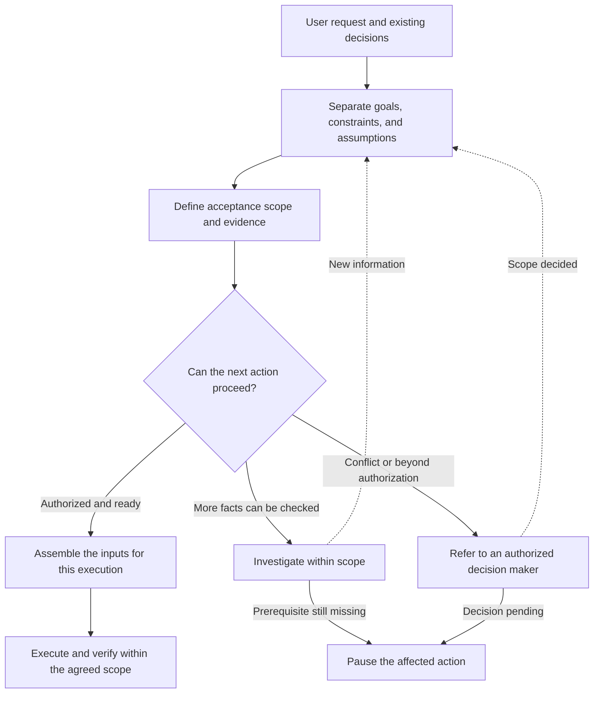

# Chapter 4. Intent Engineering
## From a Vague Request to a Bounded Goal

“Improve this UI.”

That could mean clarifying the information hierarchy, changing the visual style, making the interface easier to read during combat, or making a dangerous condition easier for players to notice. An agent could enlarge some text, adjust colors, and pass its checks while leaving the problem that prompted the request untouched.

The first three chapters looked at how delegation changes who interprets a goal, acts, and responds to feedback. Now we can ask a more practical question. How do we record the change we want so different people and different execution attempts can come back to the same goal?

I call this *Intent Engineering*. It organizes the desired outcome, motivation, boundaries, and acceptance criteria in a description people and agents can keep referring to. It builds on requirements clarification, change control, and acceptance design. As an agent gains discretion over the steps, the project has to keep the goal visible and decide which parts can change when new information arrives. The save examples in this chapter are for teaching.

## 4.1 Identify the Problem Before Choosing the Method

An actionable goal answers four questions. Why do the work? What result do we want? Which boundaries apply? How will we judge the result? “Change the loader” describes an activity. It leaves open who will be able to do what after the change. “Improve compatibility” names an effect but gives us little to check.

Motivation is particularly easy to omit. Suppose someone asks to make a status bar 15% shorter because it overlaps enemy information at a particular resolution. If the 15% is a binding design decision, the agent should preserve it. If it was a first suggestion, the agent can propose another layout that removes the overlap. The agent can look for an existing decision and ask for clarification if the answer changes the choice of implementation.

I use *Intent over Instruction* for this approach. State the goal and boundaries before choosing steps that require judgment. Some tasks still call for precise instructions, such as moving a file, making a prescribed tool call, or following an approved migration procedure. The agent should follow those steps while using the motivation to understand the work.

Here is the teaching request used in Chapters 4 and 5.

> Keep old saves usable in the target version. Preserve the existing save format and leave the rest of the save system outside the change.

The request gives us a direction. We still need to find out which versions count as old, what “usable” includes, and which build we are targeting. The task can start by finding those answers and leaving the scope open until they are confirmed.

## 4.2 Requirement, Intent, Task, and Agent Input

A short brief can hold all four objects while keeping their responsibilities clear.

| Object | Meaning in this book | Role in the save example |
|---|---|---|
| Requirement | A need or constraint raised by a stakeholder | Existing players should be able to continue a game, and the format should stay the same |
| Intent Artifact | A durable record of the desired outcome, motivation, identity, and scope | Restore continued use of specified older saves in a named target version |
| Task | A unit of work that can be assigned now | Investigate the failure, implement a local fix, or check migration samples |
| Agent Input | The assembled material an agent actually receives for a run | The goal, selected code, rules, tool capabilities, and output requirements |

Requirements can contain conflicts or preferences waiting for a decision. A revision of the wording alone cannot settle them. If a Task comes from an Intent, retain how the task's scope and acceptance relate to it. Rules or events can also trigger investigations, incident response, and maintenance directly.

A *Prompt* is the textual instruction or message in an Agent Input. It can be kept, versioned, and reviewed. A long-running Intent can serve several executions, while each execution combines it with the context, tools, and boundaries available at the time.

## 4.3 Turn a Request into a Minimal Task Brief

Keep the user's words and distinguish confirmed requirements, facts you found, and assumptions you made. The versions, paths, and roles in this example are placeholders. Suppose an existing decision confirms that only `v2` saves are in scope, that `R` is the target build, and that an existing delegation permits a local implementation and tests.

| Item | Minimal task brief |
|---|---|
| Motivation and outcome | Players with `v2` saves can load their progress in build `R` and continue through one specified action |
| Scope | Investigate and repair the connection between loading and migration. Use copies for verification and preserve the original saves |
| Explicit constraints | Keep the target format unchanged. Leave the rest of the save system and gameplay rules outside the change |
| Acceptance scope | Agreed samples load, key progress fields survive, repeated loads follow the contract, and the target scene supports continued play |
| Open questions | Do we have all agreed variants? Where can we get a sample with optional fields missing? Can failure leave a partial write? |
| Authority reference | Existing delegation covers the local change and verification. Expanding supported versions, changing the format, or overwriting real user data requires separate handling |
| Output | The change and check results, samples actually covered, uncovered conditions, and suggested next actions |

The task's existing entry point can hold a brief like this. If people will reuse it across executions, give it a stable identifier, owner, and revision.

“Only `v2` is required for this task” records confirmed scope. “So far I have only found `v2` samples” records current information. Keep both meanings available. Likewise, “we think a missing field can take a default” remains an assumption to check.

The same issue arises in design work. In lessismore, a reward proposal used prices on paper and income along a route to reason about what 30 gold would do. Calibration against the project changed judgments about what players could buy, when they could heal, and what the opportunity cost would be. The team retained the proposal as an alternative. The task tested which assumptions would affect the design choice. The simulation was a design exercise about possible player behavior. See [Chapter 23, section 23.44](/chapters/23-en.html) for the task and its sources.

## 4.4 Give Each Part of Acceptance Its Own Check

*Acceptance Criteria* say which outcomes can enter a named acceptance decision. *Required Evidence* says what material that decision needs. Match the two before implementation so the checks that happen to pass do not become the acceptance standard after the fact.

| Acceptance dimension | What to observe | What remains outside that observation |
|---|---|---|
| Format and data preservation | Fields, default values, and migration output from specified copies | Compatibility with every historical save |
| Behavior | Continued play through the required action after loading in the target build | A successful parse by itself leaves continued play unverified |
| Errors and side effects | How invalid input is rejected, whether failure damages the original copy, and whether it leaves partial writes | Ordinary samples say little about the safety of failure paths |
| Product and experience | If messaging or the recovery experience is in scope, have the appropriate role check what the user sees | Experience acceptance still requires its own judgment |
| Decision scope | The version, sample set, and purpose accepted by the authorized person | Adoption and release each require a separate decision |

The right dimensions depend on what could change. A wording change may only need a readback. A change that writes saves calls for knowing what happens to the data on failure.

If an acceptance criterion says the load should be faster, compare with a before-change baseline under the same conditions. An after-change timing alone gives no comparison. If a key sample is missing, continue with investigations and implementation that do not depend on it. The final conclusion still has to name the gap. [Chapter 8](/chapters/08-en.html) and [Chapter 9](/chapters/09-en.html) explain the distinctions between results, evidence use, and authorized acceptance.

## 4.5 Handle Unknowns That Affect the Next Action

A vague request can leave useful work available. To decide how to handle an unknown, ask whether it affects the next action, whether a mistake can be undone, and what existing authorization covers.

### Figure 4-1 From a User Request to the Next Action

The solid arrows show action choices. Dotted arrows show when new information or a decision calls for updating the brief. The figure omits the steps internal to execution. Readiness concerns the next action, and the brief records the basis for action without itself granting authorization. If the search yields no new lead and the gap still blocks the next action, pause that action. Independent authorized work can continue.

For example, check whether a `v2` sample exists. If you find one, inspect it. If you cannot find one, record where you looked and what is missing. If the gap only affects a final compatibility claim, already authorized implementation preparation can proceed. An action that would overwrite the only copy of data requires more than an optimistic assumption.

| Situation | What can proceed | When to stop or decide again |
|---|---|---|
| It is unclear whether reading or migration failed | Read the relevant implementation and diagnose with authorized copies | The next action touches data outside authorization or has an irreversible effect |
| An agreed sample is missing | Search within scope and continue work that does not depend on the sample | Leave the variant outside acceptance and report the gap when there are no new leads |
| A local choice is reversible and can be checked | Record the key assumption, implement, and check | An assumption fails or the scope changes |
| A fix appears to need a new save format | Offer local adaptation, a narrower scope, or a format change as options | A format change exceeds the current delegation, so pause affected actions |
| The goal, delivery date, and rules in force conflict | Record the conflict and send it to the role identified by the rules | If priority or authority is missing, keep the issue open |

Escalation can go to an authorized Controller, an existing gate, or a human decision maker. The available path depends on the existing rules. The ability to make a change still depends on the authority to make it.

## 4.6 Give Each Role an Execution View

An *Execution View* is the part of an Intent selected for a particular role and task. An implementer needs a local outcome, boundaries on changes, and check requirements. A reviewer needs acceptance criteria, known risks, and material for independent inspection. A coordinator needs dependencies and the name of whoever can authorize exceptions.

A view has to preserve constraints that change the meaning of an action. “Restore old save loading” gives an implementer a different task if it omits “keep the format the same.”

The execution view is part of the input. Assembling the rest requires the Context selected in [Chapter 5](/chapters/05-en.html), references to applicable Policy and Decisions, tool capabilities, the [Execution Contract](/chapters/07-en.html), and output requirements. The Intent records the desired result. The contract records how this execution may act and end under the applicable authority.

Current code, sample availability, and the latest run result are state and observation material. Keep their sources visible. Urgency is a property of the goal and does not give the agent permission. A short document can carry the references while retaining their different meanings.

## 4.7 Give the Goal an Identity Across Attempts

An *Attempt* can end before it reaches the target. It can also complete implementation and wait for acceptance. One goal can therefore have several attempts. Failure on one attempt leaves the Intent in place unless a separate decision changes it. An acceptance decision may apply only to one result and one use, with both the continuing goal and release still open.

When an intent needs long-term reuse, its artifact can record an identifier, revision, owner, source or Parent, motivation, desired outcome, scope, constraints, acceptance criteria, and references to relevant decisions. Logs, runtime state, and source evidence can remain in their own records.

Lifecycle labels describe what has happened to the Intent. `draft` means it is being written. `approved` means it has passed the applicable approval decision. `active` means it is being used. `superseded` means a revision replaced it. `cancelled` means it was called off. Use existing task records if they can already express the distinctions. Leave an attempt's `PASS`, failure, or result acceptance with the attempt and decision that produced it.

The *Intent Owner* maintains the goal description and its decision path. Authorized people or organizational roles can change the ultimate value goals or Parent Intent. An agent can propose, derive, or maintain local goals inside an explicit delegation. A stronger model, more tasks, or a longer run does not extend that grant.

## 4.8 Preserve Inherited Constraints and Conflicts

Investigation, implementation, and verification of a save migration usually need only a few linked tasks. Give a piece of work a *Child Intent* if its outcome, scope, and lifecycle need independent maintenance.

When dividing the work, retain parent constraints that still apply, non-goals, acceptance mappings, and decision boundaries. A verification task still has to account for a missing-field variant even if ordinary samples are easier to get. The implementation task should preserve the format constraint. Attach any exception to the decision authorizing it.

Several valid requirements can conflict. Suppose old saves must remain usable, existing policy prohibits a particular parser path, and the release plan calls for a freeze this week. The agent can investigate alternatives and make the costs visible. Local adaptation may add implementation and verification. Narrower support leaves some users affected. Delay changes the delivery commitment. The project has to choose among those implications.

Follow existing rules if they set priority and assign a decision maker. Otherwise record the options, affected scope, and open issue. Pause dependent actions and continue independent work with sufficient authorization.

## 4.9 When Execution Reveals a Need to Change the Goal

Start by finding which part of the task the new fact changes. It may call for a new implementation approach, invalidate a technical premise, or change the goal and authorized scope.

A smaller fix that satisfies the same criteria is usually an implementation choice. A new target build calls for checking the code, samples, and applicability of the original checks. Supporting another save version or changing the format calls for updating the goal and bringing the new trade-off to someone with authority.

After updating the goal, state which constraint changed, which tasks still fit, and which need to be checked again or stopped. Older versions and results retain their historical meaning. The new decision changes future uses. The historical record still shows which checks actually ran.

If only ordinary `v2` samples are found, record the special variants that remain uncovered. The team can seek samples, narrow acceptance, or defer a related decision. If a person has authority over the scope change, [Chapter 12's decision interface](/chapters/12-en.html) can present the choice explicitly.

## 4.10 Choose the Amount of Structure the Work Warrants

Executors need a goal, boundaries, a way to judge the outcome, and a path for handling missing conditions. Stable IDs, a separate registry, complete Parent/Child graphs, and dedicated interfaces can help when the work calls for them.

| Work | A suitable starting point | Why add structure, and what it costs |
|---|---|---|
| Local, low-impact, easy to reverse | A short brief at the point of entry and appropriate readback or checks | A registry can cost more to maintain than the change |
| Repeated execution or handoffs across roles | A stable goal reference, a mapping from scope to acceptance, and key assumptions | Traceable inputs help explain differences across attempts and require upkeep |
| High impact, several sources of authority, or difficult recovery | Explicit revisions, responsibilities, exception decisions, and evidence requirements | Makes trade-offs and responsibilities easier to locate. A copied template can obscure real uncertainties |

Duration and the number of agents can indicate coordination risk. A very short operation that overwrites data may warrant tight boundaries. Long read-only work may need little structure.

## 4.11 Hand the Goal to the Next Action

We can now act on the original request and check the result. Name the old saves and the target build. Retain the format constraint. Look for missing prerequisites, fix what falls within the delegation, and report what the checks actually cover.

One part is still missing. Which format specification, version of the code, samples, and historical decisions should the executor read? If those inputs are wrong, a clear goal can still lead to the wrong action. The next chapter uses the same example to show how to choose and supplement the information and how to proceed when it is missing, conflicting, or outside current access.
