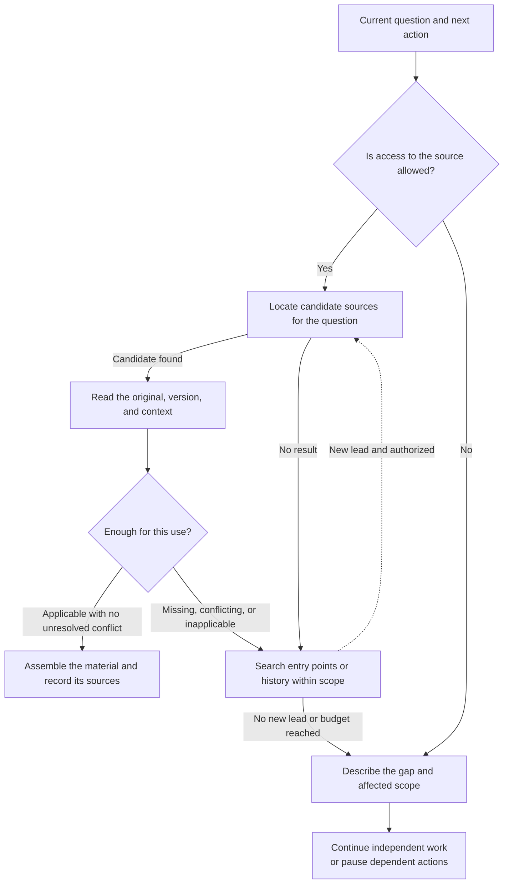

# Chapter 5. Context Engineering
## Choosing, Checking, and Supplying Information for a Task

The previous chapter turned a vague request into bounded work. Keep specified older saves usable in a target build while preserving the existing format. Even with a clear goal, an agent might receive an obsolete format specification, an example that uses a removed API, a historical summary that no longer applies, and a test result from another release.

If it changes the loader on that basis, we need to ask whether the information matches what it acted on. We can inspect the relationship between inputs, code, and observable actions. The bad outcome alone leaves the model's hidden reasoning unknown.

I have called Context the agent's “working world.” The phrase draws attention to what the agent receives. The material it can see is a partial view of the project. *Context Engineering* is the work of selecting, organizing, obtaining, condensing, updating, and recording the information available for the current task. The save example is for teaching, and the selection methods described here have to be evaluated for the work they serve.

## 5.1 Context Is a Selected Information Surface

*Context* is the selected information surface an agent can access during a particular reasoning or execution session. It influences the agent's working representation of the task. The project state and the model's internal representation are separate concerns.

A decision can exist in the project while remaining absent from the retrieval index. The system might be able to retrieve it without selecting it for this task. The decision might reach the input without being understood or applied. Each stage gives us a different question to check.

| Stage | What can we observe? |
|---|---|
| Project state and records | Which objects exist? What has already been recorded? |
| Available information | What can tools, indexes, and access boundaries supply? |
| Selected Context | Which sources were chosen for this question? Which were left out? |
| Agent Input | What content was transmitted, or which access points were opened? |
| Observable use | What use is visible in later output, references, or actions? |

Context Engineering manages the selection and supply of information. The execution environment assembles the Agent Input. Giving an agent more material may make information accessible while leaving comprehension and use open. Prompt Engineering can also involve selecting and presenting background. Our concern here is who supplies and maintains the sources across files and runs.

## 5.2 Separate the Requirements, the Material, and the Assembly Record

A Context Pack can be used to mean “what the agent should receive” and “what it actually received.” After execution, that makes omissions hard to see. Give these records distinct responsibilities.

| Object | Responsibility | Save example |
|---|---|---|
| Context Contract | What information the execution needs, may receive, or must exclude, and what to do if it is missing | Identify the target build, loader entry point, current format, and authority boundaries. Real user saves require the applicable permission |
| Context Pack | The files, excerpts, summaries, and indexes actually transmitted | Current task brief, relevant implementation excerpts, sample references, and their sources |
| Context Manifest | Which sources and versions were supplied or made accessible, with known omissions | Which format description and worktree revision were used, when they were checked, and which sample remained missing |

The contract can be part of the [Execution Contract in Chapter 7](/chapters/07-en.html). A manifest can be a few lines in the task record. It records what was offered. An *Access Log* separately records reads visible to tools. Verifying the source and establishing how a model used it call for different evidence.

For the save task, a brief can say, “Start at the loader entry for the target build and check the current format rules. Use approved copies of samples. Keep missing variants outside the verified claim.” Then record the paths, versions, and gaps actually found. This is easier to check than a long template if the entry point leads the executor to the right material.

## 5.3 Supply Enough to Start and a Way to Find More

*Minimum Initial Context* is enough information to understand the goal and boundaries and take the next step. *Progressive Retrieval* means looking for more information as new dependencies emerge. There may be several adequate starting sets.

For the save task, start with the brief, repository rules, target revision, and location of the loader. When you encounter the migration call, read its implementation. When a field comes from another module, find that module's contract. When you need to know why the old path survived, locate the decision made at the time. Each step should answer a question about the work.

Loading the entire repository adds unrelated information and reading cost. Freezing the initial pack can block necessary investigation. Give the agent an authorized scope and a way to obtain more information within it.

Some background cannot be derived from the code. A compatibility branch that appears redundant may have been retained for a reason a person can supply. Give priority to brief, sourced explanations for decisions and exceptions that have high impact, recur, or are easy to misread.

## 5.4 Start Retrieval With a Question

Keep the question and its conditions visible. To find out how the target build reads `v2` saves, look for the loader entry point and format contract. To find out why the format should stay the same, look for the decision in force and its rationale. Retrieving the most similar files for the word “save” can mix the answers.

### Figure 5-1 Use a Question to Guide Each Step of Retrieval

The arrows show the proposed relationship between retrieval and selection for the current task. The dotted arrow returns to retrieval when there is a new lead. When a source is unavailable under the current authorization, record the gap or obtain authorization for broader access. Applicability in the figure concerns the current use. Check provenance and normative authority according to the type of source.

The exit is material sufficient for the next action or an explicit reason that action lacks support. If you have checked the same sources and query and have no new lead, record the gap. Continue independent work, narrow the recommendation, or pause the dependent action. Rewording the same search repeatedly gives little basis for an additional conclusion.

## 5.5 Find Where Retrieval Failed

“Nothing found” can mean there were no matches, access failed, the original no longer exists, or many results proved irrelevant. Start by locating the failed step.

| Signal | What to check first | Possible action and stopping condition |
|---|---|---|
| No results | Query terms, index coverage, and whether the file was indexed | Use known paths, symbols, module entry points, or history within authorized scope. Retain the question and record what was searched |
| Only old versions | Does the question concern the past or current behavior? Does the file contain several periods? | Read the relevant passage and check what superseded it. Historical material can explain earlier choices |
| Conflicting sources | Are the object, time, and scope the same? Are facts and decisions being mixed? | Retain both sources and check the current implementation or decision in force. Pause dependent action if the decision remains unclear |
| The summary answers, but the original is unavailable | Provenance, broken references, and allowed archives | Repair the entry point or report the missing original. Leave conclusions that need it open |
| Access is denied | Authorized public descriptions, redacted material, or a result from an authorized reviewer | Use a permitted alternative. Ask for access or a decision when the original is necessary |
| Too much material or exhausted budget | Which candidates could change the next decision? | Read decisive conditions and counterevidence first. Record which material remains unread |

Queries can come from filenames, symbols, the user's words, or terms in a source you have read. Keep their connection to the original question, especially limitations such as “exclude this version” or “only in this scope.” [Chapter 15](/chapters/15-en.html) covers query transformation, improving retrieval after misses, and evaluating persistent memory. This chapter concerns how those results enter the current task.

## 5.6 Check the Source Against the Question

Suppose three teaching records coexist. An old design recommends upgrading the format. The current decision says to preserve it for this work. The code still contains an old migration function. All three can be accurate. The design could be a proposal, the decision governs the current action, and the call graph determines whether the function is still reachable.

To answer what actually ran, find runtime evidence. To answer what the implementation contains, inspect the corresponding revision. To answer what may be done, find the applicable grant and decision. The source and the decision each answer their own question.

When checking an original source, preserve its provenance, revision, scope, and relevant context. Describe uncommitted worktree contents as current observations and identify what was actually delivered separately. If a historical acceptance matters, name the object and conditions that were accepted and check whether they still match.

*Freshness* describes applicability to the current use. An old record can accurately explain why a change happened. A new summary can repeat a stale conclusion. Ask which conditions the current use depends on and which judgment a change in those conditions affects. [Chapter 6](/chapters/06-en.html) distinguishes Claims, State, Decisions, and Assumptions.

## 5.7 Preserve Conditions That Could Change the Decision

A summary is a new representation. It can lose exceptions, timing, and uncertainty. These two summaries leave the executor with very different things to work from.

| Summary | What the executor can infer |
|---|---|
| “Old saves work. Tests passed.” | The version, samples, untested paths, and intended use are unclear. The wording invites a general conclusion |
| “A copy of a standard `v2` save passed the load check on the target build. The missing-field variant is unavailable, and writes on failure are still open. See the result record.” | The executor can tell which action has support and what needs checking |

A summary for action or handoff should retain the question, scope of support, limitations, and links to original material. Negative conditions, rejected options, conflicts, and gaps in verification can all affect the decision. [Chapter 12](/chapters/12-en.html) develops compression for decisions in more depth.

A file index can be short. A brief for acceptance needs the decisive conditions. A summary written for a task also needs its own provenance, use, and maintenance justification to become a persistent Memory Record.

For important compression, list three to five of the original questions. Check that the summary answers each one or points to the original. Restore missing conditions or preserve the gap explicitly. Chapter 12, section 12.13 shows a concrete repair of a summary for a RandomHeroes buff rule. Chapter 23 retains the limits of the disposition in that episode. Mapping every question to an answer has a cost and suits handoffs or entry points that inform decisions.

## 5.8 Check Sources Along Several Dimensions

A useful match can lack authority over the rule in question. An authoritative original can apply only to an older version. A single confidence label would conceal the difference.

| Check | Question |
|---|---|
| Relevance | Which part of the question can this source answer? |
| Provenance | Can I find the original and trace its transformations? |
| Normative authority | If it directs an action, who had the authority to require it and in what scope? |
| Verification | What was checked? What remains unchecked? |
| Freshness and scope | Which version, environment, object, and use does it cover? |
| Conflict | Which records support, limit, or challenge it? |
| Access and instruction boundaries | Is it permitted to read, cite, or act on the material? |
| Cost | Is the cost of obtaining, reading, and maintaining it proportionate? |

These dimensions interact. Self-reported model confidence can prompt a check. The source and scope still determine what can be used. Access rules can limit who receives even correct material.

## 5.9 Record the Runtime Conditions That Matter

The right format file does not establish that a test is running against the intended build. The environment, loaded resources, feature flags, and sample paths can change the observation. Record the conditions that matter to the behavioral question.

A *State Snapshot* records state references within a defined scope and time, as described in Chapter 6. A Context Manifest records what was assembled for the run. An Access Log records reads the tools observed.

For recovery after interruption, refer to the [Checkpoint in Chapter 7](/chapters/07-en.html). Give the next executor the target revision, completed actions, artifacts, open issues, and next step. These records help people explain and reconstruct work externally. Repeating the same inputs can still produce different model outputs, and the record covers observable conditions.

## 5.10 Project Context for the Role and Keep Responsibility in the Handoff

*Context Projection* selects the material a role needs to access. The preceding chapter's *Execution View* selects the part of the goal the role needs to understand. Both feed the assembled input.

A migration implementer needs call paths, the format contract, and permitted samples. A reviewer needs the original acceptance criteria, actual changes, raw check results, and uncovered cases. An implementer's “complete” summary leaves too little for independent review. Stable shared sources can support several role-specific entry points.

A handoff should tell the next executor which responsibility it is accepting, which actions occurred, which sources still apply, and why the next step is allowed. Here is a more informative handoff than “code done, tests passed.”

> The local fix is complete. The standard sample passed its check. The special variant is still missing. Search the designated archive next. Keep full compatibility outside the conclusion until the gap is closed.

## 5.11 Memory, Skills, and External Material Enter as Sources

A persistent record first becomes a retrieval candidate, then goes through checks for current applicability and access. Repeatedly recording a conclusion gives it no new evidence. A historical Prompt can be useful without gaining authority to issue instructions for this run.

A *Skill* is a reusable work procedure that can contain background, steps, instructions, and tool requirements. Reading its explanation, adopting its method, and letting it change state are three separate choices. Check its revision and environment, then follow the active instructions and tool permissions.

The same separation applies to web pages, logs, issues, and third-party documents. Text in a retrieved page that asks to upload a file remains content from that page. Authorization comes from the active task. This is a boundary for use. [Chapter 19](/chapters/19-en.html) discusses enforcement outside the model and the protection of data.

## 5.12 Combine Mechanisms to Fit the Work

Static descriptions, layered documentation, search, role projections, and recovery records can be combined. The problem tells you what to change. Improve navigation if entry points are hard to find. Make scope explicit if people misread it. Repair handoffs when they lose unresolved issues.

| Design dimension | Options | Cost or failure mode |
|---|---|---|
| Source organization | Short entry point, layered descriptions, typed index | Too many or poorly maintained entry points can diverge |
| Retrieval | Direct file reads, symbol search, history search, RAG | Query or index gaps can hide a key constraint. Verify results against originals |
| Access and storage | Hot / Warm / Cold material for frequent, on-demand, or archival use | Storage tier says little about current applicability |
| Validity management | Mark what was superseded, no longer applies, or needs rechecking | Stale labels can keep outdated conclusions in use |
| Continuity | Task progress, manifest, or a necessary checkpoint projection | Overcompression can lose side effects and open issues |
| Role and boundary | Task-specific selection and role-specific access | Excessive filtering can deny reviewers the originals they need |

A *Context Capability Profile* can record the capabilities the project uses and which activities remain manual. It describes the current configuration. Choose between static guidance and dynamic retrieval by looking at task outcomes and upkeep.

## 5.13 Maintain the Entry Points

If the format changes, a rule is superseded, or a source path moves, somebody needs a way to update the affected index and summaries. A module maintainer might own the format specification while the task owner maintains the current material list. Temporary excerpts can use those existing responsibilities.

Prioritize breaks that change the next action. An example can point to a deleted API. An old decision can still be presented as a default instruction. A summary can lose its source. A brief can mix two versions. Consolidate duplicate entry points, identify replacement sources, and preserve exceptions that matter.

A record that no longer applies can still explain the past. Removing it from default context and deleting the original are distinct actions. [Chapter 18](/chapters/18-en.html) addresses evidence retention, retirement, and recovery material.

## 5.14 Evaluate Whether the Information Supported the Action

Distinguish at least three errors. The system fails to find relevant material. It finds material that does not apply. It finds and reads material, then applies it incorrectly. A hit count alone hides the differences.

For a teaching evaluation of the save task, choose questions in advance. What can change? Which code loads `v2`? Where is the sample with missing fields? Which prior options were rejected? List the original sources and key constraints for each question, then observe retrieval, source inspection, selection, and the answer the agent gives. This illustrates an evaluation design. Its representativeness and outcomes would need checking.

The necessary records are the question, source, omission, actual input, and unresolved conditions. It is useful to compare how different entry points affect lookup cost, misuse, and task outcomes. Automated indexing, vector retrieval, and complex assemblers are optional. Chapter 15 develops question selection and retrieval evaluation. To compare performance after removing a class of Context, fix or report the task, model and tool versions, order, budget, number of runs, and judgment criteria.

Also check separately whether material left the default reading surface, remained available in the archive, and was organized into applicable long-term knowledge. Archival navigation and recovery checks in lessismore appear in Chapter 18, section 18.21. Reducing the number of characters in the original gives no direct measure of model tokens, expense, or human attention.

We may finish with a collection of material that has identifiable sources, or with a gap we can explain. A standard sample is available. The special variant is still missing. Chapter 4's action boundaries help decide what to continue or pause. The next chapter deals with the distinction among facts, assumptions, decisions, and evidence, and how to handle conflicts between them. Retrieval, judgment, and execution can send the work back to any of those questions.
