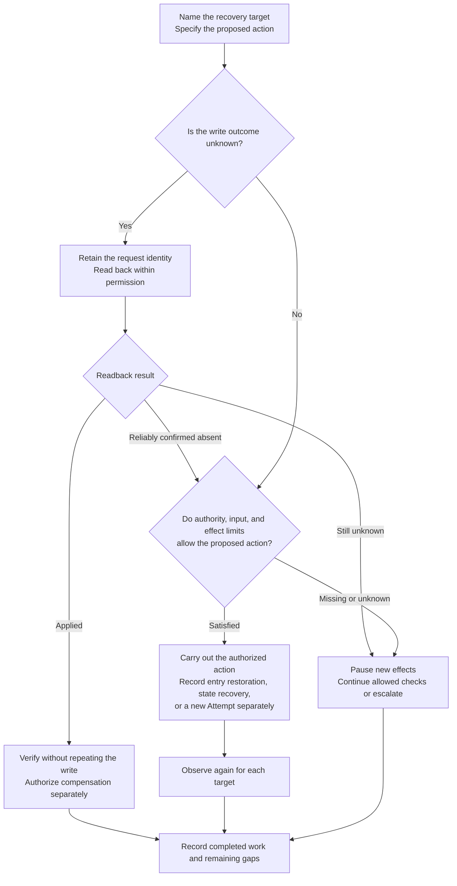

# Chapter 8. Agent Reliability Engineering
## Distinguishing Outcomes, Results, Failures, Unknowns, and Recovery

Chapter 7 separated the Work, its Execution Contract, and the Attempt. Once the Attempt starts, “Did it succeed?” is too broad a question.

We need to know what the Attempt did, whether the target ran and was observed, and what the test, verifier, or human evaluation checked. If something failed, where did it fail? What is still unknown? Should the project retry, recover, narrow the scope, ask for a decision, or stop the Work?

*Agent Reliability Engineering* is the work of classifying, containing, observing, and recovering from the consequences of uncertain execution. The categories here offer a way to reason about a run. Their completeness and the effectiveness of a particular retry, rollback, or sandbox depend on the work.

---

## 8.1 Reliability Depends on the Work

Stable code completion says little about the same agent's reliability in data migration, external calls, or production releases. At a minimum, reliability depends on several conditions.

- Work and target.
- Contract and allowed effects.
- Baseline, context, and environment.
- Agent, model, tools, and configuration.
- Evaluation coverage.
- Failure detection.
- Stop and recovery.
- Time and revision.

A general `agent_reliability_score` would hide those conditions. Record what happened to a named Attempt and target under named conditions and whether the project could respond within its boundaries.

---

## 8.2 Keep Three Result Relationships Distinct

```text
Attempt
├── Attempt Outcome
├── Target Result or explicit non-result
└── Evaluation Result(s)
```

| Object | Question it answers | What still needs its own basis |
|---|---|---|
| Attempt Outcome | How far did execution get and what effects did it have? | A result from the target |
| Target Result | What output or behavior did the target produce when it ran? | Verification of that output or behavior |
| Evaluation Result | What did a named check, test, verifier, or review conclude about a target and run? | Work acceptance, adoption, or release |

Some of the records can exist while others are absent. Suppose an Attempt starts a test harness and the harness stops on an integrity problem before reaching the target. The Attempt has an Outcome and the verifier has an Evaluation Result. The target has an explicit `non-result`.

---

## 8.3 Attempt Outcome Records the Effects of Execution

An *Attempt Outcome* is a result relationship tied to an Attempt identity. It records how far the execution went, what external effects occurred, and how the Attempt ended.

Examples include these.

- completed as contracted
- partially executed
- blocked before target
- paused at checkpoint
- cancelled
- timed out
- crashed
- stopped by policy
- external effect unknown

A project can choose its own labels. Make it possible to identify which actions happened, which side effects are known, where the Attempt ended, which targets it reached, and what outputs, unknowns, and remaining obligations it left.

An Attempt can finish as contracted and leave a candidate for subsequent evaluation. Work completion still depends on the criterion and decision for that Work.

---

## 8.4 The Target Result Belongs to the Target Actually Run and Observed

A *Target Result* is a typed result for a target's output, state change, or behavior after sufficient execution and observation. Bind it to the target identity, Attempt and input versions, environment, observation time and scope, result type, and known limitations and unknowns.

The result might be business output, a build artifact, a migration result, runtime behavior, or a response from an external system. The review of that result and the product decision about it are separate.

When a run affects several targets, report them separately. “The script failed” leaves open whether it wrote to the database. “The API returned 200” leaves open whether the downstream business state matches what was requested.

---

## 8.5 A `non-result` Records the Absence of an Evaluable Target Result

Use `non-result` when the trace establishes that the expected target was never reached, or that the identifiable result belongs to a different target. The run then produced no evaluable result for the expected target.

- A precondition blocks the execution before the target.
- A verifier or harness fails before reaching it.
- A required input or environment is missing.
- Authority, a credential, or permission is missing.
- Cancellation or timeout occurs before reaching the target.
- The actual subject is identifiable and differs from the expected target.

Keep the Attempt Outcome and any effects that already occurred. If the target or external side effect may have happened and the outcome is uncertain, use Unknown and `external-effect-unknown`. If the target ran and was observed with changed inputs, record the actual `observed_target`, the input difference, and its scope. The actual target can have a result, while the expected target has an explicit absence. A target that was never observed cannot receive either a pass or a fail based on that run.

---

## 8.6 An Evaluation Result Belongs to a Named Evaluation

An *Evaluation Result* is the result of a particular check, test, verifier, review, or human evaluation applied to a named target, run, and evaluation conditions. Preserve the following.

- Identity of the evaluator or generator.
- Target and Attempt reference.
- Criterion or encoded assertion.
- Input, environment, and configuration.
- Coverage and exclusions.
- A result such as PASS, FAIL, Partial, Unknown, Not Applicable, or Error.
- Generator integrity and known limits.

The narrow meaning of `PASS` is that the named evaluation in the named run did not trigger its failure conditions and provided scoped evidence for its encoded assertions. The broader Behavior Claim, necessity of the implementation scope, acceptance, adoption, release authorization, and untested scenarios each need their own basis.

Bind human evaluation to a target and criteria as well. A named human with the relevant Authority Grant decides the questions of aesthetics, experience, and direction reserved for human judgment. “Looks good” leaves the scope and Decision Target unspecified.

---

## 8.7 Failure Is a Scoped Classification

A *Failure* is an observed, unacceptable deviation from a named contract, target, criterion, or expected state. Say what failed and against which standard.

| Failure Surface | Example | What remains open |
|---|---|---|
| Intent / Scope | Execution aims at something inconsistent with the effective Intent | Whether the departure was deliberate |
| Context / Baseline | It uses stale material or the wrong revision | Whether model capability contributed |
| Planning | The path omits a required step | Whether the target ultimately failed |
| Tool / Environment | Tool error, missing dependency, or unavailable service | Whether the target has a defect |
| Execution | Actions did not complete as specified in the contract | Root cause |
| Target | The behavior misses the criterion | Whether the evaluation was correct |
| Evaluation | The test, verifier, or observer itself fails | Whether the target failed |
| Reporting | The report conflicts with observable facts | Whether the underlying execution was wrong |

A Failure Classification is the current explanation. New evidence can narrow, split, or overturn it. If a change precedes a test failure in the trace, an environmental difference, changed baseline, concurrent work, a test defect, or another factor could still explain the result.

---

## 8.8 Preserve Unknown, Partial, and Conflict

A record needs to express more than PASS and FAIL.

- **Unknown.** The current material cannot support a judgment.
- **Partial.** Only part of the target was completed or observed.
- **Conflict.** Observations or evidence are incompatible.
- **Stale.** The result no longer applies to the current baseline.
- **`non-result`.** The run yielded no evaluable result for the expected target.

An unknown can limit later actions even when no failure has been established. A partial result needs to name coverage and omissions. Conflicting observations need to remain visible after the next write.

An unknown that affects an irreversible or high-impact action usually calls for a stop, narrowed scope, or authorized decision. A low-impact disposable task can often end with the unknown recorded.

---

## 8.9 A Retry Creates Another Attempt

A retry can resolve a transient error. It can also repeat the same unproductive path, multiply external effects, change inputs or environment, produce a different failure, cost time and money, or hide instability behind the final pass.

At a minimum, a retry should keep the following.

- The preceding Attempt and its Failure Classification.
- A new Attempt identity.
- A limit on count, time, or cost.
- Idempotency or handling for side effects.
- Whether the baseline is still valid.
- A reason for keeping the strategy or an explanation of the change.
- The stop or escalation that follows when the limit is reached.

A material change in input, contract, authority, or environment can require a Rebase before the new Attempt. Preserve retries even if the last one passes. Later decisions may need to tell stable success from a single success or from success under several different conditions.

---

## 8.10 Define What Recovery Has to Achieve

*Recovery* is the authorized response to a failed, unknown, or unacceptable Attempt, target, or environment. It aims to reach a named state the project can accept or use for further judgment.

- **Rollback.** Restore a known prior state.
- **Forward Correction.** Fix the condition through a smaller or compatible new change and retain the history.
- **Fallback.** Switch to a less capable path with clearer boundaries.
- **Compensation.** Counter an effect already produced that cannot directly be reversed.
- **Checkpoint Resume.** Continue if the prerequisites remain valid.
- **Human Takeover.** Give execution or judgment to a person with authority.
- **Safe Discard.** Discard an Attempt whose external effects do not require preservation or repair.

A recovery plan states the target, current unacceptable condition, required authority and permission, new actions and their effects, conditions for success, failure, or `non-result`, and the Claims to evaluate again.

A Recovery Decision is a Decision Record that targets a named recovery action or state. A Recovery Attempt uses Chapter 7's Attempt. Recovery Outcome uses Attempt Outcome, Target Result, and Evaluation Result. They can share a record, while authorization, execution, observation, and acceptance keep their separate meanings. Preserve the original Attempt and add the recovery actions and outcomes.

### A Recovery Brief Someone Can Execute

Suppose work stops at “write request sent, final state unknown.” This is a teaching example. An immediate retry might issue the reward twice. Reopening the task entry gives no evidence about the earlier write. Start with a narrow recovery brief.

| Item | Minimum for this situation |
|---|---|
| Recovery target | Establish whether the write took effect, then decide whether to continue, compensate, or hand over |
| Current state and effects | Preserve the request identity. Read back state while the effect is unknown |
| Minimum material | Request, target identity, input and version, and the path to read persisted state. Add a valid checkpoint and its dependencies for Resume |
| Execution | Read back by request identity and branch on applied, reliably confirmed absent, or still unknown |
| Stop condition | If the original is missing, the target differs, or readback fails, pause actions that depend on the result. Keep permitted read-only checks available |
| Reobservation | Record whether the action executed, what state the target reached, and which conditions remain open |

The brief also states what can follow each readback.

| Readback | Next action | Conditions that still apply |
|---|---|---|
| Applied | Verify the target result and continue permitted work without repeating the write | Check that the result belongs to the same request and target |
| Reliably confirmed absent | Propose a retry and execute it when the conditions are met | Authority, input, and target still apply. Retry count, idempotency key, and concurrency conditions are satisfied |
| Still unknown | Pause new effects. Preserve request identity and continue allowed read-only checks or escalate | A timeout or one missed lookup leaves delayed writes possible. Escalation leaves the effect unknown until checked |

If the write took effect and needs correction, authorize compensation separately. Identify which effect to compensate, in which order, who authorizes it, and how to check the result. A new Attempt preserves the earlier uncertainty until there is evidence about it.

“Recovery succeeded” needs an object. Restoring a task entry lets someone find the work again. Restoring state requires the original state and dependencies. A new execution produces a new result. An agent checkpoint preserves the external decision environment needed to continue work. A game save preserves product runtime state. Their recovery inputs and verification conditions differ.

The [lessismore S5 material record](../../Evidence/receipts/ER-20261122-002__CLM-C18-002.md) gives a real boundary. After an earlier original could not be found in the places searched, a new Run and Visit were created. The new generation checks had 26 passes and the continuation checks had 30. Those results support the specified new execution while the earlier original remains missing. A symbolic-link alias blocked the first closeout inventory. A later bounded inventory covered the alias. The record still called for review, retained the originals, and preserved holds that had not been lifted. Neither the new checks nor the inventory restored the old S5 material. Recovery and closeout each had open work.

### Figure 8-1 Name the Recovery Target Before Deciding Whether to Proceed



This is a teaching diagram. An unknown write goes to readback first. Pause new effects that depend on the unknown state and allow permitted read-only investigation to continue. Restoring an entry point, restoring state, and starting another execution can coexist. Record each result separately. Compensation may lead to a named state from which work can continue. Reaching the historical state requires its own evidence.

Chapter 18, sections 18.21–24, considers which material to retain and which abilities retirement gives up. Recovery requires a named target and a check on its prerequisites. A complete worktree image is useful if that target actually depends on it.

---

## 8.11 Isolation Limits the Blast Radius

Sandboxes, read-only mode, separate worktrees, temporary databases, mock services, and least-privilege credentials can limit the *Blast Radius*. This is the set of assets, users, environments, and downstream systems an error can directly affect.

Target behavior, production representativeness, external calls, secret, license, or privacy compliance, and successful recovery each need their own checks. Match isolation to the Action Sink. File write restrictions leave authorized network calls possible. A test database alone cannot protect sensitive data copied into an external Context. Chapter 19 develops security, privacy, supply-chain, and IP boundaries.

---

## 8.12 Reliability Signals Can Trigger a Response

These signals can justify a pause, a narrower action, reobservation, or escalation.

- unexpected failure
- repeated retry
- scope expansion
- state mismatch
- tool uncertainty
- unknown dependency
- detector or verifier integrity problem
- recovery path unavailable

The appropriate response depends on impact, reversibility, current authority, the Policy Floor, and capacity for recovery. A first timeout on a read-only query might call for a note and one retry. A state mismatch in a production migration may require an immediate stop even on its first occurrence. The executor can add checks, pause, or seek help while following the applicable floor. A signal is an input to a decision about response and cause.

---

## 8.13 Make the External Conditions Recoverable

An agent can produce different output under the same Prompt. To check earlier work, make these conditions locatable.

- Agent, model, tools, and configuration.
- Intent, contract, and Context versions.
- Input, baseline, and environment.
- Observable actions and tool results.
- Checkpoints, stops, and retries.
- Attempt Outcome, Target Result, and Evaluation Result.

The records help later reviewers check applicability, find gaps, and rerun key steps. They describe external conditions and permit a bounded reconstruction. Bit-for-bit replay is a different requirement. Logs without identities, versions, and boundaries can still leave reviewers unable to tell which target ran.

---

## 8.14 Reliability Metrics Need a Denominator and an Observation Boundary

Candidate metrics include Task Success, First-pass Success, Rework, Regression, Rollback, Human Intervention, Scope Violation, and Evidence Failure. Compare them only after defining their scope.

- Who defines the task and success in Task Success?
- Do prechecks, retries, and human corrections count within the same First-pass Attempt?
- Is Human Intervention a risk or the intended control for consequential work?
- Do more rollbacks signal instability or real use of a recovery mechanism?
- Does Evidence Failure describe the target, verifier, or coverage?
- How does the denominator handle undetected Silent Failures?

Bind each measure to the workload, version, time window, observation coverage, and intended use. A percentage can sit alongside information about the distribution of failures, tail risks, and irreversible losses. Whether a particular agent, workflow, or governance arrangement is more reliable requires a separate evaluation.

---

## 8.15 The Verifier That Changed Its Own Inventory

In D-048 of AI Game Dev OS v4.94, ordinary Python imports caused the Launcher to change its own protected inventory before the target Compile Harness ran. An exact-inventory check noticed the change and stopped the run. The target runtime directory and compile result were never produced.

```text
Attempt Outcome:
  stopped before target after verifier self-mutation

Evaluation Result:
  exact-inventory check detected a real integrity change

Target Result:
  non-result; target compile was not executed and observed
```

The detector's finding was valid. The direct engineering defect was that the verifier changed its own inventory. Distinguish verifier and target results when a verifier can fail independently, change what it observes, or stop before reaching the target. A low-risk task can retain this distinction in one record.

Declared output that is isolated and preserves the identity of the subject and the scope of interpretation can be ordinary behavior. The available material does not include a rerun of the historical harness, so the effect of the proposed correction remains open. See the [D-048 verifier case record](../../Evidence/receipts/ER-20260818-002__CLM-C06-004.md) for sources, counterevidence, and the bounds of the human decision. [Chapter 23](/chapters/23-en.html) places the episode in the larger case and traces its relationship to later failures and corrections.

---

## 8.16 A Minimal Record Proportional to Impact

### Disposable Read-Only Attempt

Record the Attempt identity, target, whether execution reached it, output, error or unknown, and conditions for safe discard.

### Reversible Change

Also retain the Start Baseline, change, Attempt Outcome, Target Result, Evaluation Result of the named checks, and retry and rollback boundaries.

### High-Impact or Irreversible Action

Consider rehearsal and independent evaluation, a Side Effect Inventory, compensation or forward correction, human takeover, observation in the target environment, the relevant recovery outcomes and results, and renewed authorization.

Across these cases, preserve whether the target actually ran. It determines how its outcome can be recorded.

---

## 8.17 Common Anti-Patterns

1. **One Result Field.** Attempt, target, and evaluation share a `status`.
2. **Verifier Failure = Target Failure.** A prerequisite error becomes a target FAIL.
3. **PASS = Done.** An evaluation pass becomes Work completion or release.
4. **Last Retry Wins.** The last pass overwrites earlier failures and effects.
5. **Failure = Root Cause.** A current classification becomes established causation.
6. **Force Unknown into a Binary.** Choose PASS or FAIL with no observation.
7. **Rollback = Recovery.** Skip checking the target state after rollback.
8. **Sandbox = Safe.** Isolate one resource while ignoring network, data, and credentials.
9. **Metrics Without a Denominator.** Omit the workload, version, window, and silent failure.
10. **Recovery Overwrites History.** Delete or change the earlier Attempt after a forward correction.

---

## 8.18 Interfaces With Other Chapters

| Chapter | What this chapter uses | What is defined there |
|---|---|---|
| 4–6 | Intent, Context, State Claim, Evidence, and authority boundaries | Truth, Decision, and Policy types |
| 7 | Work, Contract, Attempt, Checkpoint, and Bounded Execution | Execution identities and permitted actions |
| 9 | Evidence Use, Decision Target, Acceptance, Adoption, and Release Authorization | Normative uses of results |
| 10 | Review Target, Finding, and Review Disposition | How review challenges a result |
| 13–14 | Authority, Risk Trigger, Observation, Detector, and Intervention | Governance and control |
| 18 | Trace, Release Execution and Outcome, and Accountability | Long-term traceability of results |
| 19–20 | Security Boundary, Operational Outcome, Metric, and Drift | Security and operational effects |
| 21 | Lifecycle Transition | How results enter the next state |

Chapter 8 first defines Attempt Outcome, Target Result, Evaluation Result, Failure, `non-result`, and Recovery. Chapter 9 follows Evidence into later decisions. Chapter 10 covers Findings from reviews. Chapter 21 integrates the transitions.

---

## 8.19 Checklist

### Recording Results

- Can we distinguish Attempt Outcome, Target Result, and Evaluation Result?
- Did the target actually run and get observed?
- Can we retain `non-result`, Unknown, Partial, and Conflict?
- Does PASS name the evaluation, run, and coverage?

### Recording Failures

- Which contract, target, or criterion defines the failure?
- Is the classification an observation, a contemporaneous judgment, or a retrospective causal hypothesis?
- Can we tell verifier, target, and reporting failures apart?
- Are alternative explanations and counterevidence visible?

### Retry and Recovery

- Did the retry get a new Attempt identity?
- Are side effects, idempotency, and retry limits clear?
- Can we distinguish the recovery target, authority, and outcome?
- Was the target state observed again after rollback or forward correction?

### Metrics

- Is the denominator clear, with the workload, version, and window?
- Do we acknowledge silent failures and observation gaps?
- Does the use of the metric stay within the evidence, especially for causal claims or cross-project rankings?

---

## 8.20 Conclusion

Reliability begins by naming what an uncertain execution produced and what it left open.

```text
Attempt
→ observable Attempt Outcome
→ Target Result or explicit non-result
→ scoped Evaluation Result
→ classified Failure / Unknown
→ authorized Retry, Recovery or Stop
```

Attempt Outcome tells us what execution did. Target Result belongs to a target that ran and was observed. Evaluation Result belongs to a named evaluation. A failure needs a scope, and `non-result` preserves an absence. Recovery adds actions and results to the history.

The next question is which claims these results support and how evidence informs authorized decisions about acceptance, adoption, or release. The next chapter takes that up.
