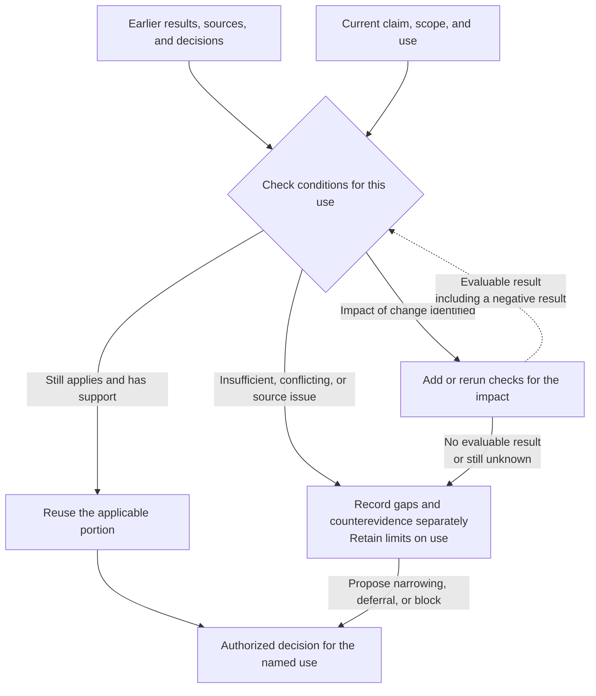

# Chapter 9. Verification and Evidence Engineering
## How Evidence Informs an Authorized Decision

Chapter 8 separated Attempt Outcome, Target Result, and Evaluation Result. A result needs context before anyone can rely on it. What Claim does it bear on? What scope, revision, and environment does it cover? Where did it come from, and how do we intend to use it?

Four questions run through this chapter. How do assertions of completion, observed results, verification, and acceptance relate? When do different types of evidence fit different claims? How do we retain provenance, current applicability, coverage, gaps, and counterevidence? When can a test pass produce an acceptance decision?

Evidence Coverage, Evidence Use Context, Evidence Portfolio, and Decision Disposition are proposed ways to keep those relationships visible. The chapter concerns how evidence enters a named decision and the scope of the disposition that follows.

---

## 9.1 From Result to Evidence Use

A Result records something execution or evaluation produced. Evidence is inspectable material that can support, challenge, or limit a Claim. Both may reference the same artifact.

```text
Attempt Outcome / Target Result / Evaluation Result
+ provenance and observation boundary
→ supports / challenges / limits a Claim in Scope
→ is considered for an Intended Use
→ informs, but does not create, a Decision
```

A target may produce a result before evaluation. A test can pass for a local assertion. Evidence may fit development feedback while leaving qualification open. An authorized person can accept evidence and leave adoption open. Release can be authorized before execution or observation in the target environment.

> **Encapsulate Execution, Expose Evidence.**

A project can encapsulate execution details in proportion to risk. Keep results, change scope, evidence, unverified assumptions, risks, scope changes, unknowns, and the trace needed to make the decision inspectable. A reviewer can then locate the material that matters without reading every search and attempt. An externally inspectable record is the basis for transparency.

The same applies to *Evidence over Confidence*. Model-reported probabilities, tone, and past success rates can provide signals. The claim at hand still depends on observations and checks that match it.

---

## 9.2 Completion Has Several Dimensions

“Done” can mean an agent reported completion, code changes exist, the target behavior was observed, checks passed in a stated scope, an authorized role accepted the candidate as a baseline, or the result was adopted or authorized for release.

| Dimension | Question | Example |
|---|---|---|
| Completion Claim | Who asserts which work is complete? | “The command-response correction is implemented” |
| Observation Status | Which target was actually observed? | target executed / target not observed |
| Validation Status | Which Claim and scope does the evidence cover? | `verified-for-scope` |
| Decision Disposition | What did which authority accept, reject, or leave open for which target? | accepted as E1 source baseline |

This sequence is useful for teaching.

```text
Claimed Completion
→ Observed Completion
→ Verified Completion
→ Accepted Completion
```

The first three stages mainly describe an assertion and what has been established about it. Acceptance describes an authorized decision. A single monotonic `completion_level` would hide that distinction.

```text
completion_claim = submitted
observation_status = observed
validation_status = verified-for-scope
decision_target = E1 source baseline
decision_disposition = rejected
```

Here the evidence supported the tested behavior and the authorized role rejected the candidate's implementation scope. The record also needs to tell us what any acceptance applies to.

```text
accepted_for = evidence chain
accepted_for = source baseline
accepted_for = qualification result
accepted_for = release decision
```

These are example values. The important question is which `decision_target` was accepted. See the [Completion and Decision Disposition case record](../../Evidence/receipts/ER-20260818-004__CLM-C09-002.md). The cases give us a reason to consider these dimensions. Their general usefulness remains open.

---

## 9.3 Three Questions About Evidence

### 9.3.1 Evidence Coverage

*Evidence Coverage* describes which Claim, revision, environment, and scope a piece of evidence supports or contradicts.

```text
unsupported
partial
verified-for-scope
counterevidence
unresolved
```

Coverage changes with the target Claim. The properties of a file alone do not give it a permanent coverage score.

### 9.3.2 Evidence Use Context

*Evidence Use Context* describes the decision setting for which evidence is gathered.

```text
development feedback
bounded regression
qualification
acceptance decision
adoption decision
release decision
```

A project can define its own profiles. The same material can be suitable for one use and insufficient for another.

### 9.3.3 Decision Target, Decision Record, and Disposition

The *Decision Target* identifies the object and intended use of a normative decision. The *Decision Record* stores the judgment a named authority made under a valid grant, with the scope, rationale, limitations, and conditions for review.

A *Disposition* is the outcome recorded for that Decision Target. It tells us who made what judgment about which `decision_target`. Evidence Disposition, Reliance Disposition, Result Disposition, Change Disposition, Operational Disposition, and Fitness Disposition share this relationship. Each has its own evaluation criteria.

```text
accepted
rejected
deferred
blocked
```

Without a named Decision Record, write `not-decided`, Pending, or another explicit absence. Use a disposition when the authorized judgment has occurred.

```text
Evidence
→ supports / challenges / limits a Claim for a Scope
→ is considered for an Intended Use
→ informs a Decision Record and its Authorized Disposition
```

An applicable Authority Grant gives the decision normative force. Strong evidence, tool permission, and prior successes can inform a decision but cannot supply the grant.

---

## 9.4 From an Evidence Stack to a Portfolio

A familiar Evidence Stack orders the following materials.

```text
Text Explanation
→ Diff
→ Static Analysis
→ Automated Test
→ Runtime Observation
→ User-facing Validation
→ Production Metrics
```

This can show increasing exposure to the running system and its users. Suitability still depends on the question.

| Evidence | Claim it can support | What needs other evidence or a decision |
|---|---|---|
| Text Explanation | What was changed and what intent or limits were stated | Whether a target behavior actually occurred |
| Diff | Which repository contents changed | Whether the runtime behavior is correct |
| Static Analysis | Static properties under stated rules | Dynamic results in the target environment |
| Automated Test | Behavior of selected scenarios in a test environment | Necessity of implementation scope, adoption, or release authority |
| Runtime Observation | Actual behavior in a specified build and environment | Behavior in unobserved scenarios |
| Human / User-facing Validation | Experience, aesthetics, or business acceptance | Behavior at production scale |
| Production Metrics | Changes measured in a deployed population | Causal source, source correctness, or unmeasured risks |

An *Evidence Portfolio* groups material for a claim and use.

```text
Claim + Scope + Risk + Intended Use
→ Required Evidence Portfolio
→ Coverage + Gaps + Counterevidence
```

Choose material that answers a concrete question and keep uncovered risks visible. D-048's exact-inventory check supported the finding that the verifier changed its own authority-bearing surface. The target compile had no PASS or FAIL. D-079's 42 focused tests supported selected behavioral checks, while deciding whether the extra implementation belonged in E1 required a separate judgment.

See the [Evidence Portfolio record](../../Evidence/receipts/ER-20260818-005__CLM-C09-003.md) for cases and counterexamples. A portfolio is a proposed way of organizing the evidence. Its comparative usefulness depends on the work.

---

## 9.5 Provenance, Currency, and Generator Integrity

*Evidence Provenance* answers who produced the material, how, for which object and revision, and in what environment and time. Useful references include the project, Work, Attempt, and target, source revision, artifact identity or input snapshot, tool, model, harness, evaluator and configuration, environment and period, whether humans or automation produced it, how raw output relates to later interpretation, and known integrity, coverage, and exclusions.

Human observation can be wrong. An automated test can observe the wrong target. Evaluate provenance alongside the Claim, scope, method, and use.

*Currency* means suitability for current use. Old evidence can still apply when the baseline, environment, and Claim remain relevant. Evidence generated today for the wrong revision can already be unusable. Check the conditions that may have changed before reusing material for another Decision Target.

| Compare | What to inspect | Example |
|---|---|---|
| Target and source revision | Does this concern the same object? Did relevant code or dependencies change? | The loader is unchanged, but a parser it calls has changed |
| Input | Do samples, data shapes, parameters, and initial states still cover the scope? | The old run had only ordinary saves. This one adds a missing-field variant |
| Environment and tool | Do build, configuration, resources, runtime, and checker still match? | The check ran in another build, or the checker has a known omission |
| Assertion and coverage | What did the check actually examine? What was excluded? | Parsing succeeded, but writes on failure were untested |
| Use and effective rules | Is the current decision broader? Did a gate requirement change? | Development feedback is being offered for release, which needs more material |
| Source integrity and counterevidence | Is the original available and consistent? Has a contradictory observation appeared? | A summary reports a pass but the original is missing, or a new sample failed |

“We found no relevant change” needs a basis, such as the scope of changes, dependency inspection, or recorded runtime conditions. Unrelated repository edits by themselves do not expire old evidence. If the effect is unclear, inspect relevant dependencies and sources and retain any remaining gap. A matching hash only answers a question about the bytes compared.

When an evidence generator fails, first record its own outcome, then establish whether it observed the target. Chapter 8 distinguishes verifier failure from a target `non-result`. Provenance helps people find, challenge, and reinterpret evidence. Bit-for-bit reproduction is a separate requirement.

### Find Which Check Failed

“We did not pass verification” leaves several possibilities open. Consider a teaching example about card descriptions.

| Question | What a negative result supports | What can happen next |
|---|---|---|
| Data validity. Do fields, references, and inputs fit the consumer contract? | The input fails this consumption condition | Reject the affected request or use an expressly allowed degraded path. Check the affected boundary after correction |
| Behavioral correctness. Did a named assertion hold? | The checked behavior differed from expectations, or the check needs investigation | Locate the failure in the target or verifier, then check the affected behavior |
| Applicability of evidence. Do earlier results fit this object and use? | The old result currently lacks a basis for this use | Check the impact of the changes, reuse applicable portions, and investigate, narrow, or defer the gaps |
| Artifact provenance and integrity. Does the material match its recorded source? | The chain of provenance needs repair | Preserve the anomaly. Recover the material or produce a new, sourced result |

Data validity and behavioral correctness need their own coverage. Outdated evidence and invalid product data are different findings. Bind any block on operation, delivery, or release to the applicable contract and authority. Keep old results as historical records and add new evidence without rewriting the old disposition. Figure 14-1 shows how these distinctions can change a product action.

### Historical Confirmation and Current File Matching

The AI Game Dev OS whiteboard [snapshot and current matching record](../../Evidence/receipts/ER-20261030-003__CLM-C09-002.md) shows one bounded implementation. A completion claim captures copies and hashes of explicitly referenced files along with the task definition. Before confirmation, the current files must match the claim, and the confirmation binds that material. Later checks separately validate the saved snapshot and task definition and compare listed files with the current worktree.

One saved synthetic test changes a referenced file after confirmation. The saved confirmation basis still validates, while current file matching returns false. A related dependent-task transition is rejected. The record separates what the team had at confirmation from whether present files still match. A changed task definition or corrupt snapshot can also affect validation. Older records without snapshots continue to use the earlier current-file check.

The snapshots cover explicit references. Capture across files is non-atomic. The local `human` role is a declaration. A saved test demonstrates the modeled behavior and leaves actual human acceptance open. A hash mismatch can establish changed content. A hash match leaves unlisted inputs, environment, and behavior outside that comparison. Reuse still depends on the current purpose.

---

## 9.6 State the Decision Target in Acceptance-to-Evidence Mapping

Chapter 4 tied the Acceptance Criterion to the Required Evidence. Add who can make which decision with that material.

```yaml
acceptance_id: AC-01
decision_target: candidate-as-E1-source-baseline
claim_scope:
  - command-response contract
non_goal:
  - exhaustive schema mirroring

required_evidence:
  - focused contract tests
  - bounded diff review
evidence_intended_use: development-acceptance

decision_authority: human-lead
gate_delegation: none
downstream_non_claims:
  - qualification
  - adoption
  - release
```

The Decision Target can be an evidence chain, a source baseline, a qualification result, supported adoption, or production release. Keep the target Claim instead of only a suite name, make the implementation scope decision explicit, and keep later adoption and release separate from local acceptance. Preserve `non_goal` so a possible test does not become a required proof for the current phase.

### Record Reuse and Gaps Against the Same Acceptance Scope

In the teaching example from Chapters 4 and 5, suppose a standard `v2` save was checked on `R1`, and `R2` changed failure handling. The decision concerns whether a local fix can enter the development baseline. Product release is outside the decision.

| Acceptance criterion | Prior material and change | Use in the current decision |
|---|---|---|
| Ordinary samples still load | An older sample result exists. Check shared paths for effects of the change | Reuse if you can establish no relevant impact. Check any shared dependencies that changed |
| Invalid input preserves the original copy | The change directly touched this path | Obtain fresh verification for the affected scenario |
| The missing-field variant still works | The sample was already unavailable | Keep the gap. Obtain a sample or propose narrowing or deferral |

A few lines in the current task can name what can be reused and why, what the new results cover, and what remains open. If narrowing support exceeds the executor's delegation, take the proposal to someone with authority.

---

## 9.7 Gates Can Decide Within an Explicit Delegation

A project can authorize a gate to issue a disposition for a narrow target.

```yaml
gate_id: regression-gate-01
delegated_decision: accept-regression-result
decision_target: parser-v3-regression-acceptance
authority_grant_ref: AUTH-PARSER-REGRESSION-01
claim_scope: parser-contract-v3
required_evidence:
  - test-suite: parser-v3-regression
allowed_disposition:
  pass: accepted-for-regression
  fail: rejected-for-regression
downstream_non_authorities:
  - supported-adoption
  - production-release
```

A test pass can map directly to this acceptance when the target is named, the Claim, revision, environment, and scope are bounded, the authority explicitly delegated the gate, result and exception meanings are defined, and the delegation remains valid within its downstream boundaries. In the absence of a delegation, retain the test result as Evidence for the authorized decision maker.

---

## 9.8 Acceptance, Adoption, and Release Authorization

| Decision | Question | Possible authority |
|---|---|---|
| Evidence Disposition | Does the evidence fit the stated Claim and scope? | Validator, reviewer, or human |
| Acceptance | Does the named result meet the named criterion or target? | Delegated gate or owner |
| Adoption | Will the project put the result into a supported baseline or practice and rely on, maintain, or promote it? | Project or Product Authority |
| Release Authorization | May the result be distributed, deployed, or promoted to the target release surface? | Release or Operations Authority |

*Release Authorization* grants permission. *Release Execution* is the actual delivery, deployment, or promotion. *Release Outcome* describes what happened in the target environment. Chapter 18 handles traceability for the execution and outcome. Chapter 21 connects all three in the lifecycle. “Release” in an overview can refer to the group. Name the specific layer when discussing authority, execution, or the result in the environment.

One person can make several decisions at once. Different people can also make them at different times. Keeping the meanings distinct makes room for authorization without execution, failed execution, and successful execution with a higher qualification still open.

```text
evidence accepted for bounded claim
!= candidate accepted as source baseline
!= result adopted as supported baseline
!= result authorized for release
!= release execution completed
!= release outcome accepted for a higher scope
```

If a low-risk project combines later decisions, say so through explicit delegation.

---

## 9.9 Three Linked Cases

| Case | Evidence | Actual decision | Claim that remains outside the result |
|---|---|---|---|
| v4.94 D-079 | 42 focused tests passed | The over-scoped E1 candidate was rejected. A smaller forward correction became a later ancestor | Lower long-term cost of the smaller implementation |
| v4.94 F4a | 48/48 bounded tests passed | Evidence was accepted as part of `NON_QUALIFYING` development closure | Qualification, Gate acceptance, production approval |
| lessismore SP122 | A human accepted the qualifying evidence chain | Supported adoption remained blocked | Production approval |

These cases show ways evidence and decisions can diverge. They leave the optimum test count, the division between human and automated gates, a common state model, and the general applicability of v4.94's E0–E3 levels as separate questions. See the [test and scope decision record](../../Evidence/receipts/ER-20260818-003__CLM-C09-001.md). [Chapter 23](/chapters/23-en.html) gives the sequence and shared provenance of the cases. That connection limits their use as independent observations.

---

## 9.10 An Evidence-Driven Definition of Done Exposes Boundaries

A Definition of Done can require implementation, tests, runtime, visual, performance, regression, and risk evidence. A single value loses most of what the decision needs.

```text
done = true
```

A more inspectable result can look like this.

```yaml
completion_claim: submitted
claim_scope: parser-contract-v3
observation_status: observed
validation_status: verified-for-scope
evidence_use: bounded-regression

decision_target: regression-result
decision_disposition: accepted
decision_authority: regression-gate-01

downstream_status:
  adoption: not-decided
  release: not-authorized
```

A short task can use a sentence.

> The authorized gate accepted the parser-v3 regression for the current commit. Adoption and release remain undecided.

What matters is whether someone can tell what was verified, how it may be used, who decided, and which conclusions remain open.

---

## 9.11 An Evidence Gap Needs a Specific Response

Which Claim, use, and next action does the gap limit? A gap can exist even when the target ran and produced a result. Record the covered samples and unknowns. Use Chapter 8's `non-result` when there was insufficient execution to produce an evaluable result for the target.

### Figure 9-1 Can Earlier Evidence Support This Decision?



Solid arrows show how material enters a fitness-for-use decision. Dotted arrows return evaluable new results for another check. A valid test that observes a target failure supplies counterevidence and can support rejection or corrective work. A run that produces no evaluable result leaves an unknown. Retain earlier failures and acceptances alongside new results. A narrowly delegated gate or named role can issue a disposition. Reaching that step leaves the decision open until it is made. When no new leads remain, the budget is reached, or permission is insufficient, record the gap and stop dependent work or decisions. Independent work can continue.

| Response | When it fits | Action and boundary |
|---|---|---|
| Reuse | Object, conditions, assertions, and use still fit. No unresolved counterevidence or mandatory rerun | Cite the earlier result and why it applies. Recheck when relevant conditions change |
| Partial reuse and added verification | Impact is localized and old material still covers unaffected work | Preserve old evidence, check new assertions or samples, and keep the two coverage scopes visible |
| Rerun affected checks | Relevant implementation, input, environment, or verifier changed, or the gate requires a new run | Correct prerequisites and add a new record. Widen regression if impact grows or a failure indicates a broader issue |
| Narrow the claim or use | The material fits a smaller judgment that is still useful | State exclusions. A changed commitment or acceptance scope needs authorization |
| Defer or block the use | A key prerequisite is missing, provenance is suspect, counterevidence is unresolved, or authority is missing | Keep failures and unknowns. Pause the affected decision or action until there is a new basis or a valid disposition |

These responses can coexist. Reuse evidence for the normal path, retest changed error handling, and defer acceptance of a special variant. Ask what new information would change the judgment. If the relevant sources and dependencies were checked and a sample or environment is missing, name the gap and how to obtain the missing material, or take a narrower use to an authorized role. A current decision with no dependency on old material needs no rerun on its account.

Low coverage limits the claims and decisions available. How much governance to add depends on impact, reversibility, authority, and the action at hand. Chapter 10 handles when review can stop. Chapter 21 handles how to size the full work path.

---

## 9.12 A Review Agent's Authority

A Review Agent can check whether evidence is bound to the right Claim, object, time or revision, environment, and scope. Repository-bound evidence also needs a commit or revision. The agent can identify gaps, stale evidence, conflicts and `non-result`, inspect the acceptance mapping, execute a gate when delegated, and recommend acceptance, rejection, narrowing, or deferral to the authorized role.

Product Acceptance, Supported Adoption, Production Release, and changes to gate scope each need a grant. If the agent will decide automatically, record the delegation, scope, validity period, and permitted dispositions. Chapter 10 covers the target, timing, independence, budget, and authorized disposition of review.

---

## 9.13 Interfaces With Other Chapters

```text
Chapter 4
Acceptance Criterion + Required Evidence + Decision Target
        ↓
Chapter 6
Claim + Observation Boundary + Provenance + Authority
        ↓
Chapter 7–8
Attempt + Outcome + Target Result + Evaluation Result
        ↓
Chapter 9
Evidence Coverage + Intended Use + Authorized Disposition
        ↓
Chapter 10
Review timing, independence and challenge
        ↓
Chapter 13
Risk-appropriate governance and decision rights
```

Each piece of evidence should let the reader tell which Claim it bears on, what scope it covers, which decision it serves, and who can make that decision.

---

## 9.14 Conclusion

Preserve the distinction among a Completion Claim, observation, verification, and acceptance. An evidence-driven Definition of Done retains coverage, provenance, counterevidence, the mapping to acceptance, and the Review Agent's evidence-checking role. Bind each item to the object, time or revision, environment, and scope appropriate to its type. Bind repository evidence to a commit or revision.

The cases show that test success can coexist with rejection of implementation scope. Local evidence acceptance leaves adoption and release separate. Agents and gates can only decide within their grants. An automated mapping depends on its Decision Target, scope, and authority.

The proposed completion dimensions and Evidence Portfolio help describe those boundaries. A universal E0–E3 ranking, the value of collecting more evidence, the need for human acceptance, how governance responds to coverage gaps, and the effects of encapsulating execution all depend on the work and remain unproven as general propositions.

```text
scoped Result or Observation
→ Evidence with Provenance and Coverage
→ Intended Use and Decision Target
→ authorized Disposition
→ explicit downstream non-claims
```

The next chapter takes up Review Target, Finding, Review Budget, Independence, and Review Disposition. It asks how review challenges evidence within a scope and leaves acceptance and release to their authorized decision paths.
