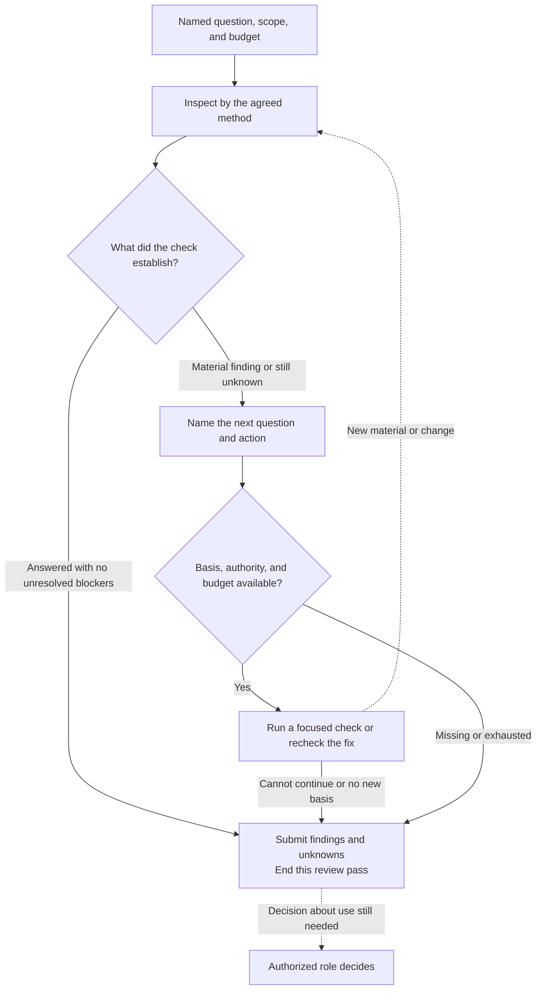

# Chapter 10. Review Engineering
## Give Review a Target, a Budget, and the Independence It Needs

Chapter 9 followed evidence into an authorized decision. A review has its own questions. “The reviewer looked at it. PASS.” Which target and revision did the reviewer inspect? What criteria and evidence were used? What was in scope? Which statements are observations, inferences, risks, or unknowns? How independent was the reviewer? What authority did the reviewer have? Which downstream action can proceed?

*Review Engineering* gives a named object a review target, scope, method, budget, appropriate independence, and a path from finding to authorized disposition. The relationships below are candidate mechanisms. Whether independent review, an additional check, or a particular level of review improves quality or efficiency depends on the work.

---

## 10.1 Review, Reading, Validation, and Decision

A *Review* checks a named target at a particular revision and scope against criteria. It examines how the target relates to intent, contract, evidence, risk, and known unknowns. Reading can be part of the work.

| Activity | Main output | What still needs its own basis |
|---|---|---|
| Reading or inspection | Sources inspected and observations | A Finding |
| Validation | Evaluation Result and coverage | Candidate acceptance |
| Review | Findings, unknowns, and a recommended disposition | Decision Authority |
| Decision | An authorized disposition for a named Decision Target | Execution of the decision |

A person or a gate can perform several functions. Record the role and target for each action.

---

## 10.2 The Review Chain

```text
Review Target + bounded Review Contract
→ inspection / validation / challenge
→ Finding + Unknown + Recommendation
→ authorized Decision Record
  names a Decision Target for closing or limiting use of that Review Target
→ Review Disposition
```

A submitted review can still await a decision. A finding can remain unknown. A viable candidate can need narrower scope. An authorized review pass can close a narrowly named decision. A request for more evidence can leave unrelated work free to continue. Someone can adopt a finding and reject its recommended correction.

---

## 10.3 The Review Target Identifies What Is Inspected

The *Review Target* is the named object, revision, baseline, and scope the current review examines. Examples include:

- An Intent, Plan Candidate, or Execution Contract.
- Work, an Attempt, a Checkpoint, or an Attempt Outcome.
- A change, diff, artifact, or configuration.
- A Target Result, Evaluation Result, or Evidence Portfolio.
- A Decision, Policy, Authority Grant, or Release Candidate.
- An incident, recovery plan, Memory Candidate, Context Capability Profile, or Engineering Capability Profile.

The Decision Target states what an authorized party is deciding. A parser change can be the Review Target for several decisions. Is the implementation allowed to continue? Is the regression evidence accepted? Can the candidate become a supported baseline? Is release authorized? Each decision retains its own target even if it considers the same review.

---

## 10.4 The Review Contract Connects the Target to Method and Boundaries

A *Review Contract* identifies the Review Target, criteria, scope, non-goals, evidence, budget, independence, permitted outputs, and authority boundaries. A pull request, issue, gate configuration, or short brief can carry it.

At minimum establish the following.

- Review Target and baseline.
- Review question and criteria.
- Scope, non-goals, and current stage.
- Intended Decision Use.
- Available evidence, primary sources, and counterevidence.
- Review budget and stop condition.
- Required independence.
- Reviewer, validator, or challenger assignment.
- Which findings, recommendations, or dispositions can be submitted.
- Authority Grant and escalation path.

The contract describes the grant it relies on and remains subject to it.

---

## 10.5 A Finding Is a Scoped Review Judgment

A *Finding* is an inspectable judgment a reviewer makes about a target in scope from named criteria, evidence, counterevidence, and unknowns. A finding may report that the target fits the intent or contract, that a defect or conflict exists, that scope grew, or that coverage is insufficient. It may establish that no safe action is currently available, that a risk appears only under narrower conditions, that the candidate is more complex than the goal warrants, or that the claim needs to be narrowed or split. It can also say that the materials leave the question open.

| Field | Question |
|---|---|
| Review Target / Version | What is this about? |
| Criterion / Contract | What standard applies? |
| Observation / Evidence | What did we directly see? |
| Inference | What do we infer from it? |
| Counterevidence / Alternative | What could challenge or limit that judgment? |
| Scope / Materiality | Where and when does it matter? |
| Unsafe Action / Current Impact | Is there an action that should stop now? |
| Unknown / Missing Evidence | What remains unknown? |
| Recommendation | What should be kept, narrowed, reworked, deferred, blocked, or escalated? |

A reviewer can revise or withdraw a finding and others can challenge it. Its support comes from the material and method.

---

## 10.6 From Evaluation Result to Finding to Decision

A failed test produces an Evaluation Result. Its log, environment, and target identity can be evidence. A reviewer can read that evidence and find that the candidate violates a parser contract. An authorized decision maker can then block the candidate from a baseline.

```text
Evaluation Result
+ supporting Evidence
→ informs Finding
→ informs Decision Record
→ records Target-specific Disposition
```

Keep observation, inference, and recommendation visible in the finding. Authority to act and a demonstrated cause each require a separate basis. The finding can itself be considered as new evidence when it is bound to a Claim, scope, and intended use.

---

## 10.7 Pre-execution Review Tests Direction Before Work Accumulates

Before execution, review can check that the intent and non-goals are clear, the split of work and scope are proportionate, and the contract references a valid baseline, context, and authority. It can inspect risk assumptions and alternatives, determine whether planned evidence can answer the Acceptance Target, and check stop, recovery, and handoff paths. It can also identify proof that belongs to a later stage.

The smaller change surface makes directional problems easier to expose. A local, reversible correction that existing policy covers and tests can check may go straight to bounded execution and automated checking. A plan pass still leaves tool permission and execution authority to the applicable grants.

---

## 10.8 In-process Review Checks Changes Against the Original Boundary

At a checkpoint, handoff, or risk trigger, review can ask whether the attempt still serves the original intent. Did scope, dependencies, baseline, or authority change? Did new evidence invalidate an assumption? Did a tool exceed the contract's side-effect limit? Is the implementation adding needless complexity? Have triggered stops been addressed? Does the work need a Rebase, restriction, recovery, or human decision?

Choose triggers in proportion to risk, irreversibility, duration, and recovery cost. When review blocks execution without identifying a material finding, current unsafe action, or named decision it serves, look for *Governance Livelock*. Find the loop before adding a review layer.

---

## 10.9 Post-execution Review Checks Results, Scope, and Use

A review after execution can inspect the Attempt Outcome and Target Result, confirm the Evaluation Result is bound to the right target, and check whether the change fits the intent, contract, and architecture. It can consider regression, security, privacy, data, and operational risk, and check the evidence portfolio, coverage, gaps, counterevidence, failure, unknowns, recovery, and residual risk. It identifies which Decision Target can take the candidate and which judgments remain unsupported.

Waiting until the end can leave a change too large to inspect well. More checkpoints also bring waiting, context, and coordination costs. The Review Budget should determine which review times are worth using.

---

## 10.10 Spend the Review Budget on Questions That Can Change the Decision

A *Review Budget* is the time, attention, check depth, methods, sampling, independence, and number of iterations available for a named target. It should identify the questions the effort is meant to answer and when further work should stop.

Consider impact, irreversibility, novelty, existing coverage, source integrity, recovery, and downstream use. High impact can justify expertise or more independence. The review still needs a specific target and a limit.

In the old-save teaching example, suppose an implementer has submitted a local change and a reviewer must assess scope for the development baseline. The reviewer has no final acceptance authority and can start with this brief.

| Item | Review arrangement |
|---|---|
| Question | Does the format remain the same? Can the exceptional path damage the original copy? Is an uncovered sample being reported as compatible? |
| Material and method | Compare the original task scope with the diff, read the relevant call paths, and inspect raw check results and omissions. Propose a focused verification where needed |
| Budget | Run one pass on these questions. After a fix, recheck affected conditions. On reaching the time limit, report checked scope and unknowns |
| Output | Findings, sources, affected scope, open questions, and recommendations |
| Stop and reopen | End the review when the scoped questions are answered and no unresolved item blocks them. Reopen affected questions on a material change, failure, counterevidence, or required gate |

One pass is an arrangement for this example. A wording change may need only a readback. Production data migration may require independent checks and other prerequisites. The budget must respect those obligations and the scope of the current decision.

If a reviewer suspects more risk, identify the object, trigger, and impact on the decision. A check that would distinguish plausible explanations gives the work a next step. A repeated concern with no new testable question should remain open for the appropriate role.

---

## 10.11 Review Independence Has Several Dimensions

*Review Independence* is the degree to which review has enough separation across producers, contracts, context, sources, methods, decisions, and authority. Ask what is independent.

1. **Producer Independence.** Is the reviewing subject configuration different?
2. **Contract Independence.** Does review use a different decision lens or test for different failures?
3. **Context Independence.** Is the reviewer limited to the producer's conclusions?
4. **Source Independence.** Can the reviewer inspect primary sources and counterevidence?
5. **Method Independence.** Are the test, harness, model, or inspection methods different?
6. **Decision Independence.** Can the producer rewrite the finding?
7. **Authority Independence.** Can another authorized party resolve a major conflict?

Two agents using the same model, prompt, summary, and failure assumptions can expand sampling while sharing blind spots. A separately assigned reviewer can still have a missing source, wrong contract, limited ability, or the same assumptions.

Low-risk work can combine reviewer, validator, and challenger functions. High impact, irreversibility, self-reference, or a clear conflict of interest can make additional separation worth the cost.

---

## 10.12 A Reviewer Submits Findings Under the Authority Granted

A reviewer can inspect targets, criteria, evidence, and scope. They can submit findings, unknowns, and counterevidence, and recommend accepting, rejecting, narrowing, reworking, deferring, blocking, or escalating. A review contract can permit a request for evidence or trigger a stop. A separate delegation can authorize a narrow gate.

Work Acceptance, candidate adoption, release authorization, scope expansion, modification of a grant, and judgments reserved to humans about direction, experience, aesthetics, or law each depend on the relevant authority. If one gate handles Validation and narrow Acceptance, record the target of evaluation, the grant to decide, and what remains outside it.

---

## 10.13 Bind Review Disposition to a Target and an Authority

*Review Disposition* is Chapter 9's named decision relationship applied to a review. Under a valid grant, a Decision Record describes how a Decision Target concerning use or closure of the Review Target is allowed, rejected, narrowed, sent for rework, deferred, blocked, or escalated. The thing inspected and the decision someone can make about it remain identifiable separately.

```text
Review Target:
  migration candidate v4 / rollback coverage

Finding:
  evidence does not cover migration rollback

Disposition Recommendation:
  narrow current target to dry-run only

Decision Record:
  decision_target: permitted migration mode for candidate v4
  authority_grant: production-migration-owner / scoped grant
  review_disposition: dry-run allowed; production migration blocked pending rollback evidence
```

The same finding can lead to different dispositions. A low-impact sandbox might proceed with residual risk recorded. Production migration might be blocked.

A reviewer without the grant can submit a finding and recommendation. `Unknown` records a gap in judgment. The authorized party can defer, block, request evidence, narrow, or permit limited exploration. If a project uses `PASS / FAIL` in a narrow review contract, name the target that result closes. Adoption and release authorization retain their own decision boundaries.

---

## 10.14 End, Stop, and Reopen a Review for Different Reasons

A review can end because its questions were answered within scope. It can also stop because material, capability, permission, or budget runs out while questions remain. Preserve the difference when reporting the result.

### Figure 10-1 Continue With a Basis, Stop at the Boundary



Solid arrows show choices in the current pass. Dotted arrows reopen inspection with new material or refer a use to the authorized role. An ended review still leaves acceptance to the proper decision. A spent budget can leave issues open. Follow existing authorization for further actions and stop any currently unsafe action under the applicable rules.

| Trigger | Next step | Boundary for ending or reopening |
|---|---|---|
| The question is answered, applicable checks are done, and no material issue is open | Submit scoped findings and omissions, then end the pass | Repeat only with a new change, failure, diagnostic question, or gate requirement |
| New work touches a premise of the earlier judgment | Locate the impact and recheck the applicable sources or assertions | Reuse unaffected portions as Chapter 9 describes |
| A new failure or finding changes the decision | Preserve the first failure and evidence that can distinguish causes. Propose a testable next question | Recheck affected paths after correction. Expand review when scope of impact grows |
| Sources conflict or material is missing | Distinguish observation and inference. Seek the source most likely to change the judgment | Retain an unknown when no new lead or access is available. Take the dependent use to its authorized decision maker |
| A material risk remains after other checks pass | Name the risk, affected actions, and recommendation | Keep the risk visible until its own basis changes |
| Budget or capability is exhausted | Report inspected scope, remaining questions, reasons, and recommendation | Additional budget, specialists, narrower use, or residual risk acceptance depends on the relevant authority |

In the save example, a reviewer who finds that invalid input can trigger a write should identify and address the affected path, then check it and its dependencies. If the author has yet to judge the readability of the error message, machine review can end and keep the experience judgment open. If an admission rule requires it, admission waits.

Stopping the investigation and closing a finding are separate events. Keep open items, current recommendations, and reopen conditions in the original review. Consolidated records should retain unresolved problems and past failures.

Many reviews and stalled delivery can be signs of governance livelock. Changing goals, unmet dependencies, tool failures, and unclear permission can produce similar symptoms. Locate the concrete cycle before removing steps, then check that the lighter process can still detect the problem the review was meant to catch.

---

## 10.15 Review and Cognitive Compression Can Share an Executor

Review asks what can be found about the target relative to criteria, evidence, risk, and scope. Cognitive compression asks what a human needs for a decision, how they can inspect supporting material, and which unknowns must remain visible.

One executor can produce a finding and a human-facing brief for a small task. Work with greater impact can call for an independent reviewer and an independently selected information view so the producer does not control every source and its interpretation. Chapter 11 covers qualified review capacity. Chapter 12 covers compression and the Human Decision Interface.

---

## 10.16 Fit the Review to Its Target

### Local, Low-Risk Change

```text
named target + bounded diff
+ focused check
+ one reviewer or authorized gate
→ finding / narrow disposition
```

### Ordinary Work Across Several Files

Typically identify the target, baseline, scope, intent, contract, non-goals, evidence portfolio, gaps, findings, recommendations, authority, conditions for rework or another review, and downstream boundaries.

### High-Impact or Irreversible Decision

Consider checkpoints before and during execution, independence of source, method, and authority, experts for security, privacy, contract, or jurisdiction, recovery exercises and residual risk, a human Decision Target, and a budget, iteration limit, and adequate trace.

Choose review weight for the impact and the target.

---

## 10.17 Common Anti-Patterns

1. **Unnamed Review Target.** “Review the change” leaves out revision, scope, or criteria.
2. **Finding = Evidence.** A reviewer's judgment becomes the original observation.
3. **Finding = Decision.** A recommendation blocks or releases work without authority.
4. **PASS = Everything.** A review pass becomes acceptance, adoption, and release.
5. **Unknown = FAIL.** Lack of material is reported as a negative fact.
6. **Independence by headcount.** Agents with shared sources are recorded as independent.
7. **Maturity by number of reviews.** Wait, attention, and rework costs go uncounted.
8. **Mandatory review at every stage.** Fixed gates slow low-risk work.
9. **Only the producer summary.** Primary sources and counterevidence are inaccessible.
10. **Recursive review.** Each finding only creates another thing to review.

---

## 10.18 Interfaces With Other Chapters

| Chapter | What this chapter uses | What stays defined there |
|---|---|---|
| 4–6 | Intent, Acceptance Target, Claim, Evidence, and authority boundaries | Sources of Truth and Decisions |
| 7 | Work, Execution Contract, Attempt, and Checkpoint | Execution identity and permitted actions |
| 8 | Attempt Outcome, Target Result, Evaluation Result, Failure, `non-result`, and Recovery | Result taxonomy |
| 9 | Evidence Use, Decision Target, Disposition, Acceptance, Adoption, and Release Authorization | Normative use of evidence |
| 11–12 | Review capacity, Cognitive Load, Compression, and Human Decision Interface | The design of human judgment interfaces |
| 13–14 | Authority, Risk Trigger, Observation, and Intervention | Governance and the control plane |
| 17 | Role, Assignment, Handoff, Conflict, and Integration | Organization of review roles |
| 18 | Trace, Attribution, and Accountability | Long-term traceability |
| 21–22 | Lifecycle Transition and Capability Fit Review | Review integration and target-specific review types |

Chapter 10 first defines Review, Review Target, Finding, Review Budget, Review Independence, and Review Disposition. The Review Contract is a compact way to carry their operative relationships.

---

## 10.19 Checklist

### Define the Review

- Are the target, version, baseline, and scope clear?
- Are criteria, non-goals, and intended use explicit?
- Does the review contract state outputs and authority boundaries?

### Produce a Finding

- Can we distinguish observation, evidence, inference, and recommendation?
- Can we see counterevidence, alternative explanations, and unknowns?
- At which stage does the finding first matter?
- Is there an unsafe action now, or a risk for later?

### Allocate Budget and Independence

- Is review depth proportionate to impact, reversibility, and coverage?
- Which dimensions of independence are actually different?
- Can the reviewer access primary sources?
- Are iteration limits, stop conditions, and escalation paths available?

### Record the Disposition

- Does the reviewer have the applicable Authority Grant?
- Can we tell the finding, recommendation, and disposition apart?
- Which target does PASS or FAIL close?
- Are adoption and release handled under their own decisions?

---

## 10.20 Conclusion

A limited review earns its place when it can change a named decision and show where its coverage ends.

```text
named Review Target
+ bounded Contract and Budget
+ appropriate Independence
→ scoped Finding and Unknown
→ named Decision Target + valid Authority Grant
→ Decision Record + authorized Review Disposition
→ explicit downstream boundary
```

The target says what gets inspected. The finding records a scoped judgment. The budget allocates limited capacity. Independence makes common causes of error visible. An authorized role gives the disposition its force.

Even a sound review model can fail to fit into the available decision window if generation and execution grow faster than qualified review. The next chapter examines when work that really needs human judgment can exceed the capacity to give it that judgment.
