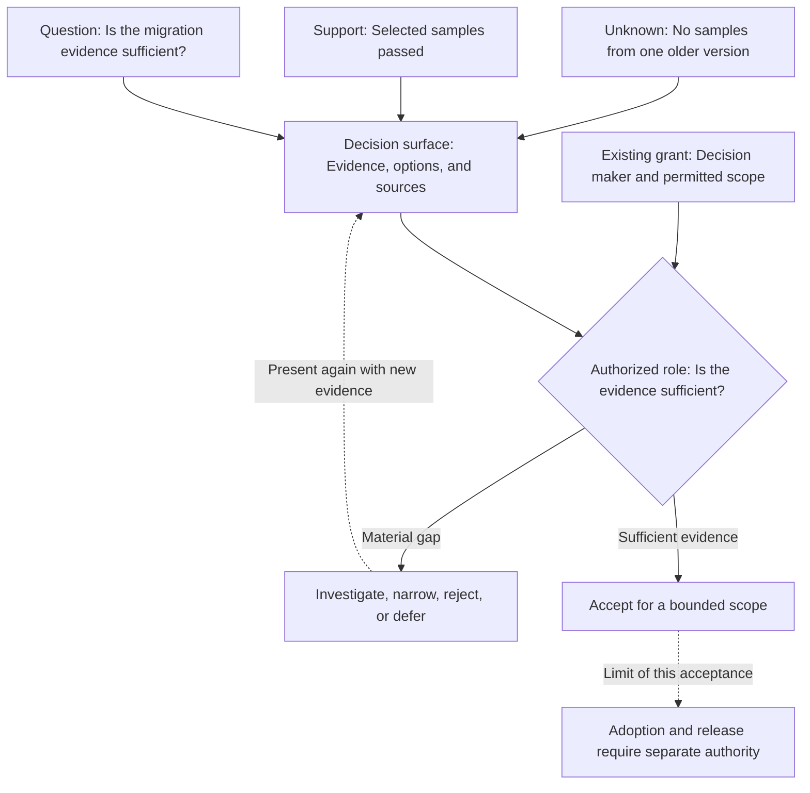

# Chapter 12. Cognitive Compression and the Human Decision Interface
## Making a complex system possible to judge and inspect

This chapter proposes an interface contract for Cognitive Compression and the Human Decision Interface. The cases support a few local boundaries, including non-authoritative projections, the distinction between evidence and authority, and the limits of interpreting silence as health. They leave open whether an HCP reduces judgment load, rework, or incidents, and whether a single HCP architecture works across projects.

Chapter 11 asked how a project can restore balance when accepted changes that call for human judgment keep exceeding the capacity of qualified reviewers.

Teams can throttle incoming work, narrow scope, bring in more reviewers, automate verification, and route work according to risk. A long-running delegated system that spans tools and agents can still leave people with a large amount of state, evidence, authority, risk, exception, and recovery information to interpret. A screen full of raw logs, diffs, run records, and governance objects can be as hard to act on as a single label reading `SYSTEM STABLE`.

Two designs constrain each other. **Cognitive Compression** converts machine-level engineering state into a traceable view suited to a particular decision, with a path back to source detail. A **Human Decision Interface** gives authorized roles a place to locate pending decisions, inspect the grounds for them, understand the limits, and invoke permitted actions. The first is a transformation. The second is the surface that carries its output and the controls. Section 12.2 introduces the HCP as one way to organize such surfaces and views.

The design question is what a person needs for the judgment in front of them, and how that person can discover an omission, challenge the summary, or go back to the source.

---

## 12.1 Organizing detail around the decision

The first layer of a view will usually leave things out. That creates a risk of loss, omissions, and misreading. A compact screen can simply move risks out of view if it leaves the selection criteria, sources, and omissions unexplained.

Cognitive Compression has three requirements.

1. Select information for a named Decision Target.
2. Preserve source, scope, evidence, unknowns, and counterevidence.
3. Allow people to drill down from the summary to the records that produced it.

~~~text
Source records and observations
            ↓ select / transform
Non-authoritative projection
            ↓ present / route
Human or authorized decision
            ↓ invoke
Existing authority-bearing action path
~~~

A projection inherits its evidential limits and has no additional authority of its own. It can explain existing claims and expose existing grants. An inference remains an inference, evidence remains distinct from a decision, and silence leaves health open. Source ownership remains with the source owner. Buttons invoke grants that already exist. Old data remains old.

> **Encapsulate Execution, Expose Evidence.**

Keep search and intermediate steps out of the default view where they have no bearing on the current judgment. Make the result, scope, evidence, unknowns, risks, necessary trace, and routes to deeper detail visible.

~~~text
Transparency
≠ Show everything

Transparency
= Expose what is required
  to verify, decide and intervene
~~~

---

## 12.2 When a Human Control Plane is useful

A **Human Control Plane (HCP)** organizes one or more Human Decision Interfaces and their projections. It presents a non-authoritative view of the Control and Evidence Plane for named decisions. AI-native projects can choose whether to use it.

It is more likely to help when:

- Several delegated execution paths are active over time.
- State, evidence, and authority live in different systems.
- People have stopped reviewing each low-risk output.
- Consequential decisions depend on information about several objects.
- The project needs standing ways to pause, veto, take over, or revoke delegation.
- Raw logs and dashboards have become a cognitive burden of their own.

It may be expensive relative to its value when:

- The project is small and its state is simple.
- Direct review costs less and is more reliable.
- Tasks are infrequent and differ widely.
- An expert must inspect each important change.
- The underlying sources, evidence, and authority are still informal.
- Nobody owns the correctness or freshness of the views.

An HCP built on unreliable records can make them more convincing. Address the reliability of the records and controls where they originate.

---

## 12.3 Projection ownership and source ownership

The book distinguishes the Product System, the Production Intelligence System, and the Control and Evidence Plane that cuts across them. The HCP organizes views of the existing objects.

| Object in the projection | Authoritative source or owner | What the HCP can do | Boundary |
|---|---|---|---|
| Intent / Decision | Intent, Decision, or Policy Record | Display goals, constraints, and pending decisions | Changes to intent belong to the source |
| State Claim | Named source and version | Display the claim, scope, freshness, and conflict | The projection has no standing to declare global truth |
| Evidence | Evidence Record and artifact | Display coverage, use, limitations, and counterevidence | Acceptance requires its own disposition |
| Authority | Authority Grant, role, and policy | Show who can take which action | Permissions come from a grant |
| Risk | Risk Claim, assessment, and owner | Summarize impact, exposure, and reversibility | A score remains an assessment |
| Telemetry / Exception | Runtime, observer, and detector | Display observations, coverage, and unknowns | Silence leaves health open |
| Recovery | Versioned baseline and Recovery Contract | Display available paths and prerequisites | A rollback can fail |
| Memory | Memory source and Promotion Record | Display relevant history and provenance | Current truth requires applicable evidence |

~~~text
State / Evidence / Authority / Risk / Telemetry / Recovery
                         │
                         │ source-linked read
                         ▼
              Human-facing Projection
               ├─ attention routing
               ├─ progressive disclosure
               ├─ evidence drill-down
               └─ authorized action invocation
~~~

A projection can have its own identity, generation time, and expiry. These fields describe the view itself.

---

## 12.4 What a Projection Contract specifies

A **Projection** is a non-authoritative view produced by selecting and transforming material from authoritative sources for a particular decision. It needs a minimal contract. The following schema is one design example.

~~~yaml
projection_id: HCP-PRJ-042
projection_type: decision_brief
generated_at: 2026-08-24T14:30:00+08:00
expires_at: 2026-08-24T18:30:00+08:00
generated_by: control-brief-builder-v3

decision_target:
  id: DEC-TARGET-091
  question: Whether to accept qualifying evidence for the save migration candidate
  intended_use: qualifying_evidence_disposition
  deadline: 2026-08-25T12:00:00+08:00

subject:
  project: example-game
  candidate_ref: commit:abc123
  baseline_ref: commit:def456

state_claim_refs:
  - current_save_format_state

evidence:
  supporting_refs:
    - EV-TEST-041
    - EV-RUNTIME-019
  counterevidence_refs:
    - EV-REVIEW-007
  coverage_summary:
    covered:
      - bounded migration behavior
    not_covered:
      - production adoption

observation:
  as_of: 2026-08-24T14:20:00+08:00
  coverage_ref: OBS-COVERAGE-012
  detector_health_ref: DET-HEALTH-006
  unknowns:
    - legacy save population size

risk_and_impact:
  assessment_refs:
    - RISK-033

available_actions:
  - action: accept_qualifying_evidence
    authority_ref: AUTH-QUAL-002
  - action: request_more_evidence
    authority_ref: AUTH-QUAL-002
  - action: reject_scope
    authority_ref: AUTH-QUAL-002

drill_down:
  source_index_ref: SRC-IDX-091
  raw_artifact_refs:
    - ARTIFACT-201
~~~

The contract makes a brief answer these questions.

- Which decision was it generated for?
- Which candidate and baseline does it use?
- Through what time does the data extend?
- Which evidence supports which claim?
- Which areas lack coverage?
- What counterevidence and unknowns remain?
- What actions are available now?
- Where does each action get its authority?
- How can the reader return to the source?

Those answers let a person use the brief for control as well as reading it for context.

---

## 12.5 Preserving meaning through Progressive Disclosure

**Progressive Disclosure** shows the minimum needed for the current judgment first and opens evidence and raw detail in stages as needed. This can reduce the default cognitive burden.

A project profile could set up the layers this way.

~~~text
Level 0  Attention status + coverage status
Level 1  Decision cards + deadline + available actions
Level 2  Risk, impact, Evidence coverage, unknowns
Level 3  Change narrative, architecture view, history
Level 4  Source records, Diff, logs, trace, raw artifacts
~~~

The layers are an example and carry no maturity ranking. A security incident may open at Level 3. A low-risk recurring task may need Level 1 alone. A creative review may start with the visual artifact.

The meaning of the same claim must survive a change in detail. If Level 1 reads:

~~~text
Qualifying evidence accepted
Adoption blocked
Production not approved
~~~

Then the next layer must preserve those dispositions. Collapsing them to the following would change what was authorized.

~~~text
Candidate approved
~~~

### The minimum each layer retains

- Subject identity.
- Decision Target.
- Scope.
- The time boundary of the current state.
- Coverage and unknowns.
- Whether human action is needed now.
- A drill-down path.

Use fewer words if necessary while keeping the state and its limits accurate.

---

## 12.6 A Change Narrative separates facts, inferences, and recommendations

A **Change Narrative** organizes changes, rationale, effects, evidence, and pending decisions into an argument whose links a reviewer can trace.

~~~text
Observed problem
→ Intent and constraints
→ Candidate and alternatives
→ Actual changes
→ Impact claims
→ Supporting and opposing Evidence
→ Unknowns
→ Current recommendation
→ Authorized disposition target
~~~

### Observable facts

- The files, configuration, or runtime state that changed.
- The tests and observations that actually ran.
- The objects that went unobserved.
- The identity of the current candidate and baseline.

### Contemporaneous judgment

- Why a direction was chosen at the time.
- Which alternatives were ruled out.
- Which risk was considered most important.
- Who made which scope decision.

### Retrospective inference

- Possible causes of the problem.
- Dependencies through which a change might have effects.
- Successes or failures that may be related to the change.

### Current recommendation

- Accept, reject, narrow, collect more evidence, defer, or recover.
- The Decision Target the recommendation addresses.
- Its basis and remaining uncertainty.

Fluent prose can make these categories sound equally certain. A useful narrative binds statements to sources, keeps their category visible, and retains the counterevidence. Any causal connection still needs independent evidence. The sequence of events and the coherence of the account are insufficient on their own.

---

## 12.7 What the Architecture Impact View can establish

An **Architecture Impact View** shows the known effects of a candidate on modules, contracts, dependencies, data flows, and runtime boundaries, along with the areas that remain unknown. It helps a reviewer choose where to look more closely.

It can show:

- Affected modules.
- Added or removed dependencies.
- Interface and schema changes.
- Changes to data flows and state lifecycles.
- Runtime, deployment, or configuration changes.
- Tool, permission, Agent Contract, or workflow changes.
- Areas explicitly checked where no change was found.
- Areas still unobserved or unconfirmed.

| Label | Meaning |
|---|---|
| Observed Impact | A direct diff, runtime observation, or other named evidence is available |
| Inferred Impact | A dependency, contract, or analysis suggests the impact, and direct observation remains pending |
| Unobserved / Unknown | Coverage is insufficient to determine whether the area was affected |

An assertion that an area was unaffected also needs a basis. A path can behave differently at runtime without a file diff. Passing unit tests leave some effects on external systems open. Silence alone leaves open whether a dependency path ran. An explicit `unknown` keeps a gap in coverage visible.

---

## 12.8 A Risk Map projects Risk Claims

A **Risk Map** shows risk claims about impact, exposure, reversibility, and detection conditions for a current decision. Those claims retain the limits of their source and scope.

~~~yaml
risk_id: RISK-033
subject_ref: commit:abc123
decision_target: production_adoption

hazard: legacy save data may become unreadable
affected_scope: users with v2 save format
impact: high
exposure: unknown
reversibility: forward-recovery only
detection:
  available: partial
  blind_spots:
    - corrupted saves not represented in fixtures

evidence_refs:
  - EV-MIGRATION-021
assumption_refs:
  - ASM-LEGACY-004
owner: release-safety-lead
expires_at: 2026-09-01
~~~

A Risk Map can help people compare:

- The extent of the impact.
- Reversibility.
- Data, security, and user-experience risks.
- Current exposure.
- Detection and recovery capability.
- Assumptions awaiting validation.

Bind `high / medium / low` to scope. A single score can hide an unlikely but irreversible high-impact event, a frequent but easy-to-recover problem, unknown exposure, a false assumption shared by detector and builder, or a risk owner who lacks authority to decide. Use the map to decide where to inspect or escalate. The decision itself follows its authorized path.

---

## 12.9 Reserve the Decision Surface for pending decisions

A **Decision Surface** brings together the questions an identified role must decide, the options, their basis, deadlines, and consequences. General notifications have a separate purpose.

Suppose a team is reviewing an old save migration. The samples selected so far passed, and one version still lacks samples. A green "tests passed" card would obscure the decision. Is the current evidence enough for acceptance within the proposed scope?

In this example, accepting within a bounded scope or narrowing what is supported requires a human decision. The team can look for additional samples under existing authority. An absent sample is a gap to handle and may be investigated without additional approval.

A **Decision Card** puts a pending issue, evidence, options, and boundaries in one place. Figure 12-1 shows which inputs converge on the decision.

### Figure 12-1 Information converges on a decision for the authorized role

*Illustrative example. The upper arrows show how information converges, and the lower branches show options. Dashed lines mark the condition for reopening the decision and the limit of acceptance. Authority comes from existing rules or delegation. Sample results are hypothetical.*

Start with the question, inspect evidence and unknowns together, and then decide. If the missing version is required, investigate or defer. If it can be excluded, have an authorized role record the narrower scope and keep the reason visible. Route the decision to a role with the grant when necessary.

| Information | How to fill it in for this example | Error it helps prevent |
|---|---|---|
| Question and scope | Which older-save migration evidence can be accepted for the current version | Treating bounded results as compatibility across all versions |
| Basis and gaps | Passing samples, missing version, source links, and when the evidence was updated | Treating absence of a sample as absence of a problem |
| Options and consequences | Accept, investigate, narrow, reject, or defer, each with a next step and owner | Treating a notification as a requirement to approve |
| Decision and follow-up | Decision maker, allowed scope, deadline, and what happens to anything outside the acceptance | Extending acceptance to adoption or release |

Record the choice and its scope. If more evidence is needed, state what question it should answer. Reopen the same decision when there is new evidence, a change in scope, or an agreed review trigger. Test the card by asking a reader what is being decided, what is missing, who can decide, and what happens afterward. A reading test and a migration test check different things.

Prioritize decisions involving:

- Irreversible or hard-to-recover changes.
- Changes in authority, permissions, or delegation.
- Architecture changes and changes to public contracts.
- Data migration.
- Scope expansion.
- New external dependencies.
- Core experience and creative direction.
- Security boundaries.
- Lasting changes to Memory, Skills, Workflows, and governance rules.
- Incomplete evidence near an expiring decision window.

A notification can simply keep someone informed or leave an audit trail. A decision requires an identified authority and an actual pending question.

---

## 12.10 The Brief as a view

A **Brief** is a short-lived projection generated for a particular time window and decision role. It can be the primary presentation in a Human Decision Interface. A project might use three views.

### Project / Production Brief

> What is happening in the product or project, and which results and risks merit attention?

### Control Brief

> Which named exceptions or authority changes have occurred in the agents, workflows, gates, memory, and verification systems that produce the product?

### Learning / Evolution Brief

> Which lessons, workflow candidates, or memory promotions are waiting for independent evidence or a disposition?

These are optional views. Each brief can keep references to the underlying objects. When a source changes or expires, regenerate its briefs, mark them stale, or invalidate them. Maintaining a brief by hand as current state would give it a role it cannot support.

### A minimal Control Brief

~~~text
CONTROL BRIEF

SUBJECT
Agent workflow candidate WF-042

AS OF
2026-08-24 14:20 +08:00

ATTENTION
1 named exception requires disposition

OBSERVATION COVERAGE
runtime: partial
authority changes: covered
detector health: healthy as of 14:18
unknown: external tool retry side effects

DECISION
Continue supervised pilot or freeze candidate

EVIDENCE
3 supporting records
1 counterevidence record

AVAILABLE ACTIONS
continue_supervised
freeze_candidate
request_more_evidence

DRILL-DOWN
source index: SRC-IDX-WF-042
~~~

The brief scopes its health information to the detector. The uncovered areas leave a global health claim open.

---

## 12.11 What silence means in an exception-driven interface

**Attention Routing** assigns limited human attention to named objects by risk, authority, timeliness, and exception conditions. It can make exceptions the focus of the routine interface.

An **exception-driven** design routes objects that match defined exception conditions. Specify:

- The expected normal condition.
- The area being observed.
- The detector.
- How long its data remains fresh.
- Which role receives each class of exception.
- How detector failure is reported.
- How the interface shows unobserved areas.

~~~text
No alert
≠ Healthy
~~~

A more precise report is:

> Within declared, fresh observation coverage with a healthy detector, no named exception requiring this role's involvement was detected.

If coverage is incomplete, show it.

~~~text
NO NAMED EXCEPTION DETECTED
OBSERVATION COVERAGE: PARTIAL
DETECTOR HEALTH: UNKNOWN
GLOBAL HEALTH: NOT ASSERTED
~~~

Detector failure should itself surface as an exception. [Chapter 14](/chapters/14-en.html) covers Observation Coverage, Detector Health, and the exception lifecycle. The compression layer must retain those boundaries.

---

## 12.12 HJL and TTE as experimental probes

### HJL — Human Judgment Load

**Human Judgment Load (HJL)** is the set and cost of judgments requiring human disposition in a given time window. A count of pending decisions can be one observation, and other dimensions include:

- The difficulty of each judgment.
- The expertise required.
- Risk and irreversibility.
- Waiting time.
- The cost of reconstructing context.
- Missed signals and escaped incidents.
- Rework caused by incorrect compression.

Consider this comparison.

~~~text
100 tasks → 7 human decisions
is better than
100 tasks → 42 human decisions
~~~

The seven decisions could all be high-risk incidents. The 42 could be quick creative choices. Observe the components separately.

~~~text
decision count by class
decision age
judgment time
escalation source
reversal and rework
escaped incident
unowned high-risk decision
~~~

Any experiment intended to reduce HJL must also observe quality, safety, and missed signals.

### TTE — Time To Explain

**Time To Explain (TTE)** is how long an identified role takes to understand a class of decision to a stated standard of accuracy and completeness. It can be used to test interface usability.

~~~text
named user or role
named decision class
required explanation content
accuracy / completeness threshold
maximum acceptable delay
~~~

The evidence here provides no basis for a rule that everything important must be explainable in five minutes. A quick, inaccurate explanation provides little control. A complex incident may take longer to understand. Use TTE to compare interfaces on similar tasks under similar standards. A single project-wide target would conceal those differences.

---

## 12.13 How to test whether compression preserves judgment

Test Cognitive Compression itself along eight dimensions.

### 1. Source Binding

- Can each important state and number be traced to a source?
- Are source identity, version, and time clear?
- Could the projection refer to a superseded object?

### 2. Scope Preservation

- Does the summary retain claim scope?
- Has a local pass been promoted to end-to-end success?
- Has evidence acceptance been described as adoption or release?

### 3. Epistemic Separation

- Are facts, contemporaneous judgments, inferences, and recommendations identifiable?
- Are risk and impact presented as claims?
- Are assumptions visible?

### 4. Counterevidence and Unknowns

- Did counterevidence survive compression?
- Did a default value replace an `unknown`?
- Were uncovered areas marked unaffected?

### 5. Coverage and Freshness

- How current are the data?
- Is Observation Coverage declared?
- Is Detector Health visible?
- Does the Projection have an expiry?

### 6. Drill-down Fidelity

- Can a reader go from summary to evidence?
- Can they reach the artifact, diff, log, or runtime record from there?
- Do the deeper views refer to the same subject and version?

### 7. Action Correctness

- Is each button tied to a real grant?
- Are its preconditions satisfied?
- Are scope, effects, and recovery visible?
- Can a role use the interface to make a decision outside its authority?

### 8. Omission Testing

- Sample projections and compare them with their sources.
- Look for limitations that the summary dropped.
- Test with stale data, failed detectors, conflicting evidence, and empty results.
- Check for a false assumption shared by the builder and the projector.

A successful sample has a defined scope. Future projections still need suitable checks.

### Test a design entry point against its original question

A [review of the RandomHeroes GDD](../../Evidence/receipts/ER-20261122-004__CLM-C12-002.md) found that some mechanics had been reduced to their names after the entry point was reorganized. The review found references to an event and HUD for buffs, while conditions such as activation in the next battle, stacking, and expiry after combat had disappeared. Later editing restored the material to the temporary buffs section of the GDD. There is no complete independent version from before the reorganization. The comparison below uses the review record and the saved current draft.

| Step | What this example shows |
|---|---|
| Original question | If the player gets a temporary buff while exploring, which battle can they take it into, and when should it clear? |
| Gap the review identified | References to a buff event and the HUD do not answer when the buff takes effect, stacks, or expires. An implementer could retain it for too long, and a verifier would lack a specific expectation. |
| Conditions restored | The current draft states that the buff takes effect in the next battle or on its first turn, can stack, and is consumed at the next boss fight. It separately lists a type that expires by step count. |
| How to check | Distinguish next-battle buffs from step-count buffs. Then check acquisition, advancement, activation, and exit for each kind. In the saved code, both next-battle and current-battle buffs clear on victory and defeat. |
| Exception to preserve | A step count of zero normally expires the buff during exploration. If the same step enters a boss fight, the code allows it to last to the end of the fight. A general rule that buffs are consumed in the next fight leaves this branch unexplained. |
| Next action and remaining unknowns | The branches suggest checks for victory, defeat, ordinary step expiry, and expiry on entry into battle. This round read back documents and code only. The runtime paths were unexecuted, and experience and document authority still require their own judgments. |

If a reader asks whether a next-battle buff survives defeat, the restored text gives the post-battle clearing condition, and the defeat path in the saved code identifies the clearing call. That supports an expectation to test. A heading that merely says "Buffs supported" leaves the expectation unformed. The answer for next-battle buffs cannot settle the behavior of every step-count buff.

The drill-down must reach a passage that answers the same question. Restoring the text made this question answerable. The authority order of conflicting documents and the runtime result remained separate.

---

## 12.14 When an AI summary depends on the execution it describes

AI can generate Change Narratives, Risk Maps, and Briefs. A **common-mode failure** occurs when several steps fail together because they share the same false assumption.

~~~text
AI builds
→ AI selects evidence
→ AI summarizes
→ AI recommends
→ summary is treated as approval
~~~

A higher-risk task can use:

- Independent evidence sources.
- A reviewer separate from the builder.
- Different context or a separate verification path.
- Rule-based checks for source completeness.
- Random audits by a human.
- Direct artifact inspection for high-impact claims.
- Required display of counterevidence and unknowns.
- A separate disposition for recommendations.

Agents with different names can still fail together if they read the same summary, miss the same source, and share the same prompt assumption. Choose an appropriate degree of independence based on the claim, risk, reversibility, and evidence coverage. A low-risk task may need little extra review.

On the GDD question, another agent reading the same reorganized draft could repeat the omission. Check the original question, cited passage, and reorganized draft together. If no earlier snapshot is available, keep that historical gap explicit. Section 14.16 of [Chapter 14](/chapters/14-en.html#section-14-16) examines independent readback of displayed values and persisted state for significant writes. A write summary alone cannot establish that those values agree.

---

## 12.15 The Human Decision Interface exposes existing authority

The original outline put the ability to be informed, get explanations, decide, veto, take over, and ask for drill-down under Human Cognitive Authority. These abilities have two distinct roles.

### Interface Capability

The surface should let the appropriate role:

- Discover pending decisions.
- Inspect scope, evidence, unknowns, and counterevidence.
- Ask for an explanation or more evidence.
- Drill down to the source.
- See available actions and their consequences.

### Authority-bearing Action

Acceptance, rejection, pause, delegation revocation, release, and takeover are actions that exercise authority. Each needs a named role or gate, Authority Grant, scope, preconditions, permitted operations, and an audit and recovery path.

Security, compliance, and separation of duties can require more than one person to lift a control. The HCP makes existing authority visible and gives authorized roles a way to invoke the actions it permits. [Chapter 13](/chapters/13-en.html) defines how to grant, limit, revoke, and reduce authority.

---

## 12.16 What AI Game Dev OS and lessismore support

This section draws on the [control-interface case record](../../Evidence/receipts/ER-20260824-002__CLM-C12-001.md) for AI Game Dev OS v4.94 and lessismore SP122.

### Observable facts

- AI Game Dev OS v4.94 implemented a task-level non-authoritative read model that collects tasks, attempts, blockers, handoffs, and some context.
- v4.94 provided local control paths for checkpoint, cancel, authorized claim withdrawal, and returning a rejected review to rework.
- D-048 had no normal target result and the target went unobserved. External evidence of failure still gave reason to withhold a health judgment.
- The human disposition in lessismore SP122 kept `qualifying evidence accepted`, `adoption blocked`, and `production not approved` separate.
- The inspected artifacts did not show an implementation of a complete HCP, global takeover, delegation revocation, Observation Coverage health, or a Detector Health interface.

### Inferences the record supports

- A human-facing state summary can be a non-authoritative projection.
- It needs to keep evidence distinct from authoritative disposition.
- An absent normal result or alert leaves health open.
- Controls should refer back to existing authority and state records.

### Open questions

The record leaves open whether an HCP lowers Human Judgment Load, incidents, rework, or review time. It does not establish that the fields are complete or that briefs are more reliable than direct review across tasks. A full implementation of pause, takeover, revocation, and Detector Health remains unestablished, as does a unified HCP architecture validated through v4.94 or SP122.

These cases support local observations. The Interface Contract remains a proposal for later prototypes and task tests. [Chapter 23](/chapters/23-en.html) covers the complete episode, failure paths, and shared provenance. The observations here are part of that shared history.

---

## 12.17 Start with one decision path

Start with a path that already consumes judgment time before considering a Constitution Dashboard, Trust Engine, Telemetry Platform, Workflow Optimizer, or Learning Center.

~~~text
qualification evidence disposition
workflow candidate acceptance
high-risk data migration
authority expansion request
production incident takeover
~~~

Build a minimal loop for that path.

1. Bind the candidate, baseline, and Decision Target.
2. Reference State Claims, evidence, counterevidence, and unknowns.
3. Declare coverage, freshness, and the Detector Health reference.
4. Show the decisions the current role owns or needs to handle.
5. Keep a drill-down path to the source.
6. Provide an action the role can actually invoke under its grant.
7. Set an expiry for the projection.
8. Sample projections against sources.
9. Record inaccurate compression, missed and false alerts, judgment time, and rework.

Once that loop is repeatedly useful, consider more decision types, cross-project briefs, automated Attention Routing, HJL or TTE observations, Random Audits, and a Learning / Evolution View. Give an optional view its own persistent objects only when the work calls for them.

---

## 12.18 Responsibilities of Chapters 12, 13, and 14

Chapter 12 defines the Projection Contract, Progressive Disclosure, Change Narrative, Architecture Impact View, presentation of the Risk Map, Decision Surface, Briefs, Attention Routing, and Compression Validation.

| Related objects | Where they are defined |
|---|---|
| Authority Grant, Delegation, Autonomy Profile, Revocation | [Chapter 13. Governed Autonomy](/chapters/13-en.html) |
| Telemetry Source, Observation Coverage, Detector Health, Exception Lifecycle | [Chapter 14. Observability and Intervention](/chapters/14-en.html) |
| Memory Promotion, Retrieval, Conflict, Expiry | [Chapter 15. Memory Engineering](/chapters/15-en.html) |
| Self-Evolution Candidate, Evaluation Contract, Activation / Rollout Record | [Chapter 16. Self-Evolution Engineering](/chapters/16-en.html). Basic Recovery and Decision come from Chapters 8 and 9, respectively. |

An HCP can show them together in one or more interfaces. Each retains its type and owner.

---

## 12.19 Principles

1. **Compress for a Decision Target.** Select information for the actual decision.
2. **A projection is non-authoritative.** Truth, evidence, Reliance Disposition, and Authority come from their own sources.
3. **Encapsulate Execution, Expose Evidence.** Leave irrelevant detail out of the first layer and retain the outcome, its grounds, unknowns, and drill-down.
4. **Preserve meaning across levels.** Keep scope and disposition intact.
5. **Keep observation gaps visible.** The Architecture Impact View needs an explicit unknown.
6. **Treat risk as a claim.** Use the Risk Map to inform judgment.
7. **Distinguish notification from decision.** The Decision Surface carries named decisions.
8. **Treat the brief as a view.** When sources change, update, expire, or invalidate it.
9. **Scope non-detection.** Show coverage, freshness, and Detector Health together.
10. **Use HJL and TTE as experimental probes.** A project-wide target needs validation.
11. **Bind actions to authority.** Each action needs a named grant and preconditions.
12. **Verify the compression.** Check for omissions, stale data, common-mode failures, and incorrect actions.

---

## 12.20 Common failure patterns

- Counting dashboards as observability.
- Equating a shorter summary with Cognitive Compression.
- Covering unobserved areas with `SYSTEM STABLE`.
- Rewriting `no alert` as `healthy`.
- Maintaining a projection as a second state store.
- Compressing a local pass to "candidate approved."
- Hiding counterevidence, assumptions, or `unknown`.
- Presenting an inferred impact as observed.
- Claiming no impact without coverage.
- Ranking all decisions by a single risk score.
- Promoting every notification to a human decision.
- Silencing alerts or delegating authority incorrectly to reduce HJL.
- Applying a five-minute TTE target across tasks.
- Giving the builder, evidence selector, summarizer, and approver the same flawed source.
- Providing a stop button with no actual authority or recovery path.
- Building a full HCP platform before identifying decisions it would serve.
- Presenting the v4.94 read model as validation of a complete HCP.

---

## 12.21 Checklist

### Projection Identity

- Which Decision Target is the projection for?
- Are the subject, candidate, and baseline clear?
- Are the source, version, generation time, and expiry present?
- Is the view being treated as a new source of truth?

### Information Boundary

- Are facts, judgments, inferences, and recommendations distinct?
- Are scope, counterevidence, unknowns, and observed non-effects visible?
- Does the view show Observation Coverage, freshness, and Detector Health?
- Does each layer of Progressive Disclosure keep the same meaning?

### Decision Surface

- Is a human decision required now, or would a notification suffice?
- Are authority and deadline clear?
- Are acceptance, adoption, and release separate?
- Does each action show its authority reference, preconditions, effects, and recovery path?

### Drill-down

- Can a reader reach evidence from the brief?
- Can they go from evidence to source, diff, log, or artifact?
- Do the links still point to the same subject and version?
- Is direct review available for high-risk objects?

### Compression Validation

- Have projections been sampled against sources?
- Did tests cover stale data, detector failure, conflicting evidence, and a target `non-result`?
- Are misses, false alerts, rework, and wrong dispositions recorded?
- Are builder and reviewer sufficiently independent to reduce correlated failure?
- Does the HCP cost less to maintain than the judgment and recovery burden it removes?

---

## 12.22 Conclusion

Cognitive Compression is a lossy transformation that people can inspect.

~~~text
many source objects
→ decision-bound selection
→ non-authoritative projection
→ progressive disclosure
→ human or authorized disposition
→ source-linked action and recovery
~~~

A Human Decision Interface can let a person skip most implementation and logs on the first pass, while still being able to ask:

~~~text
WHAT is being claimed?
FOR WHICH decision?
BASED ON WHAT evidence?
WITH WHAT coverage and unknowns?
AUTHORIZED BY WHOM?
WHAT can be done now?
HOW do I drill down, stop or recover?
~~~

An HCP can organize these views, compress existing control information, and route it to the relevant roles. Ownership of Truth, Trust, Authority, Memory, and Telemetry remains with the underlying systems. The next chapter takes up the questions the interface leaves to those systems: granting authority, configuring autonomy, and enabling people to pause, revoke delegation, or take over.
