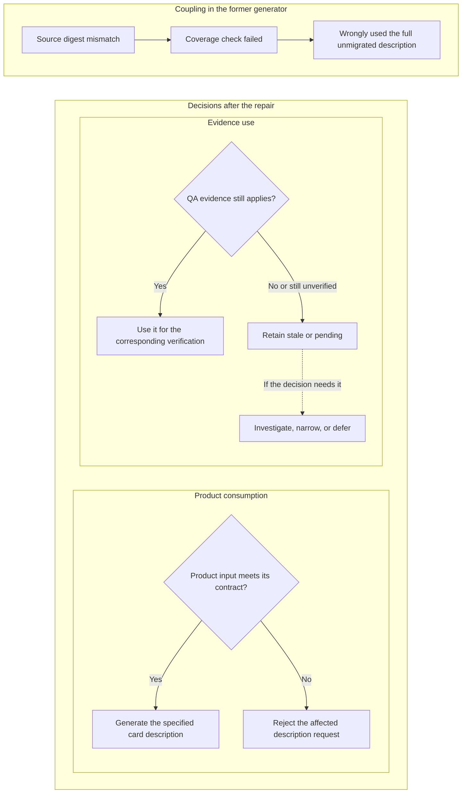

# Chapter 14. Observability and Intervention
## Seeing what happened and checking that a control worked

This chapter models Observation, Detector, Signal, Exception, and Intervention separately. The cases illustrate their boundaries. The particular Observation Contract, Detector Health, and Exception Lifecycle designs remain proposals.

[Chapter 13](/chapters/13-en.html) defines autonomy as revocable delegation under existing authority. To govern that delegation in practice, a project needs to answer several questions.

- Did the named action start?
- What did it actually act on?
- Which state changed?
- Which outcomes were observed?
- Which surfaces went unobserved?
- Did the detector finish its check?
- Did the signal reach someone with the authority to act?
- Did pause, rollback, or takeover take effect?

Without those answers, bounded autonomy can exist on paper alone. **Operational Observability** is the ability to determine what is happening to a named execution, state change, observation gap, or control using external records with known sources, scope, freshness, and integrity. This is the engineering scope used here for delegated execution systems. Control theory and conventional distributed-system observability have their own definitions.

An observation supplies inspectable information. Diagnosis, authority to intervene, and the health of uncovered surfaces each need their own basis.

---

## 14.1 Required, useful, and optional capabilities

### Required

When an agent can affect persistent state, external systems, or later decisions, the project needs a way to establish:

- The target of an action.
- Its boundaries.
- Whether it occurred.
- Its known result or `non-result`.
- Whether stop and recovery can be verified.

A small record can meet these needs.

### Useful

For long-running, concurrent, multi-agent, asynchronous, or cross-tool work, structured events, coverage, detectors, and exception records can help where direct observation is hard to maintain.

### Optional

A unified dashboard, comprehensive timeline, centralized metrics platform, exception prediction, and automated intervention are implementation choices. A one-off synchronous, low-risk task under direct human review may need only command output and a diff.

For the Decision Target at hand, can the project explain what it observed, what remains unobserved, whether the records still apply, and who can act on them?

---

## 14.2 Eight distinct roles in the observation chain

A project can represent these roles with records, fields, views, or events. They need to remain identifiable even when stored together.

| Role | Question it answers | Separate question |
|---|---|---|
| Telemetry Event | Which source emitted which raw or structured event? | What is the complete state of the world? |
| Observation Record | What was actually recorded within the declared boundary? | What caused it? |
| State Claim | What checkable claim is being made about a state? | Has it been accepted? |
| Evidence | Which observations or artifacts support or challenge a claim? | What decision was made? |
| Detector Evaluation | Which detector checked which condition with what input? | How effective is the detector? |
| Detection Signal | Did a named condition match, remain unknown, or fail evaluation? | Has an exception or incident been confirmed? |
| Exception Record | Which deviation, risk, or unknown was routed for handling? | Has the root cause been identified? |
| Intervention Record | What control did an authorized subject request, execute, and verify? | Did the intended effect occur? |

A **Telemetry Event** is a raw or structured operational record emitted by a named source at a particular time. Tools, agent harnesses, runtimes, gates, repositories, queues, and human actions can all be sources.

An **Observation Record** captures what was seen in an inspectable form, within a declared subject, scope, collection method, and time boundary.

A **Detector Evaluation** is a traceable check by a named detector version against bound inputs and a condition. Record the input, result, and the detector's execution status.

A **Detection Signal** is the detector's match, unknown, or evaluation failure for a named condition. It serves as an input to routing.

An **Exception Record** brings a deviation, risk, unknown, or control failure into a named process for handling. It requires triage, an owner, authority, and a disposition.

An **Intervention Record** tracks an authorized request, execution, and verification of a control action intended to change execution or risk. Track the request and the effect separately.

[Chapters 6](/chapters/06-en.html) and [9](/chapters/09-en.html) define State Claims and Evidence. Here the focus is how operational observations contribute to them and lead to disposition.

~~~text
Telemetry Source
→ Telemetry Event
→ bounded Observation Record
→ supports or challenges a State Claim
→ may become Evidence for a named use

Observation Records
+ Detector Configuration
→ Detector Evaluation
→ matched / not_detected / unknown / error
→ optional Signal and Exception routing

Exception Disposition
+ Authority Grant
→ Intervention Request
→ execution observation
→ effect verification / recovery / unresolved
~~~

A person can raise an exception directly from an observation. A signal can also be classified as a duplicate, an expected change, or a false positive.

---

## 14.3 Start the Observation Contract with a question

> What behavior or state of which subject needs to be observed for this Decision Target?

An **Observation Contract** is a versioned agreement about the question, sources, coverage, freshness, integrity, privacy, and failure semantics.

~~~yaml
observation_contract_id: OBS-CONTRACT-014
version: 2
decision_targets:
  - delegated_task_health
  - intervention_readiness

subjects:
  - task_execution
  - bound_worktree
  - test_harness
  - authority_usage

questions:
  - did_the_named_action_start
  - which_subject_was_actually_observed
  - did_state_change_outside_scope
  - was_required_evidence_produced
  - can_execution_be_paused_and_recovered

sources:
  - task_event_stream
  - tool_call_receipts
  - repository_snapshot
  - test_result_receipts
  - control_action_receipts

coverage:
  included:
    - local_worktree_actions
    - bounded_test_process
  excluded:
    - model_internal_reasoning
    - uninstrumented_external_side_effects

time:
  event_time_required: true
  ingestion_time_required: true
  maximum_decision_age: 10m

integrity:
  observer_version_required: true
  source_identity_required: true
  target_mutation_policy: fail_closed

failure_semantics:
  missing_source: unknown
  detector_error: unknown
  target_not_reached: non_result

privacy:
  secret_payload_capture: prohibited
  retention: 30d
~~~

This is one design profile. A low-risk tool may need only a few fields. A production migration may need stronger records of identity, time, data, and recovery.

---

## 14.4 Observe declarations, actions, and outcomes

The original outline proposed observing goals, plans, completed steps, blockers, tool calls, risks, costs, Context, permissions, and checkpoints. Each source has a different limit.

| Surface | What can be recorded | What still needs evidence |
|---|---|---|
| Goal / Intent | Named Intent Artifact, version, and scope | What the agent privately wants |
| Plan | The submitted plan, revisions, and current step | Complete internal reasoning |
| Tool Action | Request, parameter boundary, permissions, start, and result | Coverage of every external side effect |
| State Change | Diff, commit, snapshot, or queue state | Correctness or acceptance of the change |
| Context Access | Observable reads, retrievals, and citations | Attention, comprehension, or use of all Context |
| Risk | Named Risk Claim, trigger, and owner | Overall risk represented by one score |
| Cost | Available token, runtime, API, and review data | All cognitive and opportunity costs |
| Checkpoint | Creation, acknowledgment, restoration attempt, and state | Whether recovery will actually succeed |
| Authority Use | Grant reference, action class, and Decision Target | Organizational authority inferred from platform permissions |
| Human / Gate Decision | Options, authority, disposition, and rationale | Objective truth of the outcome |

For Codex and other agent tasks, process evidence comes from observable messages, tool activity, outputs, artifacts, and changes to files. A plan or explanation records what the agent explicitly said.

---

## 14.5 What an Activity Timeline can show

An **Activity Timeline** organizes sourced execution events and recorded relations into a time-ordered view that a person can inspect in more detail.

~~~text
Goal Received
→ Context Loaded
→ Plan Approved
→ Files Modified
→ Test Failed
→ Plan Revised
→ Evidence Collected
→ Awaiting Human Decision
~~~

Three boundaries matter in a human-facing timeline.

### Sequence and causation

`Test Failed` after `Files Modified` leaves the cause open. The environment, baseline, concurrent changes, or a test defect may explain it.

### Concurrent execution and partial ordering

Agents, tools, queues, and human decisions can interleave. Preserve event and parent or correlation IDs, subject, candidate and baseline, event and ingestion times, source, scope, and uncertainty.

### View and source ownership

The timeline can compress events and still link back to the source. Maintaining a separate current state in the view can create a competing record that goes stale. The timeline shows the recorded execution history within its scope.

---

## 14.6 Observation Coverage states what can be seen

**Observation Coverage** declares which subjects, actions, states, failure modes, environments, and time windows can be observed with current collection and checking, along with explicit blind spots. Bind coverage to a question.

| Observation question | Covered | Partial | Unobserved |
|---|---|---|---|
| Which files changed in the local worktree? | Git snapshot and diff | Untracked temporary files | External mounts |
| Did a tool call return? | Tool receipt | Follow-on subprocess actions | External services with no integration |
| Did the target test run? | Harness receipt | Some shards | Target scenarios that never started |
| Was authority exercised? | Grant reference and action log | Semantic scope needs review | External actions that bypass the platform |
| Was a person notified? | Queue and acknowledgment | A read does not establish comprehension | Offline conversations |

One figure such as `87% observed` can hide an infrequent but high-impact blind spot. Record the observation question, subject, environment, included and excluded surfaces, collection method, failure modes, time window, last successful observation, known blind spots, owner, and review date. Identify which parts of the question have usable records.

---

## 14.7 Name the source of an unknown

| Unknown type | Meaning | Candidate response |
|---|---|---|
| `uninstrumented` | No collection mechanism exists | Limit the claim, add collection, or narrow scope |
| `source_unavailable` | The source is unreachable now | Retry, switch sources, or pause |
| `stale` | The record is older than the current decision allows | Observe again |
| `delayed` | The event may still be in transit or queued | Wait for a watermark or mark the result provisional |
| `schema_incompatible` | Source and consumer versions are incompatible | Isolate, migrate, or update the detector |
| `detector_error` | The detector failed to complete a valid evaluation | Record `unknown` and leave detection open |
| `sampled_out` | Sampling dropped the event | Restrict claims to sampled surfaces |
| `access_denied` | The current subject cannot read the source | Use an authorized path or retain the unknown |
| `conflicting` | Sources give inconsistent observations | Suspend the joint conclusion and seek disposition |
| `not_applicable` | This question is outside the current scope | Record why and exclude it from success counts |

Each type suggests a different recovery. A gray N/A for all missing data would hide that information.

---

## 14.8 Freshness depends on several clocks

**Freshness** is whether an observation is still recent enough for the Decision Target.

~~~text
event_time       when the target event occurred
observed_at      when the source observed it
ingested_at      when the record entered this system
evaluated_at     when the detector processed it
projected_at     when the dashboard or brief was generated
decision_at      when the authorized disposition was made
~~~

Last night's test result may still apply to an unchanged pure-function candidate and be obsolete for changing production state. Bind freshness to the Decision Target, subject or build and environment identities, dependencies that could invalidate the observation, maximum acceptable age, and an event-time watermark or other completeness condition. A dashboard generated now can still show old data.

---

## 14.9 Separate Observer Integrity from the Target Result

**Observer Integrity** is whether collection or verification operated within its declared boundary and preserved the identities of the observed subject and inputs and the limits of interpretation. Declared, isolated outputs can be part of valid collection when they leave target identity and authority-bearing surfaces intact.

Watch for:

- An observer changing the target before observation.
- Collection changing an inventory with authority significance.
- Instrumentation affecting timing or resources.
- Reusing an old result after the observer fails.
- Reporting collection failure as target failure.
- Promoting partial observation to complete coverage.

[D-048's target non-result case](../../Evidence/receipts/ER-20260818-002__CLM-C06-004.md) gives a direct example. The launcher changed its own exact inventory before the target compile, and the second check failed closed.

~~~text
observer_integrity = failed
target_observation = not_reached
target_result = non-result
~~~

The observation distinguishes those statements from the unsupported assignment below.

~~~text
target_compile = failed
~~~

The target was never observed. The case allows declared side effects and leaves open whether every silent failure can be detected.

A different problem appears when a check completes but its result is used for the wrong decision. A CardInformation repair in lessismore retained this failure. The former description generator used verification coverage to decide whether to display migrated content. In the saved diagnostics, six description model samples passed repository integrity checks but fell back to full unmigrated descriptions after a source digest mismatch. The record covers generation from repository through Composer to Reader. No claim is made about six actual mouse hovers.

The repair calculated display eligibility and QA applicability separately. In the saved, bounded checks, valid data produced the expected descriptions even when QA was stale or pending. Rejection checks for incorrect source identity and missing required content continued to pass. See the [card description and QA applicability record](../../Evidence/receipts/ER-20261030-001__CLM-C14-001.md) for sources and limits.

### Figure 14-1 Separate product input checks from QA applicability

*Simplified mechanism from the case. The top group shows the recorded chain of erroneous propagation. The lower group lays out the two judgments in the repair. Their positions do not specify the actual call order. Product input includes required data and contracts for its source and consumption. The dashed line shows options when a decision needs the evidence.*

The old QA result remains stale after the description is fixed. The product request has its own input check. The source change also narrowed dependencies and adjusted the consumption contract, so the result of the joint repair cannot be attributed solely to separating the states.

Elsewhere, determine which layer has the mismatch before choosing a response. Genuine version incompatibility, incorrect source identity, or missing data may warrant blocking. A delegated delivery gate can still deny delivery when applicable evidence is missing. Each check needs a bounded purpose.

---

## 14.10 Assess Detector Health across the whole path

**Detector Health** is the current judgment that evidence supports about whether the data path, detector configuration, evaluation, and signal routing work as declared.

| Dimension | What to check |
|---|---|
| Source Health | Is the source reachable and correctly identified? |
| Collection Health | Is collection active? Were events dropped or permissions denied? |
| Transport Health | Are events queued, out of order, or missing? |
| Schema Health | Are the source and detector versions compatible? |
| Configuration Identity | Which rule, model, threshold, and suppression policy actually ran? |
| Evaluation Health | Did evaluation start, finish, or return an error? |
| Coverage Currency | Does declared coverage still apply to this subject and environment? |
| Route Health | Did the signal reach the intended queue, gate, or person? |
| Effectiveness Evidence | Have injection, replay, incidents, or sampling shown the detector finding the target condition? |

A heartbeat supports process responsiveness. Input completeness, rule correctness, schema compatibility, reachability of the alert path, and detection of the intended failure mode require other checks. Treat detector self-reports as one source.

High-impact detectors can use an independent watchdog, synthetic events, recorded replay, cross-source reconciliation, random human audit, failure injection, or route acknowledgment. Each can reveal a different failure. Choose the checks that cover the risks in scope.

---

## 14.11 Interpret silence within the detection boundary

**Non-detection** means a named detector did not match a target condition within its valid evaluation boundary and bound inputs. Silence can have several causes.

~~~text
named condition did not occur
condition occurred outside coverage
source became stale
event was delayed or sampled out
detector evaluation failed
suppression policy hid the signal
routing failed
queue was not acknowledged
~~~

An empty queue leaves global health open. A defensible report says that, within declared and applicable coverage, the source was fresh, the named evaluation completed, the route was healthy, and the detector found no condition that required the current role to intervene.

~~~text
No routed exception for this decision scope.
Coverage: declared
Freshness: within policy
Detector evaluation: completed
Known blind spots: 2
~~~

Keep the route to detail behind the short display. Give `No Signal`, `Not Detected`, `Unknown`, and `Not Applicable` distinct presentations.

---

## 14.12 A detector reports a condition

A detector can report a timeout, an unauthorized action request or observed action, missing evidence, scope growth, a changed error rate, an unacknowledged human queue, or Observer Integrity failure. Each is a named condition. Root cause, impact, candidate disposition, workflow changes, human fault, and recovery all need further evidence or an authorized decision.

~~~yaml
evaluation_id: DET-EVAL-901
detector_id: DET-AUTH-SCOPE
detector_version: 4
configuration_digest: sha256:example
coverage_ref: COVERAGE-014
input_watermark: EVT-2048
started_at: 2026-08-24T10:01:00+08:00
completed_at: 2026-08-24T10:01:02+08:00
result: matched
matched_condition: write_outside_granted_scope
observation_refs:
  - OBS-4401
health_basis:
  - source_current
  - schema_compatible
  - route_acknowledged
limitations:
  - external_mount_not_observed
~~~

Use this as an example audit profile. The necessary fields depend on the detector.

---

## 14.13 Signal, Exception, and Incident

### Signal

A detector or person submits a candidate anomaly for consideration.

### Exception

A signal enters a named handling path through policy or triage. A person can also record a deviation directly for disposition.

### Incident

An **Incident** records actual or possible named harm requiring its own investigation and recovery. It can be confirmed or under investigation, with separate records for impact, timeline, disposition, and recovery.

A signal can turn out to be expected. An exception without harm can close after a Forward Correction. People can discover incidents without automatic signals, several signals can refer to one incident, and a detector error can be a control exception. A severity label such as `severity: critical` is an input to handling.

---

## 14.14 Keep unknowns and ownership in the Exception Lifecycle

A candidate lifecycle is:

~~~text
raised
→ triaged
→ acknowledged
→ dispositioned
→ intervention_requested
→ intervention_applied / non-result / execution_unknown
→ effect_verified / unresolved / forward_recovery
→ closed / superseded
~~~

`execution_unknown` means whether the intervention ran is unconfirmed, as after a dispatched command times out. A `non-result` requires confirmation that the action did not reach its target. Where external effects are possible, retain `external-effect-unknown` and reconcile state first. Keep the outcome `unresolved` until new evidence arrives. Marking it `effect_verified` or retrying on that basis would be premature.

Adapt these branches to risk and tool capabilities. Advancing to the next state may require its own evidence or disposition.

An Exception Record should identify:

- The signal, observation, or person who raised it.
- Affected subject, scope, and Decision Target.
- Observable facts.
- Inferences and alternative explanations.
- Coverage, freshness, and Detector Health.
- Who assessed severity and urgency.
- Owner and current authority.
- Available actions and their non-effects.
- Deadline or expiry.
- Closing conditions.
- Counterevidence and unresolved unknowns.

Closing an exception can indicate a false positive, accepted risk, an issue outside scope, reassignment, effective temporary restriction, promotion to an Incident or Workflow Candidate, or a task ended with insufficient evidence. Record which disposition occurred. Root-cause repair is one possible outcome.

---

## 14.15 Judge severity, urgency, and authority separately

Exception routing can depend on:

~~~text
impact
reachability
irreversibility
time sensitivity
observation confidence
affected authority boundary
recovery availability
current exposure
~~~

A high-impact condition that cannot currently be reached may suit a scheduled fix. A moderate-impact problem that keeps writing incorrect state may require an immediate pause. Low confidence in the evidence leaves risk open and can warrant a narrower claim or scope, or an independent observation. A single value such as `risk = 83` hides those differences.

Severity helps route an exception to someone with the necessary authority. A detector can intervene within an explicit grant and policy mapping.

---

## 14.16 The State Dashboard as a Decision View

The original outline aimed to show which tasks were running, awaiting approval, exceptional, making high-risk changes, stalled, or over budget. Keep those views and show the basis for each state.

A Decision View should identify:

- Decision Target.
- Subject, candidate, and baseline.
- Current State Claim.
- Source link.
- Coverage and blind spots.
- Freshness.
- Detector Health.
- Exceptions and unknowns.
- Available actions.
- Authority reference.
- Last intervention and effect status.

For `running`, `blocked`, `awaiting approval`, and `over budget`, give more than color. Show the source, time, and rule behind the state. If projection fails or becomes stale, display that failure instead of keeping the old green indicator visible as current. The HCP described in Chapter 12 can project these records. The underlying sources keep their authority.

### Read back the same target after a write

A [DevOS isolated whiteboard fault trial](../../Evidence/receipts/ER-20261122-004__CLM-C12-002.md) produced a mismatch. The write response was `accepted`, while the on-disk task was still `claimed_done`. The first value means accepted, and the second means someone claimed completion. The revised interface confirmed the state through an independent readback bound to the same request, project root, instance, and target revision. A mismatch stayed unverified on screen and did not trigger a second submission.

Submit a named request, then read the same target through the durable-state entry point. If the states match, display the confirmation and observation time. If they differ or readback fails, show the gap and leave confirmation pending. Bind any action requiring confirmation to the current target and its confirmation data.

This synthetic fault leaves the cause of the original production incident open. Independent readback establishes a state at the observation time and leaves future changes and identity verification to their own controls. An extra read and a failure path add cost. This suits important writes such as acceptance, while an interface action with no side effects may need less.

---

## 14.17 Exception Routing directs attention to someone who can act

**Exception Routing** applies the Attention Routing of Chapter 12 to runtime exceptions. It routes them using Decision Target, risk, freshness, authority, and the available attention of the people who can handle them.

Consider:

- Who holds the necessary authority?
- Who understands the domain?
- Are there conflicts of duty?
- When is the decision due?
- Can it be batched?
- Is there a delegated gate?
- Are high-risk items still unacknowledged?
- Do several signals share a cause?
- How does route failure escalate?

Lower interruption counts may reflect better automatic verification, aggregation, or less wasted work. They can also reflect missed alerts, delays, an unhealthy detector, or suppressed feedback. Interpret `interruptions ↓` with those conditions in view.

An Attention Queue can distinguish:

~~~text
new
acknowledged
owned
waiting_for_evidence
waiting_for_authority
intervention_in_progress
expired
unresolved
~~~

These states describe routing. The underlying exception retains its own record.

---

## 14.18 An Intervention Point is an authorized path to action

An **Intervention Point** lets an authorized subject pause, narrow, change, take over, or recover work at a named execution or state boundary. It needs a grant from the model in Chapter 13.

| Action | Boundary to establish |
|---|---|
| Pause | Does it block new actions, and how does it handle in-flight work? |
| Change the goal | Record a new Intent Revision. |
| Narrow scope | Update task scope, grant, or Autonomy Profile as applicable. |
| Change agents | Rebind Context, Authority, and Recovery to the new subject. |
| Roll back | Check whether the baseline applies and external effects can be reversed. |
| Hand over to a person | Confirm the person actually took control. |
| Reduce permissions | Verify which permissions closed and whether authority was revoked or temporarily restricted. |
| Require replanning | Check the new plan against the original intent, scope, and authority. |

Verify the path in practice, including credentials, queues, subagents, tool sessions, locks, external effects, and evidence preservation.

---

## 14.19 An Intervention Contract tracks request, execution, and effect

An **Intervention Contract** records the trigger, authorized subject, target action, expected effect, risk, verification, and recovery conditions.

~~~yaml
intervention_id: INT-204
exception_ref: EXC-088
requested_by: delegated-control-gate
authority_ref: AUTH-STOP-014

action: pause_new_writes
target:
  task_id: TASK-441
  worktree: WT-22

reason:
  detector_evaluation_ref: DET-EVAL-901
  matched_condition: write_outside_granted_scope

expected_effects:
  - reject_new_write_actions
  - preserve_current_evidence

in_flight_policy: isolate_and_report
external_side_effect_policy: reconcile_separately

verification:
  - permission_state_snapshot
  - queue_state_snapshot
  - worktree_diff_after_pause

fallback:
  - revoke_bound_credential
  - human_takeover

expires_at: 2026-08-24T10:20:00+08:00
~~~

The schema is illustrative. Preserve distinct states for the progression.

~~~text
requested
authorized
dispatched
applied
effect_observed
effect_not_observed
partial
non-result
recovered
unresolved
~~~

A pause request still needs observation of whether execution stopped. A rollback command still needs confirmation of whether external state recovered.

---

## 14.20 Map automatic interventions explicitly

An automatic detector can trigger a control under a mapping established in advance.

~~~text
named detector result
+ coverage and health conditions
+ policy version
+ authority grant
+ target action
+ maximum scope
+ verification
+ recovery
→ authorized automatic intervention
~~~

For example, if a completed exact-inventory evaluation finds that an authority-bearing surface changed before target execution, the current harness can block that execution and record a target `non-result`. That grant covers the stop. Editing the rule, extending check scope, deleting evidence, declaring target code failure, creating unbounded successors, and accepting a workflow require their own authority.

Specify:

- Whether detector error fails open, fails closed, or changes to a degraded mode.
- How to recover from a false positive.
- How to deduplicate repeat signals and make handling idempotent.
- Maximum intervention duration.
- Who can override.
- Whether override requires independent authority.
- How to keep controllers from repeatedly triggering each other.

Additional stops can become risk sources if detectors are mistaken, failures are correlated, or recovery is missing. Figure 14-1 can be expressed as a decision table. [Chapter 9](/chapters/09-en.html) covers what evidence supports. Here the focus is the control a result can trigger.

| Check result | Object to act on | Action and stopping point | How to confirm the action |
|---|---|---|---|
| Required product data or source contract is invalid | The affected consumption request | Reject it or use a permitted degraded mode. Bound the effect to the relevant module. | Construct the bad input and check rejection and continued handling of valid input. |
| Data is valid and QA is stale or pending | Current use of the evidence | Keep the unverified state. If the decision needs evidence, investigate by impact or have an authorized role narrow or defer the use. Keep the card description governed by product inputs. | Check that a valid description can coexist with unverified QA and that historical evidence was not marked PASS. If no one relies on the evidence, retesting need not be triggered automatically. |
| Required delivery evidence is insufficient | A named delivery decision | Let the gate block delivery if delegated to do so. Keep the reason scoped to absent evidence. | Check rejection with missing evidence and the corresponding path with applicable evidence. |
| The checker or evidence source fails | Current evidence dependency | Suspend reliance and investigate. Retain uncertainty about whether the target ran. | After restoring collection, confirm target, scope, and result again. |

Each row needs a named owner and permitted effect. Without delegation, the checker reports and an authorized role decides. Stop repeating the verification once the disposition is complete and the question is answered. New changes, failures, and open questions can trigger another check.

---

## 14.21 Observe the target effect after intervention

An intervention can succeed at three different points.

1. The control command is accepted.
2. The execution state changes as intended.
3. The original risk is contained, recovered, or handed off.

A single `success: true` hides those differences. After pause, check whether new actions are denied, in-flight work finished or was isolated, credentials still work, queues still deliver, subagents still act, external state is still changing, evidence is preserved, and who owns recovery.

After rollback, identify the restored baseline. Check consistency across source, runtime, data, and external state, the presence of irreversible effects, whether the old baseline remains safe, and whether forward recovery is the only viable option.

Effect observation can itself fail. If an intervention might have happened but its effect cannot be confirmed, record `effect_unknown` for the target. Where external side effects are possible, also retain Chapter 8's `external-effect-unknown`. Reserve target `non-result` for a trace that establishes the intervention was blocked before acting on its target. The observation task can have a `non-result` of its own if it never starts. That says nothing about whether the intervention occurred. A control returning HTTP 200, or an observer failing afterward, leaves risk resolution open.

For Figure 14-1, observe both sides of the repair. Check that descriptions are restored, genuinely bad inputs are still rejected, and stale evidence remains unverified. The saved case supports those bounded checks and preserves earlier fixture failures and limited UI samples. Gameplay as a whole, release packages, and all language experiences remain outside that coverage.

---

## 14.22 Automate telemetry where it can observe the event

The runtime can record:

~~~text
workflow_id and version
subject configuration
started / completed / failed
tool action
state transition
rework / rollback
human intervention
acceptance result
exception and route
~~~

Automatic generation can be easier to sustain than repeated manual form filling. Some questions still call for human annotation, rationale, or review.

- Why did a person accept the risk?
- Does the creative result fit the intended experience?
- Did a reviewer understand the change?
- Was a delay cognitive difficulty or an unrelated interruption?
- Was rework caused by a defect, changed preference, or changed scope?
- Were there issues that went unreported?

Ask for human judgment where machine records cannot establish the meaning.

---

## 14.23 Account for observation cost, access, and risk

Telemetry can introduce runtime and storage cost, high-cardinality and duplicate events, exposure of secrets, credentials and personal data, source and prompt retention risk, observer effects, schema migration, dashboard maintenance, false positives and alert fatigue, overoptimization for measurable metrics, and new authority surfaces.

An Observation Contract should address:

- Data minimization.
- Redaction.
- Access control.
- Retention.
- Deletion and legal holds.
- Source and event identities.
- Sampling.
- Aggregation.
- Audit.
- Minimum retention for debugging and incident investigation.

Redaction should preserve enough structure to inspect the action boundary. Retaining complete payloads calls for access and expiry proportionate to the risk. Observability is a control with costs and security boundaries of its own.

---

## 14.24 Observation and intervention in the longitudinal case

[Chapter 23](/chapters/23-en.html) has the chronology. Chapter 12 describes the implemented task projection and its gaps. Three relations matter here.

- **D-048.** The observer changed a controlled surface before the target ran. The detector caught the change and stopped execution. Track Observer Integrity, the target `non-result`, authority after the stop, and recovery independently. Detection of other silent failures remains open.
- **Task Projection.** A read-only projection tied to task, commit, and review can refer to underlying state. Unified Coverage Health, Detector Health, global Takeover, and Delegation Revocation remain outside its demonstrated scope.
- **D-073 to D-075.** A `meta-only successor`, growing proof artifacts, and stalled delivery evidence can inform a Process Warning. Later `NON_QUALIFYING` evidence leaves strict governance as one candidate explanation. Increases in source or tests need their own assessment as progress.

See the [target non-result record](../../Evidence/receipts/ER-20260818-002__CLM-C06-004.md), [control-interface case](../../Evidence/receipts/ER-20260824-002__CLM-C12-001.md), and [governance livelock history](../../Evidence/receipts/ER-20260818-001__CLM-OUTLINE-002.md).

---

## 14.25 Start with one decision path

Choose a recurring decision with explicit risk, costly direct observation, a workable stop or recovery route, and available source identity.

1. State the Decision Target.
2. Identify subject, action, and failure mode.
3. Write the observation question.
4. Choose a minimal telemetry source.
5. Record included, excluded, and unknown coverage.
6. Define freshness and `non-result`.
7. Implement one versioned detector.
8. Test detector error and route failure.
9. Bind the exception owner and authority.
10. Implement a pause, restriction, or recovery action.
11. Verify the intervention effect.
12. Record false positives, known false negatives and escaped incidents, delays, rework, and human interventions.
13. Decide whether to expand.

Exercise stale sources, schema drift, detector errors, route failure, partial intervention, and unavailable recovery. A dashboard demonstration on the normal path is only one part of the evidence for control.

---

## 14.26 Responsibilities of neighboring chapters

| Object | Chapter | How Chapter 14 uses it |
|---|---|---|
| State Claim, Source, Applicability, Evidence Generation Integrity | 6 | Generate and check operational observations |
| Evidence Portfolio, Coverage, Acceptance / Adoption / Release Authorization | 9 | Apply observations to named claims and release authorization |
| Human-facing Projection, Progressive Disclosure, Decision Surface | 12 | Display coverage, health, exceptions, and actions |
| Authority Grant, Autonomy Profile, Pause, Revoke, Takeover | 13 | Determine who can intervene |
| Telemetry Source, Observation Contract, Detector Evaluation, Exception Lifecycle, Intervention Effect | 14 | Core objects of this chapter |
| Memory Promotion, Conflict, Expiry | 15 | Decide whether historical observations enter long-term memory |
| Self-Evolution Candidate, Evaluation Contract, Activation / Rollout Record | 16 | Use longer observation to evaluate workflows, with basic Adoption from Chapter 9 |
| Release Execution, Release Outcome, Trace | 18 | Observe authorized releases and external effects |

Telemetry can feed a memory decision or workflow evaluation. Those processes determine what to retain and whether an improvement claim is warranted.

---

## 14.27 Principles

1. **Begin with an observation question.** Collect telemetry for a decision.
2. **Keep roles identifiable.** Event, Observation, Claim, Evidence, Signal, Exception, and Intervention each mean something different.
3. **Show blind spots.** Keep unobserved surfaces visible.
4. **Tie freshness to a decision.** Check the source times behind a fresh view.
5. **Separate Observer Integrity from Target Result.** Record failure of the observer in its own right.
6. **Assess Detector Health across the path.** Heartbeats and self-report are partial records.
7. **Scope non-detection.** Interpret silence in view of coverage, freshness, and Detector Health.
8. **Bind the timeline to events and relations.** Preserve identity, correlation, and uncertainty in concurrent work.
9. **Route high severity to an authority.** Establish policy mappings and grants for automatic intervention.
10. **Observe effects independently of requests.** Check whether pause or recovery actually changed the target.
11. **Record human judgment where it belongs.** Authorized roles supply reasons, experience judgments, and accountability.
12. **Govern observation itself.** Include cost, privacy, retention, attack surface, and cognitive load.

---

## 14.28 Common failure patterns

- Collecting every log before identifying a purpose.
- Treating event count as coverage.
- Collapsing coverage to a percentage that ignores failure modes.
- Making the dashboard another truth store.
- Inferring causation from sequence.
- Claiming to have captured hidden model reasoning.
- Treating a Context Manifest as a record of understanding.
- Interpreting silence as health.
- Ending a health check at detector self-report.
- Displaying a detector error as `not_detected`.
- Giving old observations a fresh appearance through a newly generated view.
- Promoting every signal to an incident.
- Letting severity expand authority.
- Responding to every warning with a Hard Stop.
- Judging improvement by fewer alerts alone.
- Treating a queue acknowledgment as resolution.
- Treating a successful pause response as proof that execution stopped.
- Completing rollback without checking external effects.
- Substituting metrics for human rationale.
- Keeping secrets and complete payloads indefinitely for observability.
- Generalizing from D-048 to all silent failures.
- Generalizing from the v4.94 task projection to a complete HCP.

---

## 14.29 Checklist

### Observation question

- Which Decision Target is in scope?
- Are subject, action, environment, and failure mode named?
- Does the decision need events, State Claims, evidence, or a disposition?
- Does the record claim access to unavailable internal reasoning?

### Source and coverage

- Are source identity, version, and collection method recorded?
- Are included, excluded, partial, and unknown surfaces visible?
- Are stale, unavailable, delayed, and sampled-out observations distinct?
- Can the observer change the target or authority-bearing surface?

### Time and integrity

- Are event, ingestion, evaluation, projection, and decision times distinct?
- Is freshness tied to the decision?
- Is Observer Integrity failure kept separate from target outcome?
- Has partial observation been presented as complete?

### Detector

- Are detector, configuration, inputs, and coverage versioned?
- Does evaluation record whether it completed, was unknown, or failed?
- Can one inspect source, transport, schema, route, and effectiveness health separately?
- Is there a suitable check such as synthetic events, replay, an independent watchdog, or human audit?

### Exception and routing

- Are signals, exceptions, and incidents distinct?
- Can readers distinguish facts, inferences, alternative explanations, and recommendations?
- Does the owner have domain knowledge and authority?
- Are route failures, queue age, duplicates, and expiry handled?

### Intervention

- Does the action have a grant and maximum scope?
- Are request, dispatch, application, and effect observation separate?
- Are in-flight work, credentials, queues, subagents, and external effects handled?
- Is recovery by rollback, forward correction, or still unknown?
- Who takes the next step if the intervention fails or takes partial effect?

### Cost and human judgment

- Are secrets, payloads, or personal data being collected unnecessarily?
- Are retention, redaction, access, and deletion explicit?
- Do alert-count comparisons account for misses, delays, and Detector Health?
- Are rationale, experience, and responsibility supplied by appropriate people?

---

## 14.30 Conclusion

Observability gives a named decision an inspectable chain.

~~~text
Observation Question
→ Source and Coverage
→ Observation Record
→ Freshness and Integrity
→ Detector Evaluation
→ bounded Signal / Exception
→ Authority-bound Intervention
→ Effect Observation and Recovery
~~~

Any step can be `partial`, `unknown`, an `error`, or a `non-result`. Show those states even when other steps report success.

> **Absence of a signal is not evidence of global health. An intervention request is not evidence of control effect.**

Silence supports scoped non-detection when coverage, freshness, and detector health are known. The effect of an intervention requires fresh observation. The next chapter asks which observations, decisions, and exceptions can enter long-term Memory, how provenance, scope, and expiry survive, and how a project can keep a mistaken lesson from propagating.
