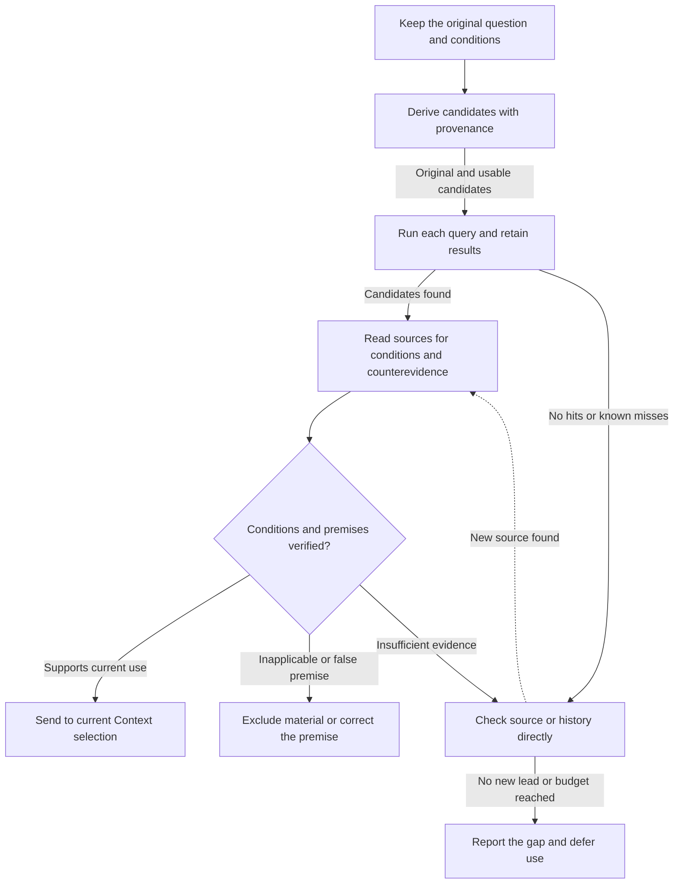

# Chapter 15. Memory Engineering
## Continuity depends on records people can govern

This chapter proposes a Memory Governance model for candidates, promotion, provenance, retrieval, conflict, and expiry. The cases illustrate parts of the model. Complete implementation and any lasting improvement in efficiency or quality remain open.

[Chapter 14](/chapters/14-en.html) developed the operational chain through Observation, Detector, Exception, and Intervention. Saving an operational record is only the beginning. A system may have logs, task transcripts, commits, tests, reviews, decisions, incidents, summaries, workflows, and preference notes, yet still leave basic questions open.

- Which records could be useful again?
- Which conclusions still apply?
- Which were one-off judgments?
- Which were superseded or conflict?
- Which can travel across projects?
- Which can enter the current Context under existing authority?
- Which should be quarantined or deleted?

**Memory Engineering** manages long-lived, retrievable records through candidate creation, review and admission, source binding, applicability checks, retrieval and use, conflict handling, invalidation, and deletion.

The goal is for a later person or agent to find useful history and know where the record came from, what it said then, where it applied, whether it applies now, and what conflicts with it.

---

## 15.1 From one task to project continuity

A capable model can produce a high-quality result on one task. Project continuity also requires traceable decisions, durable lessons from failure, reusable procedures, state carried across conversations, a mechanism to invalidate old conclusions, and accurate interpretation of project preferences and constraints.

**Project Memory** is a collection of persistent, retrievable records kept for future project decisions, with sources and limits on applicability. It supplies part of that continuity. Organizational intelligence also depends on Authority, Evidence, Workflow, human judgment, Review, Recovery, current Context, and model and tool capability.

One tempting shorthand is:

~~~text
more memory
→ more intelligence
~~~

A narrower statement is:

~~~text
traceable records
+ bounded retrieval
+ current validation
+ human and delegated judgment
→ may improve continuity and reuse
~~~

Evaluate effects on quality, speed, or risk using named outcomes and a comparison.

---

## 15.2 Required, useful, and optional capabilities

### Required

For a consequential, long-lived, or cross-role task, keep enough external records to find:

- Original Intent and scope.
- The sources, evidence, and unknowns at the time.
- Decision and authority.
- Important state transitions.
- Unresolved issues.
- Recovery or supersession.

Versioned records can meet this requirement.

### Useful

Structured Memory Records, an index, expiry, and conflict links help when projects span conversations, agents, and versions, or repeatedly face similar decisions.

### Optional

Embedding retrieval, a memory graph, automatic summaries, a cross-project knowledge base, a personalized preference model, and automatic pattern extraction are optional. For a small project, a versioned decision log, issues, Git history, and a few maintained documents may be more reliable.

---

## 15.3 Place Memory alongside its sources and inputs

| Object | Role | Relationship to Memory |
|---|---|---|
| Primary Source / Artifact | Holds original code, runs, decisions, or evidence | Memory can reference it. Copying needs a reason. |
| Archive | Preserves historical materials | Suitability for retrieval or reuse needs its own assessment |
| Project Memory | Maintains bounded records for future use | Records can expire, conflict, or be wrong |
| Memory Index | Helps find records | A match needs an applicability check |
| Context | Information accessible to the current task | Selects some of the available Memory |
| Agent Input | What actually reaches the model or harness | Comprehension remains unobserved |
| Model Weights / Provider Memory | Persistent state inside a model or platform | Usually unavailable as an auditable authority for the project |
| Truth / State Claim | Makes a checkable assertion about current or historical state | Memory can preserve the claim with its existing status |

Keep important continuity in external records that can be exported, cited, and reviewed. Platform-level personal memory may make interaction more convenient. Project authority, evidence, and audit need their own inspectable records.

---

## 15.4 Seven roles in the Memory chain

These roles make up a minimal teaching sequence. A project can represent them as records, fields, views, or events according to risk.

### Source Record

A **Source Record** is an original or near-original artifact, observation, decision, incident, commit, test, review, or human note used as a basis for a Memory Candidate.

### Memory Candidate

A **Memory Candidate** is a record or derived summary proposed for later use and awaiting admission. A person, agent, workflow, or rule can propose it.

### Promotion Decision

A **Promotion Decision** is an authorized decision about whether the candidate enters Project Memory and under which use, scope, status, and expiry. Admission authority determines access to the memory surface. Authority over the underlying facts comes from elsewhere.

### Memory Record

A **Memory Record** is a long-lived retrievable record with a named admission disposition, source, scope, status, invalidation conditions, and conflicts. It can point to a Primary Source or include a bounded Derived Summary.

### Memory Index

A **Memory Index** helps find, navigate, and filter Memory Records. Authoritative content remains in its sources.

### Retrieval Candidate

A **Retrieval Candidate** is a matching Memory Record awaiting applicability and Context selection checks. A match can come from similarity or a filter.

### Use Record

A **Use Record** describes whether Memory was selected, observably accessed, or used for a named decision. It records what can be observed about the process. Model comprehension and acceptance remain separate questions.

~~~text
Source Record
→ Memory Candidate
→ Promotion Decision
→ Memory Record + Index
→ Retrieval Candidate
→ applicability / authority / freshness / conflict checks
→ selected Context Item + Context Manifest
→ observable use and outcome
→ reaffirm / narrow / dispute / supersede / deprecate
~~~

Each transition can stop. Automatic capture, promotion, retrieval, validation, Context inclusion, and adoption each require their own conditions.

---

## 15.5 Record Roles can overlap

The original outline listed fact, decision, experience, skill, preference, failure, and constraint memory. Those names mix content, source, purpose, and authority. A **Record Role** is a label for the future questions a record is intended to help answer. A record can have several roles.

| Record Role | Boundaries to preserve | Separate question |
|---|---|---|
| State / Fact Claim Reference | Subject, scope, time, source, evidence, applicability | Whether the claim remains true |
| Decision Memory | Decision Target, options, authority, rationale, tradeoffs, supersession | Which policy applies now |
| Experience / Lesson Candidate | Observation, inference, alternatives, conditions | Whether it generalizes |
| Procedure / Skill Reference | Version, environment, verification, permission, recovery | Whether it can be executed under current authority |
| Preference / Identity Record | Owner, form of expression, scope, stability, override | Whose preference it represents |
| Failure / Incident Memory | Impact, timeline, root-cause status, correction, open questions | Causes of other similar problems |
| Constraint / Policy Reference | Authority, scope, effective time, exceptions, supersession | What factual state it describes, if any |

A decision made during an incident can be both Decision Memory and Failure Memory. Tag both roles. Treat a "fact memory" as a claim tied to its source, time, and applicability.

---

## 15.6 Use a Promotion Contract for long-term admission

A **Memory Promotion Contract** specifies a candidate's future use, source requirements, applicability, review, and invalidation conditions.

~~~yaml
memory_candidate_id: MEM-CAND-240
candidate_kind: retrospective_lesson
intended_uses:
  - future_validator_design_review

source_refs:
  - incident:D-048
  - review:d048_verifier_integrity_review

candidate_statement:
  text: >
    When a verifier changes an authority-bearing observation surface
    before the target is reached, observer integrity and target result
    must be recorded separately.
  epistemic_type: recommendation

scope:
  domains:
    - validator_design
  conditions:
    - target_not_reached
    - authority_bearing_surface_changed
  excluded:
    - declared_isolated_normal_outputs

promotion:
  authority_ref: AUTH-MEMORY-REVIEW-02
  required_review:
    - source_binding
    - counterevidence
    - cross_project_scope

lifecycle:
  review_on:
    - verifier_architecture_change
    - contradictory_incident
  expires_at: null
~~~

This is an example profile. Review future Decision Use, source and derivation, epistemic type, scope and exclusions, counterevidence, current compatibility, retention and privacy, promotion authority, invalidation triggers, and review cost. A task summary should earn its place in long-term Memory by meeting a future need.

---

## 15.7 Keep the transformation chain in Memory Provenance

**Memory Provenance** links the Primary Source, producing activity, and responsible subject through generation, derivation, revision, and admission to the current Memory Record.

Locate the source and its revision or identity. Record who or what produced it and when it was observed, captured, summarized, and admitted. Preserve the boundaries among original records, human judgment, agent summary, and retrospective inference. Identify what was removed or compressed, who authorized admission, which sources are unavailable, and whether references form a loop.

~~~text
memory_id
source_ref / source_revision
derived_from
producing_activity
responsible_subject
captured_at / promoted_at
transformation_method
epistemic_type
scope / intended_use
applicable_versions / environments
conflict_refs
invalidation_triggers
review_status
retention_policy
~~~

Many summaries of the same source represent one provenance chain. Count independent origins when assessing corroboration.

---

## 15.8 Retain the epistemic type of a record

Recording a statement over the long term leaves its epistemic type intact.

~~~text
Observable fact:
D-079 candidate 471dd87 passed 42 selected tests.

Contemporaneous judgment:
Human rejected it as over-scoped for E1.

Retrospective inference:
Test fit and implementation-scope fit are separate questions.

Current recommendation:
Bind automated acceptance only to a named Decision Target and Authority.
~~~

A compressed summary might read:

~~~text
The candidate was wrong despite passing tests.
~~~

That loses what passed, who rejected which scope and why, which phase was affected, and the distinction between later inference and original evidence. A summary can sound decisive while becoming harder to reuse.

---

## 15.9 Treat a Derived Summary as its own record

A **Derived Memory Summary** is a secondary record produced by selecting, compressing, and interpreting one or more sources. It needs:

- Summary producer.
- Source list.
- Transformation method.
- Omitted surface.
- Intended audience.
- Scope.
- Time generated.
- Review Record, Finding, or authorized disposition reference.
- Drill-down.
- Conflicts and unknowns.

Summaries can speed retrieval. They can also drop conditions, merge authorities, conflate failure with `non-result`, turn a one-time decision into a general rule, present expired state as current, hide counterevidence, or make the derivative appear to confirm the source. Frequent retrieval does not change evidential status.

---

## 15.10 How Memory becomes polluted

**Memory Pollution** happens when incorrect, mis-scoped, stale, untraceable, or wrongly authorized records enter the chain of long-term use and affect later judgment.

It can start with an erroneous source or a summary that drops scope. A decision can become a fact, a preference can become policy, a temporary workaround can become standard procedure, or a single failure can become a general explanation. Old state can look current. A retrieval match can be mistaken for compatibility. Related summaries can be treated as independent support. Agent-generated records can cite one another in a loop. External content can carry prompt injection. An expired skill can be given current tool authority, a project exception can be applied elsewhere, and a revoked constraint can keep entering Context.

~~~text
weak or mis-scoped conclusion
→ promoted without boundary
→ retrieved repeatedly
→ used in generated explanations
→ re-summarized as corroboration
→ appears institutionally established
~~~

Repetition extends a claim's reach. Assess independent evidence at the sources.

---

## 15.11 Inspect the conditions of Memory Amplification

**Memory Amplification** is the growing influence of a record through long retention, frequent retrieval or injection, broad reach, or high instruction weight. Stable reuse of a validated safety constraint can help avoid repeating mistakes. Problems arise when the influence exceeds the evidence or authority.

~~~text
retrieval frequency
context injection frequency
number of affected roles
decision impact
instruction or authority weight
lifetime
cross-project reach
source visibility
conflict visibility
recovery cost
~~~

Assess these dimensions separately. An occasional obsolete procedure with high tool authority may be riskier than a frequently retrieved explanation.

Responses can include quarantine, narrowing scope, removing instruction authority, attaching a conflict, rebuilding a summary, revalidating, halting cross-project propagation, superseding, deleting, or redacting.

---

## 15.12 Track lifecycle dimensions separately

The original outline used:

~~~text
Capture
→ Validate
→ Store
→ Retrieve
→ Reconfirm
→ Deprecate
→ Delete
~~~

Storage can occur before validation. Retrieval leaves reconfirmation open. Deprecation affects future use, and deletion has its own conditions. Track at least four dimensions.

### Admission Status

~~~text
captured
candidate
promoted
rejected
quarantined
~~~

### Epistemic / Applicability Status

~~~text
unreviewed
supported_for_scope
partial
disputed
stale
not_established_for_current_baseline
~~~

### Supersession Status

~~~text
current
superseded
deprecated
historical_only
~~~

### Storage / Retention Status

~~~text
hot
archived
redacted
scheduled_for_deletion
deleted_with_tombstone
retained_under_hold
~~~

One record can be all of the following.

~~~text
promoted
+ historical_only
+ supported_for_original_scope
+ archived
~~~

It still serves as history, with support confined to its original scope.

---

## 15.13 Expiry and Invalidation affect current applicability

**Memory Invalidation** occurs when a record ceases to apply to a named current use because dependencies, versions, environment, authority, or evidence changed. Keep historical validity separate. Common triggers include:

- A changed source revision.
- Changed code, schema, data, or environment.
- A superseded decision.
- Revoked policy or authority.
- A changed preference from its owner.
- Incompatible procedure tooling.
- Incident counterevidence.
- An expired assumption.
- A new project phase.
- A transfer beyond the original scope.

**Expiry** is reaching a planned date, version, or review condition at which applicability must be established again. An expired migration procedure can still describe valid steps for an older environment. Check its fit before executing it now.

~~~text
revalidate
narrow
mark historical
supersede
quarantine
deprecate
delete
~~~

---

## 15.14 Check what kind of conflict a match contains

| Conflict type | Example | Response |
|---|---|---|
| Direct Claim Conflict | The same build is recorded as deployed and undeployed | Check source, time, and domain |
| Temporal Supersession | Old and new policies differ | Preserve history and mark effective time |
| Scope Conflict | A rule from project A is applied to project B | Narrow scope or make a Transfer Candidate |
| Authority Conflict | An agent summary conflicts with a human decision | Preserve sources and escalate by Decision Target |
| Applicability Conflict | A procedure worked with an old tool and is unverified with the new one | Mark applicability to the current configuration as unestablished |
| Preference Conflict | Owners or phases have different aesthetic preferences | Bind owner, product surface, and time |
| Evidence Conflict | A new observation challenges an old lesson | Retain counterevidence and review again |
| Instruction Conflict | Two skills prescribe incompatible actions | Decide by authority, scope, and compatibility |

Embedding similarity can identify material worth comparing. The kind of conflict depends on time, scope, evidence, and authority. Keep the original records, link the conflict, mark current applicability, assign an owner, name the Decision Target, record any temporary selection and its basis, and set a next review or expiry.

---

## 15.15 Supersede, Deprecate, Quarantine, Delete, and Tombstone

### Supersede

Use a replacement record as the current entry point. Preserve the older record and provenance for history.

### Deprecate

Stop recommending a record for new work. It can still apply to historical reconstruction or an old environment.

### Quarantine

Temporarily exclude a record from ordinary retrieval and Context because of pollution, unclear provenance, malicious content, conflict, or high risk.

### Delete

Remove content under retention, privacy, security, or governance requirements.

### Tombstone

A **Tombstone** is a minimal marker that an identity was deleted, must not be imported again, or requires special handling. It omits the sensitive content that was deleted.

Deletion can conflict with audit, privacy, and continuity. Decide whether to retain a hash, ID, reason, and deletion time, whether archives can restore the item, whether derived summaries and search entries are removed, how backups and caches are handled, how legal hold applies, and which historical references will break.

Removing material from default Context changes what is supplied now. An archive needs a usable index and a retrieval check. Reusable Memory also needs source and applicability judgments. The partial cleanup and archive cases in [Chapter 18](/chapters/18-en.html), sections 18.21–18.24, illustrate the first two operations. The deletion counts do not measure retrieval quality or savings, and the cases leave memory admission open.

---

## 15.16 From the original question to inspectable retrieval candidates

**Memory Retrieval** finds candidate records using the current question, filters, and an index. Finding a candidate and deciding whether it applies are separate steps. [Chapter 5](/chapters/05-en.html) covers acquiring and assembling information for current work. This section asks how persistent records are found again and what retrieval might miss.

### Two kinds of omission in a limited implementation

A [retrieval and original-source readback record](../../Evidence/receipts/ER-20261030-002__CLM-C15-001.md) from AI Game Dev OS v4.98 provides a concrete counterexample. On a fixed collection of 22 public historical memory documents, three questions were expressed as keyword queries, full English sentences, full Chinese sentences, and manually selected keywords. All six full-sentence queries ran normally and returned no hits. Term-by-term diagnostics showed that an all-terms matching rule had excluded relevant files. They had never reached ranking.

A later implementation extracted `snake_case` technical identifiers from the original question and kept their character positions. The original and candidate could be queried separately, and the candidate was identified as semantically unconfirmed. Eight of nine trials completed both queries. One question entirely in Chinese contained no such identifier, generated no candidate, and did not run both queries. Six positive formulations expressed three questions in English and Chinese, and the candidates recovered the records an agent had labeled relevant. Two challenges remained.

| Key condition in the original question | Candidate query and recorded result | Remaining problem |
|---|---|---|
| Find why v4.89 kept `top_level`, excluding the steps that removed it in v4.90 | Only `top_level` remained. Five documents were returned and two were labeled relevant. | Version and negation were lost. One file contained both the reason for keeping it and the later removal. |
| How does `_ev_get` automatically promote `verification_ok` from `details` to the root? | `_ev_get verification_ok` returned three relevant records and missed one that directly described the helper boundary. | The question contained a false premise. Matching shared identifiers did not recover the material that corrected it. |

The next change added a read-only original-source path constrained by candidate snapshot, source hash, actual line numbers, and ranges excluded from view. An independent agent inspected the originals. It distinguished applicable and inapplicable passages in the same version-history file and used the historical material on the second question to distinguish a read helper from an explicit write, correcting the premise that the helper automatically promoted a field.

The missed `helper_scope_boundary.md` came from comparing earlier labels and misses. The readback path did not discover it. The change improved access to a known original. Recall and answer selection remained open. Failure to find a condition in one passage leaves the rest of the file unexamined.

These were three connected small trials. The corpus was familiar, an agent that knew the rules and had read the corpus chose the questions, and relevance was not human ground truth. Manual keywords also used the passages containing answers. The record helps explain the named failures and local changes. Production quality, general language understanding, and lasting efficiency remain untested. See the source for the chronology and [Chapter 23](/chapters/23-en.html) for the longitudinal case.

### Preserve the question and verify conditions against the source

The following is a proposed workflow to test beyond the limited implementation. It does not describe the tools already operating as a complete automated sequence.

### Figure 15-1 Keep the original question alongside candidate queries

Proposed mechanism. Solid edges show retrieval and decisions about use. The dashed edge returns to source readback after a targeted check finds a new source. Carry the original conditions through the final check. Merging candidates, targeted follow-up, and premise checks are proposed steps. Existing access permissions still apply to retrieval.

Keep the full question, then derive a few candidates from its wording, paths, symbols, or sources already read. Deduplicate by source and revision while retaining which query produced each candidate. Similar summaries can come from different records. Check version, negation, counts, relations, and intended use separately. Actively look for limiting and corrective material.

Apply version filters at passage level when one file contains earlier rationale and later changes. Dropping the whole file can create another miss. To test a false premise, search beyond the hits that share its words. Look for a function's responsibility, actual writes, prohibited side effects, or an alternative relationship. If authorized source and history queries cannot resolve the question, report what was checked, what is missing, and which conclusion remains unsupported.

Once a record is found, identify whether it is a fact, contemporaneous judgment, or recommendation, whether it was superseded, where it applies, and whether it carries the authority required for this use. Retrieval preserves current tool permissions. Readback supplies material for an evidence-use or acceptance decision.

### Choose the smallest change that addresses the failure

| Option | Purpose | Cost and failure mode |
|---|---|---|
| Explicit keyword or symbol search | Find candidates quickly when the object and vocabulary are known | A user needs source terminology. General natural-language coverage remains open. |
| Keep the original and traceable candidates, query separately, then read back | Make query changes and lost conditions inspectable | Adds reading and maintenance. Identifier extraction can still drop version, negation, and relations. |
| Direct authorized source, history, or typed index lookup | Investigate search misses and questions about a named object | Requires access and navigation. Stop and report gaps when leads run out. |
| Vector or hybrid retrieval | Test discovery with different wording | Requires separate comparison, can mismatch, and still depends on source and applicability checks. |

Preserve the original question, errors, and unknowns. Treat unconfirmed candidates as candidates. Reproducible readback and evaluation on questions chosen in advance are useful. Vector stores, multiple routes, and automatic reranking are optional. Start with a local fix when it addresses the observed failure.

---

## 15.17 Separate Retrieved, Selected, Supplied, Accessed, Cited, and Adopted

[Chapter 5](/chapters/05-en.html) follows historical records through candidates to current Context selection. Observe these distinct relations at use time.

| State | Observable meaning |
|---|---|
| `retrieved` | An index or search returned the record |
| `selected` | Context Assembly decided to provide it |
| `supplied` | A payload, reference, or access path was made available |
| `accessed` | A tool observed a source opened or expanded |
| `cited` | An output explicitly references the record |
| `adopted` | An authorized decision adopts a recommendation or rule |

A known corrective file can be read directly. A search hit can be excluded. The helper boundary example shows why acquisition route matters. Describing a successful later read as complete search would hide the miss.

A light Use Record can keep the question, acquisition path, source version, selection or exclusion rationale, and external citations. Record steps that actually occurred. An access log leaves comprehension, belief, and reliance open. Similar answers may also come from prior knowledge or other sources. Observe retrieval, readback, and explicit adoption separately.

---

## 15.18 A Skill carries more than a Memory Record

The original category Skill Memory can combine:

~~~text
historical lesson
procedure
instruction
tool invocation
mutation authority
~~~

A Skill can include information, a procedure, instructions, tool bindings, required permissions, authority boundaries, verification, and recovery. Memory can keep skill versions, use history, failures, and candidate proposals. Installation, instruction priority, tool permission, authority, environment compatibility, and acceptance of an update have their own paths. Important skill changes are candidates for evaluation and adoption under Chapter 16.

---

## 15.19 Bind preferences and project identity to responsible people

**Preference Memory** records choices expressed or accepted by a named person, team, or project for a specified product surface, time, and set of conditions.

~~~text
The user prefers minimal UI.
~~~

A statement like this needs an owner, source, whether it was explicit or inferred, product surface, strength or override conditions, effective time, relation to current Intent, conflicting preferences, human review or disposition, and last review date.

A choice can reflect a temporary constraint, an experiment, limited time, a particular audience, an actual preference, or a compromise among poor options. A preference inferred from behavior can become a candidate. A person with authority can decide what belongs to Project Identity or Producer Soul. Current explicit Intent can usually override historical preference. Safety, compliance, and organization policy keep their own authority.

---

## 15.20 Keep project Memory and cross-project knowledge scoped

A namespace can distinguish:

~~~text
task-local
repository / module
project
organization
domain
cross-project candidate
personal preference
external reference
~~~

A project exception may depend on architecture, team roles, tools, authority, product phase, history, data, risk appetite, or creative direction. Changing scope requires revisiting those conditions.

> **Project success does not create cross-project validity.**

Prepare a new candidate, translate its conditions to the target, validate it, and record a disposition. Cross-project search can return project Memory while showing where it originated.

---

## 15.21 Cross-project transfer creates a candidate

**Memory Transfer** proposes reusing a record from one namespace in another project, environment, or organizational boundary.

1. Keep the source and original namespace.
2. Name the target project and Decision Use.
3. Extract dependencies and implicit conditions.
4. Identify differences in authority, tools, data, and policy.
5. Preserve counterexamples.
6. Create a target-side candidate.
7. Verify it in the target environment or obtain authorized acceptance.
8. Name an owner and expiry on the target side.

~~~text
source project memory
+ transfer rationale
+ target compatibility evidence
→ target-side memory candidate
~~~

The shortcut below skips the compatibility check.

~~~text
source project memory
→ global rule
~~~

Apply the same checks to the External Capability Layer, including licensing, confidentiality, prompt injection, and source updates.

---

## 15.22 Distinguish automatic capture from automatic promotion

A runtime can automatically capture task events, tool receipts, commits, test results, exceptions, interventions, decision forms, review outcomes, handoffs, and metrics. Capture can feed an archive or a candidate source.

Promotion has a wider effect because it determines what later retrieval can find by default. A narrow rule could be delegated in advance.

> Add a read-only reference and authority metadata for each signed Release Decision to the Decision Index.

A successful task alone gives little basis to promote lessons, root cause, preferences, procedures, skill updates, policy, cross-project rules, or a summary of human intent. Specify the rule version, required source, maximum scope, prohibited record classes, conflict check, expiry, rollback or quarantine, and authority reference.

---

## 15.23 Trigger Memory Review when the record warrants it

**Memory Review** rechecks provenance, applicability, conflicts, permission, and retention based on risk, change, and use. It applies the target-specific Review of [Chapter 10](/chapters/10-en.html). Its ordinary outputs are findings, unknowns, and disposition recommendations. Actions to retain, delete, or change authority require a grant.

Triggers can include:

- Use for a high-impact decision.
- Source, dependency, or environment change.
- Counterevidence.
- Repeated rework.
- Incident or escaped defect.
- Change of preference owner.
- Policy or authority change.
- Skill or tool version change.
- Cross-project transfer.
- Expiry.
- Unusually frequent retrieval or injection.
- Long inactivity with high maintenance cost.
- Security or privacy request.

~~~text
keep
reaffirm for scope
narrow
attach conflict
rebuild summary
remove instruction authority
quarantine
supersede
deprecate
delete
~~~

A named authority can give these recommendations normative effect by deciding on a target such as Memory Retention, Instruction Authority, or Retrieval Eligibility. A reviewer PASS ordinarily remains a finding or recommendation. An explicit grant in the Review Contract can let it also produce a narrow Review Disposition. Later applicability remains open to change.

---

## 15.24 Security, privacy, and Memory Poisoning

**Memory Poisoning** occurs when malicious, untrusted, or wrongly authorized content enters long-lived retrieval and Context and influences subsequent judgments or actions.

Risks include:

- Persistent prompt injection.
- Exposure of secrets, credentials, personal data, or proprietary code.
- Malicious summaries obscuring primary sources.
- Old content surviving an external source update.
- Cross-project data leakage through retrieval.
- Deleted text surviving in embeddings and caches.
- Low-authority records carrying high-priority instructions.
- Repetition making an injection appear widely supported.
- Agent-generated memories citing one another in a loop.

Controls can include source trust and security labels, data minimization, redaction, namespace isolation, separation of instructions from data, quarantine, policy filtering at retrieval, access audit, derived-copy tracking, cascade deletion, revalidation of external content, and review of high-impact use. A security label governs processing and access. Factual validity still depends on evidence.

---

## 15.25 Select questions in advance and evaluate misses and wrong adoption

A memory process can expose candidates, sources, search results, actual readback, selection, citations, exclusions, supersession, and quarantine. What the model privately remembered remains unobserved. A citation alone leaves causal contribution open.

Before adjusting a query, choose the questions, relevant materials, and constraints for a small evaluation. Keep the reasons for the labels. These examples use the save scenario from Chapters 4 and 5. The document names describe example roles, and the table is an evaluation design awaiting execution.

| Question chosen in advance | Material to label in advance | What an acceptable answer preserves |
|---|---|---|
| Can this round change the save format? | Current scope decision and an old upgrade proposal as a distractor | The distinction between current decision and old proposal |
| How does the target build load the standard `v2` copy? | Target build entry point, format contract, and record for that sample | Version and sample scope |
| Find the old version's reason for retaining it, excluding later removal steps | Passages from different periods in one record | Applicable passages and the exclusion condition |
| How does the read helper automatically rewrite the save? | Read responsibility, actual write locations, and documentation prohibiting side effects | Test and correct the premise |
| Is the unavailable special variant also compatible? | Current sample inventory and coverage gaps, marked without available evidence if necessary | The gap remains visible alongside standard sample results |

Relevant material includes support, limitations, counterevidence, and premise corrections. Preserve disagreement over relevance or ask an appropriate role to review it. An agent's label alone is not ground truth. Historical rationale and current behavior can require different sets of relevant documents.

Record the evaluation in stages.

1. **What retrieval did.** Save the original question, variants, filters, corpus version, result limit, and results. Count normal zero hits, execution failure, and not run separately. If the result file is absent, leave the outcome unknown.
2. **What retrieval missed.** Compare against labels for each question, listing missed support, limitations, and corrective sources. A correct answer can still hide an evidence gap.
3. **What matched but was inapplicable.** Record outdated versions, superseded decisions, wrong scopes, and unauthorized candidates. Check whether they were excluded. A match to an old record can be handled correctly.
4. **Which conditions reached the external answer.** Check version, negation, relationships, and unknowns against the source. A citation must support the corresponding statement.
5. **What it cost.** Record searches, reads, time, human judgment, and maintenance, alongside bounded task outcomes. Interpret additional searches and citations in light of those outcomes.

For `Recall@k`, name the pre-labeled relevant count as the denominator. For `Precision@k`, specify whether the denominator is fixed at `k`. The fraction of returned results that were relevant is a distinct measure. Report empty and disputed labels separately. Keep questions with poor results in the evaluation. Treat several phrasings of one intent as related trials.

Compare entry points or rewriting rules against the original method with the same corpus, budget, and judgment standard. Keep tuning questions separate from later unseen questions. Report whether selectors knew the rule or had read the answers. The DevOS experiments leave unseen corpus performance, human ground truth, and production benefits open.

Investigate a miss where it occurred. If the index omitted it, check ingestion. If matching excluded it, compare queries. If it ranked too low, inspect ranking. If readback lost a condition, improve presentation. If a reader saw it and still adopted it incorrectly, check use judgment. One change may fix only one segment. Stop when the scoped question is answered, remaining gaps do not change the next action, and there are no new leads. If consequential material is still missing, record that it cannot yet be used.

---

## 15.26 What the cases require Memory to preserve

[Chapter 23](/chapters/23-en.html) gives the full chronology. Three episodes show how a summary can lose the boundaries of a lesson.

| Episode | What the record must preserve | Misleading compression |
|---|---|---|
| D-048 | Observer failure, unobserved target, `non-result`, human disposition, corrective path | "The source caused the target compile to fail." |
| D-079 | 42 selected tests passed, a human declined the over-scoped candidate, and a smaller forward correction became the next baseline | "Tests proved the smaller solution was best." |
| D-073 to D-075 | Governance artifacts grew while delivery evidence stalled, and the route later changed. Strict fail-closed checks had caught actual defects, and the later result was still `NON_QUALIFYING`. | "Strict governance is always harmful" or "Function-first alone caused recovery." |

See the [target non-result case](../../Evidence/receipts/ER-20260818-002__CLM-C06-004.md), [test and scope decision](../../Evidence/receipts/ER-20260818-003__CLM-C09-001.md), [evolution candidate case](../../Evidence/receipts/ER-20260824-003__CLM-C16-001.md), and [governance livelock history](../../Evidence/receipts/ER-20260818-001__CLM-OUTLINE-002.md). The sources yield scoped Lesson Candidates. They leave long-term maintenance cost and controlled efficiency comparisons open.

---

## 15.27 Start with one valuable question

Choose a repeated question that is costly to reconstruct. For example:

- Why was an architecture decision made?
- Which incident lesson applies to the current validator?
- Which policy replaced the old one?
- Which procedure works with this tool version?
- Which human preferences still apply to this product surface?

1. Define the future Decision Use.
2. Choose a Primary Source.
3. Create a Memory Candidate.
4. Label fact, judgment, inference, or recommendation.
5. Bind source, scope, version, environment, and authority.
6. Declare counterevidence, conflicts, and unknowns.
7. Have a named role make the Promotion Decision.
8. Build a filterable index.
9. Exercise retrieval.
10. Check applicability, freshness, and authority.
11. Record what was provided in the Context Manifest.
12. Record observable use.
13. Simulate source changes, conflict, and expiry.
14. Exercise quarantine, supersession, and deletion.
15. Evaluate reconstruction cost and errors.

Writing and search establish basic storage and discovery. Governance also requires handling invalidation, disputes, and deletion.

---

## 15.28 Responsibilities of neighboring chapters

| Object | Chapter | How Chapter 15 uses it |
|---|---|---|
| Context Contract, Pack, Manifest, Progressive Retrieval | 5 | Decide which retrieved Memory enters the current information surface |
| State Claim, Source, Provenance, Applicability, Conflict | 6 | Constrain retained claims |
| Evidence Use and Decision Disposition | 9 | Determine when Memory can support a decision |
| HCP Projection and Drill-down | 12 | Show Memory sources, conflicts, and expiry |
| Authority Grant and Delegation | 13 | Constrain promotion, adoption, deletion, and cross-project transfer |
| Observation, Exception, and Intervention | 14 | Provide candidate sources and feedback about use |
| Candidate, Promotion, Record, Index, Retrieval, Conflict, Expiry | 15 | Define the memory chain |
| Workflow / Skill Candidate, Evaluation Contract, Activation / Rollout Record | 16 | Evaluate proposed changes from experience, with basic Adoption from Chapter 9 |

Memory can keep Skill and Workflow history and lesson candidates. Installation, workflow changes, and expanded authority go through their own controls.

---

## 15.29 Principles

1. **Preserve continuity with traceable records.** Validation remains separate.
2. **Give capture and promotion distinct paths.** An archive can supply candidates.
3. **Scope promotion authority.** It establishes retrieval eligibility and use.
4. **Let Record Roles overlap.** Preserve the uses a record serves.
5. **Trace transformations.** Show source, omissions, and derivation.
6. **Preserve epistemic type.** Facts, judgments, inferences, and recommendations keep their boundaries.
7. **Check applicability after retrieval.** Inspect scope, version, authority, and conflict.
8. **Record observable use.** Context inclusion alone leaves adoption open.
9. **Re-establish applicability after expiry.** Retain the historical record as appropriate.
10. **Keep conflicts inspectable.** Show sources, disagreement, and authorized dispositions.
11. **Establish cross-project scope independently.** Evaluate the target-side candidate.
12. **Check authority for skills and preferences.** Instructions, tools, and identity retain distinct controls.
13. **Follow derived copies when deleting.** Include indexes, embeddings, caches, and backups.
14. **Evaluate memory itself.** Compare governed use against named outcomes.

---

## 15.30 Common failure patterns

- Calling all logs and transcripts Memory.
- Injecting archived content by default.
- Treating a Memory Record as truth.
- Treating promotion as factual verification.
- Turning each successful task into a best practice.
- Counting repetition as independent evidence.
- Dropping primary sources from summaries.
- Combining a decision, inference, and recommendation into one fact.
- Presenting historical claims as current state.
- Ignoring version and environment after a high-similarity match.
- Rewriting retrieval as use or access as understanding.
- Granting tool authority when a skill is retrieved.
- Recording a one-time choice as a permanent preference.
- Applying a project exception everywhere.
- Blending conflicts into a compromise answer.
- Deleting expired records automatically and losing historical reconstruction.
- Keeping deprecated content as a default instruction.
- Removing text and leaving embeddings, caches, or summaries.
- Promoting prompt injection to long-term memory.
- Letting an agent cite its own derivation as confirmation.
- Generalizing from D-048, D-079, or governance livelock.
- Claiming the AI Game Dev OS cases validate the whole architecture.

---

## 15.31 Checklist

### Candidate and promotion

- Is future Decision Use clear?
- Did the candidate come from a Primary Source, human judgment, or agent summary?
- Are fact, judgment, inference, and recommendation distinct?
- Is admission authority explicit and scoped?
- Does this record warrant lasting maintenance cost?

### Provenance and scope

- Are source, revision, producer, time, and transformation traceable?
- Are project, domain, version, environment, and intended use declared?
- Which conditions or counterevidence did summary remove?
- Do several records share one provenance chain?

### Applicability and conflict

- Are freshness, expiry, and invalidation triggers present?
- Are historical validity and current applicability distinct?
- Are direct, temporal, scope, authority, preference, and instruction conflicts handled?
- Has a summary silently combined conflicting records?

### Retrieval and Context

- Does the query serve the current Decision Target?
- Are namespace, version, environment, authority, and security filters applied?
- Are Retrieved, Selected, Supplied, Accessed, Cited, and Adopted separate?
- Does the Context Manifest record what was provided?
- Does the record claim knowledge of hidden model use?

### Skill, preference, and transfer

- Can a reviewer distinguish skill information, procedure, instructions, tools, and authority?
- Is a preference explicit or inferred, and who owns or may override it?
- Did cross-project use create a target-side candidate?
- Are licensing, confidentiality, and injection addressed for external Memory?

### Lifecycle, security, and cost

- Are supersession, deprecation, quarantine, and deletion distinct?
- Does the disposition apply to summaries, indexes, embeddings, caches, and backups?
- Can the system handle redaction, retention, legal hold, and tombstones?
- Can it stop propagation and reconstruct Context after pollution?
- Do retrieval and review benefits justify storage, governance, and cognitive cost?

---

## 15.32 Conclusion

Ask which historical records deserve to be found again, enter Context, and influence a later decision.

~~~text
Source Record
→ Memory Candidate
→ scoped Promotion Decision
→ Memory Record + Provenance
→ bounded Retrieval Candidate
→ current applicability and conflict checks
→ Context selection
→ observable use and outcome
→ reaffirm / narrow / supersede / quarantine / delete
~~~

> **Memory preserves claims and decisions; it does not convert them into truth, authority, or universal knowledge.**

The next chapter examines how to evaluate, adopt, withdraw, or correct a Workflow, Skill, Agent Contract, or organization candidate that comes from Memory, Observation, and operational experience. The act of changing a system leaves the claim of improvement open.
