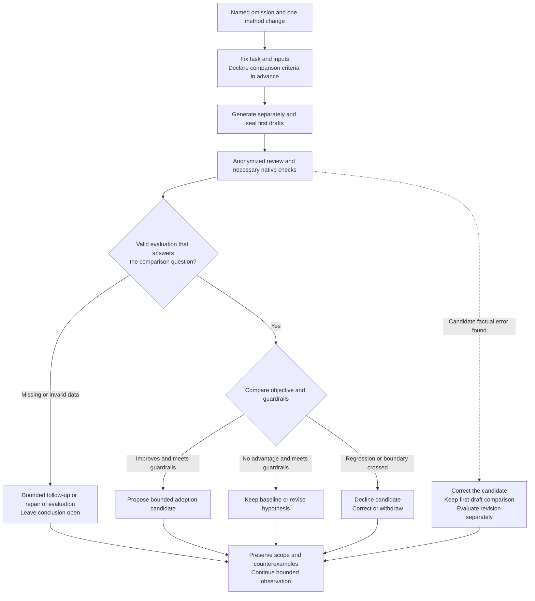

# Chapter 16. Self-Evolution Engineering
## A change becomes a candidate before it can support an improvement claim

AI Game Dev OS v4.94 illustrates the distinctions among a Candidate, a Scoped Accepted Baseline, an Evaluation Result, Evidence Use, and Adoption. It also documents a bounded pilot and a Forward Correction. Long-term effects on efficiency, quality, human attention, and defect rates remain open.

[Chapter 15](/chapters/15-en.html) retained experience as scoped Memory Candidates with provenance. A tempting next step is:

~~~text
experience
→ lesson
→ rule
→ system improved
~~~

Each transition raises a new question.

- Does one result show a stable pattern?
- Has the cause actually been identified?
- Does the experience transfer?
- Does a rule change authority?
- Can the candidate and baseline be compared?
- Did a metric improve because issues went unreported or the metric was gamed?
- Does rollback work?
- Did adoption introduce side effects?

**Self-Evolution Engineering** is the work of proposing changes to a system's configuration, workflow, Skills, Agent Contracts, or organization based on named experiences, then managing those candidates through bounded evaluation, authorized disposition, observation after adoption, and recovery. The word "evolution" names the governance workflow. The value of any change remains a question for evaluation.

> **Self-evolution is not self-authorization.**

The system can help discover problems, propose candidates, and generate evidence. Adoption and expansion require authority, and improvement requires its own evidence.

---

## 16.1 Change, Calibration, Adoption, and Improvement

### Change

A **Change** is an observable difference in configuration, artifact, procedure, workflow, contract, or organizational relationship. Its value remains to be assessed.

### Calibration

**Calibration** adjusts system configuration for a named use under current goals, environment, stage, and guardrails. Suitability depends on those conditions.

### Adoption

**Adoption** is an authorized decision to use a candidate as the current configuration within a named scope.

### Improvement Claim

An **Improvement Claim** is a testable claim that a candidate is better or fit for a use compared with a baseline for a stated objective, guardrails, scope, environment, and observation window.

~~~text
candidate created
≠ adopted

adopted
≠ activated everywhere

test passed
≠ improved

metric moved
≠ objective achieved
~~~

---

## 16.2 Required, useful, and optional capabilities

### Required

A change to authority, safety boundaries, shared workflows, important skills, agent contracts, or long-term organizational behavior needs:

- A named Change Candidate.
- Source and problem.
- Scope and owner.
- Authority.
- Evaluation or an explicit rationale for emergency action.
- Recovery.
- Adoption or rejection record.
- Post-adoption Observation.

### Useful

A baseline, hypothesis, objective, guardrails, controlled evaluation, and staged rollout can help with consequential, versionable, recurring workflows that can be compared.

### Optional

Automatic pattern mining, A/B testing, shadow execution, multi-armed bandits, an Evolution Dashboard, and automatic recommendations to reduce supervision are options. A low-risk parameter edit, emergency one-off fix, or organizational change without a meaningful comparator can be handled under its actual evidence limits.

---

## 16.3 Nine roles and relationships in a change

A project can combine how these roles are stored while keeping the meanings of Claim, Result, Evidence, and Decision distinct.

| Role or relationship | Question it answers | Separate question |
|---|---|---|
| Change Signal | Which observation, failure, review, or human request suggests a change? | What caused the problem? |
| Learning Candidate | Which pattern, lesson, or improvement direction was proposed? | Does the pattern generalize? |
| Change Candidate | Which named part of the system would change? | Has it improved? |
| Baseline | What is the current reference for comparison or recovery? | Is it safe and applicable indefinitely? |
| Evaluation Contract | Which claims, objectives, guardrails, samples, and stopping rules govern the evaluation? | Will the evaluation be valid? |
| Evaluation Result → Evidence Use | What result did the evaluation produce and which claims can it or its source records support or limit? | Should the candidate be adopted? |
| Adoption Decision | Will the candidate be used within a named scope? | Has it been activated or released? |
| Activation / Rollout Record | Where, when, at what proportion or stage did it actually run? | Did it deliver the intended benefit? |
| Post-adoption Disposition | Should it be kept, narrowed, revoked, corrected forward, or expanded? | Will the benefit persist indefinitely? |

A **Change Signal** is a named observation, failure, conflict, metric, review, or human request that suggests inspecting a surface.

A **Learning Candidate** is an inferred pattern, lesson, or proposed rule from one or more sourced experiences, still awaiting applicability and causal checks.

A **Change Candidate** is a versioned proposal to change a named Configuration, Skill, Workflow, Agent Contract, Policy, or Organization Surface.

An **Evaluation Contract** states the comparison question, baseline, objective, guardrails, evidence, samples, integrity, stop, and recovery conditions.

[Chapter 8](/chapters/08-en.html) defines Evaluation Result. [Chapter 9](/chapters/09-en.html) defines how results and source records can be evidence for a named use. No additional evidence type is needed here.

An **Activation / Rollout Record** identifies the environments, roles, traffic, or stages where an adopted candidate actually runs. It keeps operating state separate from the adoption decision.

A **Post-adoption Disposition** applies Chapter 9's Disposition to a decision about whether to keep, narrow, withdraw, expand, or correct a candidate after observing activation. An authority acts on the new evidence through a Decision Record.

~~~text
Observation / Failure / Human Request
→ Change Signal
→ Learning Candidate
→ Change Candidate
→ Evaluation Contract
→ Evaluation Result + source-bound records
→ Evidence for a named use
→ authorized Evidence Disposition
→ Adoption Decision
→ bounded Activation / Rollout
→ Post-adoption Observation
→ keep / narrow / revoke / expand / forward-correct
~~~

A project may reject a candidate. An urgent risk can warrant an authorized fix before a comparison. Record the evidence that could not be established and arrange follow-up review.

---

## 16.4 Self-modification describes how a change occurred

**Self-modification** is a mechanism by which an execution path changes its own system's configuration, rules, procedures, workflows, contracts, or organizational records. It can result in a fix, regression, compatibility migration, temporary workaround, exploratory branch, security incident, or no material effect.

A person modifying a workflow can produce a supported improvement. An agent changing a parameter may produce only a change. The producer and the case for adoption answer different questions.

Self-Evolution Engineering manages how candidates are constrained, compared, decided on, and observed. A valid comparison can yield no advantage, and a disposition can reject a candidate. A proposed improvement needs evidence specific to the claim.

---

## 16.5 Identify the Evolution Surface

The original outline used four layers. An **Evolution Surface** instead names the system objects a candidate would affect. Surfaces can be combined.

| Surface | Examples | Main risks |
|---|---|---|
| Configuration | Parameters, routing, thresholds, Context selection | Silent behavior drift and metric gaming |
| Skill / Workflow | Steps, tool combinations, evidence requirements | Repeated mistakes, incompatibility, or missing controls |
| Agent Contract | Role, responsibility, stop, escalation | Authority drift and unassigned duties |
| Governance / Policy | Gate, floor, approval, exception | Self-authorization, governance livelock, or missed controls |
| Organization | Controller / Worker, Review, Handoff, Decision Path | Conflict, complexity, and diluted accountability |

Changing a parameter can have high impact. Renaming an organizational role can leave operation almost unchanged. Set the governance strength using action surface, impact, irreversibility, authority, observation, and recovery.

---

## 16.6 Preserve epistemic type when creating candidates

The original outline proposed:

~~~text
Execution
→ Reflection
→ Pattern Extraction
→ Rule Candidate
→ Validation
→ Skill Update
~~~

A more explicit path is:

~~~text
Execution and Observation
→ bounded record
→ Reflection Candidate
→ Pattern / Causal Hypothesis
→ Change Candidate
→ claim-specific evaluation
→ Adoption Decision
→ Post-adoption Observation
~~~

A **Reflection Candidate** is a person's or an agent's retrospective interpretation, open question, or action proposal about recorded experience.

A **Pattern Candidate** infers a reusable similarity or relationship among sourced events under declared conditions. Preserve the source set, sampling boundary, basis for similarity, counterexamples, alternative explanations, scope, basis for confidence, and intended Decision Use. One failure can generate an investigation question. Apparent recurrence across summaries needs to be traced back to independent sources.

---

## 16.7 Record outcomes before proposing causes

The original outline listed sporadic, environmental, tool, reasoning, design, workflow, permission, and Context failures. They can guide diagnosis and may overlap. Start with the relations from Chapters 7–10.

| Upstream relation | Meaning here |
|---|---|
| Attempt Outcome | Where execution actually reached and what external effects it produced |
| Target Result / explicit `non-result` | The result for the intended target, or confirmation that no target result was produced |
| Evaluation Result | What a named test, verifier, or human evaluation found for a specific target, run, and criteria |
| Acceptance / Adoption Disposition | Whether an authorized subject accepts a result within scope or adopts a candidate |
| Later Failure / Finding | A later finding, gap, or nonconformance. The original record remains as observed. |

Historical shorthand such as `target_fail`, `target_pass_but_unaccepted`, `partial`, `intervention_failure`, and `escaped_failure` refers to these relations. In `target_pass_but_unaccepted`, record the evaluation PASS and the acceptance disposition separately. Intervention failure belongs to its Attempt, Target, or Evaluation. An escaped failure is a later Finding or Failure.

Candidate explanations include environment, tools, model or reasoning, design, workflow, authority, Context, state or baseline, observer or validator, dependencies, coordination, human decisions, and interactions among them. Keep evidence and unknowns with the classification.

In D-048, the [validator self-mutation record](../../Evidence/receipts/ER-20260818-002__CLM-C06-004.md) supports self-mutation, an integrity stop, and a target `non-result`. It leaves reasoning failure and target compile failure unestablished.

~~~text
observed failure or non-result
+ current causal hypotheses
+ counterevidence
+ unresolved unknowns
+ candidate response
~~~

Start with this scoped output. Admission of a permanent rule requires its own decision.

---

## 16.8 Change Candidate Contract

A **Change Candidate Contract** is a versioned record binding the problem, hypothesis, target surface, scope, expected benefit, guardrails, baseline, authority, evaluation, and recovery.

~~~yaml
candidate_id: WF-CAND-016
candidate_type: workflow
version: 1

observed_problem:
  claim: duplicate_governance_successors_delay_delivery_evidence
  evidence_refs:
    - GOV-INC-001

hypothesis:
  statement: >
    Separating development evidence from qualification evidence
    may reduce meta-only successor work for this v4.94 scope.
  epistemic_type: inference

target_surface:
  workflow: gate_b_development
  scope: v4.94_function_first_pilot

baseline_ref: WF-BASELINE-015
baseline_applicability: historical_comparison_only

objectives:
  - produce_bounded_development_evidence

guardrails:
  - no_production_claim
  - no_qualification_claim
  - no_authority_expansion
  - preserve_predecessor_history

evaluation_ref: EVAL-CONTRACT-016
adoption_authority_ref: AUTH-WF-ADOPT-03

recovery:
  rollback_available: false
  forward_correction: required

expires_at: 2026-09-30
~~~

This is a design profile. The actual v4.94 schema and other changes can differ.

---

## 16.9 Use a baseline within its accepted scope

A **Scoped Accepted Baseline** is a named version that an authority accepts for comparison, operation, or recovery during a stated scope, environment, time, and use. It can support production continuity, historical trace, or a candidate parent.

A baseline may expire, become unsafe, stop being comparable or runnable, carry old defects, be unrecoverable after an external migration, or apply only to historical comparison. Maintain comparison or restoration when the baseline is still safe, applicable, and worth maintaining. If return is unavailable, record why and establish Forward Recovery.

---

## 16.10 Declare comparability in advance

**Comparability** asks whether the baseline and candidate share enough relevant tasks, inputs, environment, versions, roles, and observation conditions to answer the Improvement Claim. Check:

- Task mix and input data.
- Model and tool versions.
- Context and authority.
- Human reviewer.
- Environment and time window.
- Learning and order effects.
- Sample size.
- Observation Coverage and failure semantics.
- Candidate scope.

Infrequent, variable, or creative tasks may not support a statistical comparison. Structured expert review, scenario replay, counterfactual analysis, a bounded pilot, failure injection, qualitative comparison, and explicit uncertainty can help. Keep the limits visible.

For a small method change, choose a task, identical inputs, and the same model configuration. Generate and seal old- and new-method first drafts separately. Compare by criteria chosen in advance. Describe what independent generation meant: separate conversations, whether outputs were visible to each other, and whether the file system was shared. An agreement between sessions to avoid reading each other's files differs from OS-enforced isolation. Anonymized review likewise leaves independent human review open.

---

## 16.11 Let the claim determine evaluation

An Evaluation Contract should answer:

- What does the candidate change?
- What is the Improvement Claim?
- Does the baseline apply?
- Which objectives are primary?
- Which guardrails must hold?
- What evidence can answer those claims?
- What counts as PASS, FAIL, Partial, Unknown, or `non-result`?
- Who generates evidence and who checks evaluation integrity?
- Who can issue a Result Disposition and an Evidence Disposition?
- Who can adopt the candidate?
- When should work stop?
- How will the project recover after failure?

~~~yaml
evaluation_id: EVAL-CONTRACT-016
candidate_ref: WF-CAND-016
baseline_ref: WF-BASELINE-015

claims:
  primary:
    - bounded_development_evidence_is_produced
  guardrails:
    - qualification_boundary_preserved
    - production_boundary_preserved
    - authority_not_expanded

methods:
  - artifact_path_inspection
  - bounded_test_receipt
  - independent_scope_review

comparability:
  status: partial
  limitations:
    - no_controlled_time_comparison
    - accumulated_project_knowledge_differs

stopping:
  hard:
    - authority_boundary_contact
    - false_qualification_promotion
  warning:
    - repeated_meta_only_successor

decision_targets:
  - pilot_result_disposition
  - workflow_adoption
~~~

Partial comparability can still support bounded evidence. General efficiency remains outside its scope.

---

## 16.12 Declare objectives and guardrails separately

A single objective can invite Goodhart-style substitution.

~~~text
Objective:
reduce human interruptions
~~~

Interruptions can fall when reporting stops, routing is delayed, detector sensitivity falls, decisions are postponed, human checkpoints disappear, or failures are reclassified.

~~~text
Primary Objective
+ Quality Guardrail
+ Safety / Authority Guardrail
+ Recovery Guardrail
+ Human / Creative Guardrail
+ Cost Boundary
~~~

For each guardrail, name the risk, observation method, failure semantics, decision owner, stage, and maintenance cost. A guardrail with no identified risk can add governance load.

---

## 16.13 Creative and experience objectives need judgment

A candidate in games or creative software may affect fun, surprise, taste, pacing, aesthetic coherence, player comprehension, or creative diversity. Behavior data, playtests, telemetry, and structured reviews can inform experienced human creative judgment.

**Human Creative Calibration** is a traceable judgment by an identified creative owner about whether a candidate fits the product direction, audience, and actual experience. Keep the Decision Target, reviewer role, product surface, build or scenario, observed experience, preference or identity reference, alternatives, tradeoffs, and disposition. The creative owner can focus on relevant decisions, and the judgment remains open to challenge.

---

## 16.14 Separate checks from authoritative decisions in the Evolution Gate

The original outline asked for provenance, a baseline, evaluation, approval, rollback, scope, and revalidation. A single gate can obscure several kinds of authority that act on that information.

| Step | Question | Main output |
|---|---|---|
| Candidate Admission | Should this problem become a formal candidate? | Decision Record / Disposition |
| Evaluation Authorization | Is evaluation permitted in the declared environment and risk bounds? | Decision Record / Authorization |
| Evaluation Integrity Check | Did evaluation follow the contract and produce an interpretable result? | Evaluation Result / scoped Integrity Claim |
| Evidence Disposition | Are these results and source records usable as evidence, and for which claim or decision? | Decision Record / Disposition |
| Adoption | Should the candidate be used in a named scope? | Adoption Decision |
| Activation / Rollout | Can the candidate be enabled in stages in the target environment? | Activation / Rollout Decision |
| Release | Can it enter production or external use? | Release Authorization |
| Expansion | Can it reach a wider scope, role, or environment? | Expansion Decision |
| Revocation / Recovery | Should it be withdrawn, rolled back, or corrected forward? | Revocation / Recovery Decision |

Different people, verifiers, and delegated gates can own different steps. If a gate checks evaluation integrity and issues a narrow evidence disposition, record the result and authoritative decision separately. A single Decision Record can carry a Result Disposition and an Evidence Disposition for different targets. Keep both explicit.

A test pass may support a scoped integrity claim. A named disposition determines permitted evidence or result use. Adoption, activation, and release each have their own authority.

---

## 16.15 Give AI review an independent path where it matters

One agent can propose a candidate, implement it, run tests, and explain the result. That can save effort and also produce common-mode failure.

Possible checks are deterministic tests, an independent reviewer or separate Agent Contract, human review, shadow comparison, an external harness, red-team or counterexample searches, and production guardrails. Match independence to risk. A small, low-risk parameter change may need little formal review. A candidate that changes authority, verification, or another high-impact surface needs more than the producer's summary and preferred tests. Independent review itself needs source access, scope, authority, and a way to handle disputes.

The [limited November method comparison](../../Evidence/receipts/ER-20261122-001__CLM-C16-002.md) shows why. The content, data, and QA tasks showed no predefined quality advantage. Both QA drafts also wrongly claimed an input log was absent, although it had been sealed before either draft. Changing a role instruction or review label did not resolve the source error. Check the original input for the same task. Then decide whether to revise the requirement to inspect sources or leave the rule unchanged.

---

## 16.16 Keep authority changes on their authorized path

A candidate may touch tool permission, Authority Grants, policy floors, review independence, evidence requirements, stop conditions, memory promotion, skill instruction priority, and delegation depth.

~~~text
propose authority change
evaluate authority change
grant authority change
activate authority change
audit authority use
~~~

A subject can propose a change within its current grant. Expansion of that grant requires a separate authority. A gate can hold narrow Adoption Authority. Changes to its own Decision Target, threshold, evidence source, or grant require explicit authority above it.

---

## 16.17 Isolate the candidate from the active path

### Offline Replay

Replay saved inputs, events, or artifacts. It is repeatable, with coverage limited to the interactions and environments represented in the recording.

### Shadow Mode

The candidate sees real input without permission to make real changes. A shadow can observe inputs but may miss closed-loop behavior.

### Sandbox / Isolated Worktree

Allow actual changes within boundaries on resources, credentials, and external effects.

### Canary / Staged Rollout

Activate early within a small scope, selected roles, or limited traffic. Specify exposure, stop, and recovery.

### Parallel Path

Run the baseline and candidate together. This costs more and may introduce coordination and data-consistency issues.

Scale isolation with risk. A Markdown template change may need no canary. Production safety requires evidence from the relevant boundaries even when shadow results pass.

---

## 16.18 Track adoption, activation, release, and improvement separately

One state can read:

~~~text
Evaluation result accepted as evidence for a named use
Adoption approved for pilot
Activation limited to one environment
Release blocked
Improvement claim still partial
~~~

Another can read:

~~~text
Candidate rejected for current scope
some tests retained as useful evidence
forward correction becomes new candidate
~~~

| State | Meaning |
|---|---|
| `candidate_exists` | The candidate artifact exists |
| `evaluation_completed` | The declared evaluation produced a result |
| `evidence_accepted_for_use` | Evidence can be used for a named decision |
| `adopted_for_scope` | The candidate is accepted as current configuration within scope |
| `activated` | The candidate actually runs in a named environment |
| `released` | External or production use has received its disposition |
| `improvement_supported` | Evidence supports an Improvement Claim within the declared objective and window |
| `expansion_approved` | Expansion to a new scope has approval |

Use the states the project needs. Their meanings differ from maturity levels.

---

## 16.19 Recovery can go forward

Some changes can be rolled back completely. Others involve partial artifact rollback, data migration, external effects, changed human practice, or an unsafe old baseline. The viable option may be **Forward Correction**: keep what already happened and produce a smaller, compatible, or lower-risk candidate under current constraints.

The Recovery Contract should specify reversible and irreversible surfaces, baseline applicability, data and external effects, credentials and permissions, in-flight tasks, Memory, Skill and Policy copies, owner, effect verification, maximum recovery time, and evidence preservation. Check actual state after a successful rollback command.

---

## 16.20 Observe what happens after adoption

Adoption records what an authority decided at a point in time. Follow up on the objective, guardrails, new failure modes, human rework, Detector Health, scope drift, authority use, creative diversity, governance cost, recovery readiness, and baseline comparability.

**Workflow Drift** is an unevaluated change in actual steps, configuration, roles, evidence requirements, or authority boundaries compared with the adopted workflow. Bind it to the identity that actually ran. It can come from models or tools, Context selection, a hidden default, manual workaround, partial rollout, skill or policy update, environment, or human practice.

After a drift finding, consider rebaselining, narrowing, revalidating, correcting forward, accepting a new candidate, or rolling back according to what changed.

---

## 16.21 Maintain separate production and exploration paths

Historical evidence can reward stability, predictability, acceptance, low failure, and low human intervention. Optimizing those signals alone can reduce exploration, surprise, and novel solutions.

~~~text
Production / Reliability Path
+ Controlled Exploration Path
~~~

Give each path its own objective, risk budget, evidence, tolerance for discarding work, authority, data and user exposure, review, and adoption gate. This chapter prescribes no fixed `80% exploitation / 20% exploration` split.

An **Exploration Budget** sets the resources, risk, and time a project permits for generating, evaluating, and discarding candidates outside the current preferred solution. Protect it through human authority or policy. Exploration candidates still go through Production Adoption.

---

## 16.22 Include governance cost in evaluation

A workflow can take less execution time while adding templates, gates, manifests, reviewers, waiting, state transitions, dashboards, recovery paths, human attention, training, maintenance, and proof artifacts.

~~~text
execution cost
context cost
governance cost
review and waiting cost
cognitive cost
expected rework
failure and recovery cost
maintenance cost
opportunity cost
~~~

The purpose is to see which costs move. A low average cost cannot settle safety, privacy, irreversible loss, or reserved human decisions. When a candidate adds more proof work than it was meant to remove, raise a Process Warning about that gap before introducing another layer.

---

## 16.23 Evaluate the surface that will actually change

### Configuration Candidate

Check parameter ranges, defaults, stage, fallback, sensitivity, and silent drift.

### Context / Routing Candidate

Check retrieval misses, stale Context, authority injection, privacy, token and attention cost, and task outcomes.

### Skill / Workflow Candidate

Check procedure, tool compatibility, evidence, stop, recovery, human handoff, and reuse.

### Agent Contract Candidate

Check role, responsibility, Decision Target, prohibited actions, escalation, authority, and conflicts with other agents.

### Governance / Policy Candidate

Check protected risks, false positives and negatives, livelock, bypass, override authority, and governance cost.

### Organization Candidate

Check coordination, decision latency, handoff loss, responsibility gaps, excess output, and human cognitive load. [Chapter 17](/chapters/17-en.html) defines organization design in detail. An organizational change starts as a candidate with observable consequences to evaluate.

---

## 16.24 What the cases show about candidates, evaluations, and adoption

The [v4.94 evolution candidate case](../../Evidence/receipts/ER-20260824-003__CLM-C16-001.md) and [governance livelock and Function-first history](../../Evidence/receipts/ER-20260818-001__CLM-OUTLINE-002.md) retain source and limitations. [Chapter 23](/chapters/23-en.html) tells the failure sequence.

| Episode | Relation used here | Limit |
|---|---|---|
| D-073 to D-075 | Governance and proof artifacts grew while delivery evidence stalled, supplying a Change Signal and investigation question | "Governance Livelock" includes retrospective judgment. Causation was not tested in a controlled comparison. |
| D-076 | A narrow objective, prohibitions, Hard Stop, and Dual Review formed a revocable pilot. Review made the candidate eligible to put before a person. | Adoption remained open. Throughput, human attention, and defect outcomes were unmeasured. |
| D-077 | Two bounded attempts after separating the architecture still ended in `SIGABRT/-6` | A recovery plan and safety envelope left effective execution unestablished. |
| D-079 | 42 selected tests passed, a human declined an over-scoped candidate, and Forward Correction preserved the history | Scope fit required its own disposition. Long-term cost of the smaller implementation is unknown. |
| F1–F4a | Source, read-only replay, package identity, and `48/48 PASS` supplied staged evidence | The result remained `NON_QUALIFYING`. PC-0, Gate, and Production were unestablished. |

The sequence leaves room for several recovery explanations. It does not establish long-term improvement of the workflow.

### What a comparison of one role requirement observed

A November 2026 reward-page comparison asked whether the three cards appeared neutral on first entry before pointer movement. The old and new methods used a fixed task and input set and the same Astra high configuration. First drafts came from fresh sessions. Only one required role output changed. After the drafts were sealed, anonymized review applied five criteria selected in advance, followed by inspection of native Godot component behavior. Sessions agreed to avoid reading one another's files on the shared file system. No isolation was enforced. The [method patch and comparison record](../../Evidence/receipts/ER-20261122-001__CLM-C16-002.md) describes the change.

| Requirement or check | Old method or draft | New method or draft |
|---|---|---|
| Required role output | UI/UX handoff route table and acceptance conditions | Keeps the existing requirements. If an approved interaction reference exists, describe initial state for applicable transitions, automatic changes and timing, existing controls the player uses, and what is visible after each change. |
| Neutral opening with pointer outside cards | Failed. First card focused and enlarged to 1.16×. | Passed. Focus on heading, all three cards at 1×. |
| Neutral reopen after Back | Failed. Reused first-card focus. | Passed. Restored neutral entry. |
| Deliberate navigation allows reading without submitting | Passed | Passed |
| Back preserves the current group | Passed | Passed |
| Explicit activation sends one request | Passed | Passed |

Both failures came from one omission about initial focus. Initial selected index was −1, details were collapsed, and request count was 0 in both drafts. Those values left visual cues open. The implementation used title focus after the new requirement specified initial state. Other implementations could meet the condition. The change was a role requirement rather than a reward-page exception and touched no tool or permission.

| Observation | Saved result | Limit |
|---|---|---|
| Predetermined criteria | Old 3/5, new 5/5 | First two criteria shared an omission. The five checks were specific to this task. |
| Documentation rework on this issue | Old one round, new zero | Total development time and cost were unmeasured. |
| Structural verification | Old, new, and revised drafts passed | The format check did not expose the interaction issue. |
| Native demonstration | Component injected with a single reward sent a selection request | No full game settlement. Anonymous AI review left human experience judgment open. |
| Other three tasks | No predefined advantage in content, data, or QA | The positive result stays with the one task. |

A single pair of first drafts leaves generation variability open. Anonymized AI review also leaves independent human review open. Both limit causal attribution and generalization.

A limited comparison can guide the next test. Start from an observed omission, propose the smallest change, hold inputs fixed, seal first drafts, and test the original question. Preserve no-advantage results and shared errors. A useful result on one task may warrant a narrowly scoped adoption candidate. When it shows no advantage, keep the baseline or investigate the conditions before adding a standing rule.

### Figure 16-1 A method comparison keeps positive and no-advantage results

Proposed mechanism based on the saved comparison. First check whether the evaluation answers the question. Then ask whether the candidate improved and satisfied its guardrails. Missing measurements leave the comparison open. The dashed branch indicates a correction that can occur in parallel. A valid review can find both drafts factually wrong, retain the no-advantage result, and correct the candidate. Improved objective performance with a guardrail failure stays outside adoption. The positive result has bounded scope and supplies no adoption, release, or overall efficiency decision.

---

## 16.25 Start with one recurring workflow

Choose a workflow that is consequential and scoped, recurring, versionable, and affected by an observable problem. Look for a usable baseline or historical reference and credible rollback or Forward Recovery. Compare the value of evaluation to the cost of maintaining two paths.

1. Record the Change Signal.
2. Distinguish observable facts, judgments, inferences, and recommendations.
3. Propose a Learning Candidate.
4. Create the Change Candidate.
5. Declare its Evolution Surface and maximum scope.
6. Check baseline safety, applicability, and comparability.
7. Name the primary objective and a few important guardrails.
8. State the Evaluation Contract and integrity limits.
9. Bind evaluation, adoption, activation, and recovery authority.
10. Evaluate in isolation, replay, shadow, or a small scope.
11. Record PASS, FAIL, Partial, Unknown, and `non-result` where applicable.
12. Make a Result Disposition.
13. Decide whether to reject, adopt for scope, or correct forward.
14. Observe effects after adoption.
15. At the review point, decide whether to keep, narrow, expand, or revoke.

Before automating the path, make the candidate and current configuration identifiable and establish a way to halt propagation after failure.

---

## 16.26 Responsibilities of neighboring chapters

| Object | Chapter | How Chapter 16 uses it |
|---|---|---|
| Work, Execution Contract, Attempt, Checkpoint, Bounded Execution | 7 | Named boundaries for trials and activation |
| Attempt Outcome, Target Result, Evaluation Result, Failure, `non-result`, Recovery | 8 | Outcomes of evaluation, intervention, and recovery |
| Review, Review Target, Finding, Review Budget, Review Independence, Review Disposition | 10 | Candidate and post-adoption review under explicit authority |
| Memory Candidate, Provenance, Conflict, Expiry | 15 | Sourced experience and Lesson Candidates |
| Observation, Detector, Exception, Intervention | 14 | Change Signals and Post-adoption Observation |
| Authority Grant, Autonomy Profile, Revocation | 13 | Limits on evaluation, adoption, activation, and recovery |
| Evidence Use, Acceptance, Adoption, Release Authorization | 9 | What Evaluation Results support for release authorization |
| Change Signal, Learning Candidate, Change Candidate, Evaluation Contract, Activation / Rollout Record, specialized Post-adoption Disposition | 16 | Core objects here, with basic Adoption and Disposition from Chapter 9 |
| Agent Role, Handoff, Conflict, Controller / Worker | 17 | Actual organization structure |
| Release Execution, Release Outcome, Trace | 18 | Whether authorized activation or release occurred and its effects |
| Metrics and Governance Economics | 20 | Long-term evaluation methods |
| Case Narrative | 23 | v4.94 and SP122 chronology |

This chapter can propose an Organization Candidate. Chapter 17 defines the roles.

---

## 16.27 Principles

1. **Scope the system's authority.** It can propose and collect evidence within its grant. Expansion requires a separate grant.
2. **Make improvement a claim.** Bind objective, guardrails, scope, environment, and window.
3. **Preserve the difference between observation, inference, and causes.** A reflection or `non-result` keeps its meaning.
4. **Check baseline and comparability first.** Keep unknowns when comparison cannot answer them.
5. **Track evaluation, adoption, activation, release, and expansion separately.** A high-impact producer needs an independent evaluation path. Continue observing drift, rework, and guardrails after adoption.
6. **Evaluate recovery and governance cost.** Give irreversible changes a forward path and owner. Additional gates, reviews, agents, and proof artifacts require their own case.

---

## 16.28 Common failure patterns

- Treating candidate creation, merging, a test or review pass, or adoption as improvement.
- Turning one failure into a permanent rule, a `non-result` into target failure, or several possible causes into one known cause.
- Letting a candidate change its detector, thresholds, authority, or control floor, or one producer propose, select evidence, and approve a consequential change.
- Reporting precise improvement against an expired or incomparable baseline, or treating shadow execution or a rollback command as proof of production safety or restoration.
- Making Function-first universal based on v4.94, treating `48/48 PASS NON_QUALIFYING` as qualification, or using uncontrolled before-and-after history as an efficiency measurement.

---

## 16.29 Checklist

### Signal and candidate

- Which observation, failure, review, or human request produced the Change Signal?
- Are fact, contemporaneous judgment, inference, and recommendation identifiable?
- Are sources, counterexample, and scope clear for the Learning Candidate?
- Which Evolution Surface would change?

### Baseline and comparability

- Is the baseline safe, applicable, available, and comparable?
- Do task, inputs, environment, model, tools, Context, and authority match where relevant?
- Are incompatibilities explicit?
- Is recovery rollback or Forward Correction?

### Objective, guardrails, and evaluation

- Does the claim identify objective, scope, environment, and window?
- Do guardrails name risks and observation methods?
- Does evaluation distinguish PASS, FAIL, Partial, Unknown, and `non-result`?
- Does the producer control every source, test, and review?

### Authority and gate

- Are admission, evaluation, result, adoption, activation, release, and expansion authority distinct?
- Does the candidate attempt to change its permission, authority, detector, or control floor?
- Are the automated gate's target and maximum scope fixed?
- Do override, appeal, and revocation paths exist?

### Activation and recovery

- How is the candidate isolated in offline, shadow, sandbox, canary, or parallel operation?
- Are adoption and activation recorded separately?
- Do recovery plans account for in-flight work, data, external effects, Memory, Skills, and credentials?
- Have intervention and recovery effects been observed again?

### Post-adoption

- Are objectives, guardrails, drift, rework, human attention, and creative diversity still observed?
- When does a role keep, narrow, expand, revoke, or correct forward?
- Is rebaselining needed?
- What evidence supports the Improvement Claim?

### Cost and scope

- Is evaluation worth the cost of running two paths?
- Do governance artifacts cost more than the risk and expected candidate benefit warrant?
- Are emergency repairs, irreversible migrations, or rare tasks being presented as experiments despite weak comparability?
- Is a one-project case being generalized to a universal process?

---

## 16.30 Conclusion

Self-Evolution Engineering provides an inspectable change sequence.

~~~text
Observed Problem
→ Learning Candidate
→ Change Candidate
→ scoped Baseline and Evaluation
→ Claim-specific Evidence
→ Authority-bound Adoption
→ bounded Activation
→ Post-adoption Observation
→ keep / narrow / expand / revoke / forward-correct
~~~

The system can help discover problems, propose candidates, implement them, and produce evidence. Keep the criteria for improvement explicit.

> **A candidate does not become an improvement by being generated, merged, tested, or adopted.**
>
> **It becomes supportable only for a named objective, guardrails, scope, environment, authority and observation window.**

The next chapter asks how to design roles, authority, handoffs, and conflict paths when several agents generate candidates, evaluate and review them, participate in adoption, and share operational duties.
