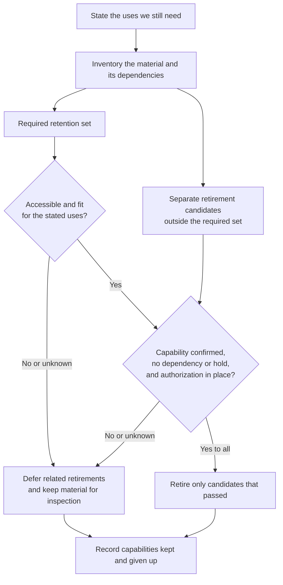

# Chapter 18. Traceability and Accountability
## Reconstructing the decision environment and the chain of responsibility

This chapter examines the external conditions we can observe around a decision. Reconstruction is limited to available records, and replay can produce a different result. Traces provide material for accountability. Named people and organizational authority determine who answers for a decision or control.

Git can retain commits, diffs, ancestry, branches, tags, author and committer metadata, messages, signatures, and file history. When I come back to a change, I often need other information as well. Which intent did it serve? What baseline, context, and assumptions were in force? Which people, agents, tools, and gates actually participated? Who could execute, and who could decide? What did review inspect, and what could the evidence support? Why did adoption remain open after a pass? Which conditions expired, and who owns explanation, recovery, and control changes after an incident?

Git history records version relationships. A decision trace records engineering relationships. Each can refer to the other.

*Traceability* is the ability to locate intent, work, context, subject, authority, action, change, evidence, review, decision, and outcome through named, sourced relationships tied to versions.

*Accountability* is the organization’s requirement that a named person or role explain, review, correct, or answer for objectives, control design, authorization, review, disposition, operations, or recovery. *Responsibility* is a role’s assigned obligation to execute, maintain, respond, or recover. One subject can hold both. Check what the organization actually assigned.

---

## 18.1 What is necessary, useful, and optional?

### Necessary

If delegated work can have consequential, external, hard-to-reverse, or multi-party effects, the project needs to identify the Work or Decision Target, who acted and under what configuration and authority, the starting baseline, what changed, what was observed, who made the subsequent decision, and what information is missing.

A task reference, commit, simple check, and named acceptance record may answer these questions for a local, low-risk, reversible change.

### Useful

Decision Graphs, audit trails, signatures, correlation IDs, and long-term retention can help with work that crosses threads, agents, systems, or releases, or needs to support high-risk decisions, maintenance, complex grants, or incident review.

### Optional

Full event sourcing, complete prompt archives, per-tool token traces, cryptographic ledgers, deterministic replay platforms, and a unified enterprise graph are design choices. Judge traceability by the questions the records can answer.

---

## 18.2 What Git history tells us

Git is particularly good at preserving these facts.

~~~text
which tree changed
from which parent
through which commit
with which recorded author / committer metadata
~~~

With consistent use, it can also retain decision and issue links, signed commits, review references, release tags, and the history of reverts or forward corrections.

1. A Commit Author can be one of several contributors.
2. A Committer and the decision authority can be different subjects.
3. Adoption and release can each require decisions after merge.
4. A commit message states an external explanation.

For example, an agent can generate the diff, a person can commit it, a gate can review it, and another role can release it. Keep those roles visible. A Decision Graph can reference Git’s commit identity, diff, and ancestry and leave Git to manage repository state.

---

## 18.3 Eight concepts a log cannot collapse into one

| Concept | Working definition | Question that remains open |
|---|---|---|
| Provenance | Where a record, claim, or artifact came from and how it was derived | Is it true and applicable now? |
| Traceability | Whether named relationships lead to relevant records | Are the records complete and the decisions sound? |
| Auditability | Whether authorized auditors can query, verify, and evaluate records in scope | Did the audit find the problem? |
| Reconstructability | How much of the observable decision environment can be recovered | Would the model behave the same way again? |
| Replayability | Whether recorded actions or events can be run again | Would the outcome match? |
| Explainability | Whether a sourced account of an action or decision can answer a particular audience’s question | Is the account complete or the causal explanation established? |
| Attribution | Whether an observable action, artifact, or decision can be connected to a named subject, tool, or configuration | What legal, moral, or organizational accountability applies? |
| Accountability | Who must answer for a named goal, grant, control, decision, or outcome and bear organizational consequences | How does the organization assign that obligation? |

*Provenance* relates entities, activities, subjects, sources, revisions, transformations, and times. It gives traces some of their footing. *Auditability* also depends on access, retention, integrity, and a review contract.

*Reconstructability* covers the external state, inputs, permissions, actions, evidence, and decision environment recoverable from retained material. *Replayability* concerns a new attempt to run recorded actions, inputs, or events. Restoration of the original state requires a separate mechanism.

*Explainability* uses sourced records to explain behavior, decisions, limits, and unknowns to a named audience. It should stay within the observable record. *Attribution* relates actions, artifacts, findings, and decisions to named people, agent instances, tools, gates, and configurations.

---

## 18.4 Eleven record roles in a chain of responsibility

| Record role | Question it answers |
|---|---|
| Trace Contract | Why are we tracing, what must be covered, and how long must it be retained? |
| Intent / Work Reference | Which goal and Work does the activity serve? |
| Execution Baseline Reference | Which state, decisions, assumptions, and context could the subject rely on at the time? |
| Subject Configuration Reference | Which person, agent, gate, or tool took part under which configuration? |
| Assignment / Authority Reference | Who was asked to do what, and who could do it? |
| Action / Activity Record | Which action was initiated, attempted, or completed? |
| Change / Artifact Reference | Which repository, runtime, data, or external state changed? |
| Evidence / Observation Reference | What was observed under which coverage and collection conditions? |
| Review / Handoff Reference | Who checked or took over what and with what scope and result? |
| Decision Record | Which authority made which disposition for which target? |
| Outcome / Exception / Recovery Reference | What followed, and did it trigger intervention, recovery, or reopening? |

These are semantic roles. A single signed release record can reference the decision, artifact, evidence, and deployment outcome. The reader still needs to identify the subject, distinguish action and decision, find the baseline, see evidence coverage, and tell whether a relationship was observed, authorized, merely adjacent in time, or inferred later.

---

## 18.5 A Decision Graph is a typed projection of records

A *Decision Graph* connects versioned engineering records through meaningful relationships. You can use it to query inputs, authority, dispositions, and subsequent effects. A first sketch might look like this.

~~~text
Intent
→ Context
→ Plan
→ Agent
→ Tool Action
→ Change
→ Evidence
→ Review
→ Decision
~~~

The actual relationships branch and join.

~~~text
Intent ──scopes──────────────┐
Baseline ──bounds────────────┤
Assignment ─binds──> Subject ├──performs──> Action
Context Manifest ─supplies───┘                  │
                                                ├──changes──> Artifact / State
                                                └──produces─> Evidence

Authority Source / Grantor ─issues───> Authority Grant
Authority Grant ─authorizes─────────> Subject + Action / Decision Type
Decision / Policy ─constrains────────> Action / Future Decision

Evidence ─supports-for-scope─> Claim
Review ─evaluates────────────> Candidate / Claim
Authorized Subject ─creates───────> Decision Record
Decision Record ─targets─────────> Decision Target
Decision Record ─records─────────> Target-specific Disposition
Adoption Disposition ─adopts / rejects─> Candidate
Release Authorization ─permits──────> Release Target
Release Execution ─acts on────────> Authorized Release Target
Release Outcome ─is observed at─────> Environment / User / Downstream
Later Evidence ─supports / challenges───> Prior Claim
New Decision Record ─supersedes─────> Prior Decision Record
~~~

Keep relationship types such as `derived_from`, `used`, `supplied_to`, `performed_by`, `authorized_by`, `generated`, `observed`, `supports_for_scope`, `reviewed_by`, `disposed_by`, `supersedes`, `invalidates`, `handed_to`, `released_as`, and `recovered_by` distinct. An event sequence gives you temporal order. A `caused_by` relationship calls for evidence about causation.

Build the graph from primary records. Keep source links, versions, freshness, and missing states visible on its nodes.

---

## 18.6 Start a Trace Contract with the audit question

A *Trace Contract* is a versioned constraint on the records, relationships, integrity checks, access, and retention required for a named work item, Decision Target, or risk.

~~~yaml
trace_contract_id: TRC-018
version: 2

target:
  work_ref: WU-042
  decision_targets:
    - source_adoption
    - production_release

required_references:
  - intent_version
  - execution_baseline
  - assignment
  - authority_grant
  - subject_configuration
  - change_identity
  - evidence_coverage
  - review_disposition
  - final_decision

required_relationships:
  - performed_by
  - authorized_by
  - supports_for_scope
  - disposed_by

integrity:
  ordering: correlation_sequence
  correction_mode: append_and_supersede

access_profile: named-audit-role
retention_profile: project-risk-profile
known_exclusions:
  - hidden_reasoning
~~~

Use this as a design example. Report coverage against the contract.

~~~text
complete-for-release-decision-v2
partial-for-incident-causality
missing-external-service-response
unknown-tool-side-effect
~~~

To check a claim of complete coverage, first ask for its target, scope, and exclusions.

---

## 18.7 Identity, authentication, attribution, and accountability

A single activity can involve an intent owner, requester, planner, assigned worker, agent instance, model or agent contract, tool, runtime credential, commit author, committer, reviewer, decision authority, deployer, and incident responder. A single `actor` field leaves those roles ambiguous.

A *Subject Configuration Reference* ties a named participant to the human, agent, or gate identity, model or rule version, tools, credential scope, and execution boundaries in force. Authentication establishes which credential or identity authenticated. Attribution links a visible action to a subject configuration. Accountability comes from the organization’s rules, authority, and responsibility assignments.

If a person uses their account to commit a change an agent generated, the trace establishes a recorded account and a commit. Check generation, the agent’s authority to commit, independent review, adoption, and organizational accountability separately.

---

## 18.8 What an Action Record can establish

An *Action Record* captures a named tool or runtime action a subject initiated, attempted, completed, interrupted, or revoked, along with references to inputs and outputs. It can show what was requested, what configuration sent it, when it started and ended, which tool or endpoint was used, what returned or errored, whether an identifiable side effect occurred, and whether anyone observed it afterward.

The reasons for the action, its fit with intent, the adequacy of authority, its causal effects, and completion of the target each need appropriate evidence. If a log is missing, keep execution or side effects unknown where the remaining records leave them unknown. To argue for causation, make a Causal Claim and retain supporting evidence, alternatives, and uncertainty. Use the action sequence as one input to root-cause analysis.

---

## 18.9 Trace context as an external relationship

[Chapter 5](/chapters/05-en.html) distinguishes the Context Contract, Pack, Manifest, and Access. A trace can show how they participated in one execution.

~~~text
eligible source
→ selected
→ supplied or made accessible
→ optionally accessed through a visible tool
→ cited or referenced in output
~~~

A manifest can show assembly or delivery. A tool log can show that a resource was requested or returned. A citation shows an explicit reference in the output. Whether the model attended to all context or drew on a particular source remains open. Missing citations may coexist with influence. A transcript covers some of the decision environment, and summaries can omit material.

---

## 18.10 Version the plan, assignment, and replanning

The plan is a candidate. Assignment binds a subject, role, work item, and authority. Trace the Plan Candidate version, review and disposition, creation and acceptance or rejection of the assignment, authority reference and execution start, replanning trigger and revised plan, cancellation or reassignment, and Handoff Receipt.

It can be reasonable to change order after observing a new state. Preserve the old plan, and make scope expansion and changes in required authority visible. Check for side effects from cancelled assignments, and retain the version actually executed.

For consequential changes, capture the grounds for replanning.

~~~text
trigger
new observation
affected dependency
scope change
authority impact
evidence impact
accepted by
~~~

For low-risk exploration, retain the important turns.

---

## 18.11 Decision Records keep rationale, authority, and lifecycle

A *Decision Record* captures the disposition an authorized subject made for a named target, the inputs available then, the stated rationale, scope, and lifecycle.

~~~yaml
decision_id: DEC-184
decision_target: candidate_source_adoption

subject:
  authority_holder_ref: product-owner-01
authority_ref: AUTH-031

disposition: rejected_for_current_scope
candidate_ref: commit-ref
baseline_ref: baseline-ref

intent_ref: INT-008
work_ref: WU-042
context_manifest_ref: CTX-M-077
plan_ref: PLAN-021-v4

evidence_refs:
  - EV-101
counterevidence_refs:
  - EV-104

stated_rationale:
  - candidate_exceeds_current_contract
alternatives_considered:
  - accept_as_is
  - narrow_and_forward_correct

assumptions:
  - smaller_candidate_can_preserve_behavior
unknowns:
  - lifetime_maintenance_cost

effective_scope: e1-source-baseline
effective_at: named-time
expires_or_reopens_on:
  - contract_change
  - new_counterevidence

supersedes: none
recorded_at: named-time
~~~

Whatever fields you use, a later reader should be able to tell which question was decided, who decided under which grant, which inputs were available, what scope the evidence supported, what remained unknown, and when the decision took effect, expired, or was superseded.

---

## 18.12 What a stated rationale can explain

A *Stated Rationale* is an inspectable account by a named subject of the objective, constraints, evidence, trade-offs, and selection behind a decision. It can be contemporaneous, reconstructed later, human-authored, drafted by an agent and accepted by a human, derived from a policy or rule, or generated by an authorized deterministic gate. Preserve that provenance and time.

Treat the rationale as an external record. Its completeness as an account of causes remains open. Hidden model reasoning, a unique psychological cause, and independent evidence of decision correctness each require grounds the rationale alone cannot supply.

~~~text
What objective was stated?
Which constraints and authority applied?
Which evidence was available?
Which alternatives were externally recorded?
Which unknowns remained?
What decision was made?
~~~

A transcript can serve as a process record with its own retention, access, privacy, source identity, and applicability boundaries. Keep the Decision Record as the account of the named disposition.

---

## 18.13 An Evidence Link specifies support and intended use

Beware of this shortcut.

~~~text
Evidence exists
→ Decision is correct
~~~

The trace should show these relationships.

~~~text
Evidence
→ supports named Claim for declared Scope
→ accepted or rejected for named use
→ informs an Authority-bound Decision
~~~

Record the evidence identity, producer and activity, target observed, coverage, claim, intended use, who accepted or rejected it, Decision Target, conclusions outside scope, and invalidation or supersession.

The same test result can support a behavior claim and be accepted as development evidence. Scope necessity, qualification, and release authority remain separate. [Chapter 9](/chapters/09-en.html) defines Evidence Use and Decision Disposition. We need their traceable relationships here.

---

## 18.14 The route from review to release contains several records

[Chapter 10](/chapters/10-en.html) defines Review, Review Target, Finding, Review Independence, and Review Disposition. Here we trace submissions, authority, and downstream relationships.

| Record | Question it answers |
|---|---|
| Review Submitted | What findings, coverage, and recommendation did a reviewer submit for which Review Target? |
| Finding | How does the Review Target relate to named criteria, evidence, coverage, and unknowns? |
| Review Disposition | Did a named authority make a Decision Record under the Review Contract about closing, limiting, or continuing to use the Review Target? |
| Acknowledgment | Did someone confirm they saw the information? |
| Approval | Did an authority permit a named action or target? |
| Acceptance | Did an outcome meet the named criterion? |
| Adoption | Did the project begin relying on or maintaining it? |
| Release Authorization | May it enter the target release surface? |
| Release Execution / Deployment Record | What was actually distributed, deployed, or advanced? |
| Release Outcome | What effect did the target environment, users, or downstream systems observe? |

Give an `approved` label a Decision Target and authority. A reviewer without a relevant grant can give findings and a recommendation. A Review Contract can delegate a narrowly defined PASS or FAIL as an authorized Review Disposition. Record the target, scope, and grant.

A reported pass still leaves the authorized disposition and adoption to check. An acknowledgment shows receipt. Merge approval addresses merge authority. Release authorization permits action. Check whether deployment ran and whether the outcome was healthy in their own records.

Release Authorization is a normative decision, Release Execution a delegated action, and Release Outcome an observable effect. Link them through trace. A properly delegated low-risk gate can do validation and acceptance together. Keep any adoption or release inside its own grant.

---

## 18.15 Allocate accountability by decision and control

The *Accountability Surface* comprises the objectives, controls, and decisions for which named subjects owe explanation, maintenance, review, or responsibility for consequences.

| Responsibility | Subject to which activity can be attributed | Named role with organizational accountability |
|---|---|---|
| Intent / Product | Human or agent proposal author | Product, creative, or business authority |
| System Design | Human or agent builder | Architecture or engineering authority |
| Policy | Human or agent policy author, validator | Policy, security, or governance owner |
| Delegation | Grant issuer, automation | Delegating authority and its control owner |
| Assignment / Execution | Assigned person or agent role | Work owner, sometimes also the human assignee |
| Evidence | Tool, validator, evidence producer | Verification or evidence owner |
| Review | Human or agent reviewer | Review authority or quality owner |
| Adoption | Candidate or integration subject | Product or project authority |
| Release / Operations | Deployer, release tool or gate | Release or operations authority |
| Recovery | Human or agent responder, recovery tool | Incident or recovery owner |
| Record Governance | Collector, indexer, audit tool | Audit or records owner |

One person can answer for several relationships and several people can share an obligation. Name each accountable role, Decision Target, scope, and institutional basis. Legal, contractual, and regulatory liability require the jurisdiction, governing arrangements, and specific facts.

---

## 18.16 Attribute the agent’s activity and identify who answers for its use

An agent can accept assignment, carry operational responsibilities under a Role Contract, use granted tools and permissions, produce changes, evidence, findings, or handoffs, trigger an automated gate, and escalate or return a `non-result` under visible conditions.

Record the agent instance, model or contract version, tool, context boundary, authority reference, and observable action. Separately establish which roles can bear risk or legal responsibility, make final value decisions, and answer for configuration, delegation, and supervision.

Who chose this agent? Who configured it and chose its reachable permissions? Who granted authority, defined review and recovery, and decided whether to keep relying on it amid inadequate evidence? Answers can fall across several people or roles. “AI did it” leaves those decisions unexplained.

---

## 18.17 Traces support accountability judgments

After an incident, traces can identify present and missing controls, grant holders, actions and their subjects, evidence available at the time, decisions that moved a result forward, missed observations or escalations, and recovery actions that did or did not work.

Use these records for responsibility review. Possible contributors include conflicting goals, inadequate resources, incentives, faulty policy, inadequate tools, a shared context gap, common-cause review failure, overlapping authority, observer failure, external dependencies, or their interaction. An audit focused only on the last person to click can miss those conditions.

~~~text
control design
authority allocation
operational execution
review and decision
organizational conditions
recovery response
~~~

---

## 18.18 An audit trail needs queries, corrections, and visible gaps

An *Audit Trail* retains activities and decisions for a named audit purpose, with identities, ordering, provenance, integrity boundaries, access, and retention rules. Depending on the purpose, it may need:

- Queryability and stable identity
- Source and revision binding
- Time, ordering, and cross-system correlation
- Tamper evidence and append-preserving correction
- Coverage and gap records
- Access controls and data minimization
- Retention, deletion, and exportability
- Detector or collector health
- Drill-down to primary records

An append-only log can miss an event at ingestion, use a faulty clock, combine distinct subjects, collect too much sensitive data, miss an external side effect, or be parsed incorrectly. It can go unqueried or expire before an incident. Give the trail its own observation coverage and integrity limitations.

---

## 18.19 What tamper evidence protects

*Tamper-evident* means an integrity mechanism can expose some deletions, replacements, reorderings, or unauthorized edits. Possible controls include hashes, signed records, append-only storage, hash chains, immutable artifact references, independent copies, access logs, sequence numbers, witnesses or external timestamps, and periodic integrity checks.

Each covers a different failure mode. A hash detects content changes while the truth of the original remains open. A signature binds a credential while the signer’s understanding is a separate question. Append-only storage keeps received events. External timestamps bound time and may still be affected by clock skew. An independent copy makes deletion harder and adds sensitive-data exposure. State what the controls can detect.

Preserve the original when correcting a record.

~~~text
original record
→ correction record
→ reason and authority
→ supersession relation
→ affected downstream decisions
~~~

---

## 18.20 Time, ordering, and cross-system correlation

Agents, tools, CI, cloud APIs, repositories, and human interfaces can use different clocks and identities. Distinguish event, ingestion, commit, decision-effective, observation, and recorded times. Nearby timestamps alone leave order and causation open.

Trace across systems with a correlation ID, predecessor reference, attempt or work ID, execution epoch or profile reference, request or response ID, artifact hash, or source-local monotonic sequence.

An Execution Epoch is an optional correlation profile that can name the intent, baseline, authority, tools, and governance configuration applicable to an interval. Use it where the grouping helps.

Express uncertainty about order directly.

~~~text
before / after
concurrent-or-unknown
observed-by-source-x
conflicting-time-record
~~~

---

## 18.21 Retention, access, and privacy constrain one another

A trace can contain source code, prompts and responses, personal data, secret or credential metadata, business decisions, security findings, customer or player data, human review, incident details, and model or tool identifiers.

Keeping all of it indefinitely increases privacy risk, secret exposure, insider access, legal and contractual risk, storage cost, search noise, and the chance that models ingest contaminated records again.

A Trace Contract needs a purpose, required fields, redaction, access roles, retention windows, deletion or tombstones, export rules, cross-border or external service limits, and incident holds or other organizational rules. [Chapter 19](/chapters/19-en.html) discusses data classification, model boundaries, secrets, IP, licenses, and compliance. Permit drill-down to primary material according to the access rules for each reviewer, including prompts, credentials, and personal data.

### Choose what to keep by what you need it for

List the questions you may need to answer later and choose a retention set. This is one possible selection method and can be scaled down for a small task.

| Capability to retain | Typical minimum material | What a summary alone can lose |
|---|---|---|
| Explain the decision at the time | Inputs visible then, key grounds, Decision Target, and dissent | Distinguishing what was unknown then from later discoveries |
| Rerun a named action | Inputs, tools and environment, sequence, access, and side-effect constraints | Enough understanding to read the action, too little to execute it safely |
| Compare a new result | Original observations, measurement definition, samples, and baseline identity | The ability to tell whether the target or the method changed |
| Restore a particular state | Checkpoint, dependent data, compatibility conditions, and recovery checks | A new run can succeed while the old state remains unavailable |
| Recover the entire workspace | The above, plus uncommitted dependencies, configuration, and accessible installation resources | A repository can check out while the original environment remains unrecoverable |

Retaining more material covers more recovery questions and increases storage, access governance, retrieval, and maintenance costs. Retaining only summaries costs less. Be explicit about the capabilities you give up, and apply the same access and retention constraints to sensitive material. Match the claim to what you actually keep.

The [records of material disposition in two projects](../../Evidence/receipts/ER-20261122-002__CLM-C18-002.md) show two concrete problems. DevOS removed only fixtures that had authorization and passed checks during a partial reclamation. It kept failed material, retention constraints on parent resources, and items awaiting human judgment. It preserved the bytes of old proof. Later records dealt separately with whether those materials could still be retrieved. An item count establishes neither net storage savings nor governance benefits.

The lessismore archive presented another problem. A local archive existed. Recovering the material from another checkout required further checks. The disposition identified 55 navigation entries for delivery, and the retained recovery check verified hashes of 147 archive members. The result covers that archive and check. Whether all other local material entered a shared backup remains open.

The same set of material can contain items with different dispositions. This table is a teaching example.

| Material | Use or constraint | Disposition |
|---|---|---|
| Checkpoint and dependencies for a named state | The system still claims it can restore that state | Include in the required retention set. Verify recoverability and compatibility for the stated purpose |
| Parent resource referenced by a consumer | Disposition of the child did not lift the parent’s hold | Retain it and identify consumers and conditions for lifting the hold |
| Duplicate cache with an accessible equivalent | It is outside the required set and has no other dependency or hold | Mark as a retirement candidate. Verify the replacement covers the purpose and obtain authority before deleting |

### Figure 18-1 Check retained capabilities before retiring material

Figure 18-1 illustrates dependency-driven retirement. Check future capability against the required retention set. Evaluate deletion only for retirement candidates, and proceed only when the capability check and the checks for each candidate pass. Removing a reading entry, moving material into an accessible archive, and deleting its original are distinct actions. Partial reclamation leaves parent and failure-material holds in force until explicitly cleared. For historical explanation, check readability, provenance, and relevant relationships. A claim of recovery requires a corresponding recovery check.

---

## 18.22 Reconstruction, replay, reproduction, and restoration

| Goal | Question | Typical outcome |
|---|---|---|
| Decision Environment Reconstruction | Can we reassemble the intent, baseline, context, authority, action, evidence, and decision visible then? | A bounded external environment package |
| Action Replay | Can we rerun the recorded action sequence? | A new Attempt and observations |
| Result Reproduction | Can we obtain a comparable result under the stated conditions? | Reproduced, Diverged, or `non-result` |
| State Restoration | Can we restore a state from which authorized work can continue? | Rollback or forward recovery |

The same prompt, model name, and Git commit can yield different output. Model revision, sampling, tool version, external APIs, runtime and OS, data, time, credentials, network, hidden service state, human judgment, and concurrent changes can all matter. For consequential work, choose reconstructability commensurate with risk and add a replay harness where needed.

[Chapter 8](/chapters/08-en.html) classifies Attempt Outcome, Target Result, Evaluation Result, and `non-result`. Replay starts a new Attempt and produces new outcomes and results. Those records may support new evidence assessments. Keep the original Attempt.

To substantiate recovery, start with a minimal check. Retrieve the indexed material from a separate clean directory, verify its identity, run the limited restoration procedure you claimed, and record what failed to restore. Narrow the stated use to historical explanation or comparison if the environment cannot be rebuilt. Recovery checks with side effects still need their own permissions and prerequisites.

---

## 18.23 Recover what was knowable then and what was found later

After an incident, reconstruct what you can.

1. Name the incident or Decision Target and the interval.
2. Preserve present artifacts, logs, external state, and access boundaries.
3. Identify the intent, plan, assignment, and authority in force then.
4. Bind the baseline, Context Manifest, tools, and Subject Configuration.
5. Build a sourced timeline and keep ordering uncertainty visible.
6. Distinguish actions, observations, evidence, reviews, and decisions.
7. Recover evidence, counterevidence, assumptions, and unknowns available at the time.
8. Record later additions and findings that overturned earlier statements.
9. State potentially overlapping causal hypotheses and alternatives.
10. Check trace gaps, observer failures, and policy or authority problems.
11. Have a named subject decide correction, recovery, accountability review, and reopening.
12. Retain original records and add superseding or narrowing relationships.

A *Contemporaneous View* uses only information reasonably available at the time. A *Retrospective View* adds later evidence, outcomes, and inferences. Keeping the difference visible helps avoid assuming that now-obvious failure was evident then.

Ask what was knowable, which controls should have exposed the risk, which assumptions went unverified, who decided what, and which conditions need to change.

---

## 18.24 Link later evidence to earlier claims

Later evidence can reveal a faulty generator, overstated coverage, a stale source, a contaminated artifact, a biased sample, an incorrect review baseline, unreliable external results, or a new policy that supersedes a human decision. Keep the original records and link to the change in support.

~~~text
Evidence EV-101
status at decision time: accepted-for-scope

Later finding EV-188
finding: generator omitted target observation

Invalidation relation
EV-188 narrows EV-101

Affected decisions
DEC-184 requires review
REL-031 remains historical but no longer active
~~~

Assess whether the decision was reasonable on information available then, what the new evidence changes about current applicability, which claims, adoptions, or releases need reopening, whether security or data disposition is required, and why the original trace missed the problem. Keep current and historical validity visible separately.

Distinguish a missing original from a replacement observation. SP139 failed to locate the old S5 originals at the specified location, then produced new checks in a new Run and Visit. The new checks belong to that execution. The original bytes and the complete conditions of the old run remained unavailable. Keep the old report and its gap, bind the new results to their own execution, and assess which uses the older conclusion can still support.

---

## 18.25 Trace gaps and `non-result`

A *Trace Gap* is a named absence of an event, relationship, identity, time, or source the Trace Contract needs. A collector can be down, an API can omit a request ID, agent identity can be lost, a Context Manifest can be missing, an action can lack outcome observation, a chat acknowledgment can lack a Decision Target, clocks can conflict, retention can delete a log, integrity can fail, or access restrictions can prevent inspection.

A gap limits reconstruction and conclusions. Whether the action occurred, the subject acted maliciously, the target failed, the system was healthy, or the decision was invalid still depends on evidence.

[Chapter 8](/chapters/08-en.html) uses `non-result` when a target produced no evaluable result. A complete trace can establish a `non-result`. A trace can also be incomplete when a Target Result already exists and its provenance is hard to reconstruct.

For consequential actions with required trace, block, narrow scope, switch to supervision, require a second observation, use break-glass authority, or proceed with an explicit unknown and mandatory follow-up where allowed. For emergency authority record the trigger, grant, controls skipped, side effects, backfill requirements, and later review.

---

## 18.26 Give random audits a Sampling Contract

The Human Control Plane proposal suggested sampling 2–5% of low-risk tasks. Set the actual rate using the population, risk and severity, change type, model or workflow version, novelty, reversibility, detection power, failure history, common-mode risk, human capacity, and the cost of false confidence.

A *Sampling Contract* states the population, sampling frame, strata, method, target risks, sample identities, and limits. It can combine random sampling, risk-weighted sampling, oversampling of new capabilities, adversarial or counterexample samples, incident-triggered samples, reviewer rotation, and probes for known blind spots.

Tie conclusions to the declared population, window, and method. Global trust, permanent autonomy, quality of unsampled work, reviewer independence, and detection of common-cause failures each require additional grounds. Audit history can inform reliance or autonomy decisions under the authority rules of [Chapter 13](/chapters/13-en.html).

---

## 18.27 What the Human Control Plane can show

People should be able to find consequential information without reading every log. The Human Control Plane can show high-risk work, pending decisions, authority and assignments, trace coverage, missing or stale references, integrity warnings, evidence and conclusions outside scope, review conflicts, exceptions, and intervention or recovery paths.

Show when the projection was generated, source links, freshness, coverage, collector or detector health, unknowns, redactions, and drill-down availability. A green status is a projection of inputs. Check those inputs before relying on it. A summary that drops trace gaps, counterevidence, or the Decision Target defeats the point of compression.

[Chapter 12](/chapters/12-en.html) defines the Human Decision Interface. A trace projection needs links back to primary records and the chain of responsibility.

---

## 18.28 Scale traceability to risk

More records increase storage, indexing, schema migration, cross-system integration, collector reliability demands, privacy and security exposure, review cost, cognitive load, and retention or deletion complexity. They can also create false confidence about completeness. Choose a trace profile for the current risk.

### Low-risk, local, and reversible

~~~text
task / intent reference
current baseline
change identity
simple evidence
named disposition
~~~

### Work across threads or agents, or work with integration risk

~~~text
assignment and role
subject configuration
context / plan versions
handoff receipt
review target
integration disposition
trace gap
~~~

### Consequential or hard-to-reverse work, multi-party authority, or strong audit requirements

~~~text
trace contract
typed decision graph
independent integrity record
detailed authority history
cross-system correlation
retention and access policy
sampling / audit contract
incident reconstruction drill
~~~

Retain the relationships that affect important judgments, recovery, and explanations of responsibility at a reasonable cost.

---

## 18.29 What the cases let us reconstruct

These episodes use saved project records to examine reconstructable relationships. [Chapter 23](/chapters/23-en.html) gives the full events.

| Episode | Relationship visible in external records | Counterexample or limit |
|---|---|---|
| SP122 | A frozen plan, revision, runtime identity, machine and human evidence, and named decision can be linked to sources. Evidence acceptance is separate from adoption and release | Hidden reasoning remains unavailable. Necessity of all fields, speed and quality effects, and assignment of accountability are open questions |
| v4.93 Snapshot | A snapshot generator coexisted with an empty `project_status_snapshot.json` | Schema capability, artifact existence, live population, and audit use are distinct. A registry can exist before it receives a live trace |
| D-079 | Test result, scope decision, source adoption, forward correction, later ancestry, and the absence of a release claim can be distinguished | The record leaves cross-project optimality of the human scope decision and long-term costs of the smaller implementation open |

Sources include the [SP122 external decision environment record](../../Evidence/receipts/ER-20260810-003__CLM-C06-003.md), the [SP122 results package](../../Evidence/receipts/ER-20260810-002__CLM-C06-002.md), and the [D-079 test and scope decision record](../../Evidence/receipts/ER-20260818-003__CLM-C09-001.md). They support some distinctions among trace, authority, and decisions. The completeness of the eleven record roles, the effects of a Decision Graph, incident cost reduction, and applicability across organizations, contracts, and legal regimes remain untested.

---

## 18.30 Start with one Decision Target you need to explain

Choose one recurring problem. Perhaps people dispute who approved what, confuse test passes with adoption, lose handoffs between agents, struggle to confirm the baseline after an incident, cannot trace authority for high-risk actions, or frequently reopen decisions after later evidence arrives.

1. Assign a correlation or work ID.
2. Reference the intent and Decision Target.
3. Retain baseline, context, and plan versions.
4. Bind assignment, Subject Configuration, and authority.
5. Record the Attempt reference, actions, change identity, and visible side effects.
6. Bind evidence, coverage, counterevidence, and conclusions outside scope.
7. Record review and Decision Disposition.
8. Retain named references to Attempt Outcome or Result, exception, intervention, recovery, or release outcome.
9. Identify trace gaps.
10. State retention, access, and correction rules.
11. Enable drill-down from the Human Decision Interface to primary records.
12. Practice reconstruction on a real incident or scope dispute.

Ask whether you can confirm the baseline, distinguish execution, review, and decision, see what the evidence covers, find missing relationships, identify findings contradicted later, and locate the people who can recover or reopen. For some work, a commit, test, and clear decision note suffice.

---

## 18.31 Interfaces with adjacent chapters

| Objects | Chapter | Use here |
|---|---|---|
| Intent Artifact, Hierarchy, Conflict, Acceptance Target | [4](/chapters/04-en.html) | Reference the goal the decision serves |
| Context Contract, Pack, Manifest, Access | [5](/chapters/05-en.html) | Trace supply and access relationships |
| State Claim, Decision, Assumption, Provenance, Execution Baseline | [6](/chapters/06-en.html) | Provide the external decision environment and source identity |
| Work, Execution Contract, Attempt, Checkpoint, Bounded Execution | [7](/chapters/07-en.html) | Provide named execution boundaries and Attempt references |
| Attempt Outcome, Target Result, Evaluation Result, Failure, `non-result`, Recovery | [8](/chapters/08-en.html) | Preserve execution outcomes and recovery relationships |
| Evidence Coverage, Acceptance, Adoption, Release Authorization | [9](/chapters/09-en.html) | Specify the meaning of evidence-to-decision links |
| Review, Review Target, Finding, Review Budget, Review Independence, Review Disposition | [10](/chapters/10-en.html) | Trace submission, findings, recommendations, and authorized disposition |
| Release Execution, Deployment Record, Release Outcome | 18 | Trace actual actions, target environment observations, and subsequent state |
| HCP Projection, Brief, Compression Validation | [12](/chapters/12-en.html) | Show trace coverage and pending decisions to people |
| Authority, Delegation, Revocation, Autonomy | [13](/chapters/13-en.html) | Provide `authorized_by` links and responsibility boundaries |
| Observation, Detector, Exception, Intervention | [14](/chapters/14-en.html) | Provide outcomes, gaps, and collector health |
| Memory Provenance, Supersession, Retention | [15](/chapters/15-en.html) | Retain long-lived records with their original sources |
| Role, Assignment, Handoff, Conflict, Integration | [17](/chapters/17-en.html) | Provide organizational action and responsibility relationships |
| Trace Contract, Decision Graph, Attribution, Audit, Reconstruction, Accountability Evidence | 18 | Define the concerns of this chapter |
| Data, Model, Secret, Privacy, IP, Supply Chain Boundary | [19](/chapters/19-en.html) | Constrain collection, access, storage, and external transfer |
| Metrics, AgentOps, Governance Economics | [20](/chapters/20-en.html) | Assess trace and audit costs and operational effects |

The question here is how to connect these objects through sources into a record we can query, partly reconstruct, and use to review responsibility.

---

## 18.32 Principles

1. **Connect Git history and decision traces.** Keep versions in Git and link intent, authority, evidence, and decisions through traces.
2. **Assign accountability explicitly.** Use trace records as evidence for the review of responsibility.
3. **Derive the Decision Graph.** Reference primary records and keep their authority visible.
4. **Give causal claims their own evidence.** A sequence establishes timing.
5. **Preserve the external decision environment.** Audit the observable record.
6. **Date and source stated rationales.** Treat them as reviewable external accounts.
7. **Trace context supply, access, and citation separately.** Internal influence remains beyond those observations.
8. **Name claim, scope, and use in every evidence link.** Decisions require their own grounds.
9. **Attach approval to a target and authority.** Track review, adoption, and release with their own meanings.
10. **Attribute agent actions.** Assign design, grants, and final disposition to people and roles that can answer for them.
11. **Expose audit coverage and gaps.** Check which events reached the trail.
12. **Describe tamper detection precisely.** Integrity checks do not determine whether initial content was true.
13. **Distinguish reconstruction, replay, reproduction, and restoration.** Retain original evidence after new attempts.
14. **Preserve what was known when.** Link later evidence through invalidation and supersession.
15. **Use a Sampling Contract.** Choose a rate for the risk and qualify the conclusions.
16. **Match trace depth to risk.** Keep simple changes simple.

---

## 18.33 Common anti-patterns

- Treating Git as a store for diffs alone
- Treating the Commit Author as sole author, approver, and accountable person
- Duplicating repository state inside a Decision Graph
- Reducing every engineering relationship to a linear pipeline
- Treating adjacent events as causal
- Combining agent, tool, committer, reviewer, and authority in one `actor` field
- Deriving accountability from authentication logs
- Claiming a transcript contains hidden reasoning
- Requiring full chain-of-thought as a condition of audit
- Taking the stated rationale as the sole actual cause
- Treating a context manifest as proof of model understanding
- Treating tool access as proof of influence on a decision
- Replacing a plan silently and dropping the replanning trigger
- Using `approved` without a Decision Target
- Letting review PASS stand for adoption or release
- Omitting claim, scope, and exclusions from evidence links
- Assigning final legal or organizational responsibility to the agent
- Focusing incident review on whoever clicked last
- Treating append-only as complete and true
- Equating a valid hash with truthful content
- Treating missing logs as proof of inactivity
- Recording a trace gap as target failure
- Promising deterministic replay for every high-risk action
- Replacing the original Attempt with a replay
- Silently editing an old decision in light of later evidence
- Mixing hindsight into the contemporaneous view
- Treating 2–5% as a universal sampling rate
- Assigning permanent trust or autonomy after a successful audit
- Retaining every prompt, secret, and piece of personal data indefinitely
- Treating a registry file as proof of live trace
- Using graph node count as proof of auditability
- Requiring a complete decision graph for local low-risk edits

---

## 18.34 Checklist

### Target and contract

- Which Work, Decision Target, risk, or incident does the trace serve?
- Which records, relationships, integrity checks, access, and retention does the Trace Contract require?
- Is coverage complete for scope, partial, missing, or unknown?
- Is hidden reasoning explicitly outside the trace?

### Identity and authority

- Can you distinguish requester, worker, agent instance, tool, reviewer, authority, committer, and deployer?
- Is Subject Configuration bound to model or rule, tool, credential scope, and operating boundaries?
- Do authentication, attribution, responsibility, and accountability retain their own meanings?
- Was the authority for the action effective then?

### Baseline, context, and plan

- Which versions of intent, execution baseline, Context Manifest, plan, and assignment were used?
- Was the context eligible, selected, supplied, accessed, or cited?
- Are any claims about internal use unsupported?
- Did replanning retain trigger, scope, and authority impact?

### Action, change, and outcome

- Was the action requested, attempted, completed, interrupted, or revoked?
- Is a tool success backed by an independent outcome observation?
- Does the change identity bind repository, runtime, data, or external state?
- Is the action sequence being treated as causal evidence on its own?
- Are side effects and in-flight work traceable?

### Evidence, review, and decision

- What was observed? What are the coverage and limits?
- Do evidence links to claims and decisions state scope and use?
- Are Review Contract, finding, disposition, and independence clear?
- Can you distinguish acknowledgment, approval, acceptance, adoption, release authorization, and deployment?
- Does the Decision Record retain target, authority, stated rationale, assumptions, unknowns, expiry, and supersession?

### Audit and integrity

- Can you query the trail and open primary records?
- Can you see collector and detector health?
- Which risks do hash, signature, append-only storage, and external copies each address?
- Are event, ingestion, effective, and recorded times distinct?
- Are cross-system correlation and unknown ordering preserved?
- Are corrections appended and linked through supersession?

### Reconstruction and accountability

- Are contemporaneous and retrospective views separate?
- How can later evidence narrow, invalidate, or reopen decisions?
- Are trace gaps explicit?
- Who answers for intent, system design, policy, delegation, review, adoption, release, recovery, and records governance?
- Has anyone treated the last operator as the sole accountable subject?
- Do any legal liability claims lack a basis beyond the model?

### Cost, privacy, and scope

- Are you collecting prompts, secrets, or personal data beyond audit needs?
- Who owns access, redaction, retention, deletion, and export?
- Does the Sampling Contract specify population, method, and conclusions in scope?
- Do you need a graph, or do commit, test, and decision note answer the question?
- Do trace costs exceed the risk it protects or the value of later explanation?

---

## 18.35 Conclusion

~~~text
named Trace Contract
→ source-linked external decision environment
→ typed Action / Change / Evidence / Review relations
→ Authority-bound Decision Record
→ visible Outcome, Gap and Correction
→ bounded Reconstruction and Accountability Review
~~~

Git retains versions. The decision trace relates engineering records. Context traces show supply and access. Action records describe observable execution. Evidence links name claim, scope, and use. Decision Records preserve stated rationale and lifecycle. The trail shows where its integrity and coverage end. Attribution connects actions to subjects. Accountability binds a named goal, control, authority, person or organizational role, and obligation to answer for consequences.

> **Preserve what was externally knowable, authorized, done, observed and decided. Do not pretend to recover hidden reasoning. Traceability supplies accountability evidence; it does not create accountability.**

The next chapter considers how to protect source code, prompts, secrets, personal data, external models and tools, and third-party artifacts in the trace itself. Traceability can create exposure, authority, and supply-chain risks of its own.

