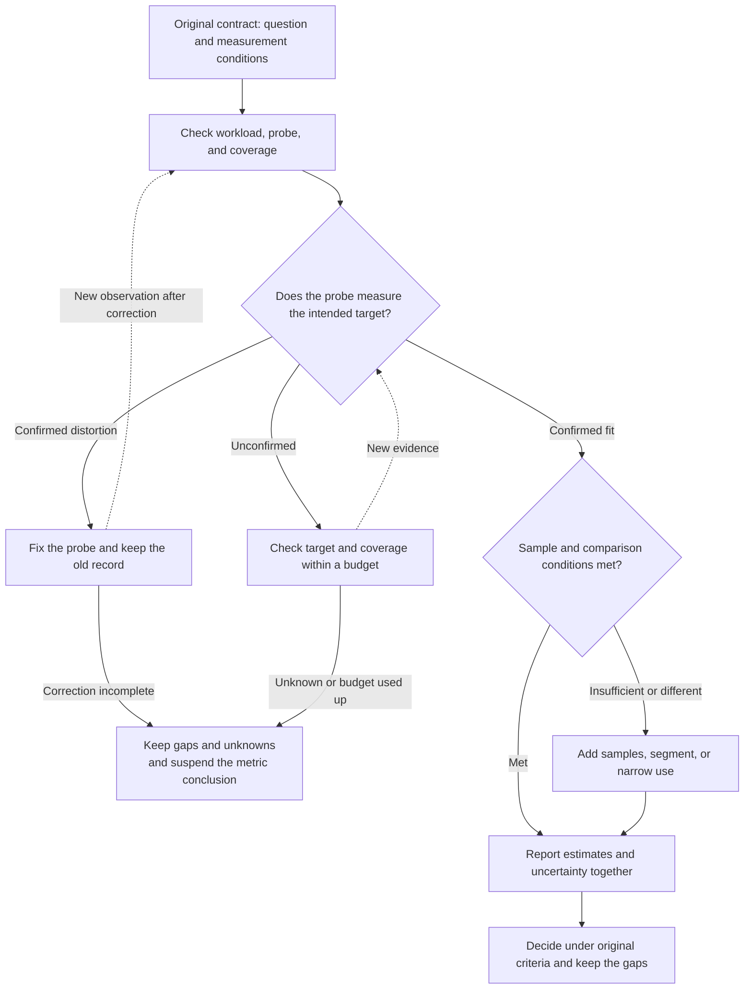

# Chapter 20. AgentOps, Cost, and Model Drift
## Evaluating operations against a baseline, a denominator, and a decision

This chapter proposes an Operational Baseline, Evaluation Window, Drift Finding, and Re-evaluation Case. They are candidates. Their completeness and fitness across projects remain open, and useful comparisons depend on the systems and workloads involved. The AI Game Dev OS v4.94 record does not establish improvements in cost, reliability, or governance.

As code generation gets cheaper, the easiest things to count are model calls, tokens, tool executions, time to first output, and concurrent agents. These measures can describe activity. I still need to know whether the result fulfilled the intent and who accepted it. I need the failures, retries, and `non-result` records in view, along with human review, waiting, rework, and recovery. I also want to see changes in the model, tools, permissions, and evaluation, check whether the security, privacy, IP, and authority boundaries still hold, and decide whether to continue, narrow, reroute, roll back, pause, or retire.

> **Operate against a versioned baseline, evaluate accepted outcomes within a bounded window, and treat drift as a trigger for scoped re-evaluation rather than automatic proof of failure.**

~~~text
bind an operational baseline
→ observe a bounded evaluation window
→ identify a relevant drift finding
→ make an authorized operational disposition
~~~

---

## 20.1 What is necessary, useful, and optional?

### Necessary

For repeated, long-running, or consequential work, identify the versions or change policies of the model, tools, skills, policies, context, and permissions. Define evaluable and accepted outcomes, and bind measurements to a workload, denominator, window, and observation coverage. State the limits on quality, safety, authority, cost, and human capacity. Identify re-evaluation triggers and the authority to continue, narrow, reroute, roll back, pause, or reauthorize. Preserve failures, exits, unknown external effects, and `non-result`.

### Useful

As volume, rate of change, or failure cost rise, consider versioned baselines, comparable windows, Metric Contracts, Cost Attribution and Routing Comparison Views, Drift Findings, Re-evaluation Cases, budgets, alerts, canaries, fallbacks, and rollbacks. Limited observation of human attention and decision queues can also help.

### Optional

A dedicated platform, full real-time dashboard, unified cost or trust score, permanent per-call records, automated root-cause analysis, model voting, full online evaluation, full regression for each provider change, and a registry entry for each metric are design choices. A low-risk, infrequent, easily inspected workflow may need only versions, a few result samples, and a stop condition.

---

## 20.2 AgentOps, DevOps, and LLMOps overlap

*AgentOps* continually identifies agent configurations, workloads, outcomes, controls, costs, and drift, then connects observations to decisions under appropriate authority.

It can reuse deployment identity, logs, metrics, traces, alerts, service levels, error budgets, incident response, model and data evaluations, feature flags, canaries, rollback, cost allocation, capacity planning, and dependency, provider, and configuration management from DevOps, SRE, MLOps, and LLMOps.

Look for the relationships an agent workload needs.

~~~text
Intent and Workload
+ Context and Instruction Boundary
+ Model and Tool Selection
+ Permission, Credential and Authority
+ Generated Proposal and Action Sink
+ Human Review and Decision Capacity
+ Outcome, Evidence and Recovery
~~~

An existing operations system may already support them.

---

## 20.3 Where operational evaluation fits in the book

| Objects | Chapter | Use here |
|---|---|---|
| Intent, Scope, Non-goal | [4](/chapters/04-en.html) | Bind observations to the workload and intent |
| Context Contract / Manifest | [5](/chapters/05-en.html) | Identify configuration and cost changes |
| State Claim, Baseline, Conflict | [6](/chapters/06-en.html) | Reference the grounds for current operation |
| Work, Execution Contract, Attempt, Checkpoint, Bounded Execution | [7](/chapters/07-en.html) | Relate operating costs to existing execution boundaries |
| Attempt Outcome, Target Result, Evaluation Result, Failure, `non-result`, Recovery | [8](/chapters/08-en.html) | Use the result and recovery definitions |
| Evidence, Acceptance, Adoption, Release Authorization | [9](/chapters/09-en.html) | Assess what metrics can support in a release authorization |
| Review, Review Target, Finding, Review Budget, Review Independence, Review Disposition | [10](/chapters/10-en.html) | Observe review capacity, queues, and disposition costs |
| Human Decision Interface | [11–12](/chapters/12-en.html) | Observe decision queues and attention limits |
| Capability, Permission, Authority, Autonomy | [13](/chapters/13-en.html) | Bound routing, budgets, tools, and automatic decisions |
| Observation, Detector, Signal, Intervention | [14](/chapters/14-en.html) | Supply sourced operational observations |
| Memory Lifecycle | [15](/chapters/15-en.html) | Identify retrieval, promotion, expiry, and maintenance costs |
| Self-Evolution Candidate, Evaluation Contract, Activation / Rollout, post-adoption specialization | [16](/chapters/16-en.html) | Receive long-term observations and trigger re-evaluation under Chapter 9’s adoption and disposition model |
| Agent Organization | [17](/chapters/17-en.html) | Observe coordination, handoff, and integration costs |
| Release Execution, Release Outcome, Trace, Accountability | [18](/chapters/18-en.html) | Separate release actions from external outcomes and retain sources for accountability review |
| Data, Model, Tool, Supply Chain, IP Boundary | [19](/chapters/19-en.html) | Check whether boundaries still hold |

This chapter proposes four core objects: Operational Baseline, Evaluation Window, Drift Finding, and Re-evaluation Case with its Operational Disposition. Cost Attribution and Routing Comparison Views derive from the source records.

---

## 20.4 What configuration are we evaluating?

An *Operational Baseline* is a versioned set of configuration, boundary, and evaluation references for a named purpose, workload, and interval. It lets us interpret operating results.

It can reference the use case and workload population, model, endpoint, deployment, change policy, tools, adapters, skills and prompt or policy packs, context, retrieval and memory boundaries, permissions, credential scope, authority and autonomy, evaluation suite, rubric and coverage, outcomes, guardrails and budgets, data, provider, security and IP dispositions, and owner, validity, expiry, and re-evaluation triggers.

~~~yaml
operational_baseline_id: OB-020-014
purpose: internal_issue_triage
workload_ref: WL-issue-triage-v3

runtime:
  model_endpoint: provider-a/model-family-x
  version_policy: provider_managed_with_notice
  agent_contract: agent-triage-v5
  tool_contracts:
    - issue-reader-readonly-v2
  context_contract: ctx-triage-v4

control:
  authority_grant: AG-triage-readonly
  autonomy_profile: observe_and_propose
  data_profile: internal-no-customer-secrets

evaluation:
  suite: eval-triage-v7
  outcome_contract: outcome-triage-v2
  known_gaps:
    - multilingual_long_threads
    - malformed_attachments

economics:
  cost_boundary: CB-triage-team-quarter
  budget_ref: budget-triage-q3

validity:
  opened_at: 2026-08-01T00:00:00+08:00
  expires_at: 2026-09-01T00:00:00+08:00
  owner: developer_productivity
~~~

Choose fields that let you name what is running, under which configuration and boundaries, and for how long, before comparing results. A baseline captures conditions for interpretation. Known-good status depends on evaluation and adoption.

A provider that supplies only an alias may leave a binary digest unavailable. Record the service identity, contract, change notices, observed behavior baseline, and remaining uncertainties.

---

## 20.5 A new baseline receives a new identity

When a model alias, tool version, prompt, policy, or evaluation set changes, using the dashboard’s latest values for the entire run history loses the conditions under which past results were produced. It can also hide whether the new configuration has been adopted for the same use and risk.

~~~text
old baseline closes or remains active for its scope
→ candidate/current configuration receives a new identity
→ comparability and required re-evaluation are assessed
→ authorized disposition selects rollout, coexistence, rollback or retirement
~~~

Correct erroneous baseline metadata through a Correction Record. Keep the model, tool, permission, and evaluation identities that actually applied to earlier runs.

---

## 20.6 Set a denominator and scope for the Evaluation Window

An *Evaluation Window* ties the inclusion rules, denominator, coverage, and Decision Use for comparable work and configurations to an observation period.

State the start and end events or times, workload, environment and baseline, inclusion and exclusion rules, sampling and deduplication, Outcome Unit and denominator, treatment of retries, fallback, cancellations and `non-result`, separate reporting of incidents, overrides, canaries and unusual traffic, missing or late data and detector failures, and the intended Decision Target.

A “92% success rate” needs a denominator, known exclusions, and a definition of success. Was it a test pass, an agent report, a review finding, or an authorized acceptance? Did a retry mask an initial failure? Were unreached targets counted as failures? Did the workload change? What could the observation actually see?

The [RandomHeroes economy measurements](../../Evidence/receipts/ER-20261122-003__CLM-C20-001.md) give an example. The checklist required at least 5,000 runs. Each group executed 4,000. The script fixed the seed, reset energy and some relic and boss states, and restricted progress. It exercised the actual settlement path with automated samples. Natural player sessions involve other conditions. The three groups used different code or configuration, so report three groups rather than 12,000 runs under identical conditions. The planned but unexecuted 1,000 constitute a sample gap, distinct from observed failures and `non-result`.

---

## 20.7 Define the Outcome Unit and Accepted Outcome

An *Outcome Unit* is a target outcome that can be observed and decided independently for a named work item and scope. It can be an answer, fix candidate, review decision, build or migration result, release, observable user behavior, or an accepted change to knowledge or policy.

It is a measurement projection pointing to one or more Target Results or Evaluation Results from [Chapter 8](/chapters/08-en.html) and declaring the denominator. A tool call, message, generated file, or commit may be a useful event without counting as an Outcome Unit.

An *Accepted Outcome* is a referenced result that has an authorized Acceptance Disposition for a named scope and purpose as defined in [Chapter 9](/chapters/09-en.html). An agent completion statement, a zero exit code, a test pass, review acknowledgment, artifact, merge, or release can occur independently. Exclude unobserved results, `non-result`, and unaccepted review passes from the accepted count.

Exploration may count a recorded candidate and explicit unknowns as its outcome. A production migration calls for stronger state observation, verification, authority, and recovery.

In the RandomHeroes example, one Spin settlement is the product sample unit. The 4,000 samples do not count as 4,000 units of agent work or accepted outcomes. The contemporaneous checklist marked one mean as passing. It did not record the named acceptance disposition needed to calculate development cost per Accepted Outcome.

---

## 20.8 What a Metric Contract lets a number support

A *Metric Contract* specifies a named measure’s definition, sources, denominator, window, segments, observation coverage, limitations, and Decision Use.

~~~yaml
metric_id: M-accepted-outcome-latency
question: how_long_until_a_scoped_outcome_is_accepted

unit: elapsed_minutes
population: issue_triage_outcomes
denominator: outcomes_opened_in_window
start_event: work_accepted
end_event: acceptance_disposition_recorded

segments:
  - workload_language
  - issue_complexity_band
  - model_endpoint
  - human_review_required

source:
  events:
    - work_record
    - acceptance_record
  coverage: sampled_with_known_gaps
  known_missing:
    - offline_human_review_time

decision_use:
  - compare_routing_candidates
  - identify_review_queue_pressure

not_supported:
  - reviewer_understanding
  - outcome_quality_without_acceptance_scope
  - causal_attribution_to_model
~~~

Record what the measure cannot support as carefully as the number. Within `outcomes_opened_in_window`, distinguish accepted, rejected, cancelled, and still open at the close of observation. If latency covers only accepted outcomes, also report their share of all opened outcomes, and the wait and status of the others. Dropping slow open tasks distorts the window.

### Read the original contract, observations, and disposition together

The RandomHeroes build after the F33 fix retained the measurements below. A Spin is the settlement of one overworld spin. The fast test calls the actual settlement path without waiting for its full animation. It samples settlements rather than player sessions. The refund measure is **energy-equivalent units per settlement**.

Each Spin cost 1 energy. Let E0 be energy before charging and E1 be energy after settlement. Direct refund is `max(E1 − (E0 − 1), 0)`. A free Spin earned in that settlement counts as one additional energy unit. The 4,000 valid settlements produced 1,623 units of direct refund and 294 free Spin entitlements, yielding `(1,623 + 294 × 1) / 4,000 = 0.47925 energy/Spin`. The entitlement is a flag set in the same settlement. It adds no further observations. Exclude empty results. A single refund can exceed one unit, so 0.47925 is a mean amount rather than a 47.925% trigger probability.

The target, mean, and confidence interval use energy units per Spin. “Pass” below preserves the scope of the judgment recorded at the time.

| Layer | Recorded | What it supports or calls for |
|---|---|---|
| Original contract | Mean target of 0.39–0.49 energy/Spin, at least 5,000 runs | Use original criteria before comparing |
| Actual execution | 4,000 with fixed seed and state interventions | Sample target unmet. Explain the intervention, add samples, or narrow the use |
| Estimate | Mean 0.47925, recorded 95% interval about 0.444–0.515 | Point estimate within target. Statistical uncertainty remains |
| Contemporaneous disposition | Mean marked as passing | The original contract did not require the full interval to stay inside the target. Apply the contemporaneous criterion |
| Uncovered claims | Planned sample count, natural sessions, real player experience | Full-contract acceptance and product balance remain open |

The free Spin conversion depends on the one-unit cost. Fixed seed, resets to energy and some world state, and exclusion of natural regeneration limit applicability to normal-session endurance.

A calculable formula establishes a defined measure. Once you collect data, check the probe and coverage. Comparable conditions and denominators support comparison. A conclusion still depends on the original question and Decision Target. Resolve or retain the gaps at each step.

### Figure 20-1 From a Metric Contract to a scoped conclusion

Figure 20-1 illustrates measurement disposition. If probe fitness is open, check start and end events, coverage, and the contract. Reassess when new evidence arrives. When evidence remains missing or the budget ends, retain the gap and suspend the conclusion. Correct a probe known to distort and check again with new observations. More samples from the old probe carry the same distortion. Report existing estimates alongside gaps after narrowing use. A passing point estimate settles only the part of the contract it addresses.

---

## 20.9 Keep the population, segments, and missing values visible

An average can mix different workloads. More formatting work can lower average latency. Sending high-risk work to a person can raise the agent success rate. Rejecting likely failures before execution can lower the mean cost of completed tasks. Logging only successful tool responses can hide unknown external effects. A new detector can make incident counts rise by identifying more of them.

Choose segments for the decision, such as workload, domain, complexity, risk, reversibility, model or tool or policy baseline, data class, review mode, new or established workflow, and incident or normal operation. Excessive segmentation adds sparse data, privacy risk, and maintenance. Give each segment a question, owner, and reason to collect it.

A fixed short scenario in lessismore illustrates how statistics can move in different directions. Cumulative time in the named Driver fell from 1,724,377 to 1,605,462 microseconds. The single maximum rose from 16,962 to 18,258 microseconds. P95 fell from 7,659 to 7,093 microseconds. The conditions were Godot 4.4, M3 Pro, Compatibility, 1920×1080, a fixed seed, and 15 operations over three rounds. Report the distinct changes. Whole-game performance and general tail latency require other measurements, as do full-frame, GPU, and long-term experience claims.

---

## 20.10 Answer different operating questions with different observations

Agent state, tool calls, success rates, latency, cost, failures, human intervention, permission, and context are all worth inspecting. They answer different questions.

| Observation surface | Question | What remains open |
|---|---|---|
| Outcome / Acceptance | Who accepted which outcomes, and within what scope? | Long-term value |
| Reliability / Failure | Which failures, retries, fallbacks, and `non-result` occurred? | Root cause |
| Latency / Waiting | Did time go to execution, queuing, review, or an outside dependency? | Whether faster is better for the work |
| Model / Tool Cost | What calls and resources were consumed directly? | Total Production Cost |
| Human Attention | Which decisions, reconstructions, and interruptions are visible? | Complete cognitive cost |
| Coordination | What happened at handoff, conflict, integration, or output triage? | General benefit or inefficiency of multiple agents |
| Context | What was acquired, assembled, supplied, or retrieved? | What the model used |
| Permission / Authority | Which grant covered which action? | Correct use of permission |
| Control Health | Can we observe detectors, gates, fallback, and recovery? | Unobserved risks |
| Drift / Re-evaluation | What change prompted what action? | Whether a model caused it |

A single score can hide conflicts among these surfaces.

---

## 20.11 Count the work around generation

A *Cost Boundary* sets the inclusions, exclusions, attribution rules, and unknown costs for a named outcome, Decision Target, owner, and window. Define it before adding costs.

*Total Production Cost* is a bounded view of execution, verification, people, coordination, failure, governance, and maintenance for a named outcome, target, and window. Some units may need to remain separate.

### Direct Execution Cost

Model and tokens, tools and APIs, compute, builds and test environments, storage, network, runtime, retries, and fallback.

### Context Cost

Retrieval, assembly, summarization, transfer, storage, freshness, and index maintenance.

### Verification and Review Cost

Testing, evaluation, code or design or product review, approval, evidence collection, and release decisions.

### Human Attention Cost

Context reconstruction, decision preparation, waiting, interruptions, exception triage, takeovers, and rebuilding an understanding of system state.

### Coordination Cost

Work decomposition, assignment, handoffs, conflict resolution, integration, and output triage.

### Failure and Recovery Cost

Failed attempts, rework, rollback, incident response, data and external state repair, and customer, player, or organizational effects.

### Governance and Maintenance Cost

Policies, gates, traces, detectors, audits, exceptions, overrides, escalations, integration of prompts, skills, tools and models, refresh of baselines, evaluations and documentation, training, and adoption support.

Categories can overlap. State attribution rules so one review does not get added three times under verification, governance, and cognitive costs.

Product measures and the cost of making the product are distinct. Gold, energy, and Driver time exclude development calls, human review, waiting, and rework. They give no percentage improvement in Agent Economics. One RandomHeroes fix changed both code and configuration. Mean gold fell from 152.0205 to 75.697. The effect of removing duplicate rewards remains unisolated.

---

## 20.12 A Cost Attribution View is a projection for a decision

A *Cost Attribution View* organizes available run and human records by outcome, workload, baseline, owner, and Decision Target. It can show the range of direct costs of an Accepted Outcome, whether review or waiting dominates, where retries, rework, or recovery accumulate, the cost of a gate and its false alerts and follow-up, which costs changed after routing, and what can only be estimated or remains unobserved.

Avoid false precision for undocumented thinking time, prevented losses, the full opportunity cost of delays, enduring effects on trust, and the full monetary value of creative quality, learning, or organizational capability. Use `unknown`, ranges, qualitative comparisons, and not-applicable where warranted.

---

## 20.13 Observe human attention within its limits

Agents can reduce some operation times and add output review, comparison of alternatives, exception triage, permission decisions, context reconstruction, handoff interpretation, drift investigation, override and takeover, and sorting of low-quality, high-volume output.

Observable proxies include the count and age of work awaiting a person, review start and end, reopen, rejection, change request and override events, takeovers, repeated briefs about the same decision, the amount of cross-output triage, and the age and risk distribution of the decision queue.

These signals leave the reviewer’s understanding, cognitive difficulty, interruption costs, quality of creative or product or ethical judgment, and work outside the system open. Combine bounded machine observations and selective human annotations. Clicks, comments, and time online are only proxies.

---

## 20.14 Compare the added costs and benefits of governance

*Agent Economics* asks whether a named production arrangement can meet outcome, risk, human-capacity, and time constraints at a sustainable total cost. Compare with human-only work, ordinary automation, and simpler tool workflows as appropriate.

*Governance Economics* compares execution, waiting, review, false alarms, missed detections, rework, recovery, and maintenance across control arrangements that keep the Protected Control Floor and unacceptable-loss constraints.

~~~text
compare:
  execution cost
  + context cost
  + review and waiting cost
  + human attention cost
  + governance and maintenance cost
  + observed rework and recovery cost

subject to:
  protected control floor
  legal / security / privacy constraints
  unacceptable-loss limits
  Human-reserved Decision Types mapped to named Authority Grants or institutional boundaries
  minimum outcome and evidence boundaries
~~~

Failure probabilities can be unknown, and avoided incidents are counterfactual. A low-probability, high-impact loss can disappear in an average. Safety, privacy, rights, and human authority resist conversion into money. Teams tolerate delay, quality, and risk differently. A new detector can catch more and create work. Fewer incidents can reflect less traffic.

Which controls address the named risks at acceptable additional cost while keeping the unobserved failure surface within bounds? The product measures illustrate denominators, probes, and attribution. Comparing governance needs comparable execution, review, waiting, and rework data with unmeasured costs visible. Counts of reclaimed files or characters in documents measure different things.

### An illustrative ledger that measures only some costs

The following numbers are **fictional teaching data**. The window is one workday and the population is five work items opened that day. Each opens one outcome to be accepted under a local delivery criterion. Cut off observation at the end of the day. Accounting units record model and tool costs, and human minutes stay separate.

| Work / Outcome | Attempt or event | Event and end-of-window status | Direct cost, accounting units | Known human activity, minutes |
|---|---|---|---:|---:|
| W1 / O1 | A1 | Failed, then retried. O1 eventually accepted | 4 | 6 |
| W1 / O1 | A2 | Retry produced the accepted result | 6 | 9 |
| W2 / O2 | A1 | Output rejected and no further attempt in the window | 5 | 12 |
| W3 / O3 | A1 | Cancelled after costs were incurred | 3 | 4 |
| W4 / O4 | A1 | Open, awaiting review for two hours | 8 | Unrecorded |
| W5 / O5 | A1 | Output accepted | 4 | 7 |
| Shared in the window | Shared environment setup | Served the five items without assignment to one item | 2 | Unrecorded |

Count five work items, five outcomes, and six attempts. W1’s retry opened no second outcome. At cutoff there are two accepted, one rejected, one cancelled, and one open, for an acceptance share of `2/5 = 40%`. W4’s two hours measure waiting, not known human activity. Record later acceptance as follow-up for the same population while preserving the cutoff.

Direct attempt costs are `4 + 6 + 5 + 3 + 8 + 4 = 30`. Shared setup adds 2, so the booked window cost is 32. Normalize it by the two accepted outcomes to get `32/2 = 16 accounting units per Accepted Outcome`. Keep “booked in the window” in the name. This includes unsuccessful work and covers only the observed period.

A different question asks how much direct cost was attributed to the two accepted results. W1 cost `4 + 6 = 10` and W5 cost 4, a mean of 7. Other work and shared costs are outside that figure. The rejected, cancelled, and open items remain in the 30 units. A prior rule can allocate shared cost equally at 0.4 per item. That is an accounting convention.

Known human activity totals `6 + 9 + 12 + 4 + 7 = 38 minutes`. W4 and shared setup remain unknown. Complete human input, total production cost, and comparative economy remain unmeasured. Collect the missing entries for future comparable windows. Align acceptance scope, treatment of failures and cancellations, cutoff, and cost coverage before comparing cost per outcome.

---

## 20.15 Compare governance measures under uncertainty

Candidate measures include Governance Overhead Ratio, review time, human decision time, escalation frequency, false escalation rate, incident rate from under-governance, rework avoided, and failure cost avoided. Each has a different interpretation.

### Governance Overhead Ratio

Name the numerator and denominator. Review can look large relative to model runtime alone. Including maintenance and incidents can change the ratio for the same control.

### False Escalation and Under-governance

The losses are usually asymmetric. An unnecessary escalation can add waiting. A missed escalation can cause irreversible external effects. Compare consequences as well as counts.

### Rework Avoided and Failure Cost Avoided

An avoided event is counterfactual. Look for a suitable control, historical baseline, or event chain. Otherwise record what action the gate blocked, what subsequent checks found, what might have happened without the gate, and the basis and uncertainty of that estimate.

### Protected Control Floor

Keep protections for secrets, production authority, irreversible data loss, legal obligations, and decisions reserved to people. Compare implementation and process choices above those constraints.

---

## 20.16 A Routing Disposition is an operational decision

Fast inexpensive models, stronger reasoning models, specialists, local models, and cross-model checks are candidate capabilities or topologies.

A *Routing Disposition* selects a model and tool path, fallback, review, and validity for a named Routing Decision Target under stated purpose, data, tool, authority, evaluation, and cost limits. It is a specific Operational Disposition under the target-specific model in [Chapter 9](/chapters/09-en.html).

Consider workload and required capability, outcome and guardrails, data processing permission, provider terms, region, retention and change policy, tools, network, credentials and authority, latency, availability and capacity, direct, review, recovery and maintenance costs, evaluation coverage and known failures, and fallback, canary, rollback and owner.

A cheaper model can add retries, review, and rework. A higher benchmark may be irrelevant if the model cannot satisfy data, tool, latency, or output constraints. [Chapter 19](/chapters/19-en.html) covers local, private, and cloud processing contracts. Here we assess results, costs, and changes under them.

---

## 20.17 Compare routing paths under comparable conditions

A *Routing Comparison View* compares candidate paths under workloads, boundaries, evaluation, and disposition rules that are as consistent as feasible. It can use offline evaluation, shadow runs, replay fixtures, canaries, A/B comparisons or interleaving, blind human review, sequential rollout, and incident or failure-mode review.

| Method | What it can provide | Main limitations |
|---|---|---|
| Offline evaluation | Low-risk, repeatable comparison | Workload or real tool effects may be distorted |
| Shadow run | Candidate output on the same inputs | External effects and human adoption stay untested |
| Replay fixture | Precisely revisits a known case | Can overfit historical failures |
| Canary | Limited observation on the real execution path | Can have actual effects and needs stop and recovery |
| A/B | Comparison on controlled populations | Hard with rare, high-risk, or irreversible work |
| Human blind review | Can reduce branding or model bias | Expensive and subject to reviewer differences |

Hold constant or record instructions, context and retrieval, tool functions and permissions, retry, fallback and review policy, outcome definitions, sampling and windows, model and tool identity, missing values, and exit conditions. If they differ, qualify the judgment accordingly.

---

## 20.18 Drift is a relevant change from a baseline

*Drift* is a sustained or discrete departure from a named Operational Baseline that could change outcomes, controls, costs, evidence coverage, or applicability. An ordinary fluctuation may have a different explanation.

A *Drift Finding* is a versioned judgment relating a sourced change to its baseline, coverage, potential impact, and uncertainty. The cause and operational disposition can remain open.

| Surface | Typical changes | Possible impact |
|---|---|---|
| Identity / Version | Model, tool, skill, prompt, policy, dependency | Comparison, behavior, provenance |
| Workload | Tasks, language, data, users, difficulty mix | Outcomes, costs, coverage |
| Behavior / Output | Format, stability, error patterns, tool selection | Quality, safety, review |
| Tool / Interface | Schema, side effects, errors, latency, API | Execution, recovery, evidence |
| Permission / Authority | Function, credential scope, grant, destination | Action boundary, risk |
| Control | Detector, gate, sandbox, fallback, rollback | Prevention, detection, recovery |
| Evaluation | Dataset, judge, rubric, coverage, threshold | Meaning of measurement |
| Economic | Price, tokens, runtime, review, waiting, maintenance | Routing and sustainability |
| Contract / Rights | Terms, region, retention, license, purpose | Availability, privacy, IP |

Name the claim or Decision Target the finding could affect. Random variation, seasonality, workload shifts, and observation gaps can all move an indicator.

---

## 20.19 Several changes can look like Model Drift

Model behavior can change after a model revision, a provider alias update, system instructions or safety policy changes, changes to sampling or temperature, tools or output schema, updates to retrieval, context, memory or templates, changes to provider runtime, capacity, routing or region, a different input population, or a different evaluation set or judge.

A drop in a measure makes model degradation one possible cause. To investigate:

1. Check model identity and change policy.
2. Compare context, tools, prompts, permission, and workload.
3. Check observation and evaluation coverage.
4. Locate the affected segment.
5. Look for independent replication or comparison.
6. Assess whether present impact warrants an immediate restriction.

Operations can restrict the path or switch to fallback before root cause is known.

---

## 20.20 Track tool, permission, and control drift

A tool can change functions, parameter schema, defaults, returns, network or filesystem or process effects, errors, retries, idempotency or transactions, credential scope, API rate, quota, latency or availability, adapter, launcher or observer behavior, recovery, disable switches, or fallback.

Permission drift concerns what the environment technically exposes. Authority drift concerns what the grant allows by purpose, scope, or effect. Usage drift concerns observed behavior. A `permission_count` alone cannot establish the other two.

Controls may drift if a detector stops or loses coverage, a gate rule expires, an alert path loses its owner, a sandbox changes, an exception persists without expiry, a rollback artifact becomes unavailable, revocation fails to reach in-flight work, or approvals become routine clicks. Stable output can coexist with a changed control surface.

---

## 20.21 Version the evaluation and the observer

Metrics can improve after removing difficult fixtures, updating a judge model, widening a rubric, excluding previous failures, testing only a new main path, changing the mix of human reviewers, lowering thresholds, or losing reports that used to count in the denominator.

*Evaluation Drift* means a change in datasets, judges, rubrics, thresholds, sampling, coverage, or disposition semantics that affects comparability across times. Give the evaluation its own identity.

Observers can miss or duplicate events, change sampling, delay reports, create side effects before the target, lose access after permission changes, record unknowns as zero, or classify detector failure as target failure. Show evaluation and observer versions and coverage gaps alongside significant trends.

---

## 20.22 Operating costs, provider contracts, and rights can change

Economic drift includes price, token and request patterns, retry and fallback rates, context size and retrieval cost, review and waiting and decision queues, tools and build or test environments, incidents and recovery and maintenance, capacity and quotas and availability, and coordination and integration.

Contract or rights drift can include terms, output use, indemnity, retention, training, support access, region, subprocessors, tenant boundaries, model aliases and change notices, package or dataset or model or tool licensing, and extension of a use to a new product, customer, or jurisdiction.

[Chapter 19](/chapters/19-en.html) identifies who can decide legal, security, and business implications. An operations finding can show that existing routing or baseline applicability needs review.

---

## 20.23 Separate observation, possible impact, possible cause, and disposition

Use the record to identify each step.

~~~text
Observable Change
  source, baseline, current value, window, coverage

Impact Inference
  which outcome, guardrail, cost or boundary may be affected

Cause Candidate
  model, tool, workload, evaluation, control or external explanation

Operational Disposition
  continue, observe, restrict, reroute, rollback, suspend or retire
~~~

~~~yaml
drift_finding_id: DF-020-041
baseline_ref: OB-020-014
window_ref: EW-020-2026-08-b

observable_change:
  metric: accepted_outcome_latency_p95
  baseline: 42m
  current: 71m
  coverage: partial
  segments:
    - multilingual_long_threads

impact_inference:
  status: plausible
  affected_boundary:
    - review_queue_capacity
    - response_time_commitment

cause_candidates:
  - workload_mix_changed
  - provider_latency_changed
  - human_review_queue_changed

disposition:
  status: continue_with_restriction
  action:
    - route_long_multilingual_threads_to_fallback
    - open_scoped_re_evaluation
  authority: operations_owner
  expires_at: 2026-08-30T18:00:00+08:00
~~~

The record gives inspectable grounds for a limited disposition while several causes remain possible.

---

## 20.24 Change, expiry, and new uses can trigger re-evaluation

*Re-evaluation* checks the affected claims, evaluations, and dispositions when operating grounds, applicability, or uses change. Possible triggers include:

- Changes in model, endpoint, tool, skill, prompt, or policy identity
- Changes in tool function, schema, permission, credentials, or action sink
- New provider terms, region, retention, training, subprocessors, or incidents
- Changes in license, rights, data class, purpose, customer, or jurisdiction
- Outcomes, guardrails, costs, latency, or human load crossing a boundary
- Repeated retries, fallback, overrides, takeover, or unknown external results
- Changes in evaluation, judge, detector, sampling, or observation coverage
- Baseline expiry
- A new workload, language, or platform, or a more consequential use
- Loss of recovery, rollback, disable switch, or owner

A trigger calls for a judgment. Select checks based on impact.

---

## 20.25 Map impacts before choosing what to retest

*Impact Mapping* connects a named change or trigger to the baselines, claims, workloads, boundaries, and Decision Targets it could affect.

1. Locate the changed source, identity, or contract.
2. Identify affected baselines, workloads, and windows.
3. Find dependent outcome, guardrail, data, authority, and cost claims.
4. Check which parts of prior evidence still apply.
5. State which uncertainties increased.
6. Choose an interim disposition if necessary.
7. Identify re-evaluation and operational decision authority.

The original outline suggested benchmark work, security tests, reliability tests, cost tests, behavior regressions, and evaluation of cognition outputs. Choose checks that address the changed surface.

| Affected surface | Candidate evaluation |
|---|---|
| Output Contract | Schema, format, references, deterministic checks |
| Task Outcome | Project fixtures, replay, human review, acceptance samples |
| Tool Behavior | Permission, arguments, side effects, idempotency, recovery |
| Security / Privacy | Threat-specific checks, data boundary, credentials, logs |
| Reliability | Retry, fallback, rate limits, partial failures, recovery drills |
| Economics | Direct cost, latency, review, waiting, rework, capacity |
| Human / Cognition | Brief quality, sufficiency for decisions, creative and product judgment |
| Evaluation Integrity | Dataset, judge, rubric, coverage, observer |

For direction, experience, aesthetics, rights, or consequential business judgment, use human review as a source of meaning. A second model can check specific properties under its own contract.

RandomHeroes retired a full presentation-duration probe after two inconsistent results. A separate button-recovery measurement of about 1.96 seconds covered button recovery. Full experience duration and human testing remained open. Match the follow-up to the trigger. Repair a faulty probe, add samples under the original contract or narrow their use, and retest changed code or configuration according to its impact. Keep old data and the reason for each disposition.

---

## 20.26 A Re-evaluation Case places evidence under named authority

A *Re-evaluation Case* opens bounded evaluation work in response to a named trigger. It links affected baselines, required evidence, temporary controls, decision authority, and final disposition.

~~~yaml
re_evaluation_case_id: REC-020-018
trigger:
  type: provider_model_alias_change
  observed_at: 2026-08-26T09:30:00+08:00
  source: provider_change_notice

affected:
  baselines:
    - OB-020-014
  workloads:
    - internal_issue_triage
  claims:
    - output_schema_stability
    - accepted_outcome_latency
    - no_external_side_effect

interim_disposition:
  status: restrict
  scope:
    tools: read_only
    workloads:
      deny:
        - malformed_attachments
  expires_at: 2026-08-29T18:00:00+08:00

evaluation_plan:
  - project_fixture_replay
  - output_schema_regression
  - prompt_injection_boundary_check
  - cost_and_latency_sample
  - human_review_of_multilingual_cases

authority:
  evaluation_owner: ai_platform_evaluation
  operational_decider: developer_productivity_owner
  security_decider: security_owner

result:
  status: pending
  final_disposition: null
~~~

Limit the case to the affected workloads, tools, or claims. If the change does not affect the current use, `no_re_evaluation_required_for_scope` can record that disposition along with its basis and authority.

---

## 20.27 What an Operational Disposition can decide

An *Operational Disposition* is a named authority’s Decision Record to continue, limit, change, or stop an operational use, baseline, or next-state choice. It specializes the target-specific Disposition defined in [Chapter 9](/chapters/09-en.html).

| Disposition | Meaning |
|---|---|
| `continue` | Existing evidence supports operation within the accepted scope |
| `continue_with_observation` | Keep running and add observation through a stated date or condition |
| `restrict` | Narrow workload, data, tools, permission, or output use |
| `reroute` | Send a specified workload to a different model, tool, or human path |
| `canary` | Run the candidate on a controlled population under stop conditions |
| `fallback` | Use a defined fallback path |
| `rollback` | Restore an available and still applicable earlier configuration |
| `suspend` | Pause new runs and keep state and evidence |
| `reauthorize` | Have the relevant authority update the grant, scope, or validity |
| `retire` | End further use of the current baseline |
| `pending` | Evidence or authority is insufficient for a decision |

Give the disposition a target and scope, baseline or candidate identity, trigger and evidence, authority, effective time and expiry, treatment of in-flight work, recovery or fallback, follow-up observation, and closure conditions. A `continue` applies under those conditions. A `rollback` needs a check that the earlier configuration still fits the current environment.

---

## 20.28 Automation acts inside its advance grant

A gate with an explicit grant can block new actions, enter a read-only or lower-impact mode, enable a preapproved fallback, lower concurrency, rate, or budget, open a Re-evaluation Case, preserve evidence, and notify an owner.

An automated signal cannot by itself grant more tool functions or credential scope, lower the Protected Control Floor, allow a new provider, approve security from cost, transfer acceptance authority, delete an incident or drift record, or resolve an unfinished root-cause analysis. Fast execution still needs a valid grant.

---

## 20.29 Alerts and escalation consume capacity

Alert volume can rise because risk rose, detector coverage improved, thresholds narrowed, workload grew, duplicate events remained, a control drifted, or alert design failed.

Specify detector version and source, severity and confidence, deduplication and correlation, owner and response window, authority for suppression or an exception, expiry, review of false positives and misses, and human decision capacity.

Aggregate or sample repeated low-risk signals. High-impact, irreversible, or out-of-authority signals can trigger a hard stop under policy. Record the detection and its subject.

~~~text
detector fired
≠ incident confirmed
≠ root cause known
≠ target failed
~~~

Use alert fatigue to investigate scope, threshold, routing, owner, automation, and the Protected Control Floor.

---

## 20.30 What the cases tell us about metrics and denominators

The timelines are in [Chapter 23](/chapters/23-en.html). Here the cases inform Metric Contracts and Cost Boundaries.

| Episode | AgentOps constraint | Conclusion outside the evidence |
|---|---|---|
| D-073 through D-075 / F1–F4a | Count governance work, delivery outcomes, evidence stages, and claim use separately. Include review, waiting, proof surfaces, and rework in cost. Keep `NON_QUALIFYING` visible in completion counts | Strict governance necessarily causes livelock, function-first alone caused recovery, or the new path lowered total cost |
| D-048 | Verifier failure and target `non-result` have different denominators. An unreached target has no pass or fail result | Exact inventory is the only valid control |
| D-079 | A selected test pass is a scoped Evaluation Result. It can serve as evidence for a named use. A candidate without acceptance stays outside the Accepted Outcome denominator | The smaller implementation lowered long-term defects or maintenance costs |

The [governance livelock and function-first history](../../Evidence/receipts/ER-20260818-001__CLM-OUTLINE-002.md), [D-048 record](../../Evidence/receipts/ER-20260818-002__CLM-C06-004.md), and [D-079 scope decision](../../Evidence/receipts/ER-20260818-003__CLM-C09-001.md) supply these relationships. A pre/post comparison of the practices, long-run economic data, and effect sizes remain unavailable.

---

## 20.31 Start with a recurring operating problem

Choose recurring work with observable outcomes, an identifiable baseline, real problems with failure, review, or cost, an owner and decision authority, and scope that can be restricted or recovered.

1. Define an Outcome Unit and acceptance boundary.
2. Record the current model, tool, context, permission, and evaluation baseline.
3. Specify an Evaluation Window with a denominator.
4. Choose an outcome, one key guardrail, and one or two cost observations.
5. Define treatment of `non-result`, retries, fallback, and missing data.
6. Choose a drift trigger that can actually occur.
7. Bind an interim disposition and authority.
8. Collect two interpretable windows or a baseline and candidate window.
9. Keep observed change, impact inference, and possible cause separate.
10. Decide whether to continue, restrict, reroute, roll back, suspend, or re-evaluate.
11. Retain unknown costs and risks.
12. Remove telemetry with no Decision Use.

Low-volume systems can use narrow cases, failure-mode analysis, replay, and human review for limited judgments under explicit uncertainty.

---

## 20.32 Interfaces with adjacent chapters

[Section 20.3](#section-20-3) shows how Chapters 5–19 supply context and state, results and evidence, human decision and authority, observations, memory and evolution, organization and trace, and security and IP boundaries.

This chapter adds the operating baseline, Evaluation Window, cost and drift findings, and re-evaluation dispositions. Access records concern external access. A metric pass needs a separate acceptance decision. A trend can lead to an Evolution Candidate under the appropriate authority. Responsibility and legal liability have their own grounds.

Operational observations feed the lifecycle in [Chapter 21](/chapters/21-en.html). Changes to model, tool, permission, provider terms, incidents, and rights still require the security, privacy, contract, and IP decisions described in [Chapter 19](/chapters/19-en.html).

---

## 20.33 Principles

1. **Baseline identity precedes comparison.** Identify the operating baseline first.
2. **A denominator is part of a metric.** Include the population and exclusions.
3. **Accepted outcome precedes productivity.** Identify what was accepted, by whom, and for which scope.
4. **A tool call is not an outcome.** Identify the business or engineering effect.
5. **A `non-result` remains visible.** Record unreached targets separately from passes and failures.
6. **Observed change is not causal proof.** Separate the observation, possible impact, and possible cause.
7. **Drift includes the evaluator.** Check models, tools, workload, controls, observers, and evaluations.
8. **Cost is wider than tokens.** Include review, waiting, coordination, rework, recovery, governance, and maintenance.
9. **Human attention is finite and partially observable.** Treat clicks and time online as limited signals.
10. **Governance has costs and a protected minimum.** Evaluate the cost of controls while keeping the Protected Control Floor.
11. **Routing is a scoped disposition.** Bind it to purpose, data, tools, authority, evaluation, and fallback.
12. **Re-evaluation follows impact scope.** Retest what the change could affect.
13. **Operational safety can precede root-cause closure.** Restrict consequential work while investigation continues.
14. **Automation executes granted dispositions.** Identify which actions were preauthorized.
15. **Telemetry has cost and risk.** Remove or reduce observations without a Decision Use.
16. **Preserve historical baselines.** Give a new configuration its own identity.

---

## 20.34 Common anti-patterns

- Putting everything on a dashboard
- Counting token cost as Total Production Cost
- Treating generated output volume as productivity
- Counting a successful tool call as an Accepted Outcome
- Counting only completed work and ignoring retries, cancellations, and `non-result`
- Reporting success rates without a denominator, population, or window
- Combining quality, risk, cost, and authority in one agent score
- Choosing the cheapest model on price alone
- Choosing the model with the highest public benchmark on that basis alone
- Attributing all indicator changes to the model
- Ignoring tool, permission, evaluation, and observer drift
- Silently updating a baseline after a provider alias changes
- Running every test after every change
- Treating scanner, judge, or test passes as adoption
- Equating fewer human interventions with more mature autonomy
- Treating human review as free
- Counting the same review under review, governance, and cognitive costs
- Reporting a prevented failure as an observed benefit
- Disabling a protected control to cut short-term cost
- Letting an agent expand model, tool, budget, or permission on its own
- Sending alerts with no owner, expiry, fallback, or authority
- Retaining all prompts, context, and tool payloads and expanding privacy or security exposure
- Rewriting old windows to match a new baseline and erasing drift from history

---

## 20.35 Checklist

### Baseline and window

- [ ] Can you identify the model, tools, skills, prompts or policies, context, permissions, and evaluation?
- [ ] Does the Operational Baseline bind purpose, workload, owner, validity, and gaps?
- [ ] Does the Evaluation Window specify inclusions, exclusions, sampling, denominator, and coverage?
- [ ] Does a baseline change get a new identity?

### Outcome and metric

- [ ] Is the Outcome Unit distinct from a tool call, file, commit, or agent claim?
- [ ] Does an Accepted Outcome have a scope and Acceptance Authority?
- [ ] Are retries, fallback, cancellation, unknown external results, and `non-result` retained?
- [ ] Does each metric specify source, population, window, segment, coverage, and Decision Use?
- [ ] Are conclusions outside the metric’s support explicit?

### Cost and people

- [ ] Does the Cost Boundary consider direct, context, verification, human, coordination, failure, governance, and maintenance costs?
- [ ] Is each cost counted once?
- [ ] Can you record unknowns, ranges, and qualitative costs?
- [ ] Are queue, waiting, review, override, and takeover treated as limited observations?
- [ ] Are security, privacy, irreversible loss, and human-reserved decisions guardrails tied to grants or institutional boundaries?

### Routing

- [ ] Does routing bind purpose, data, tools, authority, evaluation, fallback, and expiry?
- [ ] Are workloads, context, retries, and review policy sufficiently comparable?
- [ ] Are local, private, cloud, fast, stronger reasoning, and specialist models treated as candidates?
- [ ] Is the decision based on more than a public benchmark or unit price?

### Drift

- [ ] Does drift refer to a named baseline?
- [ ] Have you selected the relevant identity, workload, behavior, tool, permission, control, evaluation, economic, or contract surfaces?
- [ ] Can you distinguish observation, impact, cause candidates, and disposition?
- [ ] Does the explanation include changes to evaluation and observers?
- [ ] Are coverage gaps visible rather than filled with zero?

### Re-evaluation and authority

- [ ] Does the trigger identify affected baselines, claims, and scope?
- [ ] Did you map impact before choosing the retest?
- [ ] Do restrictions, canaries, fallbacks, rollbacks, or suspension have conditions?
- [ ] Are evaluation, security, operating, and acceptance authorities named?
- [ ] Does automation execute within its existing grant?
- [ ] Does the disposition have effective time, expiry, recovery, and closure?

### Telemetry and governance

- [ ] Does each observation support a control, debugging, evaluation, or accountability question?
- [ ] Are sampling, retention, redaction, access, and deletion specified?
- [ ] Does an alert have owner, severity, deduplication, response window, and exception authority?
- [ ] Did you consider asymmetric losses from false escalation and under-governance?
- [ ] Can you remove metrics, fields, and dashboards with no Decision Use?

---

## 20.36 Conclusion

Use AgentOps to answer questions about the operation.

~~~text
which operational baseline ran
+ which workload and evaluation window applied
+ what outcome was observed and accepted
+ what cost and control boundaries were used
+ what changed and how certain that observation is
+ who may continue, restrict, reroute, rollback, suspend or retire
~~~

Model and token prices describe direct charges. Pricing every unmeasured risk can create false precision. Compare outcome and acceptance, reliability and recovery, direct and human and coordination and governance costs, security and privacy and authority and rights constraints, evidence and observation coverage, drift, and readiness to re-evaluate.

The comparison may show that a particular AI or multi-agent workflow cannot match the economics of a simpler arrangement under the current scope, risk, and human capacity. That finding distinguishes raw generation capability from sustainable production.

[Chapter 21](/chapters/21-en.html) brings intent, baseline, execution, evidence, human decisions, evolution, and operations into an AI-native development lifecycle. It explains which relationships open, become observable, are decided, and close in different stages of work.

