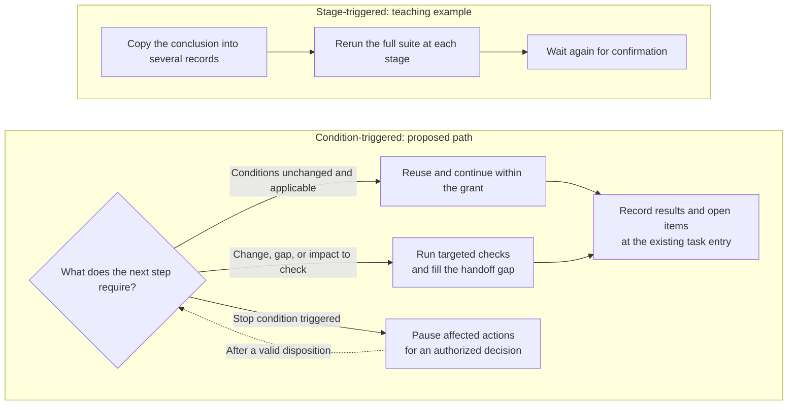

# Chapter 21. AI-Native Software Development Lifecycle
## From a Fixed Pipeline to a Network of Transitions

This chapter proposes a way to combine Lifecycle Profiles and Lifecycle Transitions. The model leaves room for traditional SDLC practices and for different sequences of work. An Execution Epoch, a sprint, multiple agents, or a full stack of gates may be useful for particular work. The AI Game Dev OS v4.94 case illustrates how states and dispositions differ. The case leaves questions about efficiency, quality, and safety open.

The conventional software development lifecycle describes the major activities from requirements through operation and maintenance.

~~~text
Requirement
→ Design
→ Implementation
→ Test
→ Deployment
→ Maintenance
~~~

Those activities still matter. With agents, we can delegate more of the interpretation, planning, execution, verification, and proposal work to systems that call tools, change state, run in parallel, and work over long periods. That gives the lifecycle additional questions to answer.

- What are the Intent, Scope, Acceptance Target, and Non-goals for this Work?
- Which State, Decision, Assumption, and Context may the agent rely on?
- Who authorizes the tools, permissions, credentials, and external effects?
- When can an Attempt begin, pause, expire, reopen, or close?
- Which Decision Target can the evidence support?
- How do we distinguish a test pass from Acceptance, Integration, Release, or Operations?
- How do we retain failures, unknown external effects, and `non-result` outcomes?
- When do we need human review, takeover, recovery, or re-evaluation?
- Which lessons remain candidates, and which may enter memory, skills, policy, or workflow?

A named Lifecycle Profile selects the parts this work needs based on its impact, duration, distribution of authority, downstream use, and recovery demands. Putting all these relationships into one longer pipeline makes it hard to omit steps whose purpose the current work never triggers.

> **A lifecycle is not the list of stages every task must visit; it is the set of authorized transitions through which work may open, branch, pause, recover, close, and re-enter operation.**

---

## 21.1 Which Controls Does This Work Need?

### The minimum controls

When an agent can change persistent engineering state or produce external effects, the lifecycle needs to retain these functions.

- Identify the Work and Attempt.
- Specify the scope, permitted actions, and surfaces those actions may affect.
- Identify the human or system authority for execution and closure.
- Make results, failures, unknowns, and `non-result` outcomes visible.
- Provide a boundary for stopping, recovering, or safely discarding the Attempt.

An issue tracker, version control, a sandbox, CI, and a human workflow can share these functions. Each piece of work can use the records it actually needs.

### Controls that depend on the work

Duration, concurrency, impact, uncertainty, policy, contracts, rights, downstream decisions, and recovery needs can warrant more explicit controls.

- A versioned Lifecycle Profile, Execution Contract, Baseline, Context, assumptions, and conflict records.
- An Evidence Plan, Coverage, and named transition and decision targets.
- Separate records for Acceptance, Integration, Release Authorization, and operational disposition.
- Exception authority, independent review, checkpoints, handoff, pause, rebase, and Re-evaluation Cases.
- A Capability Fit Review as described in Chapter 22.
- Separate promotion or adoption of durable memory and evolution candidates.
- Distinct agent roles where parallel work, isolation, or review independence matters.

### Implementation choices

An AI-native lifecycle may use a Human Control Plane with a dashboard, an Execution Epoch, or a Self-Evolution Pipeline. A team can also choose a shared Dashboard or Registry, a full Decision Graph, persistent workflow records, or a full stack of gates. Separate agents per stage, a Controller / Worker organization, fixed G0–G4 risk levels, and sprint-based timing are choices. So are full tracing, continuous evaluation, permanent context retention, and automation for post-task memory writes or workflow changes. The rules for promotion and adoption still apply.

For a small, reversible change, a brief and a targeted check can carry several relationships together. Later sections describe the available relationships. A named Lifecycle Profile chooses the ones the current work puts to use.

---

## 21.2 The Traditional SDLC Still Applies

The conventional stages ask what the product needs, how to design and implement it, how to verify and release it, and how to maintain it. The controls for delegated execution can appear within each stage.

| Traditional activity | What an agent may do | Additional control questions |
|---|---|---|
| Requirement | Organize requirements, identify conflicts, generate candidates | Who owns the intent and has authority over priorities? |
| Design | Analyze alternatives, prototype, simulate, review | Which Context, Assumptions, Trade-offs, and Acceptance Targets apply? |
| Implementation | Change code, data, configuration, or assets | Which tools, permissions, scope, baseline, and recovery path apply? |
| Test | Generate, run, and interpret tests | What are the Claim, Coverage, Verifier Integrity, and `non-result` boundaries? |
| Deployment | Prepare, execute, and observe a release | Which environment, release authority, rollback, and external effects are involved? |
| Maintenance | Monitor, repair, migrate, and evolve | What triggers drift review, re-evaluation, memory use, or evolution? |

Identity, authority, evidence, decisions, and recovery belong inside the familiar activities wherever someone delegates execution.

---

## 21.3 What the Lifecycle Model Connects

A *Lifecycle* describes the permitted transitions and closure relationships for named Work, from a trigger and formation of intent through execution, evaluation, disposition, integration, operation, and possible learning.

The earlier chapters retain responsibility for the semantics of Intent, project Truth, Context sources, tool permissions, evidence, human authority, memory, and AgentOps telemetry. The lifecycle specifies how work refers to these objects.

1. Which objects does the transition reference?
2. Who may decide its disposition?
3. Where do missing inputs, conflict, failure, or drift send the work next?
4. Which stages can be combined, repeated, skipped, or closed independently?
5. Which object actually closed when a stage finished?

An existing issue tracker, workflow engine, CI/CD pipeline, release system, and incident system may already capture these relationships.

---

## 21.4 The Main Path Is a Network of Transitions

~~~text
Need / Trigger
  ↕
Intent + Acceptance Target
  ↕
Grounding
  State / Decision / Assumption / Conflict
  Context Contract + Manifest
  Authority + Risk Boundary
  ↓
Plan / Execution Contract
  ↓
Bounded Execution Attempt
  ↕ observe / retrieve / pause / rebase / recover
Attempt Outcome + Target Result + Evaluation Result
  ↓
Observation + Evidence + Coverage
  ↓
Decision Record + Authorized Disposition
  ├── retrieve / replan / rework / narrow
  ├── reject / cancel / hold
  ├── accept-for-scope / authorize-integration / authorize-release
  └── authorize-rollback / suspend
  ↓ authorized action, when applicable
Integration Execution / Release Execution
  ↓
Integration Outcome / Release Outcome
  ↓ when applicable
Operations
  ↕ Drift / Re-evaluation
Learning Candidate
  ↓ separate promotion or adoption decision
Future Baseline
~~~

Grounding can uncover a conflict in the intent. Execution can trigger another retrieval. An observation can invalidate the baseline, and an evidence gap can narrow the claim or the work. A person can reject a candidate whose tests passed. An integration conflict can start a new Attempt. Drift after release can reopen design, evaluation, or a decision about authority. A learning candidate can be rejected, expire, or stay local.

When work returns to an earlier activity, each Attempt, Decision, and Baseline keeps its own identity and history.

---

## 21.5 Work, Attempts, Results, Changes, and Releases

It is easy to call all of these records “the task.” Chapters 7 and 8 define their boundaries. Here we need the references that let the lifecycle follow them.

### Work Reference

A *Work Reference* identifies the Work, including the goal, scope, owner, constraints, and closure criteria defined in Chapter 7. One Work can span several attempts, agents, commits, reviews, and releases. Completing an Attempt leaves Work closure to its own decision.

### Attempt Reference

An *Attempt Reference* identifies an execution instance under the same Work. Its Execution Contract, baseline, input snapshots, context, configuration, and time boundary can differ from those of another attempt. It can finish, run partially, be cancelled, time out, crash, or stop before reaching the target.

### Attempt Outcome, Target Result, and Evaluation Result References

An *Attempt Outcome* records what happened to the Attempt. A *Target Result* records output or behavior once the target has been executed sufficiently to produce it. A verifier that stops the run before the target produces a `non-result` for that target. An *Evaluation Result* records what a test, verifier, review, or human evaluation found for the named target and run. Work Acceptance, Adoption, and Release Authorization each have their own decision requirements.

### Change Reference

A *Change* is a specific alteration to code, data, configuration, an artifact, or an external state. An Attempt can produce several Changes, and acceptance can still be pending for any of them.

### Release Authorization, Release Execution, and Release Outcome References

*Release Authorization*, defined in Chapter 9, is a decision permitting a named artifact or change to enter a specified release surface. Chapter 18 distinguishes it from *Release Execution*, the attempts to distribute, deploy, or advance the release, and *Release Outcome*, the effects observed in the environment or by users or downstream consumers.

~~~text
Work
├── Attempt A → Attempt Outcome: pre-target blocked → Target Result: non-result
├── Attempt B → Candidate Change → rejected-for-scope
└── Attempt C → Accepted Change
                    ↓
                 Integration
                    ↓
              Release Candidate
                    ↓
           Release Authorization
                    ↓
            Release Execution
                    ↓
       Succeeded / Failed / Rolled Back
                    ↓
             Release Outcome
~~~

A single `done` or `released` hides failed paths, limits on the evidence, unused authorization, failed execution, and recovery history.

---

## 21.6 Choosing a Lifecycle Profile

A *Lifecycle Profile* is a scoped configuration for named Work. Its risk surfaces and recovery conditions determine which transitions, gates, observations, reviews, and recovery measures it needs.

It can specify the work type and intended use, data and tools, permissions and external effects, reversibility and recovery, state uncertainty and conflicts, duration, concurrency and handoff, required evaluation and known coverage, human cognitive authority and named authority grants, the protected control floor, required and optional transitions, and escalation, fallback, expiry, and ownership.

~~~yaml
lifecycle_profile_id: LP-021-bounded-change
applies_to:
  work_type: repository_change
  environment: development
  external_effect: repository_only

required:
  - intent_and_acceptance_target
  - baseline_and_context_reference
  - bounded_execution_contract
  - change_observation
  - claim_matched_evaluation
  - integration_disposition

conditional:
  checkpoint:
    when:
      - work_crosses_session
      - baseline_drift_detected
      - write_scope_expands
  independent_review:
    when:
      - protected_surface_changed
      - recovery_uncertain

floor:
  - no_secret_in_prompt
  - no_write_outside_grant
  - target_non_result_preserved

closure:
  allowed:
    - accepted_for_integration
    - rejected
    - cancelled
    - partial
    - target_non_result
~~~

A policy, workflow template, task form, configuration file, or team convention can all express this kind of profile. The example provides one possible shape.

---

## 21.7 Combine Controls Around the Actual Risks

A useful profile describes where harm or uncertainty may arise.

- External effects and their blast radius.
- Data, secrets, privacy, IP, and provider boundaries.
- Tools, credentials, permissions, and authority.
- Reversibility, rollback, and forward recovery.
- State uncertainty, conflict, and a dirty worktree.
- Duration, concurrency, number of agents, and handoff.
- Evaluation coverage and unknown failure modes.
- Human capacity to make decisions.
- Effects on production, customers, players, or legal obligations.
- Governance and total production cost.

Two tasks labelled “medium risk” can need different controls. For a read-only task using restricted data, I would check Context, providers, retention, and rights. If data is public and the task can write to production, the questions are authority, action sinks, transactions, and recovery. Low-impact work spanning weeks may need a stronger baseline, handoff, and drift checks. A local reversible change can use lighter planning, review, and persistence. Creative work needs room for human direction and aesthetic judgment.

Choose a profile for the actual control needs. A count of affirmative answers tells you little about which controls will help.

---

## 21.8 What Authorizes a Lifecycle Transition?

A *Lifecycle Transition* is the authorized relationship that moves named Work, an Attempt, a Change, or a Release from one bounded state to another. It identifies the target, current scope, baseline and inputs, required evidence and known coverage, who may decide, and the permitted dispositions. It also specifies what to do on failure, uncertainty, timeout, or revocation, and whether the transition produces a new Attempt, Baseline, or Candidate.

~~~yaml
transition_id: LT-021-018
work_ref: W-021-UI-fix
from: evidence_ready
decision_target: accept_change_for_integration

scope:
  paths:
    - ui/settings/
  non_goals:
    - save_migration

required_inputs:
  - intent_ref
  - baseline_ref
  - diff_ref
  - focused_test_result
  - coverage_statement

authority:
  decider: ui_maintainer
  automated_gate: focused_test_gate_for_named_scope

dispositions:
  - accept_for_integration
  - request_change
  - narrow_scope
  - reject
  - hold

on_unknown:
  action: hold_and_request_evidence
~~~

These questions can help evaluate a gate, review, or automated workflow even when the team records several transitions in the same place.

---

## 21.9 Phase, State Claim, Lifecycle Status, and Transition

A *Phase* groups work into activities such as design, implementation, evaluation, or operations.

A *State Claim* describes an observable condition of named Work, an Attempt, a Change, an Artifact, or an Environment at a stated time and scope. Permission to adopt or release belongs to a decision.

A *Lifecycle Status* projects the recorded transitions and dispositions for its target. Examples include `candidate`, `blocked`, `accepted-for-scope`, and `released-to-environment`. Implementation, runtime, and environment still require their own State Claims.

A *Transition* is the authorized, traceable move between statuses. It should refer to the Decision Record, execution attempt, and relevant before-and-after claims. Those claims each depend on their evidence.

Entering a test phase leaves it to the run records to show whether tests ran. Evaluation can finish while acceptance is pending. Review can finish while merge permission is pending. Deployment can begin before production changes, and a maintenance phase can coexist with uncontrolled drift. The activity, the facts, the status, and the decision behind a transition answer different questions.

---

## 21.10 From a Trigger to a Work Candidate

A human request, product opportunity, bug, incident, test failure, security or privacy signal, drift finding, dependency or provider change, contract change, memory retrieval, evolution candidate, deadline, or policy requirement can trigger work.

Observing a trigger leaves several questions open. Do we understand the problem and its root cause? Who owns the intent and the priority decision? Should this work run at all? Has anyone accepted the proposed response?

~~~text
Need / Trigger
→ Work Candidate
→ Intent Formation or Triage
~~~

Low-value, duplicate, unauthorized, and out-of-scope candidates can close at triage.

---

## 21.11 Forming Intent

Intent Formation considers the trigger and need, stakeholder input, product and technical constraints, security, cost and compliance constraints, existing decisions and non-goals, and who or what the work will affect.

It may produce an Intent Artifact, a scope and non-goals, Acceptance Targets, a priority or trade-off decision, open questions, the relevant Intent Authority, the grounding needed next, and the next Decision Target.

Intent can open further analysis. Repository writes, production access, data transmission, release, memory promotion, and policy changes each require their own authority and transition. If intents conflict, take the priority decision to someone with authority. The order or tone of the material in a prompt is a poor substitute.

---

## 21.12 Grounding Sets the Basis for the Next Action

*Grounding* assembles sourced State, Decisions, Assumptions, Conflicts, Context, Authority, and known gaps for the current Decision Target. The next action should have a basis someone can inspect. An earlier outline called this `Truth Resolution`. Grounding makes the scope of the activity more precise.

It can reference current State Claims and Snapshots, active Decisions and Policies, Intent and Acceptance Targets, Assumptions and Unknowns, conflicts and dirty work, source versions and commits, environment and runtime, a Context Contract or Manifest, data, rights and security boundaries, capabilities, permissions and authority, and required evidence and recovery conditions.

~~~text
Execution Baseline reference
+ Context Contract / Manifest
+ explicit assumptions and conflicts
+ authority and risk boundary
+ known coverage gaps
~~~

When this basis is incomplete, retrieve more information, ask a person, narrow the scope, explore with an explicit assumption, hold, or cancel. Grounding is an activity in the lifecycle. Its outputs can refer to the records the project already keeps.

### Inputs, candidate outputs, and limits by activity

| Lifecycle activity | Main inputs | Candidate outputs | Still to establish |
|---|---|---|---|
| Need / Trigger | Human need, incident, observation, opportunity | Work Candidate | Accepted Intent |
| Intent Formation | Need, stakeholder, constraint | Intent Artifact, Acceptance Target, non-goal | Implementation authorization |
| Grounding | State source, decision, assumption, conflict | Baseline reference, Context Manifest, known gap | A complete account of the system |
| Planning | Intent, Baseline, Context, authority | Plan, Execution Contract, Evidence Plan, recovery boundary | Plan Acceptance |
| Execution | Contract, tool, permission, Attempt State | Action, artifact, observed effect, checkpoint | Correctness of the result |
| Evaluation | Outcome, claim, test, observation | Evidence, Coverage, counterevidence, `non-result` | Acceptance |
| Disposition | Evidence, scope, Authority Grant, Decision Target | Accept, Reject, Narrow, Rework, Hold, Cancel, Authorize | Integration or Release Execution |
| Integration | Authorized Change, target baseline, conflict check | Integration Execution Record, integrated state observation | Release Authorization |
| Release Authorization | Release Candidate, environment, evidence, Authority Grant | authorized / blocked / deferred / conditional | Release Execution |
| Release Execution | Authorized Release Target, Execution Contract, Attempt | distributed / deployed / partially-executed / failed / rolled-back | A healthy Release Outcome or higher qualification |
| Release Outcome | Environment, user, or downstream observation | healthy / degraded / failed / unknown-for-scope | Long-term applicability or Production Qualification |
| Operations | Operational Baseline, window, telemetry | Drift Finding, Incident, Re-evaluation Case | Root Cause |
| Learning | Accepted experience, failure, review | Memory / Evolution Candidate | Promotion or Adoption |

For Context, the checkable records are the Context Contract and Manifest, with known gaps. They show where information came from and what was selected. Separate evidence would be needed to establish truth or actual model use.

At the end of an action, preserve the Post-action State Observation, Verification Scope, and Authorized Disposition. Each answers a question that a blanket `Verified New State` leaves unclear.

---

## 21.13 Planning Proposes a Path; the Execution Contract Bounds It

A Plan can describe the goal and steps, dependencies, decomposition of work, assignments to agents and people, tools and environments, checkpoints, evidence, recovery and stop conditions, and expected cost and time. The Plan is a proposal. It can proceed when it fits the applicable Authority, Permission, Baseline, and evidence requirements.

Chapter 7 defines the *Execution Contract*. For lifecycle purposes, it binds a named Intent, Scope, Baseline, Context, Tools, Permissions, Authority, Evidence, Stop, and Recovery to one or more Attempts. It governs which boundaries require a new decision when they change, while leaving room for the plan to develop during execution.

~~~text
Execution Contract
├── Work / Intent / Acceptance references
├── Baseline and Context references
├── Scope and prohibited effects
├── Subject / Agent / Tool assignments
├── Permission, Credential and Authority
├── Governance floor and conditional controls
├── Evidence and checkpoint requirements
├── Stop, recovery and handoff
└── expiry and owner
~~~

For local, reversible work, these references can fit into a brief. High-impact work may warrant a separately versioned contract.

---

## 21.14 When Plan Review Warrants a Separate Step

Plan Review is useful when scope can easily expand, intentions or authority conflict, tool or data use has substantial effects, production is involved, recovery is unclear, long or multi-agent work has complex dependencies, the Evidence Plan may miss the Acceptance Target, or a person needs to make a trade-off before resources are spent.

An established policy may already authorize a clear, local correction with a straightforward check.

~~~text
short work brief
→ bounded edit
→ automated validation
→ diff / outcome disposition
~~~

Decide whether Plan Review gets a separate step by asking which decision it would change. A reviewer can find a plan sound while execution permissions for its tools, credentials, or target environment still need to be obtained.

---

## 21.15 Bound Each Execution Attempt

Chapter 7 defines the *Attempt*. Lifecycle transitions may need its identity, Work and Contract references, starting Baseline, Subject, Agent, Tool and Environment, current Scope and Authority, start, pause and closure times, observable Action, Change and External Effect, Checkpoint and Handoff, result references, and output or state observations.

The Attempt connects observable actions, boundaries, and upstream references. Chapter 18 covers tracing the external decision environment, integrity of the record, and the extent to which it can be reconstructed.

A new Attempt under the same Work needs its own identity. This matters especially when the baseline, intent or scope, agent or tool, permission or authority, model or policy, evaluation requirement, or recovery path has changed. Preserve the record of failed attempts and attempts without a target result.

---

## 21.16 What Can Change During Execution?

Execution can take several paths when its inputs, scope, or conditions change.

### Retrieve

When there is a Context gap, obtain additional information within the Contract. Instruction Authority stays with its source and grant.

### Pause

Stop new side effects for now. Preserve the Attempt, actions in flight, unknowns, and the conditions for resuming.

### Rebase

If external State, Intent, a Decision, or the Baseline changes, the named authority decides whether to establish a baseline, adjust the Contract, or create a new Attempt. Keep the basis for earlier execution.

### Restrict

Narrow the permitted Tool, Permission, Data, Path, Workload, or Output Use.

### Escalate

Refer a decision that exceeds the current authority, risk, or evidence boundary to a suitable decision-maker.

### Recover

Use rollback, forward correction, fallback, compensation, or human takeover to return to an acceptable state.

Record these as explicit transitions that a reviewer can follow from observable state.

---

## 21.17 A Checkpoint Preserves the Conditions for a Decision

Chapter 7 defines the *Checkpoint*. The lifecycle refers to its Baseline, State Observation, open risks, evidence, authority, and permitted next action. These references tell you where the work can resume. A percentage such as `50% complete` leaves those conditions unspecified.

A checkpoint can be useful before crossing a new write surface or taking an irreversible action, when the Baseline or Intent changes, for a multi-agent handoff, when time or cost exceeds the budget, when an evidence gap widens, when a person must decide, or when the work needs to pause and resume in another thread or session.

~~~text
continue
pause
retrieve
rebase
restrict
handoff
request_authority
stop
~~~

To see whether recovery is possible, check actual state, artifacts, credentials, and the external systems involved. A progress summary can guide those checks. Recovering the state also requires access to the underlying artifacts and systems.

---

## 21.18 Observation and Evidence Serve Different Uses

An Observation records something that happened or was found. It can describe a tool action, change, state, test or runtime result, external response, permission use, detector or gate result, message, cost, latency, queue, or coverage gap.

Evidence is selected and interpreted in relation to a Claim and an intended Decision Use.

~~~text
event observed
≠ claim supported
≠ evidence coverage sufficient
≠ outcome accepted
≠ change integrated
≠ artifact released
~~~

Record whether the Evidence is intended for debugging, validation, acceptance, adoption, release, an incident, accountability, memory promotion, or evolution evaluation. The same test result can appear in several decisions with its original scope intact.

---

## 21.19 Evaluation Results Enter With Coverage and Non-results

Chapter 8 defines Evaluation Result, Target Result, and `non-result`. The lifecycle uses them to choose evidence and inform the next Decision Target. Evaluation can yield PASS, FAIL, Partial, Unknown, Not Applicable, a verifier failure, a target `non-result`, a coverage gap, counterevidence, or a need for a rerun or human review.

Treat evidence collection as a process with identifiable outputs.

~~~text
Evidence Set
+ Claim and Scope
+ Coverage Statement
+ Counterevidence / Limitation
+ Evaluation Identity
+ Decision Use
~~~

A verifier that fails before executing the target leaves a target `non-result`. When a test passes without covering scope fit, authority, or a release condition, those questions remain with the corresponding decision.

---

## 21.20 An Authorized Disposition Selects the Next Path

Chapter 9 defines Decision Target, Decision Record, and Disposition. The lifecycle reads the disposition and follows whichever transitions it permits.

A particular decision can yield `accept`, `reject`, `narrow`, `defer`, `block`, `cancel`, `authorize`, `adopt`, `retire`, or another result defined in its contract. That decision may permit a next step such as proceeding, retrieving, replanning, reworking, integrating, rolling back, or suspending.

An `unknown` in a State Claim, Evaluation Result, or Finding describes a gap. If evidence or authority is insufficient, a decision-maker may defer, hold, block, or request evidence and retain that gap in the record.

The lifecycle needs the Decision Target and its Subject, Artifact, or Change, scope and environment, evidence and coverage, authority, effective time and expiry, open risks and follow-up conditions, and the next permitted transition.

People retain direction, user experience, aesthetics, and final judgment. A policy or automated gate can issue a disposition within an explicit grant.

---

## 21.21 Which Object Is Complete?

~~~text
Agent Claimed Completion
Attempt Closed
Attempt Outcome Recorded
Target Result Formed or explicitly `non-result`
Evaluation Completed
Evidence Ready
Outcome Accepted for Scope
Change Integrated
Artifact Released
Operational Baseline Active
Learning Candidate Promoted or Adopted
~~~

These events can happen independently. *Closure* ends the current activity of a named object. Each target can have distinct status values and closure conditions. Keep the Outcome, open items, evidence, authority, and downstream paths even after closure.

| Closure target | Example target-specific statuses |
|---|---|
| Work | closed / cancelled / transferred-with-open-items / abandoned |
| Attempt | completed / failed / cancelled / pre-target-blocked |
| Decision Case | decided / deferred / superseded / expired |
| Release Execution | completed / failed / partially-executed / rolled-back / unknown-external-result |

A target `non-result` classifies the absence of a result for that target. The Attempt, Work, and Decision Case retain their own closure statuses.

Work Acceptance is one input to closure. The Work’s conditions and authority govern whether it closes. A Failure can be linked to an Attempt Outcome and lead to closure, but it still describes a scoped deviation from a Contract, Target, or Criterion as defined in Chapter 8. Closure can leave unknowns and downstream lifecycle activities open.

---

## 21.22 Integration Is About the Target Baseline

Identify the Change accepted into a target baseline, source and target revisions, conflicts, dirty state or concurrent changes, evidence for the combined state, integration authority, post-integration observations, and a path to recover or correct forward if integration fails.

A Git merge can succeed while the combined behavior fails to meet product intent. An artifact can be copied into an environment whose state remains unknown. Several agents’ outputs can be combined while ownership and conflicts remain unclear. A rebase can resolve textual conflicts and also change what the evaluation used as a baseline.

After integration, observe the necessary claims about the combined state. Test results from individual branches apply to the conditions they actually covered.

---

## 21.23 Release Authorization, Execution, and Outcome

A release can distribute a package or binary, deploy to production, enable a feature flag, migrate data, publish content or assets, activate an API, model, or tool policy, or enable a workflow for customers, players, or an organization.

1. *Release Authorization* records whether a named authority permits the target to enter a specified release surface.
2. *Release Execution* records the attempts to distribute, deploy, or otherwise advance it.
3. *Release Outcome* records the effects observed in the target environment, by users, or downstream.

Release Execution and its transition need the candidate identity, target environment or population, authorization and grant references, executing subject, Execution Contract and Attempt, data, security, privacy, IP and operational boundaries, validation, canary and stop conditions, rollback or forward recovery, observations of external effects, and a path for unknown results and incidents.

A deployment command can exit successfully while the Release Outcome still needs observation and a broader Production Qualification remains open. The record should distinguish authorization awaiting execution, failed or partial execution, withdrawal after execution, and successful execution with a higher qualification still unestablished. Observe the target environment and user-visible outcome directly where possible.

---

## 21.24 Operations Can Reopen the Lifecycle

After deployment, Chapter 20’s Operational Baseline, Evaluation Window, Drift Finding, and Re-evaluation Case become relevant. Operation can expose changed outcomes or reliability, drift in models, tools, permissions, controls or evaluation, or changes in cost, latency, capacity, or human load. Provider terms, region, retention, licensing, or rights can change. Incidents, unknown effects, failed recovery, new users, workloads, environments, or uses can all matter.

These triggers can reopen Intent, Grounding, design and planning, evaluation, security or IP disposition, release or rollback, memory or evolution candidates, or retirement. The lifecycle follows the continuing applicability of the system in operation.

---

## 21.25 Learning Begins With a Candidate

Successes, failures, incidents, overrides, and human corrections can produce Learning Candidates. Review the source and provenance, distinguish observations, judgments, inferences and recommendations, and check scope, conditions, counterexamples, conflict, privacy, security, rights and project boundaries. Identify evaluation and promotion or adoption authority, expiry, rollback, and revocation.

~~~text
Work / Operations Outcome
→ Learning Candidate
→ separate evaluation and disposition
→ optional Memory Promotion or Evolution Adoption
→ future Baseline
~~~

The following shortcut would skip the decision about what to retain or adopt.

~~~text
task completed
→ memory updated
→ workflow improved
~~~

A change may leave improvement unestablished. A retained record still needs an appropriate purpose before later work retrieves or follows it.

---

## 21.26 The Role of Each Control

| Upstream object | Role in the lifecycle | Still to establish |
|---|---|---|
| Validation | Checks named, decidable conditions | Scope Fit, Authority, or Acceptance |
| Review | Examines a named Review Target under Chapter 10’s Review Contract | Execution Permission or final Decision |
| Finding | Records a judgment within named criteria, evidence, and coverage | Authority or permission to act |
| Review Disposition | A named authority decides how to close, limit, or continue using a particular Review Target | Adoption or Release Authorization |
| Gate | Controls whether a class of transitions may occur | Human Approval, Truth, or Root Cause |
| Decision Record | A subject with a valid Authority Grant records a disposition for a named Decision Target | Whether a descriptive claim is true |
| Approval | Permits a named Target Action | Outcome Acceptance |
| Acceptance | Disposition for an outcome, claim, scope, and use | Integration, release, or long-term applicability |

A *Decision Gate* is a control point for a named Lifecycle Transition. Given specified inputs, Evidence, Policy, and Authority, it can allow, block, restrict, or escalate the next action.

It can automatically allow an authorized low-risk transition, fail closed, return `unknown`, request a human decision, narrow scope, start a new Attempt, or trigger pause, fallback, or recovery. Verify the inputs, the adequacy of the review, and the target outcome using the appropriate evidence for each.

---

## 21.27 The Ten Proposed Gates as Decision Targets

| Gate from the original outline | Candidate decision target | When it may deserve a separate step |
|---|---|---|
| Intent Gate | Is the intent sufficient to open the Work? | Conflicting parties, high costs of error, open-ended delegation |
| Context Gate | Does the available information support the next action, and can it enter this processing surface? | Restricted data, conflicting sources, uncertain state |
| Plan Gate | Is the Plan or Contract within authority, scope, and recovery bounds? | Long work, cross-system actions, difficult recovery |
| Risk Gate | Does the action meet the protected floor and current risk disposition? | High-impact, irreversible, or regulated actions |
| Checkpoint Gate | Continue, rebase, restrict, hand off, or stop? | Long work, concurrent writes, volatile state |
| Evidence Gate | Does evidence support the named decision target? | Important acceptance, adoption, or release decisions |
| Merge Gate | Is the change suitable for the target baseline? | Conflict, scope, review, and risk in the combined state |
| Deployment Gate | Can the candidate enter a named environment or population? | External impact and strong recovery requirements |
| Memory Gate | Can the candidate enter a named Memory Scope? | Long-term, cross-session, or cross-project reuse |
| Evolution Gate | Can the candidate be adopted or activated? | Changes to skills, workflows, policies, or organization |

Use the gates the Work needs. A brief, review, or policy can carry several decisions when their scope, authority, evidence, and disposition remain identifiable.

---

## 21.28 Identify What Each Control Does Before Removing It

When we talk about reducing governance load, identify what would actually go away. It might be duplicate prose, a check repeated despite unchanged inputs, or a control that protects against a particular risk. The distinction determines which steps can be combined and which protections must carry forward.

A gate should make its purpose inspectable. Which transition does it protect? Which problem should it expose? What are its inputs and coverage? What does its result mean? Who owns configuration and exceptions? Which other control would carry the same boundary if the gate were removed? Running, waiting, false positives, missed detections, and maintenance all have costs. Removing a step can shift the work to investigation and recovery.

### What the rule changes suggest

[Routine rule changes in lessismore and AI Game Dev OS](../../Evidence/receipts/ER-20261030-004__CLM-C21-001.md) provide written examples of reuse conditions, rerun triggers, and stop conditions. [Chapter 23, section 23.44.7](/chapters/23-en.html#section-23-44-7) covers the change history and an incomplete matrix as a counterexample. The records leave net cost open. The table and review procedure below are proposals.

Start with the question the next action needs answered. Reuse a result while its conditions still apply. Rerun when there is a change, failure, diagnostic question, or applicable gate. Stop when the affected checks pass and there are no material questions left. Take experience judgments to the person who has authority over them. Repeating a machine check leaves that decision open. After reducing steps, verify that the retained record still covers sources, isolation, resources, original failure evidence, and any applicable release or migration gate.

## 21.29 Continue Within the Grant and Consolidate Duplicate Records

Check whether the next action still falls under a valid grant. When the goal, scope, allowed effects, and responsibilities are unchanged and relevant prerequisites hold, local implementation, investigation, and validation can continue. A phase ending or an agent returning can be a convenient time to regroup, while the existing decisions still govern what may happen next.

If scope, rules, risk, or dependencies change materially, reassess the affected action. A pause, unclear authorization, or a stop condition requires its own disposition. A technically `runnable` action has passed some execution prerequisites. User authorization and release eligibility are separate.

### Figure 21-1 How to Reduce Duplicate Records and Checks for the Same Task

Teaching comparison and proposed mechanism. The upper box illustrates repetition. The project history documents the actual changes, and the benefit has yet to be measured. The lower box shows conditional branches. The dashed line shows when work can re-enter after a stop. If a targeted check fails, keep the failure and return to the relevant problem. Risk and authority boundaries apply throughout. The result record leaves acceptance, adoption, and release to their respective decisions.

Use the existing task entry point where the goal, results, and open issues can be maintained. It might be an issue, task file, or other record. Other views can retain the changes and links they need. Two roles may need different views of the same source. The reviewer should be able to inspect that source directly.

Fill the gaps that matter for the handoff. If the next executor can already find the task, artifacts, open items, and next action, a separate summary at every stage adds little. If they cannot locate a run result or are unaware of a failure’s side effects, record that gap and its source. Let the handoff need determine whether it deserves a separate file.

Human judgment is appropriate for direction, experience, value trade-offs, conflicts among authorities, and acceptance or exceptions reserved for people. Give the decision-maker the target, scope, basis, risks, recovery conditions, and available actions in the form described in [Chapter 12](/chapters/12-en.html). Work is ready for review when the relevant information is organized around the decision. Repeat machine checks only when a new condition calls for them.

## 21.30 Specify the Replacement Control and When to Restore It

*Adaptive Governance* is an authorized way to vary controls above the protected floor based on the work’s action surface, uncertainty, impact, recovery capacity, and evidence. It can add controls, consolidate them, or remove steps whose purpose no longer applies. The existing grant determines whether the executor can make that adjustment.

| Disposition | Object and protected risk | Adjustment and cost | What to check and when to restore or reopen |
|---|---|---|---|
| Retain | Authorization boundaries, failure records, isolation, applicable release gates. These protect against irreversible effects and preserve the history. | Retain the original or an equivalent approved by an authorized role. | Confirm that actions are still constrained and failures can still be found. Pause affected actions if the control fails. |
| Consolidate | Duplicate conclusions and stage summaries that carry scope and results. | Maintain the text at the existing task entry. Link to it from elsewhere. A successor may have to locate that source. | Check links, ownership, open items, and next steps. Add a view if a real handoff exposes a gap. |
| Trigger when needed | Full-stage reruns meant to detect regressions. | Check evidence applicability using Chapter 9 and select checks by impact. Impact analysis itself takes time and can miss a regression. | Rerun on change, failure, an open diagnostic question, or an applicable gate. Investigate unclear impact before skipping a check. |
| Trigger when needed | Item-by-item human confirmation meant to control scope and decision rights. | Continue within the existing grant. Seek decisions for expanded scope or matters reserved for people. | Restore the appropriate decision on revocation, pause, conflicting responsibility, or scope expansion. |
| Retire or review at expiry | Temporary two-person review or full checks added after an incident to address a named risk or detection gap. | Name the work, risk, owner, and review conditions. Removing the control re-exposes the risk it addressed. | At expiry, check the original risk and replacement. A hard stop stays in effect until an authorized decision changes it. If the risk recurs or detection coverage drops, restore the control or pause under the applicable authority. |

A temporary control should record why it was added and what would justify removal. After a write defect, for example, an authorized role can review a temporary two-person rule once the repair, relevant assertions, and recovery path have been checked. If the date arrives with a gap open, extend the control, switch to an effective substitute, or pause. Keep the uncertainty visible.

After an adjustment, observe what the removed step used to do. On a bounded class of real work, check whether successors can find results, failures are still detected, known risks have a disposition, and decisions reserved for people still reach them. To compare benefits, track scope, waiting, duplicate maintenance, validation, and later rework. A lower count of documents or checks alone tells you only how much activity occurred.

The essentials are authority, visibility into results and failures, applicable gates, and stop and recovery boundaries. Links to the task entry, impact notes, and reviews of temporary controls are useful. A dashboard, automatic control selection, and a separate registry remain implementation choices. Use the existing task record when it can explain the adjustment and open issues.

End the relevant checks when there is no new change, failure, material open question, diagnostic need, or applicable gate. If a critical risk remains open, stop the action that requires it to be resolved or refer it to the appropriate authority.

---

## 21.31 The Protected Control Floor Applies Across Paths

Profiles can vary while certain controls remain outside the ordinary executor’s discretion within a specified scope. Candidates include keeping secrets out of prompts and ordinary logs, requiring identity, scope, and authority for production writes, preserving target `non-result` outcomes, retaining original evidence, incidents, and historical baselines, and providing stop, confirmation, and recovery for irreversible actions.

Other examples include isolation across projects and tenants, grants for cross-scope propagation of memory and evolution, and specific human authority over direction and decisions reserved for human judgment. Policy, law, contracts, and authorized roles define the floor for their scope. A profile can add or adjust controls above it where authority and evidence permit.

---

## 21.32 When an Execution Epoch Helps

An *Execution Epoch* is a controlled interval from opening an Execution Contract until it closes, restarts, or is explicitly rebased. It fixes references to Intent, Baseline, Authority, Tool, and governance settings.

It can help when work crosses sessions, external state can change, agents and tools need a shared correlation boundary, the baseline needs protection from silent replacement, execution may pause, rebase, escalate, or recover, or closure needs a clear Attempt and output state.

A single-file correction, one read-only query, or work already covered by a transaction, job, run, or request may need little additional structure. An epoch refers to existing records. Use it where maintaining the boundary repays the added cost.

---

## 21.33 Sprint, Task, Run, Attempt, Transaction, and Epoch

| Concept | Main boundary |
|---|---|
| Sprint | Planning, coordination, and delivery cadence |
| Task / Work Reference | Goal, scope, responsibility, and completion |
| Run | An instance of a program, workflow, or service running |
| Attempt | An identified attempt at the same Work |
| Transaction | State change with commit, rollback, or compensation semantics |
| Execution Epoch | Optional interval with fixed references and controls |

A sprint can contain several Work items, Runs, and Epochs, and a long Work item can span multiple sprints. An Attempt can include multiple transactions, including transactions performed by a system other than an agent. AI Game Dev OS can use sprints to organize development. The lifecycle model supports other time boundaries.

---

## 21.34 Failure, Uncertainty, and Recovery Have Their Own Paths

Chapter 8 defines Failure, `non-result`, Unknown, and Recovery. Their lifecycle role is to trigger appropriate transitions.

| Event | Possible lifecycle transition |
|---|---|
| Intent Conflict | Stakeholder / Intent Formation |
| Missing Context | Retrieval / Human Request / Narrow Scope |
| State Conflict | Conflict Decision / Hold / Alternate Baseline |
| Baseline Drift | Pause / Rebase / New Attempt |
| Permission Denied | Replan / Authority Request / Cancel |
| Verifier Failure before Target | Preserve Evidence / Target `non-result` / Repair Verifier |
| Target Validation Failure | Rework / Narrow / Reject |
| Scope Not Accepted | Narrow / Replan / Reject |
| Integration Conflict | Rebase / Conflict Decision / New Evaluation |
| Release Failure | Rollback / Forward Recovery / Incident |
| Unknown External Result | Stop New Action / Observe / Incident / Human Decision |
| Operational Drift | Restrict / Reroute / Re-evaluate / Retire |
| Authority Revoked | Stop / Revoke Credential / Preserve State / Reauthorize |

Recovery can also fail. A useful lifecycle can express pending recovery, partial restoration, required data repair, manual takeover, forward correction, permanent limitation, and acceptance or rejection of residual risk. A diagram that shows only successful execution leaves these states out of view.

---

## 21.35 What Changes With Multiple Agents

Multiple agents add work decomposition and assignment, shared and local baselines, read and write ownership, handoff contracts, conflict and integration authority, parallel Attempt identities, output triage, reviewer independence, controller and worker failure, and propagation of cancellation or revocation.

The relationships governing completion still apply. Acceptance needs its decision after a test pass. Permission and authority have distinct sources. Accountability follows its assignment at handoff. Completion of a child task leaves the parent’s closure conditions in force. Multiple outputs still need integration. Summaries refer back to source evidence.

For a tightly coupled, low-risk, or small-output task, one agent with a clear Contract, tool scope, and human checkpoint may fit better.

---

## 21.36 Three Illustrative Profiles

Each profile illustrates a way to select controls for a particular kind of work.

### Local, reversible, and easy to observe

~~~text
Need / brief
→ Intent + Scope + Acceptance Target
→ current file / state reference
→ one bounded edit Attempt
→ automated validation
→ diff / outcome disposition
→ integrate or reject
~~~

A separate epoch, multi-agent organization, or ten gates usually adds little here.

### Work spanning sessions or roles, or with integration risk

~~~text
versioned Work + Baseline + Context Manifest
→ Execution Contract
→ Attempt / Handoff Identity
→ Checkpoint and Evidence Plan
→ Integration Disposition
→ close with open items / next baseline
~~~

Add an Execution Epoch when the work needs the fixed boundary.

### High impact, difficult recovery, or multiple authorities

~~~text
Intent and affected-party decision
→ Grounding + Security / Rights boundary
→ Protected Control Floor
→ staged Execution Contract
→ independent evaluation / review as required
→ canary / release decision
→ operational observation and re-evaluation
→ recovery / retirement path
~~~

Prioritize independence of authority, recovery, and evidence boundaries. Choose how many agents are useful for the actual work.

---

## 21.37 What the Case Shows About Transitions

[Chapter 23](/chapters/23-en.html) carries the full timeline. The following table extracts four groups of transitions.

| Episode | What the lifecycle needs to retain | Conclusion that remains open |
|---|---|---|
| D-073 to D-075 | Governance activity happened without delivery advancing. A process warning identified the lack of progress. | Whether strict governance necessarily causes livelock |
| D-048 | The verifier transition failed before reaching the target, which yielded a `non-result`. Baseline integrity changed. The proposed next path retains the record, corrects the verifier, and starts a new Attempt. | Whether all tools need zero side effects or exact-inventory checks are the only effective control |
| D-079 | Evaluation finished, scope was refused, the candidate was not adopted, and a forward correction entered a later baseline. | Long-term improvement |
| F1–F4a | Source, replay, package identity, and bounded evidence accumulated in stages. The result remained `NON_QUALIFYING`. | Qualification, gate passage, or production release |

The relevant records cover [governance livelock and the Function-first history](../../Evidence/receipts/ER-20260818-001__CLM-OUTLINE-002.md), [D-048](../../Evidence/receipts/ER-20260818-002__CLM-C06-004.md), and [the D-079 scope decision](../../Evidence/receipts/ER-20260818-003__CLM-C09-001.md). They provide no comparison of elapsed time, rework, defects, waiting, or overall cost between the old and new lifecycle.

---

## 21.38 Start With One Kind of Repeated Work

Choose work that occurs repeatedly, has an explainable Intent and Acceptance Target, identifiable Baselines and Attempts, an actual failure, handoff, review, or recovery problem, a named owner and decision authority, and a scope you can limit.

1. Identify the Work and state its Scope, Non-goals, and Acceptance Target.
2. Record the minimum Baseline, Context, and known gaps.
3. Bind tools, permissions, authority, and prohibited effects.
4. Identify the Attempt and its closure conditions.
5. Choose an evaluation that matches the claim.
6. Preserve PASS, FAIL, Unknown, verifier failure, and `non-result`.
7. Bind an acceptance or integration Decision Target.
8. Provide a path back after baseline drift or permission denial.
9. Decide whether the Work generates a memory or evolution candidate.
10. Remove fields and gates that serve no transition or decision.
11. After real Work, check whether the profile was too heavy or missed a control.
12. Decide whether to automate or expand it.

The minimum implementation makes the opening, execution, evaluation, disposition, and closure of a real piece of work explicit.

---

## 21.39 Connections to Adjacent Chapters

### Chapters 4–6. Intent, Context, Truth, and State

Chapter 4 defines Intent and Acceptance Targets. Chapter 5 defines Context Contracts and Manifests. Chapter 6 defines State Claims, Decisions, Assumptions, conflicts, and baselines. This chapter establishes when the lifecycle refers to them.

### Chapters 7–10. Execution, Reliability, Evidence Use, and Review

Chapter 7 defines Work, Execution Contracts, Attempts, Checkpoints, and Bounded Execution. Chapter 8 defines the result, failure, `non-result`, and recovery relationships. Chapter 9 defines Evidence Use, Decision Targets, Acceptance, Adoption, and Release Authorization. Chapter 10 defines Review, Review Targets, Findings, Review Budget, Review Independence, and Review Disposition. These definitions govern the corresponding transitions.

### Chapters 11–14. Human Judgment, Authority, Observation, and Intervention

The Human Decision Interface, Protected Floor, Detector, Pause, Takeover, and Recovery constrain the lifecycle. Their owning chapters define the details.

### Chapters 15–17. Memory, Evolution, and Organization

Learning produces candidates. Promotion, Adoption, Roles, Handoffs, and Integration follow their respective rules.

### Chapters 18–20. Trace, Boundaries, and Operations

Trace preserves the external decision environment. Security and IP constrain data, tools, and release. AgentOps handles baselines, drift, cost, and re-evaluation after adoption.

### Chapters 22–23. Capability Fit and the Case

Chapter 22 asks how a project can select enough capability for its work. Chapter 23 follows the full AI Game Dev OS history.

---

## 21.40 Principles

1. **Traditional SDLC remains.** The familiar software activities now need controls for delegated execution where it occurs.
2. **Lifecycle is a transition network, not a mandatory pipeline.** Paths can repeat, stop, recover, and reopen.
3. **Identity precedes closure.** Work, Attempt, Outcome, Change, Integration, and Release each have their own status and evidence.
4. **Grounding and contracts are scoped.** State, Context, Decisions, Assumptions, and conflicts keep their roles. Permission and Authority follow their grants.
5. **Observation, evidence, and decision each answer a question.** PASS, FAIL, Unknown, `non-result`, and the disposition must retain their claim, use, and authority.
6. **Keep the branches visible.** A new Attempt leaves the old baseline in history. Closure can leave unknowns open. Observe outcomes after deploying.
7. **Trigger learning and governance as needed.** Memory and evolution begin with candidates. Epochs, sprints, multiple agents, and full gate stacks are choices above the protected floor and within the grant.

---

## 21.41 Common Failure Modes

- Imposing a longer pipeline, ten fixed gates, or human approval everywhere.
- Treating a Context Pack, Plan Review, gate, or test pass as final truth, permission, acceptance, release, or improvement.
- Compressing Attempt, Outcome, Integration, and Release into one `done`, turning verifier failure into target FAIL, or removing `non-result` from history.
- Rewriting baselines while rebasing, treating a sprint as an epoch, or confusing agent count with maturity or review independence.
- Promoting memory on completion, letting reflection automatically edit skills or policy, or ending observation at deployment.
- Counting activity as progress, removing the protected floor to reduce cost, or building a registry or dashboard for every transition.

---

## 21.42 Review Checklist

Apply the checks relevant to the profile. Mark unused checks `N/A`.

### Work and identity

- [ ] Does the trigger open a Candidate for triage?
- [ ] Can we identify Work, Attempt, Attempt Outcome, Target Result, Evaluation Result, and Change individually?
- [ ] Are Intent, Scope, Non-goals, and Acceptance Targets clear?
- [ ] Are ownership and open items visible across parent and child Work and handoff?

### Grounding and contract

- [ ] Can we distinguish State Claim, Lifecycle Status, Decision, Assumption, Conflict, and Context?
- [ ] Can we locate the baseline, source, revision, environment, and dirty state?
- [ ] Does the contract bind tools, permission, authority, evidence, stop, and recovery?
- [ ] Can work retrieve, narrow, hold, or cancel when grounding is incomplete?

### Profile and governance

- [ ] Do controls match actual risks?
- [ ] Can we distinguish the protected floor from adjustable steps?
- [ ] Do the executor’s boundaries prevent it from expanding authority or lowering the floor?
- [ ] Does each gate have a decision target, owner, evidence, disposition, expiry, and cost boundary?
- [ ] Can gates with no decision use be consolidated or removed?

### Execution and checkpoints

- [ ] Does each Attempt bind a contract, baseline, and configuration?
- [ ] Are Retrieve, Pause, Rebase, Restrict, Escalate, and Recover explicit transitions?
- [ ] Can the project recover the state a checkpoint describes?
- [ ] Does a changed baseline create a new reference or Attempt?

### Evidence and decision

- [ ] Can we distinguish Observation, Evidence, Coverage, Review, Decision, and Acceptance?
- [ ] Can the record express PASS, FAIL, Partial, Unknown, verifier failure, and target `non-result`?
- [ ] Is intended use tied to a concrete acceptance, adoption, or release decision?
- [ ] Do automated gates operate within explicit grants?

### Closure, integration, and release

- [ ] Can an Attempt close while the Work stays open?
- [ ] Are integration and release subject to their own decisions?
- [ ] Do we observe the combined state and conflicts after integration?
- [ ] Do release authorization, execution, and outcome identify their targets, environment, authority, attempts, recovery, and external observations?
- [ ] Can we stop, observe, and open an incident when an external result is unknown?

### Operations and learning

- [ ] Can the operational baseline, drift, and re-evaluation reopen the lifecycle?
- [ ] Do memory and evolution receive candidates?
- [ ] Is authority named for promotion, adoption, activation, rollback, and revocation?
- [ ] Does Chapter 23 still retain the full case history?

### Cost and adjustment

- [ ] Does the comparison count the cost of gates, reviews, traces, and handoffs?
- [ ] Can local, reversible Work take a shorter path?
- [ ] Do high-impact paths match data, authority, recovery, and rights requirements?
- [ ] Can the profile change under new evidence and authority with its previous history intact?

---

## 21.43 Conclusion

The lifecycle follows the transitions introduced by delegated execution through the familiar activities of software engineering.

~~~text
Need / Trigger
→ Intent and Acceptance Target
→ scoped Grounding
→ Execution Contract and Attempt
→ Observation, Evidence and Coverage
→ Authorized Disposition
→ Integration Authorization / Release Authorization / Rejection / Recovery
→ Integration Execution / Release Execution
→ Integration Outcome / Release Outcome
→ Operations and Re-evaluation
→ optional Learning Candidate
~~~

The path can loop, branch, pause, fail, stay unknown, and close. Give each Work and Attempt an identity. Define the scope, permitted effects, and authority for each delegated action. Keep results, failures, unknowns, and `non-result` visible. Make stopping, recovering, or safely discarding an attempt possible. If a profile introduces a baseline, evidence, gate, or decision, bind it to its specific scope, use, transition, target, and downstream path. Integration, release, operations, and learning retain their own closure conditions, and the protected floor holds as the path changes.

For local, reversible, observable work, a clear brief, one bounded Attempt, a check matched to the claim, and an authorized disposition may suffice. Longer, higher-impact work with distributed authority can justify stronger baselines, contracts, checkpoints, recovery, independent review, release, and operations.

[Chapter 22](/chapters/22-en.html) takes up the choice of capabilities. Ask whether the current mechanisms sustain identity, scope, authority, visible results, and stop and recovery boundaries for the named workload at an acceptable governance cost. Add grounding, evidence, human decisions, and durable governance when conditions call for them.
