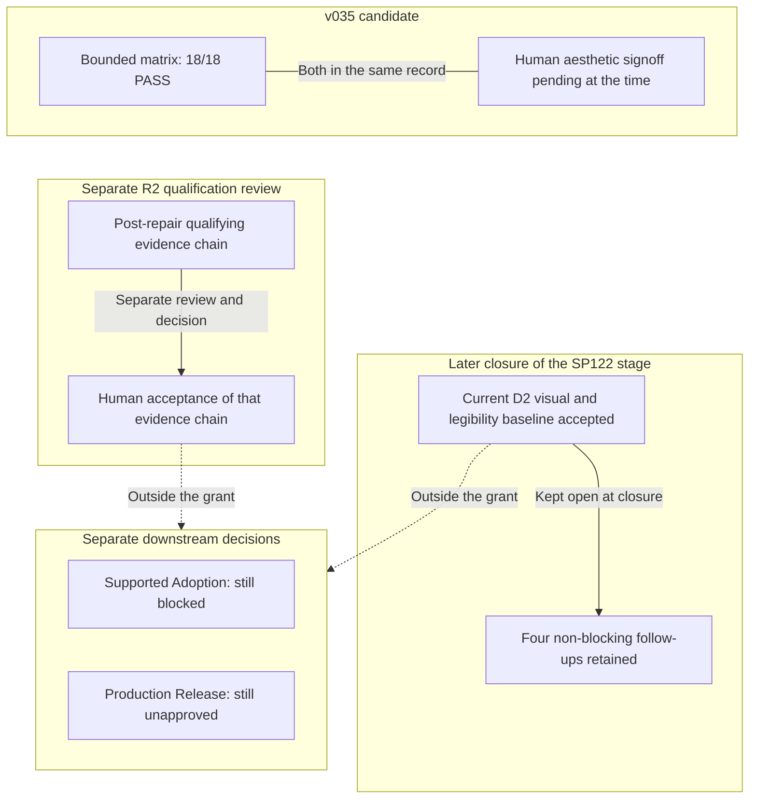
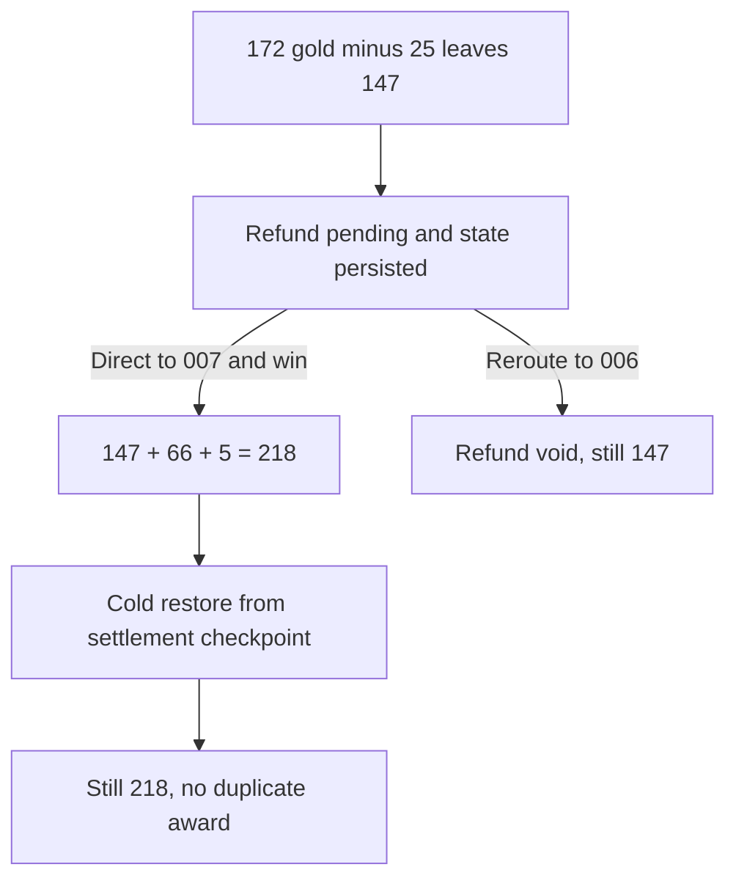

# Chapter 23. A Longitudinal Case in AI Game Dev OS, lessismore, and RandomHeroes
## Failures, Corrections, and Bounded Conclusions

This chapter follows AI Game Dev OS v4.94 and lessismore SP122, then adds named episodes from the three projects in October and November 2026. The projects share an author, methods, and feedback. They let us examine how the work evolved within that history. Independent replication, effects on speed, quality, safety, and cost, and any decision to change AI Game Dev OS would require a separate basis.

It is easy to write a case study by taking a set of concepts and finding features with the same names. The system has an Intent document, a Context Pack, Review, a Gate, Memory, and a Dashboard. The table looks complete. But it leaves the important questions unanalyzed. Did the mechanism enter real execution? Which decision did it protect? What did it leave that someone could check? What did it cost? What happened when it failed? What did a person accept, and which downstream decisions were still open?

> **A case constrains a theory only when its preserved history can also show where the theory fails to explain, predict, or justify a conclusion.**

Two related histories carry the early part of the chapter. In lessismore SP122, machine verification, visual judgment, sprint closure, qualifying evidence, adoption, and production release came apart. In AI Game Dev OS v4.94, a real verification defect, stalled governance work, failed attempts, rejected scope, bounded tests, and a `NON_QUALIFYING` closure all formed part of the recovery.

Sections 23.12–23.25 cover SP122. Sections 23.26–23.43 cover v4.94. Section 23.44 examines the later design, isolated delivery, visual work, evidence use, retrieval and compression, rule changes, and local adoption. The case map in 23.11 connects each episode to its question. They involve different dates, parameters, and acceptance targets. In particular, the 30-gold paper design and the five-gold refund feature are distinct proposals. SP139 has its own closure status.

For changes like these, which cross lifecycle stages and authority boundaries and supply inputs to later decisions, I would name the current Work, applicable Authority Grant, Evidence, Decision Target, and conclusions that remain open. That is a recommendation drawn from this history.

---

## 23.1 What the Case Needs to Preserve

### Necessary

A case that carries an argument needs an identifiable repository, version, Work, and time range. Keep observation, judgment at the time, later inference, and current recommendation distinguishable. Preserve the roles of Plan, Attempt, Result, Acceptance, Adoption, and Release. Show failures, `non-result`, open items, rejected scope, and explicit limits. Record what a person decided, under which authority, and which downstream actions remain unauthorized. Include alternative explanations and the limits of what the evidence supports.

### Useful

When events span versions, roles, and repositories, preserve versioned sources, transactions, reviews, runtime results, and human decisions. An event timeline and a limited map from episodes to theoretical questions can help. Compare the plan with what happened, preserve artifact changes around failures, and select screenshots, diffs, and diagrams that change a judgment. Offer transfer questions readers can answer in their own projects.

### Optional

A case can omit a complete feature tour, an inventory of every agent, task, thread, and commit, or copies of all artifacts. It also needs no one-to-one mapping from concepts to features, maturity score, proof that every step involved agents, enterprise reference architecture, or automatically generated operating-system roadmap. Select material that constrains the conclusions.

---

## 23.2 A Longitudinal Case Follows Events Over Time

A *Longitudinal Case* follows how problems, corrections, and decisions change across named versions and events. The term describes how we observe the work. The independence and evidentiary strength of the observations are separate questions.

AI Game Dev OS supplies workflows, schemas, policies, runtime components, and governance mechanisms. lessismore uses some of those mechanisms at identifiable versions in a game project. Problems in the game and in OS development then affect how I understand the mechanisms.

That relationship lets us watch concepts emerge from work. The author and methods overlap, concepts influence system names and designs, the repositories have direct adoption and feedback links, and later ideas can change how I interpret earlier events. Use the material to generate concepts, expose boundaries, preserve counterexamples, and identify questions for further testing.

---

## 23.3 What Each Project Contributes

### AI Game Dev OS

AI Game Dev OS contributes methods and infrastructure. It holds plans, proposals, reviews, transactions, closure, Context, Authority, Evidence, gates, lifecycle structures, agent roles, handoffs, and visible task records. It also preserves incidents, source, tests, and decisions from v4.94 development. The events here refer to that historical slice. Read their semantics, implementation, and constraints from the records that existed at the time.

### lessismore

lessismore contributes a Godot game runtime and the product conditions around UI, art, content, game design, and QA. The records include versioned PlayerStatus and Battle Visual candidates, machine checks, visual captures, manual inspection and human experience judgments, SP122 closure, and a separate v4.93 project-side qualifying decision. The early episode concerns the D2 Battle and v4.93 scopes as they stood then. Later sprints and visual versions have their own decisions.

### RandomHeroes and the later material

RandomHeroes adds economic measurement of a Godot settlement chain, a review of GDD organization, and local v4.98 adoption and recovery notes. These episodes let us compare how similar problems arise under different product conditions. The projects still share an author and methods.

Later lessismore episodes cover explanation generation, retrieval and governance feedback, specialist design, isolated feature delivery, and SP139 visual work. Later DevOS materials cover method comparisons and a limited beta distribution. Section 23.44 treats each named task on its own terms. SP122 and v4.94 keep their original periods, decisions, and open items.

### The relationship among the projects

AI Game Dev OS supplies some methods and infrastructure and also has its own development history. lessismore and RandomHeroes provide product conditions and feedback. DevOS participates in that exchange. Identify separately the project, worktree revision, candidate package, local binding, operational use, and qualification judgment.

---

## 23.4 The Unit of Analysis Is the Episode

A whole project is too broad a subject for these judgments. A *Case Episode* is a bounded period tied to named Work, a revision, something observed, a decision, and the limits of what follows from it.

| Field | Question |
|---|---|
| Work | What were people trying to complete? |
| Decision Target | What did someone need to decide? |
| Authority | Who could execute, review, accept, adopt, or release? |
| Observable Result | What actually happened, and what did not occur? |
| Contemporaneous Judgment | How was it interpreted and handled at the time? |
| Retrospective Inference | What explanation can we now draw within scope? |
| Counterevidence | Which observations weaken the explanation? |
| Non-claim | Which conclusions remain unsupported? |

Ask when a mechanism entered named work, which path it took, what decision it protected, and what result it left.

---

## 23.5 Four Kinds of Statements in the Case

### Observable Fact

An *Observable Fact* is recorded directly in source, an artifact, a runtime observation, a test, a diff, a commit path, or a visible human decision. Examples include a record of `18/18 PASS`, an open Human Aesthetic Signoff, a verifier failure before target launch, commits confined to governance records, or a closure that retained `NON_QUALIFYING`.

### Contemporaneous Judgment

A *Contemporaneous Judgment* is an interpretation or disposition recorded at the time by a reviewer, person, or project. A person may accept the current visual baseline, refuse scope, classify a follow-up as non-blocking, or record an incident.

### Retrospective Inference

A *Retrospective Inference* is a later explanation drawn from several events. For example, imposing the full E2 and E3 proof obligations prematurely on E0 and E1 work may have contributed to the standstill. That is an interpretation of the record. The causal mechanism was not directly observed at the time.

### Current Recommendation

A *Current Recommendation* is a proposed design drawn from observations, decisions, and alternative explanations. For instance, each gate can name the Claim, Evidence Use, and Decision Target it protects. The proposed practice still needs application and evaluation.

---

## 23.6 Identify the Source Before Completing the Story

Identical filenames can refer to different states at different revisions. A `PASS` depends on test selection, environment, input, package identity, and decision use.

The underlying evidence identifies the source repository, historical revision, artifact path, project or OS version, worktree and review state, result scope, and explicit limits. In the narrative, describe those boundaries in terms a reader can follow. Refer to PlayerStatus v035’s checks at the time, the SP122 closure decision, the independent post-repair v4.93 R2 decision, the v4.94 commit path from D-073 through D-075, or the bounded F4a test selection. This precision preserves what was unknown at the time and keeps later interpretations from supplying historical motives.

---

## 23.7 Why Game Development Helps Expose These Boundaries

A game project brings code and runtime, UI and aesthetics, design, content, balance, interaction, import and localization, tooling, automated tests, captures, playtests, and cross-role handoff and release decisions into one product cycle.

In a code-only account, a test pass can easily become shorthand for a completed task. For PlayerStatus, a machine can inspect geometry, bindings, state transitions, and specified regressions. A person with authority still needs to assess the visual hierarchy, legibility in battle, and whether interaction fits the experience. Machine evidence can narrow the human judgment. The authority to decide experience, scope, adoption, and release comes from the applicable grants.

---

## 23.8 What These Game Cases Leave Open

The case covers specific game development work. Clinical decisions, medical devices, regulated financial models and transactions, public infrastructure, large-enterprise approvals and labor relations, law across jurisdictions, independent team adoption, large user studies, and long-term operations, disaster recovery, and production safety all require their own evidence.

Visuals, experience, content, and collaboration are prominent here. Other domains may present stronger safety, compliance, rights, maintenance, or irreversibility concerns. Use these episodes to see how the control relationships work under the conditions actually observed.

---

## 23.9 Where the Original Feature Map Became Circular

The earlier draft paired the concepts with system features.

| Concept | Corresponding design in the earlier draft |
|---|---|
| Intent Engineering | Doc as Intent |
| Truth Architecture | Code as Truth |
| Context Engineering | Context Packs |
| Agent Organization | Controller / Lead / Worker |
| Verification | Review Agent and Evidence-driven DoD |
| Governance | Gate and Automation Default Off |
| Traceability | Registry and Handoff |
| Memory | LTM |
| Evolution | Self-Evolution |
| Cognition | Change Summary, Risk Map, Decision Surface |
| Observability | Timeline, Dashboard, Checkpoint |
| Reliability | Branch, Worktree, Sandbox, Rollback |

The mechanisms and concepts evolved from the same work. If the mechanism then serves as validation of the concept, the reasoning runs in a circle.

~~~text
experience produces a concept
→ concept influences OS terminology and design
→ OS contains similarly named mechanism
→ mechanism is used to validate the concept
~~~

The naming correspondence can show consistency of design intent. Runtime effects, the adequacy of a boundary, and wider validity each need independent support.

---

## 23.10 What a Mechanism’s Presence Establishes

| Mechanism | What it can show | What still needs evidence or authority |
|---|---|---|
| Intent Document | A place to record intent | Who owns intent and can decide |
| Code | A source for implementation state | Truth across all surfaces |
| Context Pack | A container for selected information | Accuracy, selection, and actual agent use |
| Controller / Lead / Worker | Role labels or proposed assignments | Decomposability, authority, and organizational effectiveness |
| Review / DoD | Checks and completion criteria | Acceptance of findings, adoption, or release |
| Gate | A condition or blocking point | Sufficiency, proportionality, or cost of governance |
| Registry / Handoff | Some external records | A complete decision environment or assigned responsibility |
| LTM | Durable storage | Suitability, adoption, or behavioral benefit |
| Self-Evolution | Ability to produce change candidates | Improvement |
| Summary / Dashboard | Compression and a view | Human understanding, complete coverage, or correct authority |
| Branch / Sandbox / Rollback | Isolation and recovery mechanisms | Adequate bounds, recoverability, or reliability |

For each mechanism, ask where it actually entered an episode, what it supported, what it cost, and what failure or open question remained.

---

## 23.11 A Map of Episodes and Questions

| Episode | What is observable | Question | What it can support | What remains open |
|---|---|---|---|---|
| PlayerStatus v035 | Implementation, automatic checks, capture, pending human gate | Machine evidence and human decision | Separate grounds for the two judgments | Optimality of v035 |
| SP122 Closure | A person accepted the baseline and retained four follow-ups | Scope and closure | Closure with open items | Final art or production approval |
| v4.93 R2 | Authority repair, qualifying package, human decision | Evidence use and adoption | Evidence acceptance distinct from adoption | Necessity or efficiency of the full procedure |
| D-048 | Verifier self-mutation, target `non-result` | Evidence generation | Observation integrity and target result are distinct | Whether every tool must have zero side effects |
| D-073–D-075 | Meta-only successors without delivery evidence | Governance economics | Activity distinct from delivery | General ineffectiveness of governance |
| D-079 | 42 tests passed, scope refused, forward correction | Evidence and acceptance | Test outcome distinct from scope acceptance | Whether fewer tests are preferable |
| F1–F4a | Source, replay, identity, 48 passes, `NON_QUALIFYING` | Lifecycle and qualification | Development closure distinct from qualification | Production readiness |

The two early histories retain their timelines. For the later episodes, Chapters 16 and 20 develop the method comparison and measurement. This chapter uses those results to constrain the historical interpretation.

| Later episode and date | Where to read | Question | What remains open |
|---|---|---|---|
| Specialist design, November 1 | 23.44.2 | Does a paper purchase threshold survive project calibration? | Implementation of the 30-gold proposal or changes in player choice |
| REWARD-FU05, November 19 | 23.44.3 and Figure 23-2 | Can the direct path, detour, and cold recovery be checked separately? | Integration into the main project or sustained observation |
| Recent SP139 visual work | 23.44.4 | How do direction, integration, technical checks, and experience acceptance differ? | Sprint closure or broad art productivity gains |
| CardInformation, October 27 | 23.44.5 | What should a QA applicability failure block? | Whether governance failures generally leave the product unaffected |
| OBS16–18 retrieval and November GDD review | 23.44.6, Chapters 12 and 15 | Can the retrieved and organized material answer the original question? | Full recall or resolution of conflicting document authority |
| Daily development rules, October 25 | 23.44.7, Chapter 21 | What changed in reuse, rerun, and stop conditions? | Actual total cost reduction |
| November method and product measurement | 23.44.7 and 23.56, Chapters 16 and 20 | Which conclusions can a bounded difference support? | Sustained benefits of the full process |
| v4.98 Beta and local binding, November | 23.44.8, Chapter 22 | What do distribution, binding, and full qualification each establish? | Applying later capabilities to earlier qualification |

Each row has its own question, source, and boundary.

---

## 23.12 What SP122 Needed to Decide

PlayerStatus is part of the battle interface. It handles layout, asset binding, state display, consumable interaction, visual hierarchy, and legibility during play.

“Have AI improve Player Status” leaves the work underspecified. Which candidate and scenario matter? How do we check geometry, binding, and state regressions? What does a capture establish? Who can accept the look and feel? Does the current acceptance also cover final art, system adoption, or production release?

In SP122, the question was how to accept a piece of work that spans runtime, visuals, machine checks, and human aesthetic judgment within the current stage while retaining follow-ups and downstream adoption and production decisions.

---

## 23.13 The Thirteen Steps Reconstruct a Possible Workflow

The original draft proposed this sequence.

~~~text
Human Intent
→ Controller
→ Git State
→ Context Pack
→ Plan Review
→ Worker
→ Checkpoint
→ Review Agent
→ Cognition Layer
→ Human Visual Decision
→ Merge
→ Decision / Memory
→ Skill / Pack Update
~~~

It is an illustration of a possible lifecycle. For SP122, the preserved evidence supports a different and less orderly set of relationships.

~~~text
scoped visual work
→ multiple candidates and bounded checks
→ runtime / visual evidence while Human aesthetic gate remained open
→ an authority defect preserved and repaired
→ Human current-stage closure of the repaired baseline with four follow-ups
→ separate post-repair qualifying run
→ Human accepts qualifying evidence
→ adoption and production remain blocked
~~~

A plan establishes what someone proposed. Participation depends on evidence of who did what, and a merge records integration of code. Sprint Closure, Memory Promotion, Qualifying Evidence, Supported Adoption, and production each need their own basis and decision.

---

## 23.14 PlayerStatus v035 Passed Machine Checks While Visual Signoff Was Open

The v035 record at the time includes a committed implementation, binding and geometry constraints, a bounded `18/18 PASS` matrix, a non-headless visual capture, and manual inspection. Human Aesthetic Signoff was still open, and the formal lifecycle for multiple potions remained a separate question.

| Result surface | What the record showed | What remained open |
|---|---|---|
| Machine checks | The selected checks passed | Correctness of all behavior and visuals |
| Visual capture and inspection | A named scenario was captured and inspected | Acceptance of the visuals by the person with authority |
| Human gate | A decision was still pending | The visual decision itself |

At that point, the candidate had a machine-checkable result and an open visual decision.

---

## 23.15 What the 18 Passes Covered

`18/18 PASS` is easy to read as “everything passed.” The denominator counts the 18 checks selected at the time. Other resolutions, devices, game states, potion combinations, animations, input timings, aesthetic preferences, player populations, and maintenance conditions were outside that count.

For the named version, environment, and matrix, all 18 selected checks passed. Human Aesthetic Signoff still had to address the chosen visual decision. Stating the scope keeps the result useful for the questions it can actually answer.

---

## 23.16 What Visual Capture Contributes

Screenshots and contact sheets can show that a candidate ran and produced visible output. They let a reviewer compare layout, occlusion, and state differences, approach visual judgment without rereading all the source, and bind review to a version and scenario.

Aesthetic quality, legibility throughout combat, player preference, final visual direction, production art completion, and coverage of all runtime states need further evidence or a decision. Visual Capture provides input to the Human Decision Interface. How useful it is depends on selected scenarios, version identity, missing states, and presentation.

---

## 23.17 SP122 Closure Accepted the Current Stage’s Baseline

A later human decision closed the current D2 Battle visual and legibility scope. The accepted baseline included PlayerStatus v035 and the lifecycle-tag repair. Four follow-ups stayed open as non-blocking. Section 23.18 describes them and Figure 23-1 shows how the decisions relate.

The authorized closure applied to the current stage. Final Production Art, independent Qualifying Provenance that remained unfinished at that time, v4.93 Supported Adoption, Production Release, and v4.94 Kickoff stayed outside its scope.

---

## 23.18 What Happened to the Four Follow-ups

The [SP122 closure record](../../Evidence/receipts/ER-20260827-001__CLM-C23-001.md) identifies the open work and where it could go next.

| Follow-up retained | Intended handoff |
|---|---|
| Potion focus Tooltip parity | A later scoped accessibility task |
| Old CardFace smoke check needs an update | QA maintenance |
| Nondeterminism in the drag-and-drop test fixture | QA maintenance |
| Final hover, selection, and reward-return visual bindings | The next relevant Battle visual task |

A person judged these items non-blocking for this D2 scope. Closure accepted the baseline and left accessibility, check maintenance, and visual work with their next owners. The record preserved the issues and left adoption and release to separate authority.

The drag fixture’s uncertainty thus remains visible as QA work. The source gives no detailed risk justification for each follow-up. Another project should assess a similar issue against its own Claim, risk, Authority, and Decision Target.

---

## 23.19 Read Each Decision in Its Own Scope

Placing test passes, closure, and qualifying evidence acceptance on a single staircase suggests each event automatically permits the next. The SP122 records describe decisions about different objects.

### Figure 23-1 Different Decisions in the Same Case

*Historical relationships drawn from the [two scoped human decisions in SP122](../../Evidence/receipts/ER-20260827-001__CLM-C23-001.md). An undirected line shows coexistence, solid arrows show a named disposition relationship, and dashed arrows mark the limits of downstream authorization. The groups show decision objects. The candidate’s pending signoff remains part of history. The later closure accepted the D2 baseline containing v035 and the lifecycle-tag repair. Final Production Art and v4.94 Kickoff stayed outside its scope.*

Start with the question. If it is whether v035 had visual acceptance at that time, read the pending status in the candidate record. If it is whether the D2 stage later closed, read the closure. R2 separately accepted a post-repair qualifying evidence chain.

For a handoff, identify the current target, then find the evidence and authorized decision for the relevant version. Keep a missing decision pending or blocked. Use an existing acceptance within its stated scope and give the four follow-ups their own tracking. This is a proposed way to use the case.

A single `closed = true` would lose those relationships. Chapter 21’s transition network is meant to retain them. This history shows why a single status is insufficient for the case. Completeness of the proposed model remains a separate question.

---

## 23.20 The Lifecycle-tag Repair Gives Authority a History

A later Authority Review preserved conflicting sources from earlier work. An old implementation influence entered the runtime path. The project selected a human-approved source chain, performed the repair, and bound current authority to the corrected sources.

The record retains the old conflict and its observed influence, the repair, a reviewer’s judgment that the current source conflict was resolved, and the later qualifying task’s use of the corrected chain. It leaves open what an audit might have missed, unseen effects of the conflict, whether other UI work calls for comparable review, and which earlier evidence would need to be collected again.

Authority depends on the version, scope, decision-maker, expiry, and the effect of historical conflicts on the present question.

---

## 23.21 Preserve the Evidence From Before the Repair

A change to a source that carries authority can tempt a team to erase the old influence, overwrite evidence with results from after the repair, or remove all older evidence. SP122 retained the relationship.

~~~text
historical authority conflict
→ observed influence
→ selected current authority
→ repair
→ post-repair evidence generation
→ separate Human Decision
~~~

Old results can still support a claim about what happened then. A claim about qualification under the corrected authority needs evidence for that basis.

For an Authority Change that may affect a claim’s inputs, identify which evidence still supports the historical claim, which observations need to be made again, and which material is inapplicable to the current decision.

---

## 23.22 v4.93 R2 Had Its Own Decision Target

After closure of the current SP122 stage, an independent post-repair R2 qualification run recorded the corrected authority chain, bounded plan and visible assignments, machine checks and Result Manifest, the human disposition of the qualifying evidence chain, and explicit adoption and production boundaries.

A person accepted the R2 qualifying evidence chain. The earlier Sprint Closure still concerned visual and legibility work. Supported Adoption and Production Release retained their own decisions.

The two questions were whether the current D2 Battle visual and legibility scope could close, and whether the post-repair qualifying evidence chain could be accepted. The same person could participate in both decisions.

---

## 23.23 What Acceptance of Qualifying Evidence Establishes

An evidence package may be accepted because its sources can be located, plan and results can be reconstructed, machine checks meet the declared scope, human review is complete, and limits are explicit.

Making it the default project path calls for decisions about migration cost, backups and recovery, team readiness, maintenance, exit, and production. SP122 R2 kept Supported Adoption blocked and Production Release unapproved. The qualifying decision succeeded within its evidence use.

---

## 23.24 Four kinds of conclusion from SP122

### Observable Fact

PlayerStatus v035 had bounded machine, runtime, and visual evidence while the Human Aesthetic Gate remained open. A person later accepted the current D2 Battle baseline and kept four follow-up items. The separate R2 review then accepted the corrected qualifying evidence chain. Adoption and production remained separate decisions.

### Contemporaneous Judgment

The person judged the visual and readability scope acceptable for the current stage. They also judged the R2 qualifying evidence chain acceptable. Each decision expressly limited what followed from it.

### Retrospective Inference

The history distinguishes the Decision Targets for machine PASS, human aesthetic acceptance, sprint closure, qualifying evidence acceptance, supported adoption, and production release.

### Current Recommendation

For Work that depends on both machine checks and human judgments of experience, give each decision its own scope, authority, evidence use, open items, and conclusions beyond scope.

The four kinds of conclusion belong to the same history. The broad statement “AI Game Dev OS successfully optimized the UI” would lose what each establishes.

---

## 23.25 What SP122 leaves open

SP122 does not establish any of the following.

- PlayerStatus v035 was the final or universally best UI.
- `18/18 PASS` covered all aspects of experience and runtime state.
- The original thirteen-step workflow ran completely and in order.
- Using multiple agents was necessary for the result.
- AI improved development speed, quality, safety, or cost.
- The four follow-up items necessarily belonged outside the blocking conditions.
- Every field of the Qualifying Manifest was necessary.
- The same workflow suits all games or software projects.
- Every low-risk step needs human review.
- The visual acceptance predicts final player preference.

A conventional UI and QA workflow can also use a plan, screenshots, tests, review, and scoped closure. Attribution to the AI-native method would need a matched comparison.

---

## 23.26 v4.94 concerns the development of the OS itself

The second case follows how v4.94 developed its own governance. The system being changed also supplied some of the language for planning, review, evidence, and disposition.

That creates two risks of circular inference.

1. Taking complete governance artifacts as proof that the governance worked.
2. Reading eventual closure as confirmation that every earlier design choice was a necessary step.

The v4.94 timeline therefore retains the actual defect, successors that produced only governance artifacts, failed runs, excess scope, bounded passes, and incomplete qualification.

---

## 23.27 The v4.94 timeline

~~~text
D-048
verifier self-mutation
target not observed
        ↓
D-073–D-075
governance / proof obligations expand
package source and test evidence do not appear
        ↓
D-076
scoped and retractable recovery candidate
        ↓
D-077
two confined execution attempts fail with SIGABRT/-6
        ↓
D-079
selected tests pass
candidate rejected as over-scoped
smaller forward correction becomes baseline
        ↓
F1–F4a
source freeze → read-only replay → package identity → 48/48 bounded PASS
        ↓
development closure remains NON_QUALIFYING
~~~

The arrows show chronology and follow-on relationships. Causal claims about individual transitions need separate support. The recovery path included failures after D-076.

---

## 23.28 D-048. The verifier changed the surface it was about to inspect

D-048 set out to run a Target Compile Harness. Before the target could run, a local import produced Python bytecode files and changed the closed inventory used to establish authority. A second exact-inventory check failed closed as designed.

There were two results to record.

- Verifier or launcher. Self-mutation occurred and the integrity check detected it.
- Target. Compile never ran. Record a `non-result` for the target.

A single `FAIL` for the attempt could be mistaken for a failed target compile. Treating the preparation steps as irrelevant would hide a real defect. The verifier changed the surface on which its authority check depended.

---

## 23.29 D-048 counterevidence. The strict inventory check caught a real defect

The inventory check detected real self-mutation. Keep that finding alongside the later governance stall when evaluating strict checks.

The correction questions concern the verifier’s side effects, how to record whether target observation occurred, whether the failure belongs to the verifier or the target, which outputs are normal because they are declared and isolated, and whether a corrective run must produce new target evidence.

> When a verifier blocks a target before observation or changes an input or surface used to establish authority, record Evidence Generation Integrity and Target Observation Result separately.

A test tool can produce normal output when the output is declared, isolated, and leaves the inputs to the claim intact.

---

## 23.30 A local defect can grow into a broader proof obligation

D-048 identified one problem. The launcher or verifier changed its own controlled inventory before running the target.

The scope of correction can expand if every possible environment needs proof up front, every qualification condition must close early in development, every successor must add a proposal, review, and transaction, or a candidate must satisfy full gate proof before it even has source.

At that point the work may have shifted from repairing the observer boundary to establishing qualification for the whole system in advance. That is a later interpretation of how the tasks developed. D-048 alone records the local defect.

Is the control still protecting the original claim, or now requiring a result from a different stage of work?

---

## 23.31 D-073 through D-075. Activity grew while delivery evidence remained absent

D-073, D-074, and D-075 were consecutive successors in v4.94. Their version history shows that governance, proposal, review, and transaction artifacts increased while package source and test paths had no corresponding change. The sequence produced no runtime, qualification, or gate evidence. D-075 recorded a Review Union of `0 blocker / 5 major / 0 minor`.

The recorded paths and results diverged in this way. The project later called the sequence a Governance Livelock Incident. That diagnosis is a retrospective judgment. The narrower observation is that the sequence expanded its proof surface and produced no package source, runtime, test, qualification, or gate evidence.

---

## 23.32 Governance artifacts can still carry information

Work that produced no source delta may have clarified risks, exposed conflicting constraints, developed language reused in the recovery plan, improved understanding of the qualification surface, or preserved protection against the defect D-048 exposed.

If the Decision Target is a runnable and observable Development Candidate, ask whether the governance activity continued to delay the actions that could produce evidence for that target.

| Question | What to check |
|---|---|
| What information did a governance artifact add? | Inspect its substance independently of the number of source changes |
| Did the Work produce the target result? | Look for evidence of the result independently of artifact completeness |
| Do the controls match the current stage? | Identify the risks and decisions they protect at this stage |
| Should a control be narrowed? | Assess its scope, effects, and costs beyond a single stall |

---

## 23.33 Governance Livelock is one interpretation of the sequence

The project’s retrospective account was that E0 and E1 development work inherited full E2 and E3 proof obligations too early, and that coupling between stages contributed to the stall. The sequence is compatible with that interpretation.

Other explanations remain possible. The work scope may have been unclear. The D-048 repair may have reached deeper than expected. The team may still have been learning the package boundary. Human authorization changed later, or the later result may have depended on knowledge from the earlier work. Source development itself may have contained unexposed difficulties. Record granularity may have made governance work more visible than implicit design work.

Use “Governance Livelock” to identify the project’s diagnosis. The evidence leaves the relative contribution of the possible causes open.

---

## 23.34 D-076. A recovery candidate with explicit scope and a route to withdrawal

The later Function-first plan distinguished the uses of development and qualification evidence. Here *Function-first* means producing a bounded, runnable, observable Development Candidate, then adding proof in proportion to a named stage. The Safety Envelope remained in the plan.

The proposed evidence boundaries were:

- Development Spec
- Safety Envelope
- Qualification Lock
- Run Evidence

D-076 was a scoped, retractable architecture candidate. Its scope covered a part of governance. If later results disagreed with the proposal, the project could withdraw or correct it.

The plan recorded a proposed change in work order and proof obligations. Decisions about the results and evidence of effectiveness remained open.

---

## 23.35 D-077. Two attempts still failed after the stage split

After the architecture was split by stage, two confined execution attempts ended with `SIGABRT/-6`. The stage split did not produce immediate execution success. Keep the plan, Safety Envelope, runtime outcomes, and later evidence distinct. The failed attempts remain part of the execution history.

The failures also limit what the case can establish about Function-first as the cause of recovery. Later progress may follow changes in scope, environment, source, execution methods, human direction, or further debugging. The records cannot identify the relative causal weight of those factors.

---

## 23.36 D-079. The tests passed and the source scope was declined

One D-079 candidate passed 42 focused tests. The human decision declined it as the E1 source baseline. The disposition said it brought E2 or gate-level schema mirroring and a broader verification surface into a low-risk E1 slice.

A smaller forward correction retained eight D-079 regression cases and entered the later F1 source ancestor chain.

| Judgment | Result |
|---|---|
| Selected behavior tests | All 42 passed |
| Candidate scope | Declined |
| Forward correction | Became an ancestor of the later development baseline |

A pass describes the 42 named tests on that run. Accepting the implementation scope requires a separate decision.

---

## 23.37 What D-079 leaves open about the smaller implementation

The version diff shows that the over-scoped candidate expanded the implementation and tests. The Forward Correction removed much of that material and retained a smaller regression set. These differences help identify a scope change.

Long-term correctness, test efficiency, and defect cost require their own evidence. Some deleted checks could become appropriate in E2 Qualification. Another project could reach a different scope decision.

The named D-079 test pass supplies evidence for the assertions encoded in that run, within its bound scope. Source-scope Acceptance, Adoption, and Release Authorization each require their own decisions.

---

## 23.38 F1 froze the development source

F1 created and accepted a named Source Freeze. It gave F2, F3, and F4a a fixed package subtree and reduced the chance of the object silently changing during verification.

The freeze supplies the development source identity, the input boundary for replay and testing, and a basis for reconstructing the diff and ancestry. Runtime behavior, qualification, migration, backup and recovery, and Production Adoption have separate checks and decisions.

---

## 23.39 F2 observed project-side use through read-only replay

F2 observed the source in a read-only project replay. Read-only access limits whether the observation can change the project or package source in return.

The replay gives a bounded result in a named project context. It connects input, package, and replay environment and helps distinguish verifier and target boundaries. Migration across projects, full runtime coverage, equivalence with production, and project adoption remain open.

---

## 23.40 F3 connected the source to the result

When a test result cannot identify its package, it is hard to reuse. F3 created a Package Identity binding:

- Source Freeze.
- Replay Input.
- Test Selection.
- Closure Result.

The identity reduces ambiguity about what version was tested. Target fit, dependency trust, release authority, and later drift require further evidence. Package Identity is one part of trace and a starting point for supply-chain, security, or adoption decisions.

---

## 23.41 F4a supplied bounded evidence through `48/48 PASS`

F4a recorded `48/48 PASS` for a selected set of 48 tests. The result can be traced to F1 Source, F2 Replay, and F3 Package Identity.

Read it with the denominator in view. This run supplies evidence for the assertions encoded in those 48 tests. Historical Qualification, migration, backup and recovery, F4b, PC-0, and the full Gate were outside the selected result. Production Adoption remained a distinct decision. The value is in knowing precisely what the result covers.

---

## 23.42 What `NON_QUALIFYING` permits the closure to say

The final Development Closure carried `NON_QUALIFYING`. It allowed acceptance of F1–F4a Development Evidence and closure of the current development scope. Additional qualification work stayed open, and Production and Gate claims remained outside the use of `48/48 PASS`.

A bounded pass and a qualification boundary can coexist.

~~~text
bounded development evidence = accepted
qualification claim = not made
production adoption = not approved
~~~

---

## 23.43 Four levels of conclusion for v4.94

### Observable Fact

The D-048 verifier changed itself before the target, which went unobserved. D-073 through D-075 produced governance artifacts without a package source or test delta. D-077 had two bounded failures. D-079 combined a test pass with source-scope rejection. F1–F4a produced bounded development evidence and kept `NON_QUALIFYING`.

### Contemporaneous Judgment

The project identified the D-048 integrity defect and later recorded D-073 through D-075 as governance livelock. It specified the D-076 path as scoped and retractable. A human declined the over-scoped D-079 implementation.

### Retrospective Inference

Coupling proof obligations from different lifecycle stages may have contributed to stalled delivery evidence. Narrowed scope, accumulated knowledge, and changes in human authorization may also have helped the subsequent recovery.

### Current Recommendation

A gate or review should name the claim it protects, the stage, Evidence Use, and Decision Target. Keep the Protected Floor and narrow, split, delay, or redesign controls that do not fit the present purpose.

---

## 23.44 Early counterevidence and recent bounded cases

### 23.44.1 Keep the evidence that complicates recovery

A short account could say heavy governance stalled the work, Function-first solved it, and 48 tests passed. The record supports a narrower explanation. It also shows:

1. The strict D-048 check caught actual self-mutation.
2. D-077 failed twice after the architecture was split.
3. Lean Governance Activation did not by itself prevent later over-scoping.
4. The smaller D-079 implementation became the next baseline. Its long-term superiority remains open.
5. F1–F4a stayed `NON_QUALIFYING`.
6. There is no matched comparison of time, rework, defects, human waiting, or cost between the workflows.
7. Narrower scope, accumulated knowledge, and changed human direction may all have helped.
8. Function-first may have deferred some proof obligations into later qualification work.

The coupling between stages remains a plausible contributor, alongside other explanations.

### 23.44.2 Check the assumptions that can change a design choice

A November 1 lessismore design task asked how an extra reward might change route selection. The paper candidate offered 30 gold on a designated victory. The [saved paper calculation](../../Evidence/receipts/ER-20261122-006__CLM-C23-002.md) made several assumptions.

Start at 10 health, with a cap of 12, and 5 gold. Normal route N reaches an entry shop, a normal battle, then a shared shop. The battle costs 3 health and gives 10 gold. Elite route E costs 8 health and gives 18 gold, then reaches the same shared shop. Declining the offer gives 20 gold immediately. Accepting forfeits that 20 gold and pays the extra 30 only after the target elite victory. The paper shop guarantees a 50-gold upgrade and a 20-gold heal of 6 health, subject to the cap. Compare outcomes in this order: survival, obtaining the upgrade, remaining health, remaining gold. These are assumed preferences.

Compare all routes **after shopping at the shared shop**.

| Choice | Arrival (health, gold) | Outcome after shopping |
|---|---|---|
| Decline → N | `(10−3, 5+20+10) = (7,35)` | Heal to 12 health with 15 gold, no upgrade |
| Decline → E | `(10−8, 5+20+18) = (2,43)` | Upgrade unaffordable. Heal to 8 health with 23 gold. |
| Accept → N | `(7, 5+10) = (7,15)` | Neither purchase affordable. Remain at 7 health and 15 gold. |
| Accept → E | `(10−8, 5+18+30) = (2,53)` | Buy upgrade. Remain at 2 health and 3 gold. |

Under those priorities, N is better after declining. Accepting and choosing E is the only combination that affords the upgrade. The choice is between 12 health and 15 gold without the upgrade and 2 health and 3 gold with it. The health difference is 10 at the shared endpoint. The relevant threshold is 50 gold: a bonus of 26 gives 49, and 27 reaches 50. At 20 starting gold, declining on N also affords the upgrade, so the flip disappears. At 4 starting health, the elite fight kills the player before the reward could help.

The [delivery and calibration record](../../Evidence/receipts/ER-20261122-006__CLM-C23-002.md) then checked the assumptions against project resources. The warrior had 80 health. The guaranteed card-removal service started at 75 gold and rose after each use, and removal eligibility still applied. A 59-gold item was not guaranteed to appear. A small potion did not create an out-of-combat healing opportunity. What matters is where the player reaches a purchase, what is available then, and what obtaining it costs.

The paper comparison lost two key steps. At 53 gold the player had no guaranteed 50-gold upgrade, and declining to take N no longer led to an in-shop heal to 12. Substituting the 75-gold removal service still requires a new calculation. Suppose both routes survive to the shop and the service is available at the same price. Let `G` be gold before the event and `R_E` and `R_N` the net gold gained by the elite and normal routes before the common purchase. These increments exclude the event's 20 or 30 gold, include spending along the way, and use actual receipt time. For declining on either route to leave the service unaffordable while accepting on E makes it affordable, both `G + R_E + 20 < 75 ≤ G + R_E + 30` and `G + R_N + 20 < 75` must hold. The first gives an integer window of 45–54 for `G + R_E`. The saved record does not show a real route in that window, and removal eligibility still needs checking.

The next question became how much net gold each route brings to the same real purchase window and which options are available. The 30-gold version remained a candidate and did not enter the official event pool. Some project resources later changed, and the full old route was not reconstructed. This is a record of calibration and disposition at the time.

For a similar design, list the assumptions that can flip the choice and check them against real purchase opportunities and resources. If a decisive premise is unsupported, retain the candidate or change the question. The investigation is worth its cost when that premise could change the product decision.

### 23.44.3 Verify direct travel, rerouting, and reopening separately

The November 19 REWARD-FU05 task had a different purpose and parameters. After paying, reaching 007 directly and winning grants a 5-gold refund. Rerouting to 006 voids it. Reopening must not grant the reward again.

The [isolated runs and human acceptance record](../../Evidence/receipts/ER-20261122-006__CLM-C23-002.md) identifies a separate application ID and user directory, and retains reports, logs, and checkpoints from four native processes. The machine path paid 25 from 172 gold, leaving 147. On direct victory, the ordinary 66 and extra 5 brought it to 218. A cold restore from settlement still showed 218. Rerouting left 147 and voided the refund. Award, persistence, rerouting, and duplicate prevention each had their own check.

### Figure 23-2 FU05 route outcomes and cold restore

Figure 23-2 summarizes the recorded isolated machine paths. Other exception branches, wider balance, and adoption into the main project remain outside its scope. Experience and delivery scope have separate dispositions.

The saved human record says the user confirmed both the direct 007 and rerouted 006 paths. The user asked to keep the isolated package and saves, hold changes to the main lessismore project, and leave ongoing observation inactive. The two retained human save slots later had identical bytes and both decoded to the state after rerouting to 006. The human result for 007 is supported by the saved confirmation, and its original machine settlement and cold-restore artifacts remain available. The slots cannot serve as two distinct firsthand records.

The delivery shows how to split product behavior into observable results and close a scoped task. Retain the work actually done, the human decision, and the deliverables. Main-project adoption and ongoing observation were outside that decision at the time.

### 23.44.4 Move visual direction, integration, and experience acceptance separately

Recent SP139 materials describe another production process. The [contemporaneous record](../../Evidence/receipts/ER-20261122-007__CLM-C23-003.md) shows rejection of the old white-stone corruption image, followed by a comparison of vines, dangerous energy, and swamp directions using the same original Pride overview frame, position, and size. Holding the camera fixed helped compare direction. These composites preceded product integration.

Vines entered an isolated Godot scene for adjustments to scale, the density of three clumps, orientation, movement cycle, and ground tint. Checks covered routes and nodes, click behavior, and purification state. The technical pass still left visual selection open. Final integration bound three vine clumps and expanded tint to shared terrain and retained the old corruption material. The record says a person confirmed the tint extent. Energy and swamp remained direction studies.

Saved final checks covered 43 items for a fixed seed, 28 for seed 0, and 43 each for two named older V3 saves. They addressed routes and nodes in named layouts, actual clicks, purification rendering, and limited compatibility. Purification checks called the world-clearing operation directly. A full boss victory remains outside that method. The first two rounds of pixel and camera comparisons failed and are still in the history. Later changes corrected comparison state, camera, and HUD interference.

The same period separately accepted the central route, Ilin's landing position, and return focus. Landmark hierarchy and decoration density remained for human judgment, and the sprint stayed open. This review did not inspect the primary human chat or make an aesthetic decision. The process illustrates distinct states for a direction worth trying, integrated implementation, selected passing checks, and human experience acceptance. It leaves the effect of a fixed process on art quality and time open.

### 23.44.5 Decide whether failure affects the product or its evidence

The October 27 [CardInformation diagnosis](../../Evidence/receipts/ER-20261030-001__CLM-C14-001.md) found six description model samples that passed repository integrity checks but fell back to full descriptions after a source digest mismatch. These were generated samples in the Repository–Composer–Reader chain. Actual player hover behavior was outside that record. The old chain used verification coverage to determine whether the product could show a migrated description.

The repair calculated data conditions for display independently of QA applicability. In saved checks, valid inputs still generated the prescribed descriptions while QA was stale or pending. Incorrect source identity, mismatched loaded objects, missing language, and unknown consumers still triggered rejection checks. There were also limited samples in real scenes. Full card, language, experience, and release package coverage remained open.

Determine whether a failure affects input, target behavior, observer integrity, or evidence use before rejecting a request, limiting a conclusion, or verifying again. An actual bad input still has a rejection path. Chapter 9 covers evidence disposition. Chapter 14 covers observation and intervention.

### 23.44.6 Retrieval still has to answer the original question

In a corpus of 22 public historical memories, the [DevOS OBS16–18 limited retrieval trials](../../Evidence/receipts/ER-20261030-002__CLM-C15-001.md) found that AND matching missed full-sentence queries. Extracted identifiers recovered relevant-labeled material on selected positive questions. The rewrite dropped version or negation and missed a file that would have corrected a premise. Later original-source readback let an agent inspect known sources, leaving recall and applicability for separate checks.

Keep the question and its restrictions beside candidate queries. Record what the change loses. Use a comparison set for missed corrective material and let a reviewer inspect the originals. The sample choices and limited scope leave overall retrieval improvement open. [Chapter 15](/chapters/15-en.html) describes preselected questions and checks for both misses and wrong adoption.

A November RandomHeroes GDD review reported missing entry-point details. The merge disposition restored relevant mechanics to the current draft. Section 12.13 uses temporary buff lifecycles to show what was restored and how it could be checked. Document authority still needs a decision, and experience and production approval remain separate. There is no complete independent prereorganization snapshot to attribute the changes to the summary method. Chapter 5 describes the current input-organization method. Here the record preserves the disposition and open matters.

### 23.44.7 Reduce unnecessary checks and keep the measurement gaps visible

DevOS added six routine development rules on October 25, according to the [saved rules history](../../Evidence/receipts/ER-20261030-004__CLM-C21-001.md). One rule defined when relevant evidence can be reused, when a check must run again, and when to stop. The parent version required applicable checks before completion and left these details open. It does not establish mandatory full reruns at every stage or count repetitions. The earlier ambiguity concerned when old results were usable and when the work should stop.

| Topic | Detail retained in the rule change |
|---|---|
| Choosing checks | Check diffs and affected links for documents. For code or contract changes, cover affected behavior and necessary regression cases. Leave unrelated product tests out. |
| Reuse | Reuse evidence when affected source and dependencies, inputs, environment, and assertions still apply. |
| Rerun and stop | New changes, failures, open diagnosis, and applicable gates can require rerunning. Preserve the conditions that distinguish the first failure's possible causes. Stop after applicable checks pass and open questions are resolved. |
| Controls retained | Execution still needs authority. Paused work needs explicit resumption, and an agent cannot accept as a human. Preserve provenance, isolation, resource budgets, failure artifacts, and applicable release and migration gates. |
| What the history records | The diff added rules without removing prior grant and acceptance boundaries. No comparative execution cost was measured. |

The rule replaces a reassurance rerun with an explicit reason to run again and requires an applicability check before reuse. That is intended behavior. A plausible cost shift is less repeated execution and more dependency checking. Net effects need task, human effort, and rework data.

lessismore changed its routine process the same day. It removed old validation matrix content and left a heading and incomplete separator row. That is a separate editing gap, not part of the DevOS commit. Check that trimming a process leaves a usable entry point. The two related projects do not provide independent measurements. [Chapter 21](/chapters/21-en.html) retains the method for narrowing verification. This chapter records the rule, retained controls, and unmeasured effects.

November records sharpen the measurement question. Chapter 16 reports one positive first-draft reward-screen comparison, three tasks without a predefined advantage, and a shared QA error. Chapter 20 records the original RandomHeroes sampling requirement, actual 4,000 automated samples, a probe failure, and a lessismore short-flow result in which total time fell while the maximum rose. Each needs its own purpose, denominator, observed subject, and unmeasured costs. Together they still leave the overall benefit of DevOS open.

### 23.44.8 Later capability leaves earlier qualification intact

The [November local adoption materials](../../Evidence/receipts/ER-20261122-005__CLM-C22-001.md) include a v4.98 Beta candidate package in an independent worktree, build and sealing records, and scope limited to new Godot projects on macOS. Full qualification remained open. RandomHeroes had a local binding marked applied, with no claim of official backup and restore success. Art Kit catalogs, packages, and registration records leave actual art production and experience acceptance open.

RandomHeroes and these later records give more specific examples. Distribution, binding, execution, acceptance, adoption, qualification, and sustained fit still need separate evidence and scope. [Chapter 22](/chapters/22-en.html) updates the capability map. Earlier acceptance and `NON_QUALIFYING` in SP122 and v4.94 remain facts about their own stages.

---

## 23.45 Scope distinctions in the two early cases

| lessismore SP122 | AI Game Dev OS v4.94 |
|---|---|
| PlayerStatus bounded checks | D-079 selected behavior tests |
| Current-stage visual acceptance | E1 source-scope acceptance |
| Sprint Closure | Function-first Development Closure |
| Qualifying evidence acceptance | F4a bounded evidence acceptance |
| Supported Adoption | Qualification / Gate |
| Production Release | Production Adoption |

In this method ecosystem, several decisions needed separate scopes. Other projects can choose lifecycle names and boundaries that fit their work. A result should stay inside the decision its evidence and authority support.

---

## 23.46 Authority Separation asks who judges what

The early SP122 and v4.94 cases show several distinct judging roles.

- Machine validators evaluate coded checks.
- Verifier integrity checks establish whether observation respected boundaries.
- Reviewers produce findings.
- People judge visuals and experience.
- A person or named gate decides Source Scope.
- Adoption Authority decides entry into a supported path.
- Release Authority decides entry into production.

One person can hold several roles. Identify the Decision Target each time. A human action on one decision leaves downstream decisions open. A delegated machine gate can decide a specified target, with adoption, release, and product judgment governed by their own grants.

---

## 23.47 Result Separation asks whose result it was and what a pass supports

The shared-provenance cases use relations from earlier chapters.

| Case relation or record | Earlier type | Meaning |
|---|---|---|
| Verifier Failure | Chapter 8 Failure / Evaluation Result | The observation mechanism failed its own boundary |
| Target `non-result` | Explicit absence of a result in Chapter 8 | Execution stopped before the target, so it had no attributable result |
| Test PASS | Chapter 8 Evaluation Result and potential Chapter 9 Evidence Use | A named test in a named run supports its encoded assertions within scope |
| Scope Rejection | Chapter 9 Decision Record / Disposition | The authority did not accept the implementation scope |
| Visual Evidence | Chapters 6 and 9 Evidence | A named visual output is available for judgment |
| Human Acceptance | Chapter 9 Acceptance Disposition | A person accepts the current Decision Target |
| Evidence Accepted | Chapter 9 Evidence Use / Target-specific Disposition | The evidence package fits the declared use |
| `NON_QUALIFYING` | Explicit Non-claim / Qualification Boundary | The current record carries no Qualification Claim |

An Attempt can produce valid evidence of verifier failure and a target `non-result`. A candidate can have a test pass and a scope rejection. A closure can accept evidence and remain `NON_QUALIFYING`. Interpret each record for its own question.

---

## 23.48 Change Separation keeps improvement open to evidence

| Name | Question it answers |
|---|---|
| Plan, Candidate | What is planned, and what was proposed? |
| Repair, Forward Correction | What was repaired or corrected forward? |
| Accepted Baseline | Which baseline was accepted for a named scope? |
| Adoption | Did an authorized role decide to use the candidate for a specified scope? |
| Sustained Improvement | Do applicable observations support sustained improvement? The cases here leave the claim open. |

A corrected candidate can be adopted within a scope while sustained effects stay unknown. PlayerStatus v035 became the accepted baseline for that stage. Final visual quality needs another judgment. The D-079 correction entered the F1 ancestry. Its long-term maintenance cost remains unmeasured. Function-first produced a Development Closure. Long-term governance improvement remains a question for evaluation. [Chapter 16](/chapters/16-en.html) defines the corresponding change, adoption, and improvement boundaries.

---

## 23.49 Give human involvement a named purpose

The cases show human authority in:

- Intent and product direction.
- Experience and aesthetic judgment.
- Scope acceptance.
- Risk acceptance.
- Exceptions and takeover.
- Adoption and release.
- Conflicts over values and accountability.

Low-risk, reversible checks and migrations with clear boundaries can be expressly delegated to machine gates. Protect consequential decisions from getting lost in compression, defaults, or incorrect gate mappings.

---

## 23.50 Preserve the boundaries of a human decision

A bare `approved` is ambiguous. A Decision Record should specify:

- What was accepted.
- The scope and version.
- Its inputs.
- Open follow-ups.
- Downstream states still awaiting disposition.
- When to evaluate again.
- Who owns the next decision.

SP122 preserved the boundary between current acceptance and downstream approvals in two decisions. A later agent can read those records without inferring adoption or production intent from a label.

---

## 23.51 A Multi-Agent Lane records work and handoff

SP122 R2 retained lane identities, division of work, and a Result Manifest. The record shows:

- The work assigned.
- Which lane produced each output.
- How handoff and integration can be traced.
- The combined result shown to a person.

It leaves speed relative to a single agent, optimal lane count, actual independence, human workload, and fit for other work open. Evaluate multiple agents using decomposability, shared state, conflict risk, independent verification, and integration cost. The case shows a multi-lane structure in use, with visible outputs. Organizational effects need a matched comparison.

---

## 23.52 Context, State, and Trace preserve a limited decision environment

Plans, manifests, reviews, transactions, artifact paths, and Decision Records in the two repositories let a later reader reconstruct part of the history. Unrecorded conversations, uncaptured runtime state, context the agent may have ignored, changes to tools or models, unrecorded attempts, and alternative explanations can remain absent.

Aim to reconstruct the external environment for a named decision within available limits. The record here spans visible task messages, tool activity, outputs, and file changes. Hidden model reasoning is outside that record.

---

## 23.53 Governance Economics counts what controls cost

Governance consumes:

- Human review time.
- Agent tokens and tool time.
- Waiting and coordination.
- Artifact maintenance.
- Rebasing, repair, and retries.
- Context reconstruction.
- Failure investigation.
- Adoption and exit work.

Costs need to be weighed against the risk protected. The D-048 fail-closed check protected an authority-bearing surface. Compare:

~~~text
protected claim and risk
+ expected detection or prevention value
+ failure and recovery behavior
↕
human, compute, waiting, coordination and maintenance cost
~~~

The cases lack full cost data. This is a comparison framework, with the actual effect of Function-first on efficiency still open.

---

## 23.54 Scope a control to current Evidence Use

A control should identify:

- The claim it protects.
- Current lifecycle stage.
- Evidence generated or checked.
- What failure blocks.
- Who can make an exception, override, or retry.
- Which Protected Floor applies.
- When drift calls for another evaluation.

An underscoped gate can miss actual risk. An overscoped gate can bring later proof obligations into exploration or bounded development. Match the control to its purpose.

---

## 23.55 Capability Fitness depends on the workload

A Level 0–5 scheme might rate AI Game Dev OS highly for using multiple agents, gates, trace, memory, and evolution mechanisms. v4.94 shows the questions a score can hide.

- Is a present mechanism used in operation?
- Did governance activity produce delivery evidence?
- Was implementation scope accepted alongside the test result?
- Did development closure include qualification?
- Did adoption sustain fitness over time?
- Was a complex control proportionate?

For the named workload and stage, determine whether the capability boundary is sufficient, excessive, or unknown.

---

## 23.56 The early cases leave overall effects open

For a claim of lasting workflow benefit, define the benefit first and gather a comparison that can test it.

- Comparable workloads.
- Defined old and new workflows.
- The same quality goals, or a way to calibrate them.
- Relevant time, rework, defects, waiting, and review data, with costs and constraints.
- Differences in environment, team, model, and scope.
- Failures and unfinished work included on both sides.
- A post-adoption window suited to the claimed persistence.

Choose measures and duration to fit the question. A bounded comparison of one output defect needs relevant criteria and a comparator. Overall economics requires wider cost data, and sustained fit requires observation over time.

SP122 had no matched non-AI or single-agent UI workflow. v4.94 had no controlled efficiency comparison between old and new workflows. Claims about substantial speedup, quality, governance cost, multi-agent reliability, and Function-first safety remain questions for evaluation.

The November method comparison adds one positive task and three with no predefined advantage, as Chapter 16 describes. Product measurements add evidence for specified measures. The wider workflow, cost, and post-adoption comparison remains open.

---

## 23.57 Turn case facts into transfer questions

The original draft grouped lessons into game-specific, software-wide, and enterprise-governance categories. A label can hide the difference between where a mechanism appeared and where it works.

### Case-specific Fact

- PlayerStatus geometry, Potion Dock, and battle visuals.
- Godot runtime and SP122 D2 scope.
- Project-side qualifying disposition for v4.93 R2.
- v4.94 D-048, D-073 through D-079, and F1–F4a.
- Named artifacts and human decisions from both repositories.

### Transfer Question

- Are Intent, scope, and non-goals explicit?
- Are Context, state, and authority traceable?
- Does evidence fit the current Decision Target?
- Does a measure obscure a needed human experience judgment?
- Are failures, `non-result`, and open items retained?
- Are acceptance, adoption, release, and qualification distinct?
- Are governance and coordination costs proportionate?

### Unvalidated Generalization

The case leaves open claims of enterprise-wide applicability, improved organizational effectiveness with multiple agents, lower cognitive burden with an HCP, better Function-first delivery, safer evidence-heavy work, and Self-Evolution as an organizational endpoint. The questions can travel farther than these conclusions.

---

## 23.58 Answer transfer questions again in the target environment

Before copying an artifact template, establish:

1. How similar are the workload and Decision Target?
2. Which judgments can be automated, and which does human authority reserve?
3. Can the work recover from failure? Are external effects irreversible?
4. Which sources and environments carry authority?
5. What acceptance mapping applies to current tests?
6. Who decides adoption, release, and production use?
7. Who maintains the governance artifacts?
8. Which security, privacy, legal, and organizational boundaries differ from the game case?

Limited transfer depends on similarities in work, risk, decisions, and failure surfaces.

---

## 23.59 Book findings can inform OS change candidates

Writing can reveal problems in AI Game Dev OS. Changes to its repository have their own request and authority.

~~~text
observed case problem
→ scoped retrospective inference
→ OS change candidate
→ intended objective and protected floor
→ evidence and counterevidence plan
→ Human Decision
→ separate implementation request
→ adoption observation
~~~

Candidates could include a clearer Decision Target field, separate Verifier Integrity and Target Result, Evidence Use by stage, explicit non-claims in closure, governance cost observation, and named bounds on human decisions. Each still needs disposition before entering a roadmap.

---

## 23.60 Choose visual material that affects the judgment

Possible versioned material includes:

1. PlayerStatus v035 contact sheet.
2. SP122 current-stage battle review packet.
3. A before-and-after diagram of the lifecycle-tag repair.
4. D-073 through D-075 path-class timeline.
5. A diff summary of the D-079 over-scoped candidate and Forward Correction.
6. F1–F4a closure states.

For each figure, identify its historical version, whether it shows a machine capture, manual inspection, or human acceptance, what judgment it changes, what lies outside the image, and whether later state was attributed to an earlier event.

Use mechanism diagrams for relationships. When actual visual differences matter, choose a project image bound to that version. Leave large original artifacts at their sources and reference what changes the reader's understanding.

---

## 23.61 Common case-writing failure patterns

### Feature Mapping as Validation

Treat matching feature names as evidence for a theory without checking actual use.

### Planned Workflow as History

Present planned steps as the sequence that occurred.

### Success-only Timeline

Drop failed attempts, rejected scopes, open items, and `NON_QUALIFYING`.

### PASS Inflation

Extend selected test passes to complete correctness, acceptance, or production readiness.

### Human Rubber Stamp

Record a human approval without its target, rationale, or limits.

### Artifact Prestige

Substitute counts of manifests, registries, dashboards, and documents for runtime outcomes.

### Role-label Organization

Infer an effective multi-agent organization from Controller, Lead, and Worker labels.

### Retrospective Causality

Make an earlier plan the only cause because work later recovered.

### Shared-provenance Replication

Treat projects with shared authorship and methods as independent replications.

### Case-to-industry Generalization

Derive software industry or enterprise governance claims directly from a game project.

### Book-to-roadmap Escalation

Treat a proposal in the book as authorization to change the OS.

---

## 23.62 Case reading checklist

### Source and scope

- [ ] Are repository, version, work, and period known?
- [ ] Are earlier unknowns preserved alongside later state?
- [ ] Does each artifact have a named source and Decision Target?
- [ ] Are related projects identified as related?

### Levels of narration

- [ ] Are observations, contemporaneous judgments, later inferences, and recommendations distinguishable?
- [ ] Is an incident label identified as a project judgment?
- [ ] Is a planned path distinguishable from observed history?
- [ ] If a conclusion changed, is the new fact or definition identified?

### Evidence and result

- [ ] Are machine check denominator, version, and environment clear?
- [ ] Are verifier failure and target result separate?
- [ ] Is `non-result` preserved as such?
- [ ] Is visual capture kept separate from human aesthetic judgment?
- [ ] Does a test pass stay within its scope?

### Decision and authority

- [ ] Who can execute, review, accept, adopt, and release?
- [ ] What did a person accept, and what stayed open?
- [ ] Is a machine gate's automatic disposition limited to its grant?
- [ ] Are open items, exceptions, expiry, and next owner retained?

### Counterevidence

- [ ] Does the account preserve the value of the strict check?
- [ ] Are failed attempts after architecture changes visible?
- [ ] Is the long-term effect of the smaller implementation still open?
- [ ] Are `NON_QUALIFYING` and uncompleted production visible?
- [ ] Are alternatives next to the main explanation?

### Generalization and feedback

- [ ] Are facts, transfer questions, and generalizations distinct?
- [ ] Do claims about efficiency, quality, safety, or cost have suitable comparisons?
- [ ] Are separate capabilities visible without a global level or score?
- [ ] Is OS feedback a candidate?
- [ ] Does work on an external repository await separate human authority?

---

## 23.63 Principles

1. **Preserved history constrains theory.**
2. **Shared provenance is not independent replication.**
3. **Episode before feature map.**
4. **Plan is not execution history.**
5. **Observer result and target result are different claims.**
6. **A denominator bounds a PASS.**
7. **Visual evidence informs; authorized Humans decide through named Decision Records.**
8. **Closure is decision-specific.**
9. **Evidence acceptance is not adoption.**
10. **Adoption is not production release.**
11. **Governance activity is not delivery outcome.**
12. **A strict control can be valuable and still become over-scoped.**
13. **Recovery does not prove a single cause.**
14. **Change is not improvement.**
15. **Transfer questions travel farther than case answers.**
16. **Book inference creates candidates, not implementation authority.**

---

## 23.64 Conclusion. Keep the distinctions the cases reveal

These related histories from AI Game Dev OS, lessismore, and RandomHeroes make it possible to inspect several relations that can all disappear into the word "done."

In SP122:

~~~text
machine/runtime evidence
≠ Human aesthetic acceptance
≠ sprint closure
≠ qualifying evidence acceptance
≠ supported adoption
≠ production release
~~~

In v4.94:

~~~text
verifier failure
≠ target failure

governance activity
≠ delivery evidence

test PASS
≠ source-scope acceptance

development closure
≠ qualification
≠ production readiness
~~~

Later records add intermediate steps: how the team calibrated a purchase threshold, checked direct travel, rerouting, and cold recovery, restored actionable conditions to a draft, and specified reuse and stopping in rules. They support inspection of those local practices. Method comparisons, product observations, and rule changes still leave overall workflow benefit open.

AI can increase local generation speed while leaving other constraints in place. When increased proposal and execution capacity repeatedly exceeds a project's ability to form intent, maintain state, verify changes, make human decisions, integrate work, or recover, a constraint can shift from local output to those controls. Observe the bottleneck in a named workload, risk surface, and period.

For some projects the main constraints may still be budget, skills, data, deployment, market, or product direction. Several constraints can be active at once.
